مسلسل tvN ‏100 Days of Lies لا يكون منطقيًا إلا إذا ماتت لي غا-غيونغ (كيم يو-جونغ) في الحلقة 2، لذلك توقفت عن المشاهدة بعد الحلقة 2.

إنه عمل خاص بمناسبة الذكرى العشرين لقناة tvN، من بطولة كيم يو-جونغ وبارك جين-يونغ وكيم هيون-جو ولي مو-سينغ وجين سون-كيو.
الإخراج ليو إن-سيك صاحب 'Extraordinary Attorney Woo'، والكتابة لريو بو-ري كاتبة 'Do You Like Brahms?'.
مع فريق كهذا لم يكن بوسعي ألا أتوقع الكثير.

أوضح أمرًا أولًا.
إذا تكلمت بهذه الحدة، فلن يكون لدي رد لو قال أحدهم: "وكم هي جيدة فيديوهاتك أنت؟"
ربما حُدد موعد العرض أولًا، مع ضغط لملء التفاصيل أثناء التصوير.
وربما فُرض من الأعلى مشهد أرادت الكاتبة حذفه، وشعر المخرجون والممثلون بالحرج أثناء التصوير.
وأعرف أيضًا أن صنّاعه شعروا بنواقصه أكثر من أي أحد.
ومع ذلك، كمشاهد وكشخص يعمل في المجال نفسه، أريد أن أدوّن ما شعرت به، بحذر ولكن بصدق.

رسوم المشاهد في هذا المقال لقطات شاشة حقيقية أُعيد رسمها بأسلوب الحبر الكوري باستخدام Gemini.

## خلفيات تُعلن بالحوار بدل أن تُعرض

في الحلقة 1 قرابة الدقيقة 18:28 يظهر ماضي غا-غيونغ في سلسلة من الجمل.

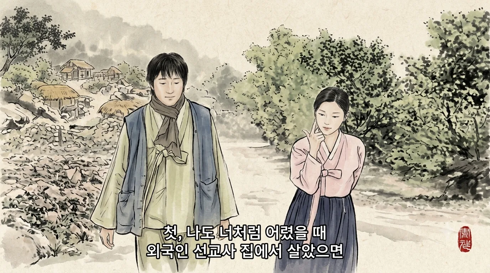

"لو أنني عشت في صغري في بيت مبشّر أجنبي مثلك…"، "اتُّهمت بسرقة الطعام وضُربت…"، ثم "في ذلك الوقت سرقت الخبز فعلًا."

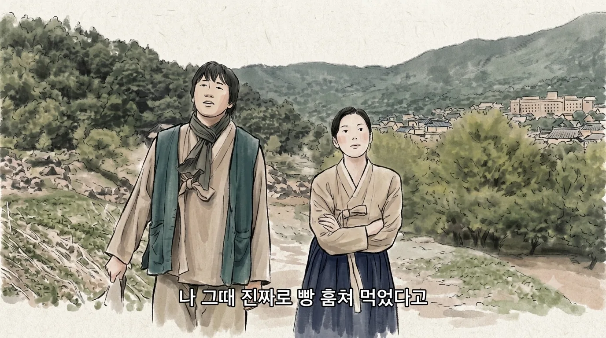

أفهم أنهم أرادوا منحها شخصية طفلة ذكية نجت بالكذب والتمثيل.
المشكلة أنهم اختاروا أكثر الطرق سطحية: الحوار.
لو عرضوا 30 ثانية فقط لغا-غيونغ الصغيرة وهي تسرق الخبز وتبكي لتخدع الكبار، لصارت الشخصية أعمق بكثير.

في الدقيقة 22:52 تأتي جملة: "قبل ثلاث سنوات سرقتِ مالي لتتسللي على متن سفينة وهربتِ…"

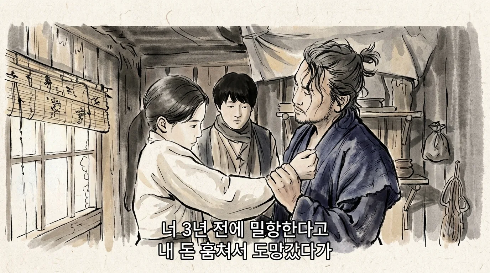

لإقناعنا بأن لديها حلم الرحيل، يجب أن يُعرض شيء ما، مشهد استرجاع أو فعل.
الصراخ "أيها الاقتصاد انتعش!" لا ينعش الاقتصاد، وسطر حوار واحد لا يصنع شخصية.

وفي الجهة المقابلة هناك The Outlaws.
يظهر ما سوك-دو (ما دونغ-سوك) أول مرة في وسط شارع يسكنه كثير من الكوريين الصينيين، حيث يتواجه رجال بسكاكين المطبخ.
ما سوك-دو يتحدث في الهاتف عن العمل، يقف أمامهم ويقول لمحدّثه: "الأولاد يتشاجرون."

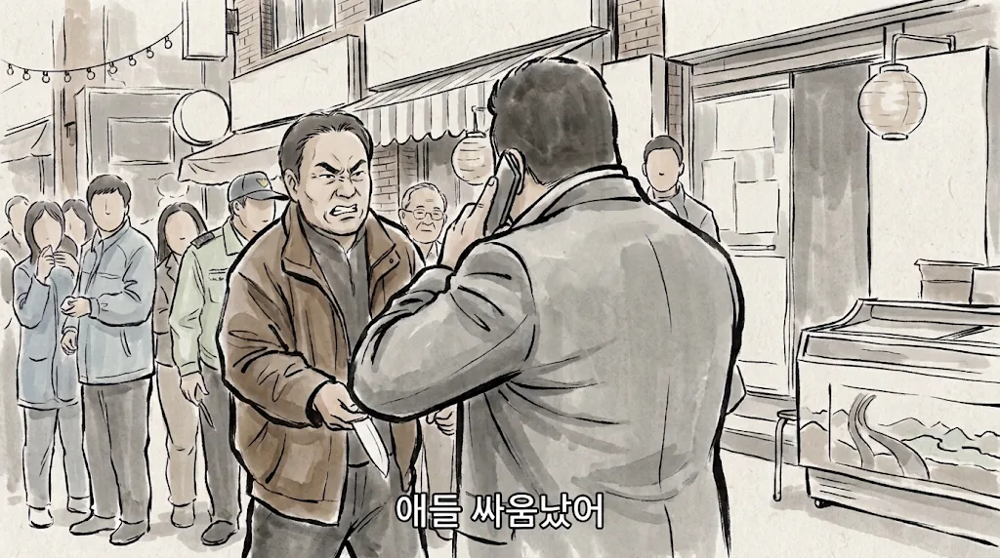

مواجهة بسكاكين المطبخ ليست بالنسبة له سوى شجار أولاد.
قالها بلا مبالاة، لكن وقعها هائل.
ومن دون أن يغلق الخط، ينهي الموقف كله.

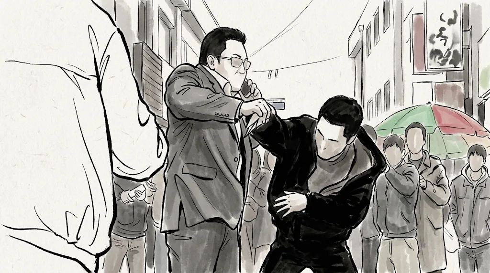

لم يضرب أحدًا، ولم يخبرنا أحد أنه قوي.
ومع ذلك يصدّق الجمهور فورًا.

لو كتب كتّاب هذا المسلسل The Outlaws، لربما جاء هكذا.

> المحقق المبتدئ: يا سلام يا أخي! سمعت أنك سجنت عشرة لصوص هذا الشهر وحده! ستنال كأس أفضل محقق جنائي هذه السنة أيضًا مثل السنة الماضية!
> (يبتسم ما دونغ-سوك. نهاية المشهد.)

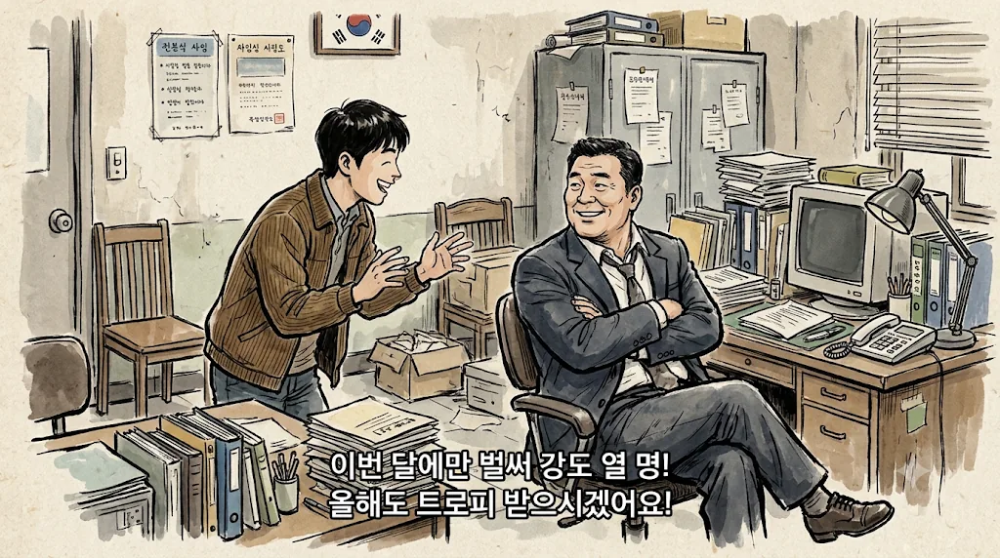

ومشهد تسلّم الكأس لا يأتي أبدًا.
يبدو أن شرح الموقف وبناء الشخصية أُنجزا كواجب منزلي، وُضعت علامة "تم إيصال الخلفية" ثم مضوا. لهذا لا أحب هذا النوع من الإخراج.
ربما يدّخرون قصة التسلل لتُروى كما ينبغي لاحقًا، لكن لسبب ما أظن أنها تنتهي عند هذا السطر.

وحزام البطن في الدقيقة 28:31 من الحلقة 1 مثل ذلك.
المناضلة من أجل الاستقلال يو سو-ران (كيم هيون-جو) تقولها بنفسها: ما في بطنها ليس طفلًا بل حزام، "سأستمر في ارتداء هذا الحزام."

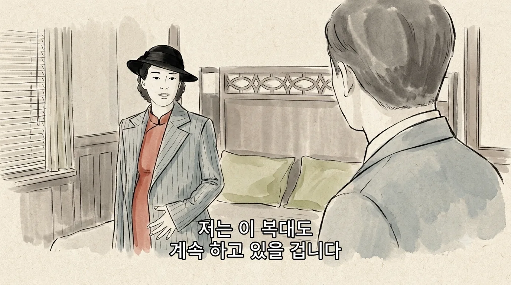

لو عُرضت فقط وهي تدخن سيجارة أو ترفع كأسًا، لانتبهنا بأنفسنا: "مهلًا، أليس في بطنها شيء؟"
وبما أنهم تعمّدوا الإشارة إليه، ظننت أنها تخبئ فيه سلاحًا أو وثائق.
لكنه مجرد حزام، وحتى الحزام لا يظهر على الشاشة كما يجب.
قد يقال إنه تكريم لطفل فقدته، لكنه في النهاية يبدو توفيرًا لتكلفة مكياج الحمل بسطر حوار.

## حراسة يابانية تختفي فجأة

في الحلقة 1 قرابة الدقيقة 52:32 يصل مراقب الشؤون السياسية ساتو شينئيتشي (جين سون-كيو) وسط موكب من عدة سيارات.

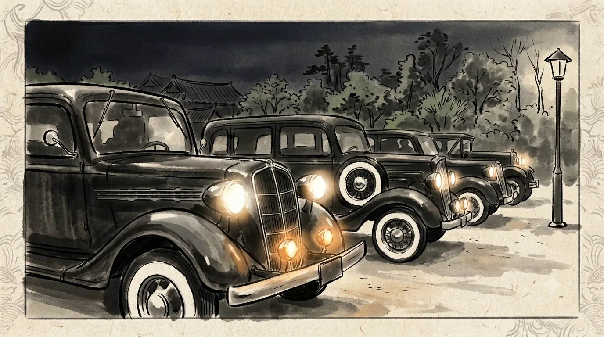

لكن بعد تبادل إطلاق النار داخل البيت، في الدقيقة 14:30 من الحلقة 2، يُرسل وحده في سيارة واحدة لأنه غاضب.

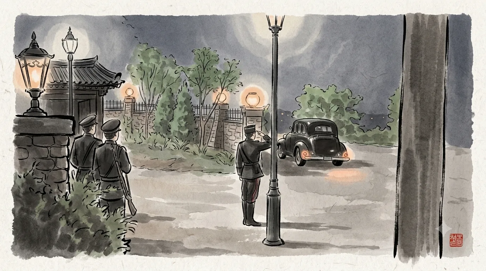

لا أحد يعرف كم شريكًا ينتظر في الخارج أو إن كانت هناك قنبلة.
أن الجهة التي تحرس الرجل الثاني في الحكومة العامة لا ترى في ذلك غرابة، هذا هو الأغرب.

وتبادل إطلاق النار نفسه كذلك.
تدوي الطلقة الأولى في الدقيقة 2:02 من الحلقة 2، ويقتحم الحراس النافذة في 6:54.
في تلك الدقائق الخمس تقريبًا تُطلق 22 رصاصة.

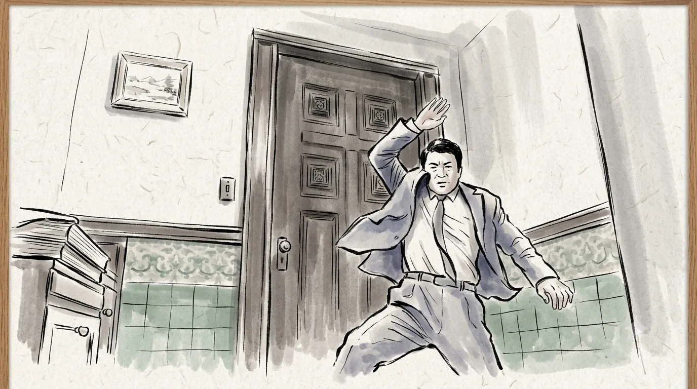

من في الداخل هو رئيسهم الأعلى.
ومع ذلك يكتفي الحراس بطرق الباب من الخارج.
حراس يطرقون الباب بأدب سواء مات رئيسهم أم لا. طوال خمس دقائق لم أفكر إلا في: "ألا يجب أن يكسروا الباب الآن؟"

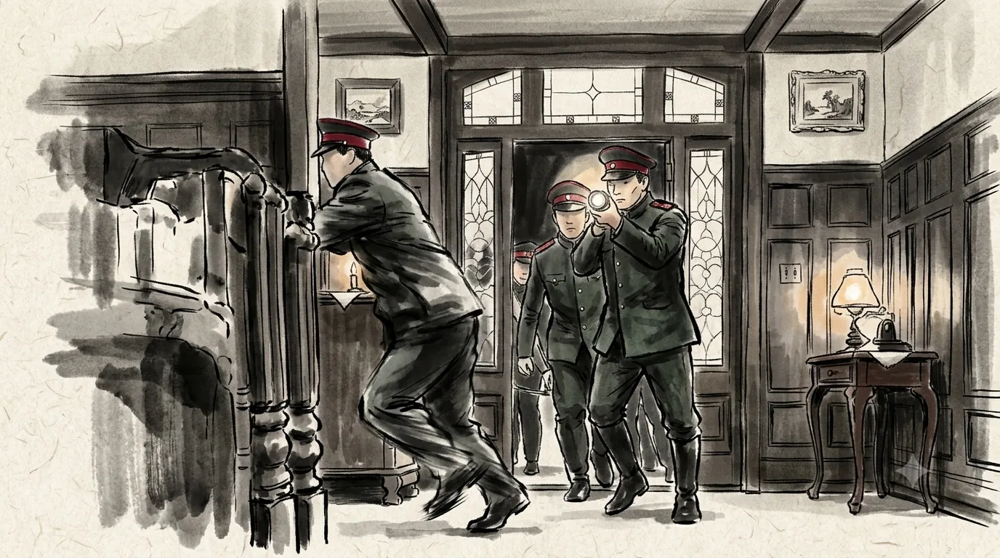

## مناضلون من أجل الاستقلال تقودهم لصة صغيرة

منظمة تقتل من أجل استقلال البلاد تترك لي غا-غيونغ حيّة، وهي غريبة عرفت حقيقتهم.
وهي تقول صراحة: "ليس وكأن أحدًا يدفع لي."

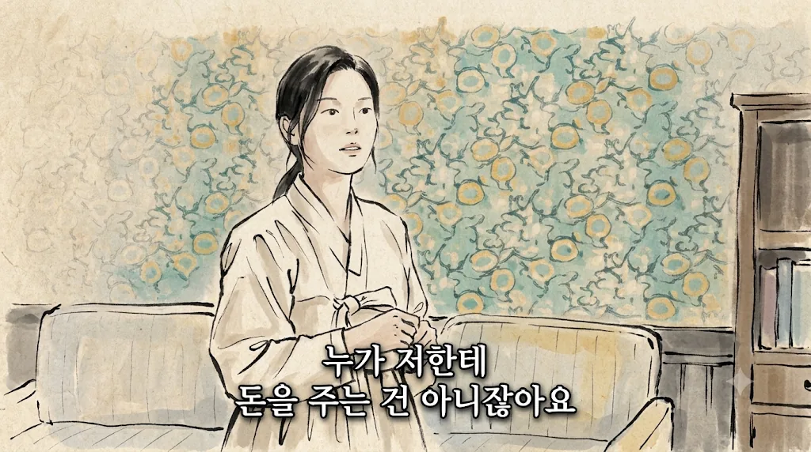

حين تكون السرية كل شيء ومصير العملية كلها على المحك، فهذا غير منطقي.
لهذا قلت إن القصة لا تكون منطقية إلا إذا ماتت غا-غيونغ في الحلقة 2.

تسرق غا-غيونغ رصاص المناضلين، ثم تذهب إلى مخبئهم لتبيعه.
وهي تقول صراحة إنها من سرقته.
بل إنها قرابة الدقيقة 59:17 من الحلقة 1 تستفز يو سو-ران: "سأصرخ وأثير الفوضى."

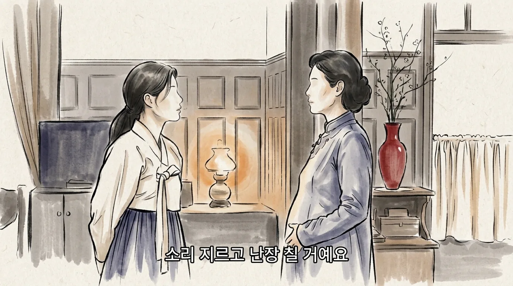

هناك طرق كثيرة لإخضاعها من دون مسدس.
وبالفعل، بعد ذلك حين يصوّب أحد المناضلين مسدسًا نحوها من الخلف، عندها فقط تخاف.
لصة صغيرة تمسك بزمام الأمور أمام أناس وضعوا أرواحهم فداءً لوطنهم، بدا لي استخفافًا شديدًا بالمناضلين، وأزعجني ذلك.

وتبادل إطلاق النار السابق كذلك.
من أطلق النار وأثار الفوضى في ذلك البيت هو زوج يو سو-ران السابق.
هو أيضًا مناضل من أجل الاستقلال، لكنه يبدو من جماعة استقلال أخرى لا من جماعة يو سو-ران.
أفهم فكرة وجود عدة جماعات تتحرك كل منها وحدها ولا تتواصل فيما بينها، لكن طريقة عرضها جعلت المناضلين يبدون أغبياء أكثر من اللازم.

## معياري مرتفع بسبب Mr. Sunshine

أظن أنني صرت بهذه الحدة بسبب Mr. Sunshine.
ذلك المسلسل لم تكن فيه شخصية سطحية واحدة، ولم ينقصه شيء في الدقة التاريخية أو الوصف النفسي أو الإخراج أو القصة.

وفوق ذلك، يبدو أن 100 Days of Lies يريد أن يروي قصة مشابهة.
يوجين تشوي (لي بيونغ-هون) لم يفكر يومًا في الاستقلال، لكنه انجذب شيئًا فشيئًا إلى أناس يضحّون بأرواحهم لمجرد أنهم وُلدوا في أرض جوسون، حتى سلك ذلك الطريق بنفسه.
ولي غا-غيونغ، النشالة التي تحلم بجمع المال والرحيل إلى أمريكا، ستسلك على الأرجح الطريق نفسه.
الحقبة نفسها والموضوع نفسه ومسار شخصية مشابه، لذلك لم أستطع إلا أن أحكم عليه بمعيار أشد.

بين خلفيات تُقال في الحوار ومشاهد بلا منطق، لم أعد أحتمل.
لذلك أطفأته عند الحلقة 2.
