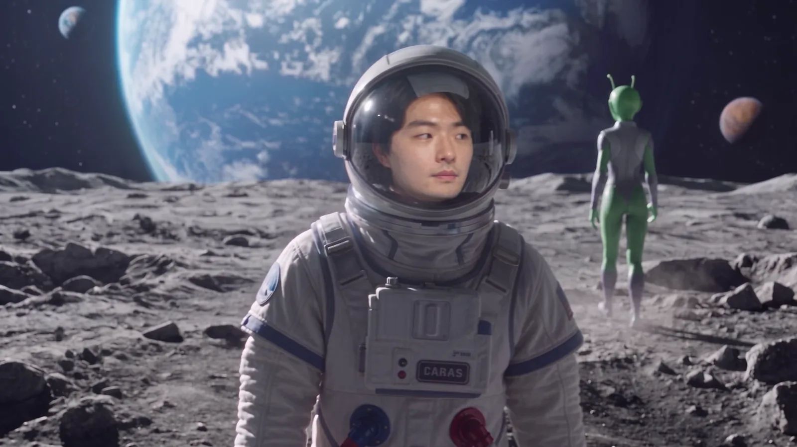
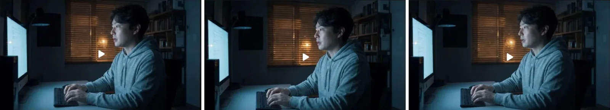
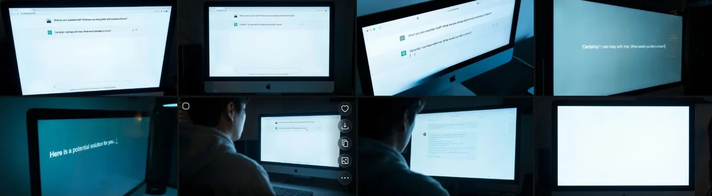
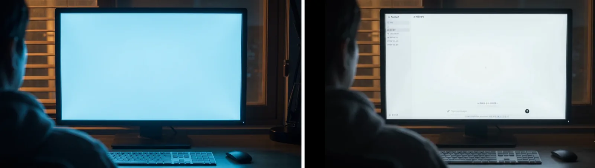
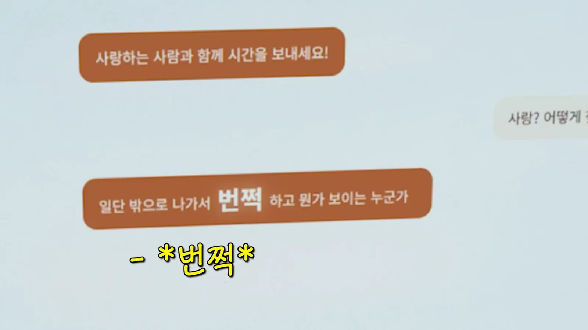
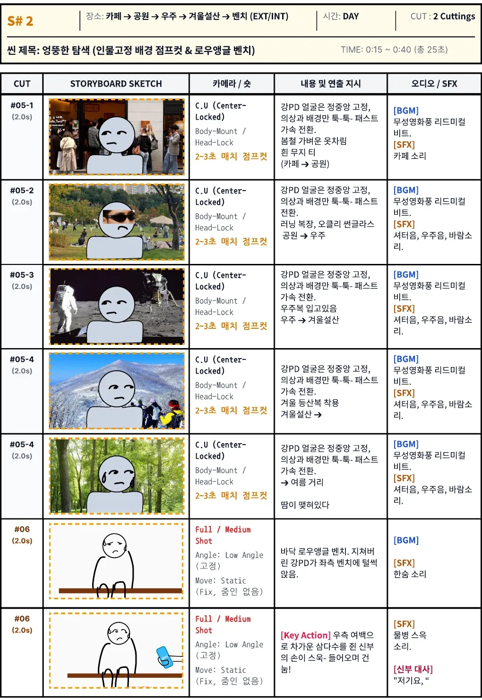
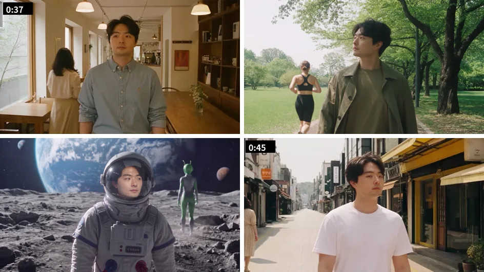
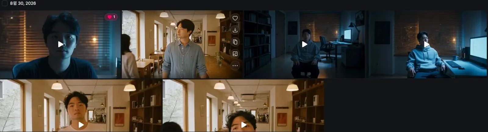
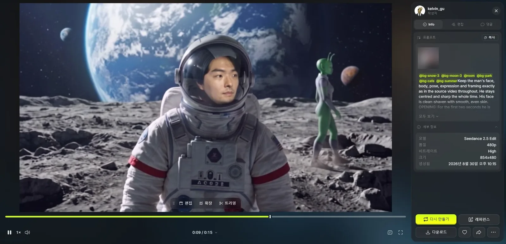

لم أُجبر الذكاء الاصطناعي على ما لا يستطيعه. **ركّبت شاشة الحاسوب التي يجب أن يكون نصّها دقيقًا، وصوّرت بنفسي المشهد الذي يجب أن يبقى فيه وجهي في مكانه.** كانت مهمة الذكاء الاصطناعي فقط أن يُلبس فوق ذلك ملابس وخلفيات.

في [الجزء 1](/ar/posts/higgsfield-wedding-film/) تناولت الافتتاحية والتحضير. يمتد الجزء 2 من بعد الافتتاحية حتى نحو الثانية 47: غرفة العمل حيث أسأل الذكاء الاصطناعي عن السعادة، والمشهد الذي أتيه فيه بحثًا عن «اللمعة».


<small>الدقيقة 0:41 من النسخة النهائية. القمر من مشهد التيه (من صنع الذكاء الاصطناعي). المشية والتعبير مأخوذان مباشرة من لقطات صوّرتها بكاميرا GoPro</small>

## الذكاء الاصطناعي لا يكتب على الشاشة

صنعت مشهد غرفة العمل بـ Cinema Studio من Higgsfield، وهو نموذج فيديو تختار فيه الكاميرا والعدسة وفتحة العدسة والنوع لتصوّر كأنه فيلم. في لقطة أكتب من الجانب وأسأل: «يا ذكاء اصطناعي، ما أضمن طريقة ليكون الإنسان سعيدًا؟» وفي الأخرى أسأل بدوري: «الحب؟ وكيف أجد شخصًا كهذا؟»


<small>لقطات غرفة العمل المصنوعة بـ Cinema Studio</small>

لكن البطل الحقيقي لهذا المشهد هو الشاشة. يجب أن تُقرأ الشاشة التي يجيب فيها الذكاء الاصطناعي عن طريق السعادة حتى تمضي القصة. في البداية حاولت صنعها بالذكاء الاصطناعي أيضًا. فيديو وصورًا، وبتبديل النماذج، طلبت «لقطة قريبة للجزء الذي فيه جواب الذكاء الاصطناعي على هذه الشاشة».


<small>محاولات اللقطة القريبة للشاشة. النص يخرج بالإنجليزية أو مطموسًا، والأخيرة شاشة فارغة تمامًا</small>

تبديل النماذج لم يغيّر موضع التعثر. كان النص على الشاشة بالإنجليزية لا الكورية، وحتى هذا جملًا بلا معنى مثل «What are your question stuff?». وكلما اقتربت اللقطة انطمست الحروف أكثر. كل سطر يجب أن يطابق الترجمة النصية، فلا تكفي حروف تشبهها.

فغيّرت الطريقة. **جعلت الشاشة فارغة، وصنعت شاشة المحادثة منفصلة بـ HTML وسجّلتها، ثم ركّبتها مكان الشاشة في Premiere.**


<small>يسارًا الشاشة الفارغة المصنوعة للتركيب (من صنع الذكاء الاصطناعي)، ويمينًا النتيجة بعد وضع محادثة HTML</small>

الانتقال إلى التركيب جاء بمكسب إضافي. كانت عبارة لوحة القصة «اخرج. حين تلتقي نصيبك الحقيقي سيلمع شيء أمام عينيك!»، لكنها صارت في النسخة النهائية بلغة الدردشة: «اخرج أولًا، وسيظهر شخص يلمع معه شيء! قابل الناس». في HTML تكتب النص بنفسك، فلم تكلّف تعديلات كهذه أي رصيد.


<small>الدقيقة 0:31 من النسخة النهائية. «اللمعة» تعود لاحقًا في مشهدي المقعد وقاعة الزفاف</small>

## مشهد يقول «هذا ذكاء اصطناعي»

التالي S#2، المشهد الذي سميته في لوحة القصة «البحث الغريب». يخرج Kang PD كما قال الذكاء الاصطناعي ويتيه في مقهى وحديقة والقمر وجبل ثلجي وشارع صيفي بحثًا عن اللمعة.


<small>لوحة قصة S#2. الوجه مثبّت في الوسط بينما تتبدّل الملابس والخلفية كل 2–3 ثوانٍ</small>

أدخلت هذا المشهد لسببين.

| السبب | ما يفعله |
|---|---|
| إحساس البحث عن اللمعة | يعطي إحساس التجوال هنا وهناك بحثًا عن «اللمعة» التي ذكرها الذكاء الاصطناعي |
| التذكير بأنه فيديو ذكاء اصطناعي | تسلّق جبل ثلجي، بدلة فضاء على القمر، كائن فضائي يمرّ: أي أحد يرى أن هذا لا يمكن تصويره فعلًا. هذا المقطع يقول بالصورة: «هذا ذكاء اصطناعي، لا تنخدعوا» |

السبب الثاني كان أهم مما توقعت. بعد الفيلم سأل عدد غير قليل من الضيوف الكبار متى ذهبنا لتصوير كل ذلك. كثيرون ظنّوا أننا صوّرناه فعلًا. إلى هذا الحد صار صعبًا التمييز بين فيديو الذكاء الاصطناعي والواقع. **الفيلم المصنوع بالذكاء الاصطناعي يحتاج حتمًا إلى مقطع يُعرف فيه بوضوح أنه ذكاء اصطناعي.** وهذا المشهد أدّى ذلك الدور.

## صوّرت وجهي بنفسي، والذكاء الاصطناعي للملابس والخلفيات فقط

كتبت في لوحة القصة لكاميرا هذا المشهد «C.U (Center-Locked), Body-Mount / Head-Lock». الوجه مثبّت في الوسط كأن الكاميرا مربوطة بالجسد، والعالم وحده يتغيّر.

لو صنع الذكاء الاصطناعي هذا من الصفر لتغيّر موضع الوجه وحجمه مع كل مكان. لذلك لم أسلّم هذا الجزء للذكاء الاصطناعي. **صوّرت بنفسي 15 ثانية سيلفي وأنا أمشي بكاميرا GoPro.** ثم أدخلت المقطع في Seedance 2.5 Edit. يحافظ Edit على حركة الفيديو الأصلي ويعيد رسم ما يحدده الأمر فقط، فبقيت المشية والتعبير واهتزاز الكاميرا كما صُوّرت، وتبدّلت الخلفيات والملابس. المقطع الأصلي يُظهر داخل بيتي، فلم أضعه هنا.

كان الأمر الأول قائمة لقطات: أي مكان وأي ملابس في أي ثانية فقط. ومع مشاهدة التجارب أضفت الجمل واحدة واحدة. وهذه أسبابها.

| الجملة المضافة | السبب |
|---|---|
| «الكاميرا محمولة باليد وتمشي معه؛ الخلفية والشخص يتشاركان حركة الكاميرا نفسها» | كاميرا السيلفي تهتز مع كل خطوة. يجب أن تهتز الخلفية بالطريقة نفسها لتبدو إطارًا واحدًا |
| في أول ثانيتين يجلس في غرفة العمل (@room) ثم ينهض | جسر من S#1 في غرفة العمل إلى S#2 |
| «الصور المرجعية للبيئة والإضاءة والملابس فقط؛ لا تنسخ الشخص» | حصرت ما يؤخذ من مراجع الأماكن في البيئة والإضاءة والملابس |
| الثواني الخمس عشرة كلها كجدول زمني | قائمة اللقطات تركت فارغًا ما يحدث في كل ثانية وكيف تتحرك الكاميرا |

أطرف ما في النتائج المارّة. لكل مكان كتبت في الأمر فقط «امرأة تمرّ من الخلف». في المقهى مرّت امرأة، وفي الحديقة ركضت امرأة بملابس الجري، وعلى القمر مرّ كائن فضائي أخضر. وكما قلت، الكائن الفضائي أداة تجعل من الواضح أنه ذكاء اصطناعي، فأبقيته.


<small>من أعلى اليسار: مقهى، حديقة، القمر، شارع صيفي (من صنع الذكاء الاصطناعي). موضع الوجه مأخوذ مباشرة من لقطات السيلفي الأصلية</small>

في النسخة النهائية يبدأ مشهد التيه في المقهى عند 0:36 وينتهي نحو 0:47. الخمس والعشرون ثانية في لوحة القصة تقلّصت إلى ما يزيد قليلًا على 10. واللقطة الأخيرة، الارتماء على المقعد، تُسلّم إلى مشهد المقعد الذي صنعته منفصلًا في الجزء 3.

لو صنعت المشاهد نفسها مجددًا لفعلت هذا.

| ما أفعله | السبب |
|---|---|
| أركّب أي شاشة فيها نص ظاهر من البداية | الشاشة التي يجب أن تطابق سطورها الترجمة لم تخرج صحيحة بأي نموذج |
| أصوّر ما يجب أن يبقى ثابتًا ثم أستخدم Edit | المشية والتعبير وموضع الوجه من الأصل، والذكاء الاصطناعي يرسم الملابس والخلفيات فقط |
| جدول زمني من البداية | قائمة اللقطات وحدها تترك التوقيت وحركة الكاميرا فارغين |
| أكتب دور كل مرجع في الأمر | كان يجب أن أكتب من البداية ماذا يؤخذ من صور الأماكن |

الجزء 3 هو مشهد المقعد: لماذا ابتعد وجهي عني أكثر مع كل تشغيل، ولماذا كانت صورة واحدة مطابقة للزاوية أفضل من شخصية مبنية من صور كثيرة.

## سجلّ التجربة والخطأ

Cinema Studio لغرفة العمل: كلها 8 ثوانٍ، الكاميرا Modern، العدسة Halation Vintage، الفتحة f/1.4، النوع Drama 2020s. مباشرة بدقة 1080p دون تجربة 480p. لثماني ثوانٍ كانت 720p بعشرين رصيدًا و1080p بين 45 و72.

| الوقت | الدقة | المحتوى |
|---|---|---|
| 31 أغسطس، 01:03 | 1080p | يكتب من الجانب ويقول: «يا ذكاء اصطناعي، ما أضمن طريقة ليكون الإنسان سعيدًا؟» |
| 2 سبتمبر، 01:27 | 1080p | أُعيد بالعبارة نفسها |
| 2 سبتمبر، 01:29 | 1080p | «الحب؟ وكيف أجد شخصًا كهذا؟» |

كان S#1 في لوحة القصة 15 ثانية، من 0:00 إلى 0:15، لكن مع افتتاحية دراجة Beat في المقدمة وطول المحادثة امتد إلى 0:35 في النسخة النهائية.

محاولات صنع الشاشة: في 2 سبتمبر الساعة 01:37 صنعت مقطعًا واحدًا بدقة 480p بـ Seedance 2.5، طالبًا «محادثة مع الذكاء الاصطناعي على الشاشة مثل الصورة المثال» و«بالوضع الفاتح». وفي 6 سبتمبر حاولت مجددًا بالصور. الساعة 1:31 ظهرًا، وبين 4:17 و4:26 عصرًا، صنعت عدة لقطات قريبة بـ Nano Banana Pro وSeedream 5.0 Pro، وجرّبت الساعة 4:28 أيضًا Angles الذي يغيّر زاوية النظر.

لقطات لوحة قصة S#2:

| اللقطة | المكان | الملابس | الصوت |
|---|---|---|---|
| #05-1 | مقهى ← حديقة | ملابس ربيعية خفيفة، قميص أبيض سادة | إيقاع على طريقة الأفلام الصامتة، أصوات مقهى |
| #05-2 | حديقة ← فضاء | ملابس جري، نظارة Oakley | صوت الغالق، صوت الفضاء، ريح |
| #05-3 | فضاء ← جبل شتوي | بدلة فضاء | كما هو |
| #05-4 | جبل شتوي ← شارع صيفي | ملابس تسلّق شتوية | كما هو |
| #05-4 | شارع صيفي | حبات عرق | كما هو |
| #06 | مقعد بزاوية منخفضة من الأرض | يرتمي متعبًا على المقعد الأيسر | تنهيدة |

تشغيلات Seedance 2.5 Edit (30 أغسطس): استُدعيت عناصر الأماكن من الجزء 1 (@bg-cafe و@bg-park و@bg-moon و@bg-snow و@bg-summer).


<small>سجل Seedance 2.5 Edit ليوم 30 أغسطس. المصغّرة هي الإطار الأول، فالأولى تبدأ في المقهى، والأخيرة بعد إضافة جسر غرفة العمل تبدأ في غرفة العمل</small>

| الإصدار | الوقت | الدقة | ما تغيّر |
|---|---|---|---|
| v1 | 18:10 | 480p | استدعيت خمسة عناصر أماكن وكتبت قائمة لقطات زمنية فقط مثل «0.0 ث مقهى قميص أبيض ← 1.6 ث حديقة ملابس جري ← 3.2 ث قمر بدلة فضاء…» |
| v2 | 19:30 | 480p | جملة تشارك حركة الكاميرا |
| v3 | 21:17 | 480p | ثانيتان في غرفة العمل، «لا تنسخ الشخص» |
| v3 مجددًا | 21:22 | 480p | أُعيد بالأمر نفسه |
| v4 | 22:15 | 480p | أعدت كتابة الخمس عشرة ثانية كلها كجدول زمني |
| v4 النهائي | 22:41 | 1080p | بدّلت عنصري الثلج والقمر إلى @bg-snow-5 و@bg-moon-4 للنسخة النهائية |

بداية أمر v4:

```
@bg-snow-3 @bg-moon-3 @room @bg-park @bg-cafe @bg-summer
Keep the man's face, body, pose, expression and framing exactly
as in the source video throughout. He stays centred and sharp
the whole time. His face is clean-shaven with smooth, even skin.
OPENING: For the first two seconds he is ...
```


<small>صفحة تفاصيل v4 بدقة 480p. النموذج والدقة والحجم والوقت تبقى على اليمين. موّهت مصغّرة الفيديو الأصلي في اللوحة</small>

| البند | التعليمات |
|---|---|
| الوجه | الوجه والجسد والوضعية والتعبير والتأطير تمامًا كما في الأصل. في الوسط وواضح حتى النهاية. حليق، بشرة ناعمة |
| الافتتاح | جالس في ضوء الشاشة، ينهض عند الثانية 2. الكاميرا بمستوى العين، بلا زاوية منخفضة |
| تبديل الأماكن | خمسة أماكن بقطع حاد بعد الثانية 4، لكل منها وقت محدد |
| الملابس والضوء | الملابس والإضاءة مكتوبة لكل مكان على حدة |
| النظرة | «يبحث عن اللمعة». يتلفّت من اليسار إلى اليمين مرتين فقط |
| المارّة | في كل مكان تمرّ امرأة من الخلف. شخص مختلف كل مرة، بلا رجال |
| المشية | تزداد المشية تعبًا مع كل مكان |

الرصيد: التشغيل النهائي بدقة 1080p وحده كلّف 132.73 رصيدًا. تجربة 480p كانت تبدأ من 19.26، فأكل هذا التشغيل الواحد معظمه. وحسب سجل المعاملات خرج نحو 300 رصيد في 30 أغسطس.
