حين وضعت وجهي في فيديو الذكاء الاصطناعي، **كانت صورة واحدة مطابقة لزاوية اللقطة كمرجع أشبه بي بكثير من شخصية محشوة بصور أمامية وجانبية ومن أعلى وأسفل.** أما الوجه الصغير البعيد فلم يخرج جيدًا بأي طريقة.

تعلّمت هذا في مشهد المقعد من فيلم زفافنا. في النهاية كان هناك سببان لإعادة اللقطة نفسها مرارًا. كان تكوين الزاوية المنخفضة صعب الوصف بالكلمات، وكلما أعدت التشغيل صار الوجه أقل شبهًا بي. ومن ضبط التكوين تعلّمت أيضًا أن أكتب بنسب الشاشة لا بالأمتار.

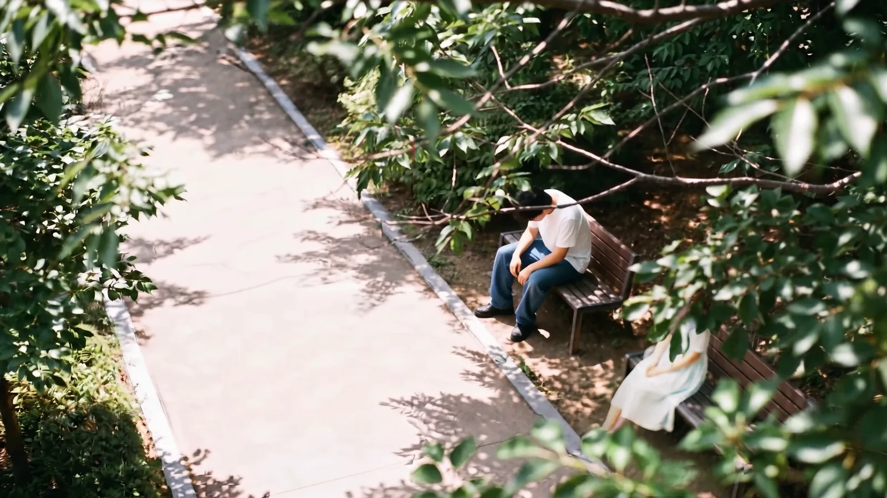
<small>الدقيقة 0:50 من النسخة النهائية. المقعد من زاوية عالية (من صنع الذكاء الاصطناعي). الأوراق التي تغطي زوجتي أضفتها في المونتاج</small>

كان [الجزء 1](/ar/posts/higgsfield-wedding-film/) عن الافتتاحية والتحضير، و[الجزء 2](/ar/posts/higgsfield-wedding-film-2/) عن غرفة العمل ومشهد التيه. الجزء 3 من نحو 0:47 إلى 1:04: منهكًا من التيه أجلس على مقعد وتقدّم لي زوجتي الماء. قسّمت هذا المشهد على ثلاث كاميرات.

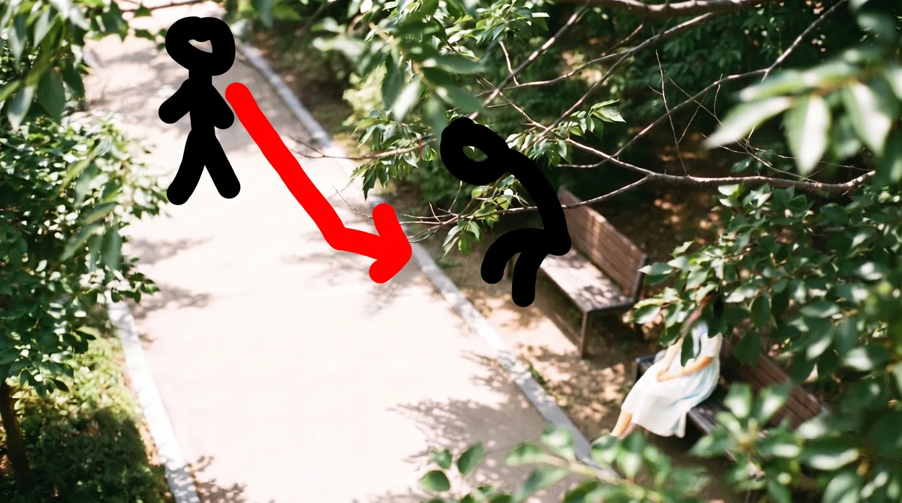
<small>تخطيط حركة المشهد 3. رسمت المشي من الممر إلى المقعد مباشرة فوق صورة ذكاء اصطناعي</small>

| الكاميرا | الموضع | ما تفعله |
|---|---|---|
| A زاوية عالية | تنظر إلى الأسفل من أعلى شجرة | أنا أمشي وأجلس، وزوجتي ووجهها مخفي بالأوراق |
| B زاوية منخفضة | بارتفاع مقعد البنش | أجلس منهكًا، وتدخل يد تحمل قارورة ماء من خارج الإطار |
| C منظوري | بمستوى عيني | أنظر إلى القارورة الممدودة، ثم أرفع عيني إلى وجه زوجتي (#07) |

في A وجه زوجتي مخفي بالأوراق، فيظهر لأول مرة في C بعد القارورة. بعد C يأتي وجهي ملتفتًا بذهول (#08)، والتكبير داخل العين (#09)، والمونتاج داخل العين (#10)، والتبعيد إلى وجه مبتسم (#11). مونتاج #10 صورنا الحقيقية، فلم أضعه هنا.

## توقّف وجهي عن أن يشبهني

انفجرت مشكلة الوجه أكثر ما انفجرت في B، الزاوية المنخفضة لتقديم الماء. الكاميرا تنظر إليّ من ارتفاع المقعد، وأنا متهالك عند طرف البنش، ويد بقارورة ماء تدخل من خارج يمين الإطار. صاحبتها زوجتي الجالسة خارج الإطار عند طرف البنش من جهة الكاميرا.

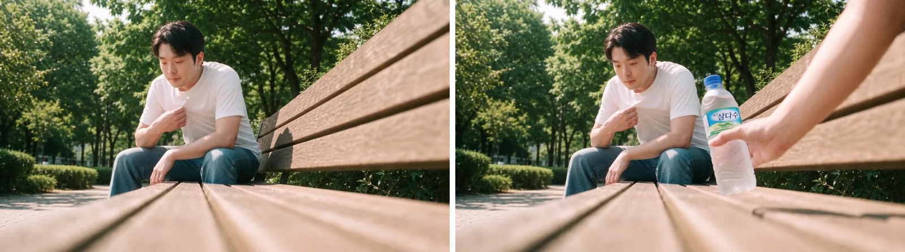
<small>الدقيقة 0:52 و0:54 من النسخة النهائية (من صنع الذكاء الاصطناعي). تدخل يد بقارورة ماء بجانبي وأنا أهوّي بقميصي</small>

ثلاثة أشياء جعلتني أعيد هذه اللقطة.

| أين تعثّرت | لماذا | ما غيّرته |
|---|---|---|
| التكوين لم يستقر بالكلمات | الكاميرا بارتفاع المقعد، والظهر يمتد طويلًا من يمين الإطار، وأنا عند طرفه، واليد من خارج الإطار من جهة الكاميرا. كان صعبًا كتابة هذا الفضاء | أضفت «اتبع تكوين الكاميرا في الصورة المرجعية بصرامة»، فسلّمت للصورة التكوين الذي لم أستطع كتابته |
| توقيت دخول اليد وردّ فعلي | في هذه اللقطة أنا مجرد شخص متعب. نظرة الدهشة مهمة #08 لاحقًا | استبدلت الأمر الإنجليزي بأمر كوري كتبته بنفسي، وخفّفت التهوية بالقميص إلى «خفيفة وبطيئة»، وأضفت أخيرًا جدولًا زمنيًا: 0–2 ث تنهيدة، 2–6 ث تهوية بالقميص، 6–8 ث يد بالقارورة |
| الوجه | كل إعادة لتصحيح التوقيت أزاحت وجهي عني قليلًا | أدناه |

بقيت عبارة «لا يبدو مندهشًا» من أول تشغيل إلى آخره. ولم يستقر توقيت دخول اليد إلا بعد إضافة الجدول الزمني، الخلاصة نفسها التي وصلت إليها في مشهد التيه في الجزء 2.

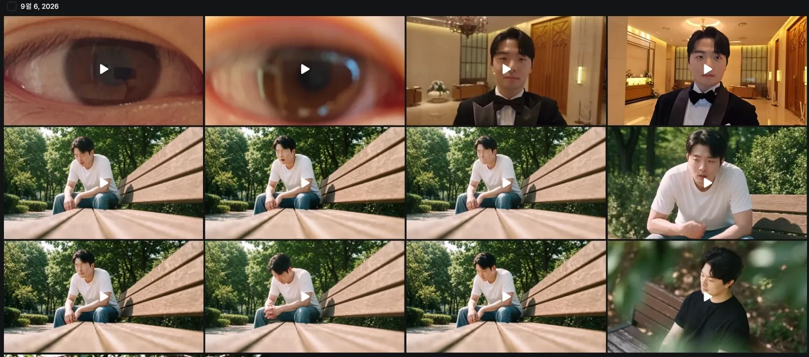
<small>سجل 6 سبتمبر. الصفّان الأوسطان زاوية المقعد المنخفضة. التكوين نفسه، لكن الوجه يختلف قليلًا في كل تشغيل. مقاطع العين والسموكينغ في الأعلى من مشاهد الجزء 4</small>

هذا ما حدث مع الوجه. كانت لديّ في Higgsfield عناصر شخصية تجمع صورًا كثيرة لوجهي: @강준구 بسبع صور، وشخصية Soul ‏@강준구-cinema بسبع عشرة صورة من زوايا وأماكن مختلفة كالمقهى والمطعم وجلسة تصوير الزفاف. تكفي مناداة الاسم في الأمر فيرسم ذلك الوجه. فيديو الزاوية العالية استدعى @강준구-cinema، وأمر الزاوية المنخفضة بدأ هو أيضًا باستدعاء شخصية: «@char_jungu قميص أبيض بأكمام قصيرة، جينز…». مريح، لكنه لم ينجح جيدًا في مشهد المقعد.


<small>شخصية Soul ‏@강준구-cinema بسبع عشرة صورة. كثرة الصور لم تجعل الوجه أشبه بي</small>

أولًا، كان الوجه البعيد مشكلة. في لقطة كالزاوية العالية، حيث الشخص نحو 1/8 من ارتفاع الإطار، لم يخرج الوجه جيدًا. وفي الزاوية المنخفضة أيضًا أجلس في عمق الإطار، فوجهي ليس كبيرًا. وفوق ذلك، مع كل تشغيل كان وجهي ينزاح قليلًا.

فهذا ما تعلّمته. بدل استدعاء شخصية تخلط زوايا كثيرة، أنتج وضع صورة واحدة لوجهي بزاوية قريبة من اللقطة المطلوبة وجهًا أفضل بكثير. يبدو أن خلط الزوايا يحسب متوسط كل زاوية فيصير وجهًا لا يخص أحدًا.

| الطريقة | النتيجة |
|---|---|
| عنصر شخصية (حزم مثل @강준구 بسبع صور و@강준구-cinema بسبع عشرة) | سهل الاستدعاء. إذا صغر الوجه أو كثرت الإعادة لا يعود يشبهني تدريجيًا |
| صورة وجه واحدة مطابقة لزاوية اللقطة | يخرج الوجه أفضل. يتطلب جهد اختيار الصورة المناسبة لكل لقطة |
| وجه صغير بعيد | لا يخرج جيدًا بأي طريقة. اقترب في اللقطات التي يجب أن يظهر فيها الوجه |

## التكوين بنسب الشاشة لا بالأمتار

بدأت A، الزاوية العالية، كصورة: أثبّت الصورة ثم أجعلها الإطار الأول للفيديو. ظل تكوين هذه الصورة الواحدة ينحرف. مجمّعًا حسب اتجاه الانحراف:

| ما انحرف | لماذا كان مشكلة | ما غيّرته |
|---|---|---|
| الكاميرا تقترب أكثر مع كل تشغيل | كتابة الأمتار والزوايا مثل ارتفاع 4 م ومسافة 8 م و25 درجة لم تؤثر | حذفت الزاوية وأعطيت الارتفاع والمسافة الأفقية فقط. كتبت **بنسب الشاشة**: الشخص 1/8 من ارتفاع الإطار، والمقعد 1/4 من عرضه، والممر الفارغ الثلثان السفليان |
| المقعد صار واحدًا، أو مقعدان متقابلان أمامًا وخلفًا، أو عاد اثنين | لتقديم الماء من الجانب كان علينا الجلوس جنبًا إلى جنب يمينًا ويسارًا على مقعد واحد، مع مكان فارغ لي | `Exactly one bench`، والمكان الفارغ `wide enough for another person to sit down`. حذفت جمل الافتراض مثل «يمكن أن يجلس شخصان» |
| مع مرجع وأربعة تصحيحات دفعة واحدة، تغيّر لون الشعر فقط | الجملة التي تطلب الإبقاء على المرجع كما هو طغت على كل التعليمات الأخرى | طريقة المرحلتين. اصنع أولًا المكان بعد حذف العنصر المشكل (الشخص)، ثم اجعله مرجعًا وأضف ما تريده فقط |
| خرج الممر مائلًا وبدا غريبًا | كتابة `diagonally` أعطت زاوية بين بين | `roughly horizontally`، ونمط بلاط واحد |
| كانت الشمس خلف زوجتي | الضوء الخلفي مطلوب فقط في C، حين تظهر وهي تحجب الشمس | في A وB صارت الشمس خلف الكاميرا، ضوء أمامي |
| الأوراق لم تغطِّ زوجتي | كان يجب أن تُتجاوز أولًا كخلفية، ثم تُلاحظ عند النظرة الثانية | حوّلت «الأوراق تغطيها» إلى حالة، مثل «وجهها مخفي خلف هذه الأوراق». لم ينجح حتى النهاية |

لبّ الأمر النهائي:

```
The camera is 3.5 metres above the ground. The horizontal distance
from the camera to the bench is 12 metres.
A paved walking path runs roughly horizontally across the frame ...
The empty path fills the lower two thirds of the frame.
Exactly one wooden park bench ... occupies about one quarter of the frame width.
... her figure occupies about one eighth of the frame height.
The left half of the bench seat is clearly empty and unoccupied,
wide enough for another person to sit down beside her.
Everything above her chest is hidden behind these leaves.
```

حتى النهاية لم تغطِّ الأوراق زوجتي ولو بكسلًا واحدًا. في كل مرة بقيت الأوراق هادئة في الزاوية العليا اليمنى. بدا أن النموذج يرسمها جزءًا من شجرة خلفية لا عنصرًا في المقدمة.

في النهاية فتحت قائمة السجل واخترت بنفسي. كان الفستان أزرق، لكن المسافة والمقعد والممر كانت الأفضل. عالجت الأوراق في Premiere بتغطيتها بلقطات أوراق حقيقية. **تسليم ما لا يستطيعه الذكاء الاصطناعي إلى المونتاج قرار أيضًا.** كان يجب أن أفعله أبكر.

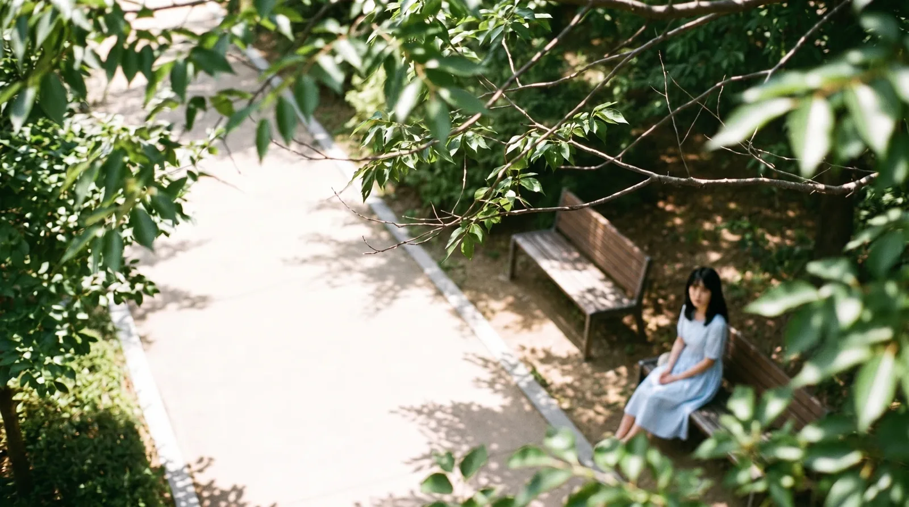
<small>التشغيل الذي اخترته بنفسي من القائمة (من صنع الذكاء الاصطناعي). فستان أزرق، والأوراق لا تغطي زوجتي</small>

حسّنت الصورة المختارة بـ Gemini ورفعتها مجددًا إلى Higgsfield، فصارت الإطار الأول لفيديو A. وكان أمر الفيديو في Seedance 2 فقط: «@강준구-cinema يمشي على الممر ويرتمي جالسًا على المقعد، الكاميرا ثابتة».

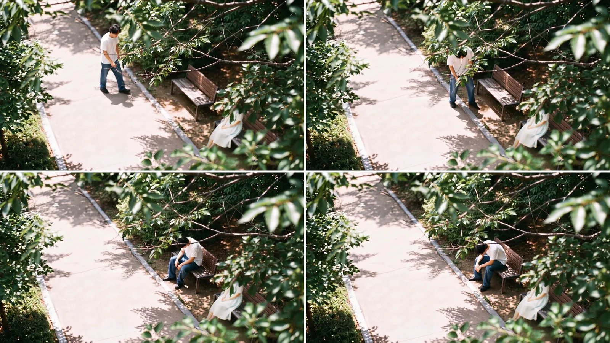
<small>الدقيقة 0:48–0:51 من النسخة النهائية (من صنع الذكاء الاصطناعي). في النسخة النهائية الفستان أبيض والأوراق الأمامية تغطي زوجتي</small>

## «منظور قارورة الماء»: منظور من؟

اللقطة C ‏(#07) إمالة من القارورة الممدودة إلى وجه زوجتي. في المحادثة سمّيت هذه اللقطة «منظور قارورة الماء»، وانحرف ذلك مرة.

فهمها Claude على أنها منظور القارورة وكتب الأمر هكذا. ما قصدته هو **منظوري وأنا أنظر إلى القارورة الممدودة.** اليد يد زوجتي، وصعود الكاميرا من القارورة إلى وجهها هو صعود نظري. وبعد تصحيح ذلك فقط وقعت القارورة واليد في مكانهما الصحيح. إذا انحرفت كلمة واحدة في اسم اللقطة انحرف الأمر كله.

حذفت أيضًا عبارة `soft veil`. قصدت ضوءًا ينتشر بنعومة، لكن في فيلم زفاف قد تُقرأ طرحة عروس. وللتوهّج كتبت `lens flare` و`bloom`.

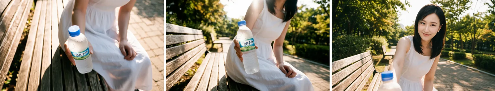
<small>مرحلة الصورة في لقطة منظور القارورة (من صنع الذكاء الاصطناعي). الوجه مصنوع بالذكاء الاصطناعي</small>

كُتبت الحركة كجدول زمني: 0–1 ث القارورة، 1–2.2 ث إمالة إلى الأعلى مع الذراع، 2.2–3.3 ث وهج الشمس من الخلف، 3.3–4.2 ث تميل وتحجب الشمس، 4.2–6 ث ابتسامة وعبارة.

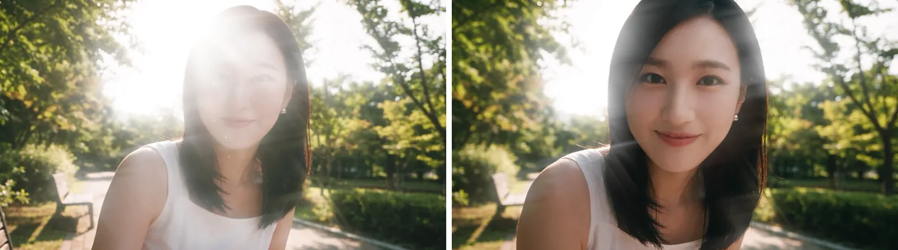
<small>الدقيقة 0:58 و0:59 من النسخة النهائية (من صنع الذكاء الاصطناعي). يبرز وجه زوجتي من الوهج</small>

#08 وجه ذاهل التفت فيه الرأس وحده، نقترب منه ببطء ثم ننجذب إلى العين. هنا كانت الوضعية كل شيء. الجذع والكتفان باتجاه مقدمة المقعد، والرأس وحده يلتفت إلى الكاميرا. إن استدار الجسد أيضًا صار شخصًا في منتصف حديث. التفات الرأس وحده يحفظ لحظة النظر المفاجئ. الفم مفتوح قليلًا، وكتبت `not smiling`.

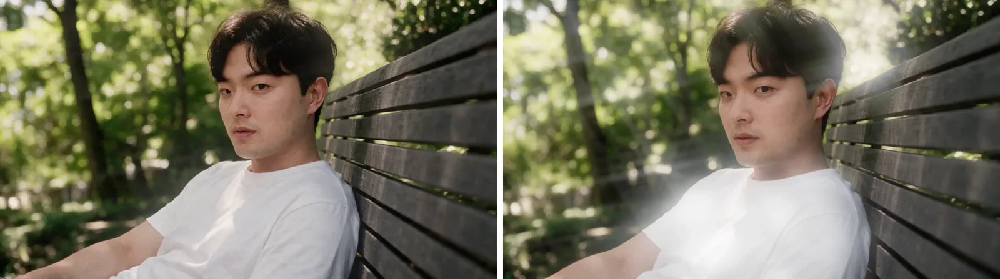
<small>الدقيقة 1:00 و1:01 من النسخة النهائية (من صنع الذكاء الاصطناعي). الجسد باتجاه المقعد والرأس وحده ملتفت</small>

#11 هو العكس، تبعيد من العين. العبارة «نعم، أحب ذلك». النظرة ليست إلى العدسة بل بجانبها، إلى أعلى خلف الكاميرا، نحو زوجتي الواقفة. هذا الوجه المبتسم يصير النصف الأول من القطع المطابق إلى مشهد قاعة الزفاف في الجزء 4.

## مبادئ الأوامر التي ترسّخت في مشهد المقعد

هذه المبادئ جمعتها عبر مشهد المقعد. لو صنعت المشهد نفسه مجددًا لكتبت هكذا من البداية.

| المبدأ | التفصيل |
|---|---|
| الوجه من صورة واحدة مطابقة للزاوية | أفضل من شخصية تجمع زوايا كثيرة. اقترب في اللقطات التي يجب أن يظهر فيها الوجه |
| نسب الشاشة بدل الأمتار | الكسور، مثل الشخص 1/8 من ارتفاع الإطار والمقعد 1/4 من عرضه، هي ما نجح |
| الارتفاع والمسافة الأفقية فقط | كتابة الارتفاع والزاوية والمسافة معًا تجعلها تتصادم. أعطِ الارتفاع والمسافة الأفقية وستتبعهما الزاوية |
| لا تطلب الإخفاء | تكديس `not visible` و`heavily shaded` و`face is not readable` يطمس الشخص كله. اكتب حالة، مثل `Her face is hidden behind these leaves` |
| المقدمة بمسافة العدسة | لإبقاء الأوراق في المقدمة ثبّت بعدها عن العدسة، مثل `just 30cm from the lens, heavily blurred`. وإلا صارت شجرة خلفية (دوّنته فقط؛ عمليًا انتقلت إلى المونتاج) |
| لا افتراضات | `Two people could sit side by side` يُتجاهل أو يرسم شخصين. اكتب الأشياء كما هي بحسم |
| أصلح شيئًا واحدًا في كل مرة | غيّر أربعة أشياء معًا فيلتصق واحد ولا تعرف أين تعثّر الباقي |
| طريقة المرحلتين | حين يغلب المرجع النص. اصنع أولًا نتيجة بلا العنصر المشكل، ثم اجعلها مرجعًا لتضيف ما تريد فقط. الرصيد مضاعف، لكنه أضمن من التصحيح المتكرر |
| ادمج المكان والشخص في الصورة | لا ترمِ المكان والشخص منفصلين في مرحلة الفيديو. ادمجهما في صورة واحدة ثم حرّكها |
| اذكر منظور مَن في اسم اللقطة | لا «منظور قارورة الماء» بل «منظوري وأنا أنظر إلى القارورة» |
| الحركة كجدول زمني | لا يستقر التوقيت إلا إذا كتبت ما يحدث في كل ثانية |
| سلّم مبكرًا للمونتاج ما لا ينجح | لتغطية الأوراق ظللت أغيّر الجمل ثم نقلته أخيرًا إلى Premiere |

الجزء 4 هو مشهد قاعة الزفاف: لماذا تكلّمت كاميرا السيلفي المصنوعة بالذكاء الاصطناعي بتكلّف لم أستطع معه استخدامها، وكيف ألبست فيديو مثّلته بنفسي بدلة سموكينغ وقاعة زفاف بدلًا منها، وما فكرت فيه بعد إنهاء الأجزاء الأربعة.

## سجلّ التجربة والخطأ

صورة الزاوية العالية (فجر 31 أغسطس، Nano Banana Pro)، راجعتها في سجل محادثة Claude:

| التشغيل | ما تغيّر | النتيجة |
|---|---|---|
| 1 | أعطيت نتيجة اليوم السابق كمرجع وطلبت أربعة أشياء معًا: «افتح الممر، غطِّ العروس بأوراق في أعلى اليمين، شعر أسود، فستان أبيض» | تغيّر لون الشعر فقط. جملة الإبقاء على المرجع طغت على كل التعليمات الأخرى |
| 2 | المرحلة الأولى من طريقة المرحلتين: احذف الأشخاص، الممر والأوراق فقط | صار المقعدان واحدًا، واقتربت الكاميرا، ولم تغطِّ الأوراق المقعد. كان يجب أن يكون المقعد طويلًا على الأقل ليكون لي مكان |
| 3 | تشغيل جديد: ارتفاع 4 م، مسافة 8 م، 25 درجة، 35 مم، مقعدان | خرج المقعدان متقابلين أمامًا وخلفًا. وعندها لا يمكنها تقديم الماء من الجانب |
| 4 | مقعد واحد أفقي، العروس في أقصى يمين الإطار، 3.5 م، 7 م، 27 درجة. أعدت كتابة جملة الأوراق كحالة وحذفت `clearly visible` | أخطأت الأوراق مجددًا. كلمة `cover` كانت ضعيفة |
| 5 | نقلت الشمس من خلف العروس إلى خلف الكاميرا (ضوء أمامي)، وحذفت جملًا مثل «هي صغيرة» والافتراضات | الضوء الأمامي والمقعد الأفقي و27 درجة صحيحة. لكنها تقترب مع كل تشغيل. الأمتار لم تؤثر |
| 6 | حذفت الزاوية، الارتفاع والمسافة الأفقية فقط. 12 م، الشخص 1/8 من الارتفاع، المقعد 1/4 من العرض، الممر الثلثان السفليان، الأوراق الربع الأعلى الأيمن، «كل ما فوق الصدر خلف الأوراق» | المسافة والموضع والشجرة ممتازة. خرج الممر مائلًا وغريبًا |
| 7 | الممر `roughly horizontally`، نمط بلاط واحد | عاد المقعد اثنين. صحّحت إلى `Exactly one bench`، والمكان الفارغ `wide enough for another person to sit down` |

سألت أيضًا إن كان يمكن تحديد ترتيب التوليد (رسم الأوراق أخيرًا)، لكن لم يكن هناك خيار كهذا.

فيديو الزاوية العالية: 6 سبتمبر الساعة 4:59 فجرًا، Seedance 2، ‏1080p. في السجل هذا التشغيل وحده. في النسخة النهائية نحو 4 ثوانٍ، من 0:48 إلى 0:51.

تحضير الزاوية المنخفضة: بعد حسم A مباشرة ظهرت مسألة مطابقة الفضاء. في A تجلس زوجتي في أقصى يمين الإطار وأنا على اليسار. في B تذهب الكاميرا إلى مكانها وتنظر إليّ على طول المقعد. منطقيًا صحيح، لكن قد يختلط اليمين واليسار على المشاهد.

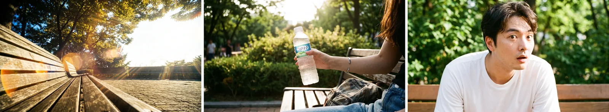
<small>صور مشهد المقعد التي صنعتها أولًا في 30 أغسطس (من صنع الذكاء الاصطناعي). مقعد فارغ بزاوية منخفضة، اليد بالقارورة، تعبير مندهش</small>

فيديو الزاوية المنخفضة (6 سبتمبر، كله Seedance 2.5):

| الوقت | الدقة | ما تغيّر |
|---|---|---|
| 05:08 | 480p | أمر إنجليزي. 3.8–4.5 ث يد بالقارورة من اليمين، 4.5–5.5 ث ينظر إلى القارورة، لا يبدو مندهشًا |
| 05:45 | 480p | أُعيد |
| 05:53 | 1080p | أُعيد |
| 06:12 | 480p | أمر كوري كتبته بنفسي: «قميص أبيض بأكمام قصيرة، جينز… يهوّي بقميصه كأنه يشعر بالحر… يد تقدّم الماء من يمين الإطار… لا يندهش» |
| 06:20 | 1080p | التهوية صارت «خفيفة وبطيئة» |
| 07:26 | 1080p | أضفت «اتبع تكوين الكاميرا في الصورة المرجعية بصرامة» |
| 07:48 | 480p | أضفت جدولًا زمنيًا: 0–2 ث تنهيدة، 2–6 ث تهوية بالقميص، 6–8 ث يد بالقارورة |
| 08:20 | 1080p | النهائي بذلك الجدول |

لقطة منظور القارورة (فجر 2 سبتمبر): في الترتيب قبل B بأربعة أيام. لمرجع وجه زوجتي وضعت الصور الثلاث كلها، كما في الجزء 1.

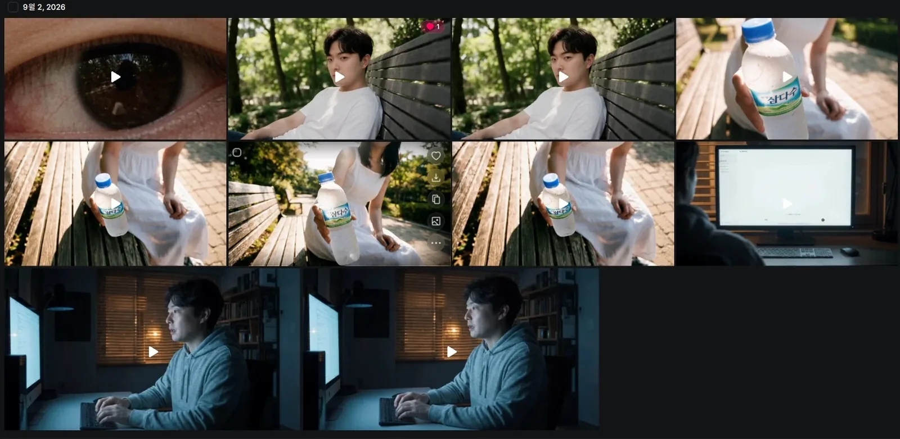
<small>سجل 2 سبتمبر. الصف الأوسط وأعلى اليمين لقطة منظور القارورة؛ والاثنان في وسط الصف العلوي وجهي الملتفت (#08)</small>

| الوقت | النموذج | الدقة | ما تغيّر |
|---|---|---|---|
| 03:06 | Cinema Studio Video | 480p | المحاولة الأولى |
| 03:13 | Seedance 2.5 | 480p | كجدول زمني |
| 03:19 | Seedance 2.5 | 480p | أضفت «he is taller than she» |
| 03:25 | Seedance 2.5 | 1080p | النهائي |

البنية التي حُسمت في 1 سبتمبر كانت لقطة متصلة واحدة مدتها 12 ثانية: لا تُقسم إلى لقطتين، وتحويل التركيز من القارورة إلى زوجتي داخل لقطة واحدة، والإطار الأخير وقد زال الوهج واتضح وجهها. أما أمر Seedance الفعلي فاختُصر إلى جدول من 6 ثوانٍ.

#08 و#11: صُنع #08 الساعة 03:47 و03:54 في 2 سبتمبر، Seedance 2.5 ‏1080p. وصُنع #11 أولًا الساعة 03:55 في 2 سبتمبر بدقة 1080p، ثم مجددًا في 3 سبتمبر الساعة 00:17 ‏(480p) و00:28 و00:41 ‏(1080p).

كتابة المبادئ: في 1 سبتمبر، عند فتح محادثة جديدة، لخّصت التجربة والخطأ حتى ذلك الحين كمبادئ وسلّمتها. معظمها جاء من الزاوية العالية؛ والزاوية المنخفضة جاءت بعدها في 6 سبتمبر.
