لمشهد السيلفي الأخير في قاعة الزفاف من فيلم زفافنا، **بعد نسختين بالذكاء الاصطناعي وحده، أدخلت في النهاية لقطات تمثيلي أنا في Seedance 2.5 Edit وبدّلت الملابس والمكان فقط.** ووضعت البداية التي تخرج من العين داخل اللقطة نفسها.

[الجزء 1](/ar/posts/higgsfield-wedding-film/) كان لوحة القصة والتحضير، و[الجزء 2](/ar/posts/higgsfield-wedding-film-2/) غرفة العمل ومشاهد التيه، و[الجزء 3](/ar/posts/higgsfield-wedding-film-3/) مشهد المقعد. الجزء 4 يغطي من 1:48 حتى 2:15 حيث تنتهي الصورة: أنا ببدلة سموكينغ أحدّث الضيوف في بهو قاعة الزفاف، ثم أضع الكاميرا على الأرض. لسجلات التوليد فتحت صفحات تفاصيل الصور والفيديو في حسابي على Higgsfield واحدة واحدة وتحققت من النموذج والدقة والوقت والأمر. وفي النهاية كتبت ما خطر لي بعد إنهاء الأجزاء الأربعة.

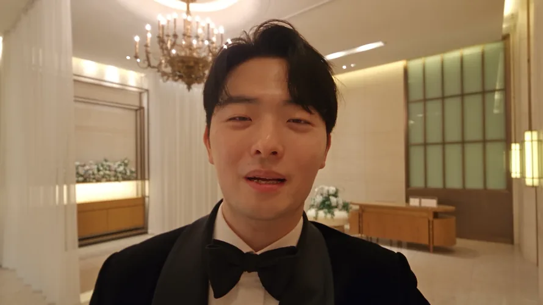
<small>الثانية 10 من لقطة السيلفي النهائية. ألبست الملابس والمكان بالذكاء الاصطناعي على لقطات تمثيلي الفعلي</small>

## من العين مباشرة إلى قاعة الزفاف

S#4 هو المشهد الذي يربط الفيلم بالواقع. أنا الذي على الشاشة أحدّث الضيوف بكاميرا سيلفي في قاعة الزفاف، ثم أُنزل الكاميرا، وينتهي بـ «الجميع، انظروا خلفكم من فضلكم». حين ينطفئ الفيلم يبدأ دخول العريس الحقيقي.

في لوحة القصة الأولى كنت أنوي في نهاية #11 أن أغطي العدسة بكفي لأُظلم الشاشة ثم أنتقل إلى القاعة. حذفت ذلك. عند الدقيقة الثانية تقريبًا كانت حيلة إضافية ستجعل الفيلم يطول. رأيت أن لقطة متطابقة من وجه #11 المبتسم على المقعد مباشرة إليّ ببدلة السموكينغ ستكون أقوى.

وثيقة التسليم التي صنعتها عند نقل محادثات Claude لم يكن فيها إلا الاستنتاج «حُذف إظلام الكف»، بلا هذا السبب. أكتب عن ذلك منفصلًا أدناه.

رسمت كيف ستتحرك الكاميرا داخل القاعة مباشرة فوق صورة التقطتها في القاعة الحقيقية.

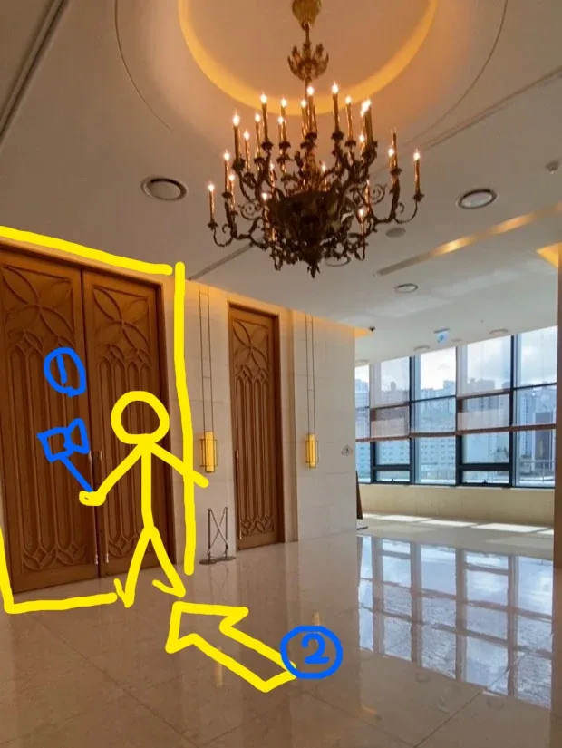
<small>تصميم حركة المشهد 4. ① كاميرا السيلفي في اليد، و② الكاميرا الموضوعة على الأرض</small>

| الكاميرا | ما تفعله |
|---|---|
| ① سيلفي | أحمل الكاميرا بذراع ممدودة وأصوّر وجهي وأنا أحدّث الضيوف |
| ② الأرض | بعد الكلام أُنزل الكاميرا وأضعها على الأرض. تنظر الكاميرا نحو باب القاعة |

لم يبقَ هذا الرسم مجرد رسم. في النسخة الأخيرة أدخلته كما هو صورةً مرجعية.

## من ابتسامة المقعد إلى سيلفي الذكاء الاصطناعي، 2–3 سبتمبر

يبدأ مشهد القاعة من المقعد. كان عليّ أن أصنع الطرف الأول من اللقطة المتطابقة أولًا، وجه #11 المبتسم.

من 10:41 حتى 11:44 ليلًا يوم 2 سبتمبر ظللت أولّد صور هذه اللقطة الواحدة. في البداية GPT Image 2 (جودة Medium، 1344x752). في الدقائق الثلاث بين 10:50 و10:53 وحدها خرجت 10 صور. ثم جرّبت Nano Banana Pro بسطر واحد «ابتسامة لطيفة»، وولّدت ثلاثًا أخرى بالأمر الإنجليزي نفسه. وفي الوسط محاولة بـ Seedream 5.0 Pro كتبت فيها فقط «سمين... أنقص وزنه قليلًا».

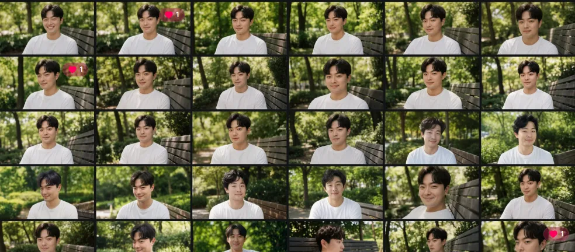
<small>سجل صور ليلة 2 سبتمبر. أكثر من عشرين وجهًا مبتسمًا بتكوين شبه واحد</small>

كتبت الأمر وفق المبادئ التي حددتها في الجزء 3. ثبّتّ أولًا أن كل الاتجاهات بالنسبة إلى الكاميرا، ثم قسمت الوضعية والنظرة والتعبير والوجه والخلفية والضوء والعدسة إلى فقرات.

| البند | محتوى الأمر |
|---|---|
| السطر الأول | كل الاتجاهات بالنسبة إلى الكاميرا؛ يسار الشاشة هو يسار المشاهد |
| الوضعية | الجذع مُدار نحو الكاميرا فيكاد الكتفان يواجهان العدسة، الظهر مستقيم، اليدان على الفخذين |
| النظرة | بجانب العدسة تمامًا، منحرفة قليلًا جدًا إلى يمين الشاشة. تلتقي بعيني من يجلس هناك |
| التعبير | الفم مغلق، زاويتا الشفتين مرفوعتان بوضوح، تجاعيد عند العينين. وجه من وجد ما كان يبحث عنه |
| الوجه | المسافة بين العينين والجفنان والأنف وعظم الوجنة وخط الفك وما بين الأنف والشفة وسماكة الشفتين كما في الصورة المرجعية. `Do not average these features`؛ لا تنحّف الوجه ولا تنعّم البشرة |
| الإطار | 50 مم، مسافة 1.5 م، مستوى عين الجالس، لقطة نصفية مقطوعة عند منتصف الصدر، ملمس فيلم 35 مم |

في الجزء 3 أبقى وجه #08 الملتفت جسده إلى الأمام وأدار رأسه فقط. #11 على العكس، يلتفت الجسد أيضًا نحو الكاميرا. لحظة الدهشة مرّت، وهو يجيب من يجلس قبالته.

صنعت فيديو #11 من هذه الصورة بـ Seedance 2.5 يوم 3 سبتمبر عند 00:17 (480p) و00:28 و00:41 (1080p). من شاشة تملؤها العين يتراجع بسرعة لثانيتين ويتوقف عند لقطة نصفية، تتضح العينان الذاهلتان، تنتشر الابتسامة، وعند الثانية 3.5 تقريبًا يقول «نعم، بكل سرور». في نسخة 00:41 أضفت في النهاية بالكورية «حافظ على الابتسامة 5.0–7.0».

حين ضُبطت الابتسامة نقلت الوجه نفسه إلى القاعة. الساعة 11:52 ليلًا يوم 2 سبتمبر أدخلت عدة صور مرجعية في Seedream 5.0 Pro (2k) وكتبت سطرًا واحدًا: «غيّر الملابس إلى بدلة سوداء، وغيّر الخلفية إلى هذا المكان». المراجع صورتان لي ببدلة وصورة بهو القاعة.

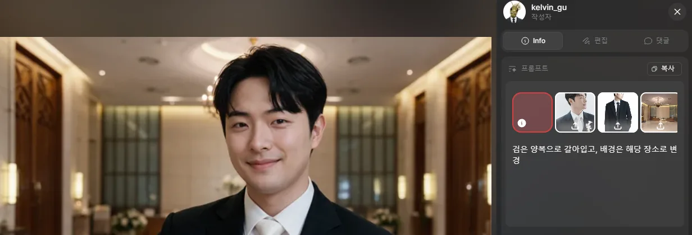
<small>Seedream 5.0 Pro. الوجه المبتسم على المقعد انتقل كما هو إلى بهو القاعة</small>

انتقل التعبير وزاوية الوجه من ابتسامة المقعد شبه كما هما. هكذا كان يجب أن يتطابق طرفا اللقطة المتطابقة. لكن ربطة العنق خرجت بيضاء. الساعة 11:56 أدخلت هذه النتيجة مرجعًا من جديد وصحّحت: «يرتدي ربطة عنق فراشة سوداء بدل الربطة البيضاء» (1k). صارت هذه الإطار الأول لسيلفي الذكاء الاصطناعي.

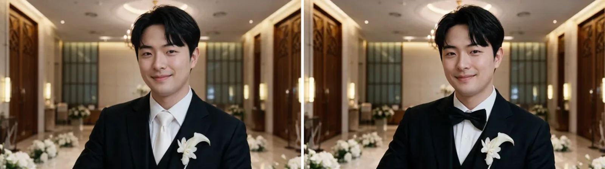
<small>2 سبتمبر عند 23:52 و23:56 (من توليد الذكاء الاصطناعي). تغيّرت ربطة العنق فقط</small>

حين صار لديّ إطار أول انتقلت إلى الفيديو مباشرة. يوم 3 سبتمبر عند 00:09 و00:43 صنعت السيلفي مرتين بـ Seedance 2.5 بدقة 480p. وبينهما في اليوم نفسه شغّلت أيضًا تصغير #11.

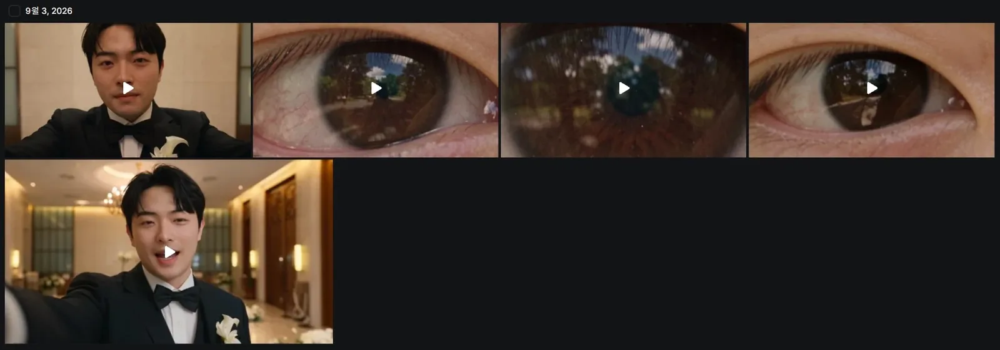
<small>سجل فيديو 3 سبتمبر. أعلى اليسار وأسفله سيلفي الذكاء الاصطناعي، والثلاثة الباقية تصغير العين #11</small>

اختلفت النسختان في الحوار والطول.

| وقت التوليد | الطول | المحتوى |
|---|---|---|
| 00:09 | 10 ث | يحمل كاميرا أكشن بذراع ممدودة ويواصل الكلام. «جئت إلى هنا بحثًا عن السعادة». «لقد لمعت فعلًا» (ضحكة صغيرة) «أضمن طريقة ليكون الإنسان سعيدًا، أظنني وجدتها اليوم». الإطار ثابت حتى النهاية |
| 00:43 | 8 ث | يبقى السطر الأول فقط، وتنزل الكاميرا من الثانية 2.6. تدور الكاميرا وتهتز كأنها تسقط، وعند 4.2 ث توضع على أرضية رخامية. من الثانية 5 يظهر باب خشبي مغلق خلف كعبي حذائي وطرفي بنطالي |

نسخة 00:43 كانت الأولى التي أدخلت في الفيديو الحركة من ① إلى ② في لوحة القصة والرسم. وطال الأمر أيضًا. كتبت كيف تتحرك الكاميرا والجسد في كل وقت، مثل «لقطة واحدة متصلة من كاميرا واحدة»، «خلف الكاميرا باب خشبي كبير بنقش أقواس قوطية مغلق»، «تنقلب الكاميرا إلى الاتجاه المعاكس وهي تنزل»، «توضع على الأرض والعدسة تنظر إلى الأمام وللأعلى قليلًا».

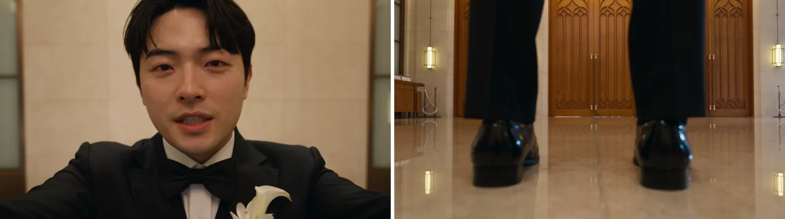
<small>الثانيتان 1 و6 من نسخة 3 سبتمبر عند 00:43 (من توليد الذكاء الاصطناعي). وقف الحذاء والباب أمام الكاميرا على الأرض</small>

لم تدخل أي من النسختين النسخة النهائية. حوار النسخة النهائية: «فتحت عينيّ فوجدتني أمام القاعة، يبدو أن هذا ما يقصدونه»، «حقًا لمعة كالضوء»، «سأدخل الآن»، و«الجميع، انظروا خلفكم من فضلكم». يختلف عن حوار نسخة 3 سبتمبر.

سبب التخلي عنهما هو طريقة الكلام. السيلفي الذي صنعه Seedance كان كلامه متكلّفًا لزجًا جدًا، وتفوح منه رائحة الذكاء الاصطناعي بقوة. مهما أعدت تشغيله لم أرَ أنه يمكن إنقاذه، فتخليت عنه. وإلى أي حد كان ذلك الكلام متكلّفًا، سأرفع الفيديو الفاشل منفصلًا وأضعه هنا.

## إلباس لقطات تمثيلي بدلة سموكينغ، أربع مرات يوم 6 سبتمبر

بدأت اللقطة الأخيرة لا من شخص صنعه الذكاء الاصطناعي، بل من لقطات سيلفي أمثّل فيها بنفسي.

صوّرت السيلفي في البيت بكاميرا الهاتف. لو صوّرت بـ GoPro لدخل تشوّه العدسة الواسعة. فصوّرت بالهاتف لكنني مثّلت كأنني أصوّر بـ GoPro. هههه.

شكل الفم وأنا أتكلم، وحركة الرأس، وحتى حركة اليد التي تُنزل الكاميرا وتضعها على الأرض، كلها كما فعلتها. كتبت في الأمر أن تُحوَّل الغرفة في اللقطات الأصلية إلى بهو القاعة. المهمة هنا تبديل الملابس والمكان فقط.

يوم 6 سبتمبر شغّلتها أربع مرات بين 1:10 و3:53 ظهرًا.

| وقت التوليد | النموذج | الدقة | ما تغيّر |
|---|---|---|---|
| 13:10 | Higgsfield Genjutsu تبديل جسم | 480p | التمثيل والوجه وحركة الكاميرا كما هي؛ إضافة ربطة عنق فراشة؛ السترة والقميص إلى سموكينغ بياقة ساتان؛ الغرفة إلى بهو القاعة؛ باب خشبي أمام الكاميرا المنخفضة |
| 14:18 | Seedance 2.5 Edit | 480p | التعليمات نفسها في Seedance Edit |
| 14:43 | Seedance 2.5 Edit | 480p | أضفت بداية تخرج من لقطة قريبة جدًا للعين. الوجه يتبع الصورة المرجعية لا الأصل؛ الملابس بدلة مطفأة بلا ساتان؛ المكان موضع الشكل في رسم التصميم |
| 15:53 | Seedance 2.5 Edit | 1080p | النهائية لما سبق. 22 ثانية |

كانت المحاولة الأولى تبديل جسم في Genjutsu. أول جملة في الأمر: «أبقِ تمثيل هذا الرجل كما هو. وجهه وهويته، وحركة الشفتين والفك وهو يتكلم، وحركة الرأس، والوضعية، وتوقيت كل حركة». وطلبت إبقاء الكاميرا كما هي أيضًا. حتى اهتزازها وهي تنزل واستقرارها على الأرض.

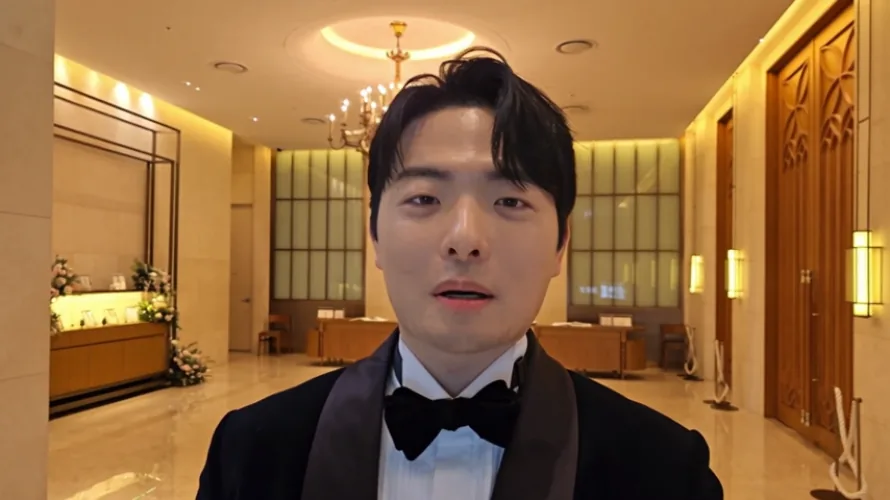
<small>تبديل جسم في Genjutsu، 6 سبتمبر 13:10 (تركيب بالذكاء الاصطناعي). خرجت الياقة بلمعة الساتان</small>

لُبس بهو القاعة والسموكينغ جيدًا. لكن الياقة كانت ساتانًا لامعًا. أنا كتبت في الأمر «سموكينغ بياقة ساتان»، فخرج كما كتبت. عند 14:18 نقلت التعليمات نفسها إلى Seedance 2.5 Edit، وعند 14:43 استبدلت جملة الملابس كليًا: «بدلة سوداء عادية، كلها صوف مطفأ، بلا ساتان ولا لمعة ولا زخرفة ياقة متباينة».

لم تتغيّر الملابس وحدها عند 14:43.

| الجملة | ما تغيّر |
|---|---|
| البداية | تبدأ من لقطة قريبة جدًا تملأ فيها العين والبؤبؤ الشاشة، وفي الثانية الأولى تتراجع مستقيمة على محور العدسة. سريعة في البداية، بطيئة عند الوصول. القزحية تصير عينًا، والعين وجهًا، وتتوقف عند اللقطة النصفية في الأصل |
| الوجه | الوجه وتسريحة الشعر يتبعان الصورة المرجعية لا الفيديو الأصلي |
| المكان | بهو القاعة في الصورة المرجعية. الشكل المرسوم في تلك الصورة مجرد علامة على مكان الوقوف ولا يظهر على الشاشة أبدًا |
| الاتصال | لقطة واحدة متصلة بلا قطع ولا تلاشٍ، وشخص واحد بالضبط |

صورة القاعة التي أدخلتها مرجعًا هي رسم التصميم أعلاه. أدخلتها والشكل الأصفر مرسوم عليها، وأخبرته كتابةً أنه علامة موضع. لم يظهر الرسم على الشاشة.

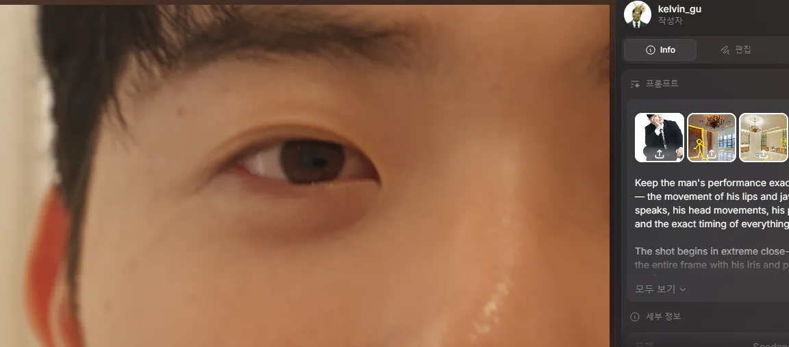
<small>الثانية الأولى من النسخة النهائية. دخل رسم التصميم بالشكل الأصفر في المراجع كما هو</small>

بوضع البداية الخارجة من العين داخل هذه اللقطة، صار وضعها مباشرة بعد تكبير العين والمونتاج الحقيقي من الجزء 3 انتقالًا من العين إلى القاعة. عند 15:53 شغّلت الأمر نفسه بدقة 1080p، وهذا ما دخل النسخة النهائية من 1:48.

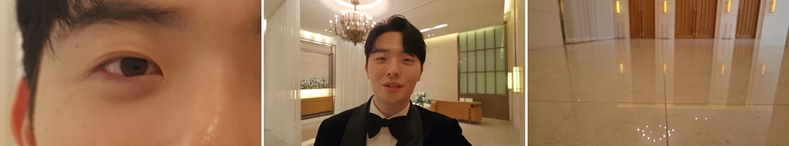
<small>0:01 و0:03 و0:17 من النسخة النهائية. يخرج من العين، يتكلم، ويضع الكاميرا على الأرض</small>

مقارنة بنسخة 3 سبتمبر المصنوعة بالذكاء الاصطناعي وحده، النهاية مختلفة. في نسخة 3 سبتمبر وقف حذاء أمام كاميرا الأرض. أما النهائية فتتبع حركتي الفعلية في وضع الكاميرا، فلا يظهر خلف الأرضية إلا الباب.

## إنهاء المونتاج وثغرة التسليم

وصلت اللقطات المنجزة في Premiere. اسم ملف المشروع `20260909_식중영상.prproj`. شاشة الحاسوب في الجزء 2 رُكّبت من تسجيل HTML، ومشكلة الزاوية العالية في الجزء 3 حيث لم يحجب الورق زوجتي حُلّت بوضع لقطات ورق حقيقية فوقها.

عملت على شاشتين. شاشة البرنامج على اليسار، والخط الزمني على اليمين.

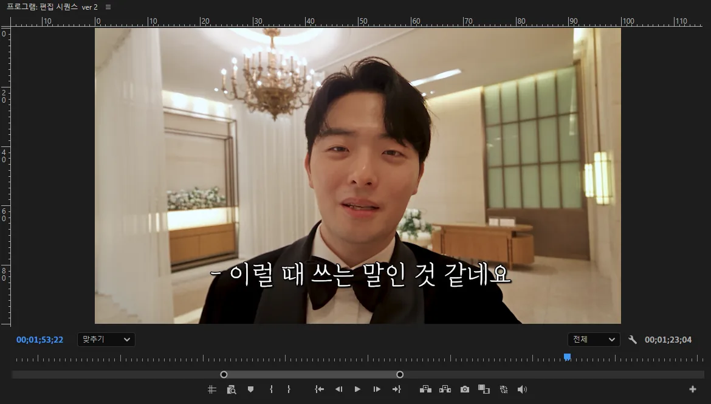
<small>شاشة البرنامج على الشاشة اليسرى. 1:53، والنص فوق لقطة السيلفي الأخيرة</small>

اسم التسلسل «تسلسل المونتاج ver 2». وفي المشروع نفسه مفتوحة أيضًا ver 3 و«فيلم ما قبل الحفل في جيجو» لحفل الاستقبال في جيجو و«التسلسل 06». آخر إطار هو لقطة السيلفي المتوقفة عند 1:53.

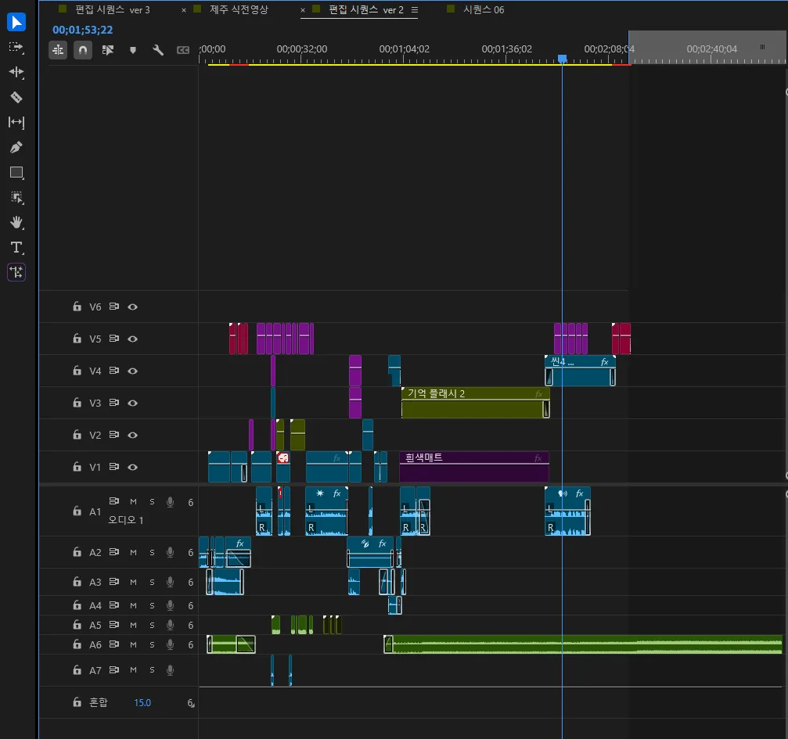
<small>الخط الزمني على الشاشة اليمنى. 5 مسارات فيديو و7 مسارات صوت. رأس التشغيل فوق سيلفي المشهد 4</small>

استخدم الخط الزمني خمسة مسارات فيديو وسبعة مسارات صوت. «ومضة ذكرى 2» و«خلفية بيضاء» الممتدتان في الوسط تقعان من 1:04 إلى 1:44، جزء المونتاج داخل العين. بعدهما مقطع «المشهد 4» على V4 هو السيلفي المصنوع في هذا المقال. الموسيقى على A6 من البداية إلى النهاية. هذه الشاشة هي الخط الزمني النهائي.

وأنا أراجع السجلات هذه المرة تأكدت أيضًا كيف صنعت افتتاحية محاكاة Beat في المقدمة. الساعة 8:06 مساء 5 سبتمبر بدّل نقل الحركة في Higgsfield Genjutsu (720p، 12 ثانية) الوجه وحده. الصورة جنبًا إلى جنب مع الأصل في [الجزء 1](/ar/posts/higgsfield-wedding-film/).

الملف النهائي 4 دقائق و5 ثوانٍ. تنتهي الصورة عند 2:15، وبعدها موسيقى فقط على شاشة سوداء. عُرض قبيل دخول العريس في حفل الواحدة ظهرًا يوم 19 سبتمبر، وبعد أن قلت على الشاشة «الجميع، انظروا خلفكم من فضلكم» تلاه الدخول الحقيقي. فيديو يوتيوب في المدونة هو ذلك الملف مقصوصًا إلى 2:20 مع إبقاء 5 ثوانٍ فقط من الشاشة السوداء.

[شاهد الفيلم الكامل على يوتيوب](https://youtu.be/J8hFwc1LpUQ)

يبقى أمر التسليم. كما كتبت في [الجزء 1](/ar/posts/higgsfield-wedding-film/)، بدأ Claude على حساب زوجتي ثم انتقل إلى حسابي. لم تنتقل المحادثات بين الحسابين، فلصقت في المحادثة الجديدة وثيقة تسليم لخّصتها المحادثة السابقة. وحين حاولت المتابعة منها كان الناقص كثيرًا فلم يتقدم العمل.

في 31 أغسطس وجدت السبب في محادثة جديدة. وثيقة التسليم لم تكن المحادثة كاملة، بل ملخصًا للاستنتاجات والمبادئ فقط. فجعلت Claude يقرأ المحادثة الأصلية كاملة، المحفوظة ملف Word في Google Drive. كانت 253,348 حرفًا. القراءة الأولى كانت لنسخة مقطوعة عند نحو 246,000 حرف، فجلبتها مجددًا وقُرئت حتى النهاية.

بالمقارنة، هذا ما سقط من الوثيقة.

| الناقص | ما كان في المحادثة الأصلية |
|---|---|
| مرجع الوجه | لم يكن في الوثيقة إلا «3 صور مرجعًا مباشرًا». سقط استنتاج أن كثرة الصور تعطي متوسطًا لكل زاوية فينهار الوجه، وسبب أن الصورة ذات الزاوية القريبة من اللقطة هي الأفضل |
| #07 منظور القارورة | أنها لقطة متصلة واحدة مدتها 12 ثانية لا لقطتان، مع تحويل التركيز من القارورة إلى زوجتي |
| لون الفستان | أزرق سماوي فاتح، اختير لأن الأبيض يحترق في شمس الصيف ويلفت النظر كثيرًا في الزاوية العالية |
| الزاوية العالية | أن زوجتي يجب أن يحجبها الورق فتمر أولًا كخلفية وتُرى عند النظر ثانية |
| وضعية #08 و#11 | إدارة الرأس فقط، ونظرة تمر بجانب العدسة إلى أعلى خلف الكاميرا |
| إظلام الكف في #11 | الاستنتاج «حُذف» فقط. السبب، أن حيلة أخرى عند الدقيقة الثانية تقريبًا ستطيل الفيلم، وقرار اللقطة المتطابقة بدلًا منها، لم يكونا إلا في الأصل |

استنتاج مرجع الوجه لم أجده فورًا حتى في الأصل. صحّحته بإعادة قول ما أتذكره. الصورة الملتقطة بزاوية قريبة من اللقطة هي الأفضل، وإن لم توجد فصورة أمامية جيدة وصورة جانبية جيدة.

Claude في المحادثة الجديدة لم يكن يعرف من الوثيقة وحدها لماذا «حُذف»، واتباع «3 صور مباشرة» في الوثيقة لمرجع الوجه كان سيعاكس الاستنتاج الذي أتذكره. واجهت مشكلة إعادة الشرح مع كل محادثة جديدة في عمل المدونة أيضًا، والآن أحفظ القواعد والحالة في مستودع GitHub خارج المحادثة، وتقرؤه كل محادثة جديدة قبل أن تبدأ. كتبت عن ذلك في المقال عن [بناء دماغ للذكاء الاصطناعي في GitHub](/ar/posts/github-brain-for-claude/).

ليس لديّ ندم كبير على الفيلم نفسه. بذلت ما أستطيع، وكانت ردود الفعل جيدة، وتعلمت كثيرًا عن الفيديو. لذلك بدل «لو أعدته» أدوّن ما سآخذه معي إن صنعت شيئًا جديدًا.

| ما آخذه معي | السبب |
|---|---|
| مشاهد الكلام من لقطات تمثيلي منذ البداية | تخليت عن سيلفي الذكاء الاصطناعي في 3 سبتمبر لأن كلامه متكلّف وتفوح منه رائحة الذكاء الاصطناعي. النهائية كانت لقطات تمثيل حقيقية أُلبست ملابس ومكانًا |
| تحديد خامة الملابس منذ البداية | كتبت «سموكينغ بياقة ساتان» فخرج ساتان، واحتاج تحويله إلى مطفأ محاولة إضافية |
| استخدام رسم التصميم مرجعًا مباشرة | حين قلت إن الشكل علامة موضع لم يظهر على الشاشة وضُبط الموضع فقط |
| اللقطات المتصلة داخل لقطة واحدة | وضع البداية الخارجة من العين داخل لقطة السيلفي أنهى اللقطة المتطابقة في مرحلة التوليد |
| التسليم بالاستنتاج وسببه معًا | وثيقة بلا أسباب لم تقدّم شيئًا، واضطررت لإعادة قراءة الأصل ذي الـ 250 ألف حرف |

إن صنعت آخر، أريد أن أستفيد من وضع Edit أكثر وأصنع عملًا أروع بكثير من هذه المرة.

## صنعه بالذكاء الاصطناعي لم يكن طريقًا مختصرًا

**صنع فيلم بالذكاء الاصطناعي لم يكن سهلًا أبدًا.** ربما كان طريقًا أصعب من التصوير بنفسي. لم أبدأه أصلًا لأختار الطريق السهل. لذلك أراه تحديًا ذا معنى.

التواريخ في هذه السلسلة هي فقط التي بقي لها سجل. في الحقيقة كنت أخطط شيئًا فشيئًا قبلها بشهر على الأقل. عدّلت لوحة القصة مرات لا أعرف عددها. وما بقي في السجلات وحده يبلغ هذا.

| المرحلة | السجل |
|---|---|
| التخطيط | شيئًا فشيئًا قبل التواريخ المسجلة بشهر على الأقل. تعديلات لوحة القصة لا تُحصى |
| لوحة القصة | «ورقة لوحة القصة النهائية الموحدة لفيلم ما قبل الحفل - Kang PD»، آخر حفظ 27 أغسطس الساعة 11:21 ليلًا |
| الصور | عشرات لكل مشهد. سبع محاولات لصورة واحدة من زاوية عالية في الجزء 3، وأكثر من عشرين للقطة ابتسامة المقعد الواحدة في هذا المقال |
| الفيديو | 36 من 30 أغسطس إلى 6 سبتمبر. 19 تجربة بدقة 480p و16 بدقة 1080p |
| الرصيد | 563 رصيدًا لآخر 140 معاملة فقط حتى 31 أغسطس. ودخل 1,000 رصيد جديد في 3 سبتمبر |
| المحادثات | عدة محادثات Claude، ووثيقة تسليم، وإعادة قراءة أصل من 250 ألف حرف |
| المونتاج | ملف مشروع 9 سبتمبر، 5 مسارات فيديو و7 مسارات صوت |
| العرض | 19 سبتمبر الساعة الواحدة ظهرًا، قبيل دخول العريس |

استغرق تفكيرًا ووقتًا وجهدًا كبيرًا. بصراحة، في أثناء العمل تخرج منك تلقائيًا عبارة أن دفع المال لشركة هو الأفضل…

ومع ذلك، ما خطر لي وأنا أصنعه يتجه إلى الجهة الأخرى. صنع الفيديو بالذكاء الاصطناعي يتيح تجربة أشياء كثيرة جدًا. تشغيل صورة من زاوية عالية سبع مرات، أو توليد الزاوية المنخفضة نفسها ثماني مرات في يوم، أمر لا تجرؤ عليه في موقع تصوير حقيقي. لقد انفتحت طرق أكثر أمام صانعي الفيديو.

والأساسيات التي اكتسبتها في صنع الفيديو حتى الآن تُستخدم طبعًا في فيديو الذكاء الاصطناعي أيضًا. في هذا الفيلم أيضًا، كتابة لوحة القصة، وتقسيم مشهد المقعد على ثلاث كاميرات، واختيار اللقطة المتطابقة بدل إظلام الكف، والتجميع في Premiere في النهاية، كلها أعمال كنت أقوم بها أصلًا. ما تغيّر أن قيود المكان زالت. يمكنني صنع جبل ثلجي أو القمر أو بهو قاعة زفاف مشاهدَ دون الذهاب إليها. لذلك **أرى أن من كانت أساسياته أمتن يستطيع أن يتألق أكثر في فيديو الذكاء الاصطناعي.**

اضطررت أنا أيضًا إلى الدراسة من جديد وأنا أعمل على هذا. كان عليّ أن أعرف جيدًا مصطلحات اللقطات وقواعد اللغة السينمائية التي تعلمتها بالمشاهدة. الزاوية العالية والمنخفضة، والإمالة لأعلى، وتحويل التركيز، واللقطة المتطابقة، واللقطة النصفية، وزاوية رؤية العدسة والمسافة: لم أقترب من اللقطة التي أريدها إلا حين كتبت أسماءها بدقة في الأمر. وانحراف موضع القارورة واليد بسبب عبارة واحدة «منظور قارورة الماء» كان في النهاية مشكلة مصطلحات أيضًا. هناك الكثير جدًا لأتعلمه. إنه تبرير، لكن لهذا أيضًا مشاهد كثيرة لست راضيًا عنها.

حديث جانبي أخير. خطر لي أن العمل الذي يدفع الناس المال لشركات من أجله قد يكون ممتعًا أن أؤتمته بنفسي وأحوّله إلى خدمة. لأن العتبة عالية بعض الشيء. أنا أستخدم الذكاء الاصطناعي بجد وصنعت فيديوهات كثيرة، ومع ذلك بعد أن أتممت هذا بدا الطريق ما زال طويلًا. أي أن كثيرين على الأرجح لا يستطيعون فعله بعد. شممت رائحة المال. هههه.
