صنعت بـ Higgsfield الفيلم القصير ذا الدقيقتين الذي عُرض قبيل دخول العريس في زفافنا. لم أصوّر تقريبًا شيئًا؛ معظم ما يظهر على الشاشة صور وفيديوهات صنعها الذكاء الاصطناعي.

وأثناء صنعه تعلّمت أن فيديو الذكاء الاصطناعي لا يخرج بضغطة زر. **كان العمل فرزًا بين ما أسلّمه للذكاء الاصطناعي وما يجب أن أفعله بنفسي.** لم يكن طريقًا سهلًا أبدًا. ومع ذلك كان تحديًا يستحق.

كان الزفاف يوم 19 سبتمبر الساعة الواحدة ظهرًا. حين ينتهي الفيلم أقول على الشاشة «فليلتفت الجميع إلى الخلف من فضلكم»، وفي تلك اللحظة أدخل أنا الحقيقي من الباب الخلفي. الفيلم الكامل على يوتيوب.

[شاهد الفيلم الكامل على يوتيوب](https://youtu.be/J8hFwc1LpUQ)

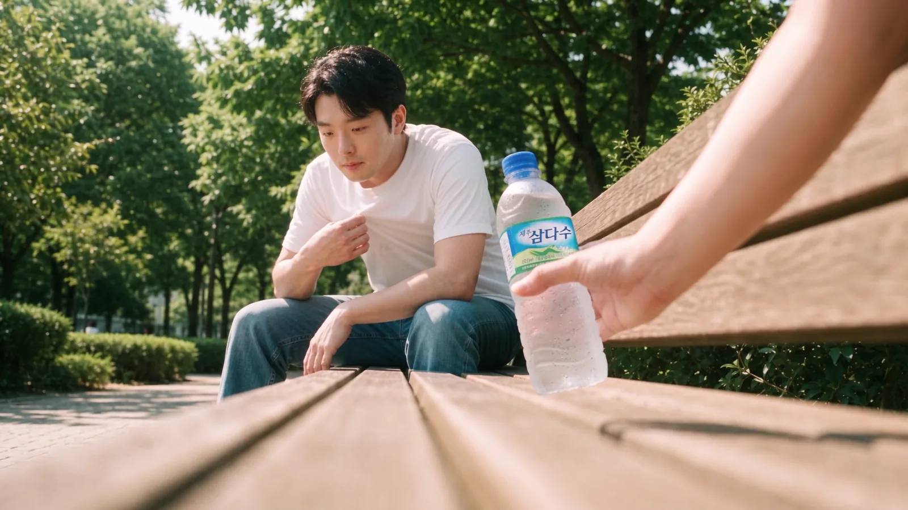
<small>الدقيقة 0:53 من النسخة النهائية. لقطة المقعد من زاوية منخفضة. اليد التي تقدّم الماء يد زوجتي (من صنع الذكاء الاصطناعي)</small>

كانت العملية طويلة، فقسمتها إلى أربعة أجزاء، لكل جزء سؤال واحد.

| الجزء | المشاهد | السؤال |
|---|---|---|
| الجزء 1 | الافتتاحية والتحضير | في زفاف بلا عرض ولا أغنية، بماذا نشدّ انتباه الضيوف؟ |
| [الجزء 2](/ar/posts/higgsfield-wedding-film-2/) | غرفة العمل، التيه | ماذا نفعل بما لا يستطيعه الذكاء الاصطناعي؟ |
| [الجزء 3](/ar/posts/higgsfield-wedding-film-3/) | المقعد | لماذا يتوقف وجهي عن أن يشبهني؟ |
| [الجزء 4](/ar/posts/higgsfield-wedding-film-4/) | قاعة الزفاف، المونتاج | لماذا لا ينجح تمثيل الذكاء الاصطناعي حين يتكلم؟ |

يركّز النص الأساسي على أين تعثّرت وماذا غيّرت بسبب ذلك. أما سجلّ كل محاولة بتاريخها ونموذجها وأمرها فجمعته في آخر كل جزء تحت «سجلّ التجربة والخطأ».

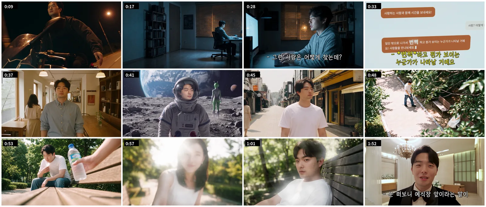
<small>لقطات من النسخة النهائية بالترتيب. لم أضع الصور والفيديوهات الحقيقية من المونتاج داخل العين</small>

## لا عرض ولا أغنية، فراهنت على المشهد الأول

سبب صنع هذا الفيلم بسيط. لم يكن في زفافنا عرض. ولا أغنية أيضًا. كان على الضيوف أن يجدوا شيئًا واحدًا على الأقل يستمتعون به.

في منتصف الفيلم لقطات من مواعيدنا. لكن لو وصلنا مقاطع المواعيد ببعضها فقط فسيكون مملًّا حتمًا. كان الهدف أن نعرض مواعيدنا ونجعل الضيوف مع ذلك يشعرون «آه، شاهدنا شيئًا ممتعًا».

الناس لا يهتمون كثيرًا بأي فيديو أصنع أو أي مواعيد خرجنا فيها. ينظرون أولًا: هل هو ممتع أم لا. وظننت أن هذا يُحسم في المشهد الأول. **لذلك كان أهم قرار في هذا الفيلم هو بماذا نفتتحه.**

بعد اختيار طويل استقررت على محاكاة ساخرة لمشهد الدراجة النارية من الفيلم الكوري «Beat»: قيادة دراجة في طريق ليلي مع فتح الذراعين على اتساعهما. لم يكن المشهد في لوحة القصة؛ أضفته في المقدمة لاحقًا.

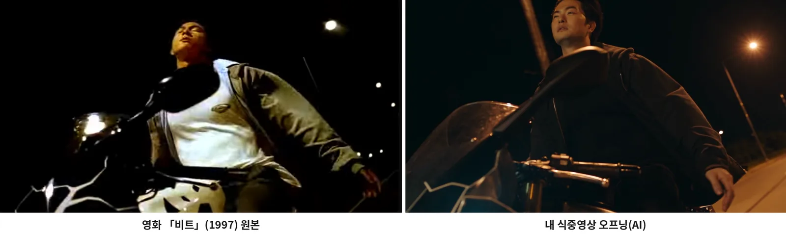
<small>يسارًا الأصل من «Beat»، ويمينًا الدقيقة 0:09 من النسخة النهائية (من صنع الذكاء الاصطناعي). الزاوية نفسها، أعمدة الإنارة نفسها، والوجه وحده وجهي</small>

اخترته بمعيارين.

| المعيار | السبب |
|---|---|
| مشهد تعرفه كل الأعمار | في قاعة الزفاف ضيوف من أعمار مختلفة |
| ممتع ومدهش حتى لمن لا يعرفه | من لا يعرف الفيلم الأصلي يجب أن ينتبه فورًا: «هل هذا ذكاء اصطناعي؟» |

صنعه كان في الواقع بسيطًا. أعطيت خاصية نقل الحركة في Higgsfield Genjutsu مقطع دراجة واحدًا وصورة واحدة لوجهي، وكتبت سطرًا واحدًا: «غيّر وجه الشخص في الفيديو إلى الصورة المرجعية».

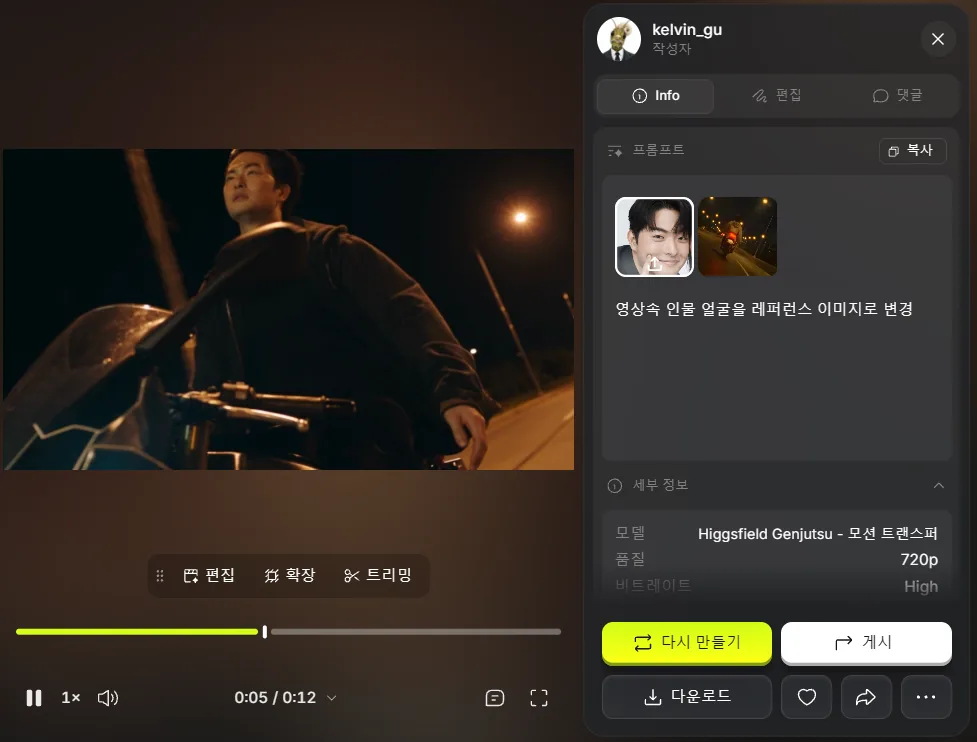
<small>نقل الحركة في Genjutsu. صورة وجه واحدة وأمر من سطر واحد بدّلا الوجه وحده</small>

تمرّ عبارتا «أنا الوحيد» و«أريد أن أكون سعيدًا» فوق الدراجة، ثم ينتقل ذلك الوحيد إلى مكتبه في غرفة العمل وتبدأ القصة. حين أنظر الآن، أرى أن هذا المشهد وحده حمل الفيلم كله. لم أوثّق ردود فعل الضيوف جيدًا بعد. جرّبت مونتاجًا متقاطعًا مع لقطات من القاعة، لكن باستثناء الضحكة الأولى لم تظهر ردود الفعل كما ينبغي. شركة الفيديو صوّرت ردود فعل الضيوف على حدة ولم تصل اللقطات بعد؛ حين تصل سأعيد مونتاج ردود الفعل وأضعها هنا.

## القصة تبدأ بسؤال الذكاء الاصطناعي عن السعادة

جعلت الحبكة بسيطة منذ البداية. يسأل Kang PD الذكاء الاصطناعي كيف يكون سعيدًا، فيخرج كما قيل له، ويتيه في أماكن غريبة، ويلتقي على مقعد في حديقة بمن تقدّم له الماء، ثم يدخل قاعة الزفاف.

| المشهد | المكان | ما يحدث | الطول في لوحة القصة |
|---|---|---|---|
| S#1 | غرفة العمل (ليلًا) | يسأل الذكاء الاصطناعي: «ما أضمن طريقة ليكون الإنسان سعيدًا؟» والجواب: «اخرج. حين تلتقي نصيبك الحقيقي سيلمع شيء أمام عينيك!» | 0:00–0:15 |
| S#2 | مقهى ← حديقة ← القمر ← جبل ثلجي ← شارع صيفي | يبقى وجهه في وسط الشاشة تمامًا بينما تتبدّل الملابس والخلفية فقط. وفي النهاية يرتمي متعبًا على مقعد | 0:15–0:40 |
| S#3 | مقعد في حديقة | تدخل قارورة ماء من الجانب؛ يرفع رأسه، ينقشع الضوء الخلفي، فتظهر زوجتي. تكبير مفاجئ داخل العين، وفيها مونتاج من صور وفيديوهات حقيقية | 0:40–2:00 |
| S#4 | غرفة انتظار قاعة الزفاف | من ذلك التعبير مباشرة إلى بدلة سموكينغ، يكلّم الضيوف عبر كاميرا سيلفي، ثم عند الباب: «انظروا إلى الخلف» | 2:00–2:20 |

دوّنت في لوحة القصة الكاميرا والإخراج والصوت لكل لقطة على ورقة واحدة. أثناء العمل كنت أسميه فيلم ما قبل الحفل، لكنه عُرض فعليًا في منتصف الحفل، قبيل دخول العريس.

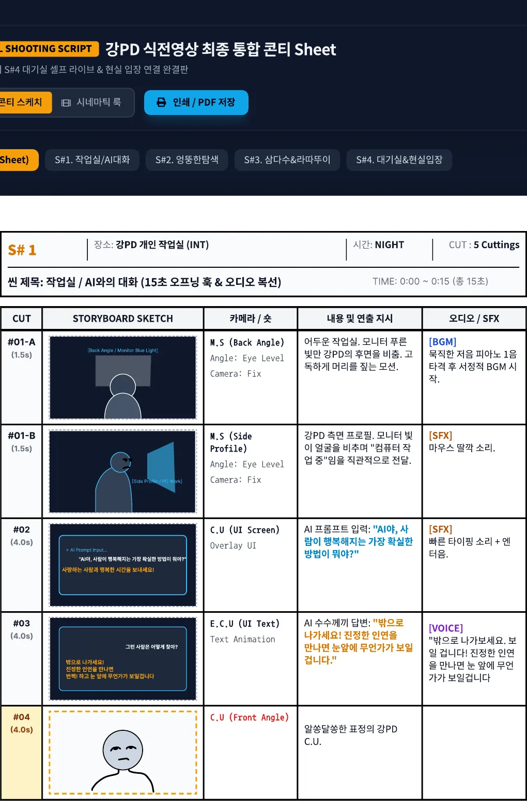
<small>S#1 غرفة العمل. حتى عبارات شاشة المحادثة والمؤثرات الصوتية مكتوبة</small>

S#3 هو الذروة. الإمالة من قارورة الماء إلى وجه زوجتي، ووهج العدسة من الضوء الخلفي، والانجذاب إلى داخل العين على طريقة Ratatouille، والمونتاج داخلها، كلها تأخذ أكثر الخانات في لوحة القصة. وذهب إليها أيضًا أكثر الرصيد والوقت.

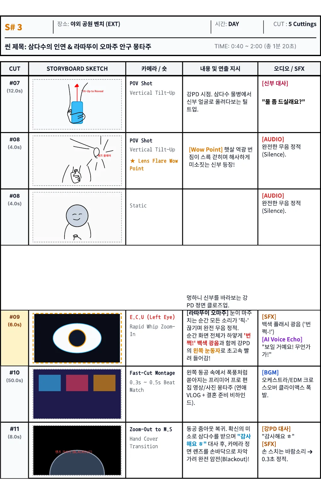
<small>S#3 المقعد. عبارة العروس «هل تريد بعض الماء؟»، #09 تكبير إلى العين، #10 المونتاج</small>

S#4 هو الجزء المتصل بالقاعة. أتكلم على الشاشة عبر كاميرا سيلفي في غرفة الانتظار، أُنزل الكاميرا، وحين ينطفئ الفيلم تبدأ موسيقى الدخول الحقيقية.

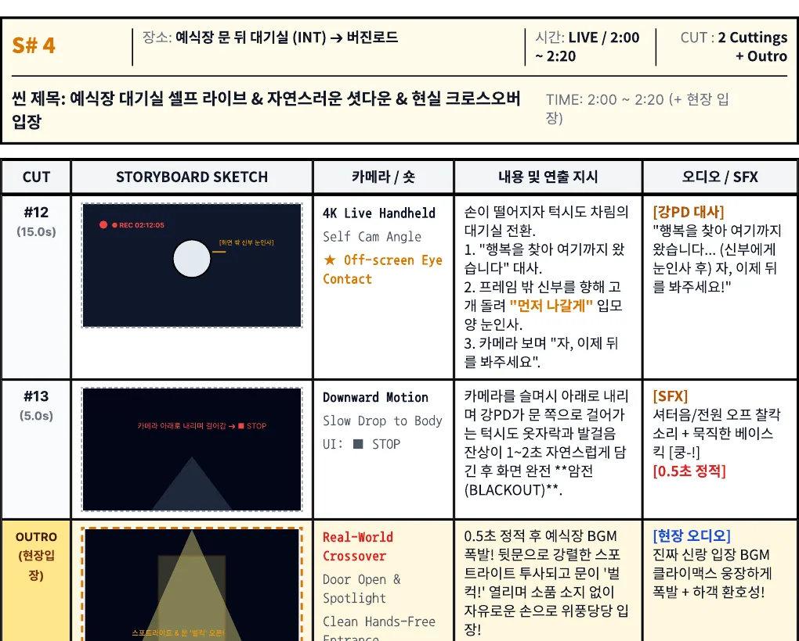
<small>S#4. المشهد الأخير الذي يصل الفيلم بالدخول الحقيقي</small>

كانت لوحة القصة دقيقتين و20 ثانية؛ والصورة في النسخة النهائية تنتهي عند 2:15. خُطّط للمونتاج بخمسين ثانية فصار أقصر بكثير، وتغيّرت الحوارات أيضًا. كيف تغيّرت، تجده في الجزأين 3 و4.

## ما حسمته قبل أن أسلّم العمل للذكاء الاصطناعي

استخدمت أداتين معًا: Higgsfield لصنع الصور والفيديو، وClaude لتصميم الأوامر ومراجعة النتائج. ربطت Higgsfield بـ Claude كموصّل، فصار Claude يصنع مباشرة ويطّلع حتى على الرصيد وسجل المعاملات.

ثلاثة مبادئ التزمت بها حتى النهاية.

| المبدأ | السبب |
|---|---|
| صورة المكان ← صورة الشخص في ذلك المكان ← الفيديو | إذا رميت المكان والشخص منفصلين في مرحلة الفيديو لم يتطابقا. والصورة المعطاة كإطار أول دخلت الفيديو كما هي |
| الوجه من صورة واحدة بزاوية قريبة من اللقطة | وضع صور أمامية وجانبية ومن الأعلى معًا جعل كل زاوية تُحسب بالمتوسط فانهار الوجه. التفاصيل في الجزء 3 |
| افحص الفيديو بدقة 480p أولًا، و1080p في النهاية فقط | تشغيل واحد بدقة 1080p كلّف مثل ست تجارب بدقة 480p |

حفظت الأماكن كعناصر في Higgsfield. صنعت قاعة الزفاف والجبل الثلجي والقمر وغرفة العمل والشارع الصيفي والحديقة والمقهى، ثم استدعيتها في الأوامر بعلامة @.

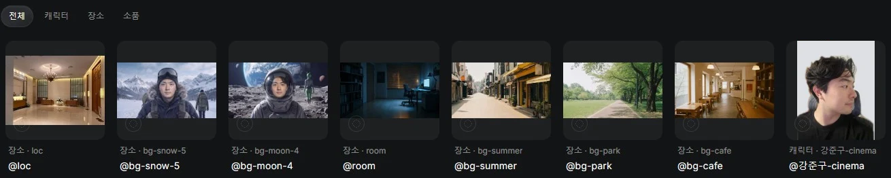
<small>سبعة عناصر أماكن وعنصر شخصية واحد في Higgsfield. استبدلت خلفية البيت في صورة الشخصية بلون سادة</small>

صوّرت وجهي ورفعته منفصلًا لكل زاوية. في البداية ظننت أن كثرة الصور تقرّبه من وجهي. كان العكس. وهذا لبّ الجزء الثالث.

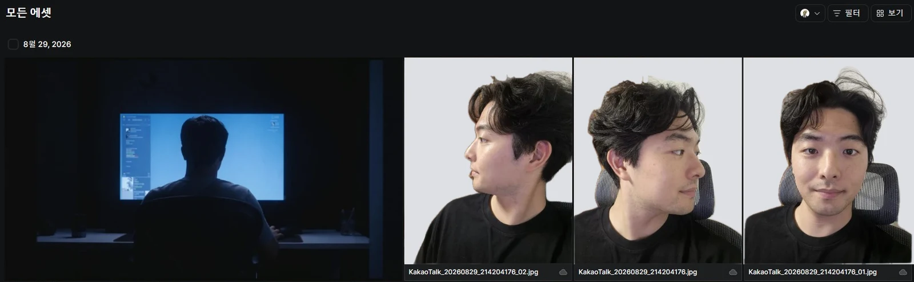
<small>صور الوجه المرفوعة إلى المشروع. جانبية و45 درجة وأمامية، صُوّرت منفصلة. كان داخل البيت ظاهرًا، فاستبدلت الخلفية وحدها بلون سادة</small>

ملاحظة عن المال. حسابي في Higgsfield على خطة Plus، ويصل 1,000 رصيد في الثالث من كل شهر. جعلت Claude يتصفّح سجل المعاملات حتى آخره للتأكد: **الرصيد المتبقي لا ينتقل إلى الشهر التالي؛ يختفي.** لذا قبيل التجديد لم يكن هناك سبب للتوفير، وبعده مباشرة كنت أتردّد حتى في فيديو واحد. ذهب معظم الرصيد إلى الفيديو. الصورة بـ2 رصيد، بينما التشغيل الواحد للفيديو من نحو 20 إلى أكثر من 130 رصيدًا.

## لو صنعت شيئًا كهذا مرة أخرى

أشياء فاتتني في التحضير كلّفتني رصيدًا ووقتًا كثيرًا لاحقًا. لو كرّرت العمل نفسه لمضيت بهذا الترتيب.

| ما أفعله | السبب |
|---|---|
| أكتب لكل لقطة «منظور مَن، وهو ينظر إلى ماذا» | كتبت «منظور قارورة الماء» فقط، فقرأها Claude على أنها منظور القارورة. كان المقصود منظوري وأنا أنظر إلى القارورة |
| أحفظ القرارات وأسبابها في ملف واحد | عند نقل حساب Claude سلّمت ملخصًا فقط فضاعت كل الأسباب (الجزء 4) |
| أجعل تجربة 480p ← 1080p قاعدة من البداية | تشغيل واحد بـ132 رصيدًا يساوي ست تجارب |
| أشغّل الموصّل وقت الصنع فقط | أوصاف الأدوات وحدها كانت تأكل جزءًا كبيرًا من استخدام Claude في كل دور |

الجزء الثاني عن غرفة العمل ومشهد التيه: لماذا لم يستطع الذكاء الاصطناعي صنع شاشة يجب أن يكون نصّها دقيقًا، ولماذا صوّرت بنفسي المشهد الذي يجب أن يبقى فيه موضع الوجه ثابتًا، وحكاية الضيوف الكبار الذين ظنّوا أننا صوّرنا كل ذلك فعلًا.

## سجلّ التجربة والخطأ

هذه هي العملية التي حذفتها من النص الأساسي، محفوظة كما هي. لمن يريد تجربة الشيء نفسه، قد يكون هذا الجزء أنفع.

افتتاحية Beat: ليلة 5 سبتمبر، نقل الحركة في Higgsfield Genjutsu، 720p، 12 ثانية. مقطع دراجة واحد وصورة واحدة لوجهي؛ والأمر سطر واحد «غيّر وجه الشخص في الفيديو إلى الصورة المرجعية».

مدة العمل: نحو أحد عشر يومًا، من 27 أغسطس حين حفظت لوحة القصة إلى 6 سبتمبر حين صنعت آخر فيديو. كنت أخطّط على فترات منذ شهر على الأقل قبل ذلك. اسم ملف PDF للوحة القصة «Kang PD pre-ceremony film final integrated storyboard sheet»، والمشاهد من S#1 إلى S#4 متتابعة عموديًا.

حسابان في Claude: بدأت Claude على حساب زوجتي. كان يفهم أوصاف مشاهدي جيدًا جدًا، فأنشأت حسابي الخاص في النهاية ورفعت الخطة إلى Max. محادثات حساب زوجتي لم تنتقل، فصنعت وثيقة تسليم وألصقتها، لكن تلك الوثيقة أبقت الخلاصات وأسقطت كل الأسباب. أما Higgsfield فكان على حسابي من البداية.

موصّل Higgsfield:

| ما حدث | السبب | ما غيّرته |
|---|---|---|
| محادثة واحدة ملأت 4% من استخدام Max، وبضع رسائل أخرى رفعته إلى 7% | في موصّل Higgsfield نحو 80 أداة، وأوصافها تُرسل في كل دور حتى دون استخدامها. ونتائج مثل 100 معاملة ظلّت تتراكم | شغّلت الموصّل وقت الصنع فقط، وأجريت أحاديث التخطيط والنص في محادثات جديدة وهو مطفأ |
| كان Claude يعرض قائمة النتائج لكنه لا يرى الصور | القائمة لا تحمل سوى المعرّف والعنوان، ولم يستطع Claude فتح الصور نفسها | كنت أشير إلى رقم الخانة على الشاشة |

الصورة الأولى: أنشأت مشروع «فيلم الزفاف» في Higgsfield وبدأت رفع المواد في 29 أغسطس. وبدأت ذلك اليوم بغرفة العمل S#1.

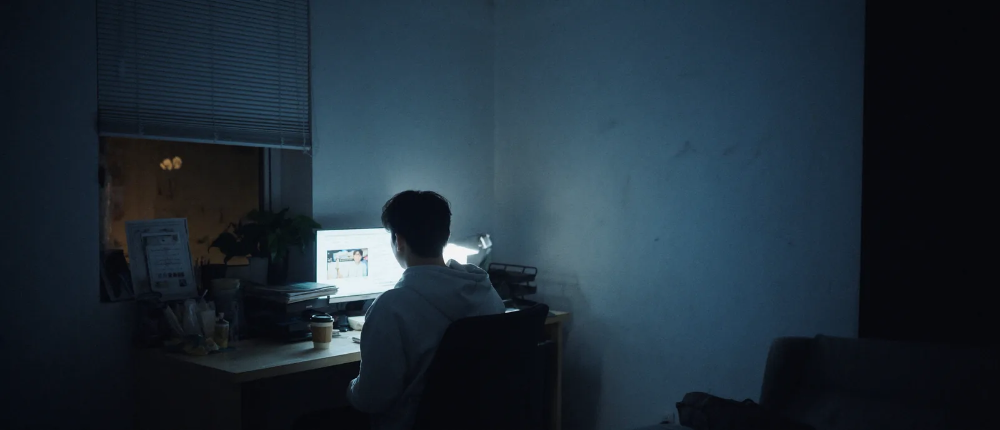
<small>صورة غرفة العمل في 29 أغسطس الساعة الخامسة مساءً (من صنع الذكاء الاصطناعي). النسخة النهائية استخدمت تكوينًا آخر</small>

إصدارات عناصر الأماكن: مرّ الجبل الثلجي والقمر بعدة إصدارات، حتى @bg-snow-5 و@bg-moon-4.

كيف استقرّت قاعدة مرجع الوجه: عناصر الشخصيات الأولى (@char_jungu و@char_sumin) قامت كل منها على صورة واحدة، فخرج الوجه ضعيفًا. فأضفت صورًا أكثر إلى العناصر وأعطيت الصور مباشرة كمراجع لكل لقطة أيضًا. ثم عرفت أن خلط الزوايا يحسب متوسطها، فغيّرت القاعدة.

| الأولوية | الصورة المرجعية |
|---|---|
| 1 | صورة واحدة بالضبط بزاوية قريبة من اللقطة المطلوبة |
| 2 | إن لم توجد، صورة أمامية جيدة وصورة جانبية جيدة |
| ممنوع | صور أمامية وجانبية ومن الأعلى معًا. تُحسب الاتجاهات الثلاثة بالمتوسط في آن |

اهتزّت هذه القاعدة مرة مع وجه زوجتي. كانت لديها ثلاث صور: أمامية؛ ومستديرة 45 درجة بعينين إلى الأمام؛ ومستديرة 45 درجة بعينين منخفضتين. احتجت وجهها كما أراه من مقعدي على البنش، فاقترح Claude الصورة الثالثة وحدها لأنها الأقرب زاوية. رأيت أن عينيها المنخفضتين في تلك الصورة لن تظهرا جيدًا، فوضعت الثلاث. القاعدة قاعدة، لكن يجب وزن تعبير كل صورة أيضًا.

ثبّتُّ ملامح الوجه بالكلمات أيضًا: المسافة بين العينين، وشكل الجفن، وعرض جسر الأنف، وارتفاع عظم الوجنة، وزاوية خط الفك، وطول ما فوق الشفة، وسماكة الشفتين، وختمت بـ `Do not average these features`.

عنصرا الشخصية: يحوي @강준구 سبع صور، تمزج صور البدلة من جلسة تصوير الزفاف وصورًا يومية.

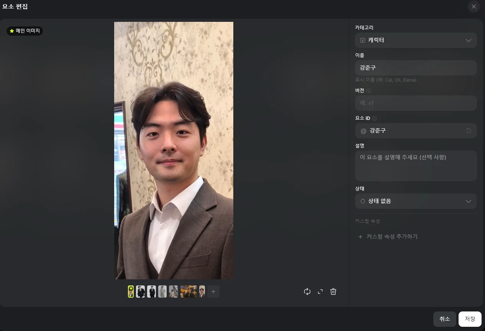
<small>عنصر @강준구. صورة رئيسية واحدة وست صور إضافية</small>

شخصية Soul (@강준구-cinema) تحوي 17 صورة لي في أماكن مختلفة، وخرج 25 رصيدًا تحت بند Soul ID في المعاملات. لكنها لا تُستدعى إلا من Soul Cinema، لا من Nano Banana Pro ولا من Cinema Studio، فلم أستخدمها في معظم اللقطات. في 6 سبتمبر استدعيتها للقطة واحدة، المشي إلى المقعد والجلوس، بـ Seedance 2.

<small>@강준구-cinema. سبع عشرة صورة بزوايا وأماكن مختلفة: مقهى، مطعم، جلسة تصوير الزفاف</small>

الرصيد: يصل 1,000 رصيد في الثالث من كل شهر الساعة 11 صباحًا (بتوقيت كوريا). في سجل 3 أغسطس كان سطر استرجاع 843 رصيدًا متبقيًا بجوار سطر منح 1,000 رصيد جديد. تكلفة التشغيل الواحد لكل نموذج من سجل المعاملات:

| النموذج | النوع | تكلفة التشغيل (رصيد) |
|---|---|---|
| Nano Banana Pro | صورة | 2 |
| GPT Image 2.0 | صورة | 0.5–8.5 (فرق 17 ضعفًا حسب الإعدادات) |
| Cinema Studio 4.0 | فيديو | 20–72 |
| Seedance 2.5 | فيديو | 19.26–132.73 |

في 31 أغسطس جمعت آخر 140 معاملة حسب النموذج: من 563 رصيدًا إجمالًا أخذت 8 فيديوهات 356 رصيدًا (63%). وصنع Nano Banana Pro ثماني وثلاثين صورة بـ76 رصيدًا فقط. الـ132.73 رصيدًا التي خرجت دفعة واحدة كانت التشغيل النهائي لـ Seedance 2.5 Edit بدقة 1080p ليلة 30 أغسطس الساعة 10:41 (بتوقيت كوريا). صرفت في ذلك اليوم وحده نحو 300 رصيد.

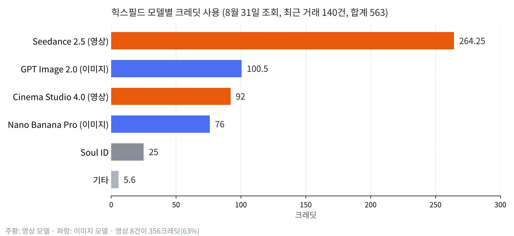
<small>المعاملات الـ140 التي راجعتها في 31 أغسطس مجموعة حسب النموذج (رسمته من سجل المعاملات)</small>

نماذج الفيديو: من 30 أغسطس إلى 6 سبتمبر صنعت 36 فيديو على حسابي. منها 19 تجربة بدقة 480p و16 بدقة 1080p.

| النموذج | العدد | المشاهد |
|---|---|---|
| Seedance 2.5 | 20 | إمالة منظور المقعد، التكبير والتبعيد في العين، كاميرا سيلفي الذكاء الاصطناعي في قاعة الزفاف |
| Seedance 2.5 Edit | 9 | مشهد التيه (تبديل الخلفية والملابس في لقطات حقيقية)، كاميرا سيلفي قاعة الزفاف، لقطة الخروج من العين |
| Cinema Studio | 4 | ثلاث لقطات كلام في غرفة العمل، وإمالة منظور المقعد مرة |
| Higgsfield Genjutsu | 2 | تبديل الوجه (نقل الحركة)، تغيير ملابس كاميرا السيلفي (تبديل عنصر) |
| Seedance 2 | 1 | المشي إلى المقعد والجلوس |
