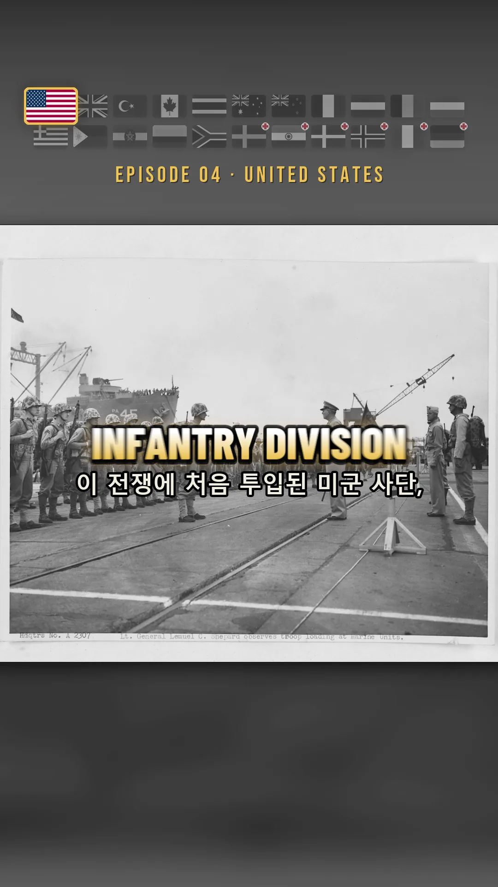
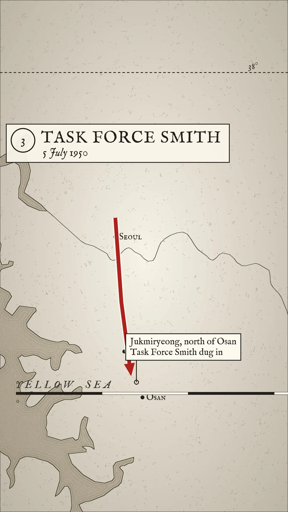
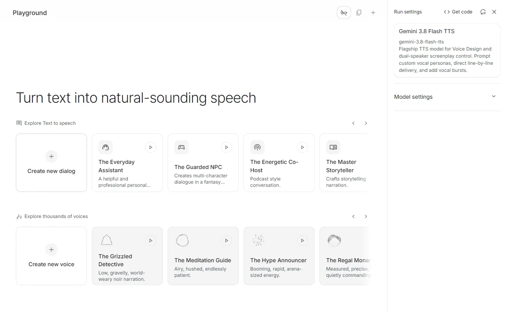
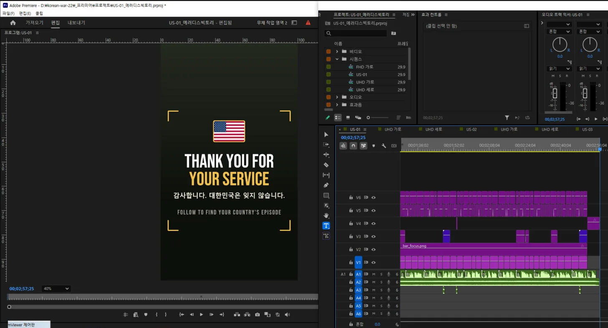
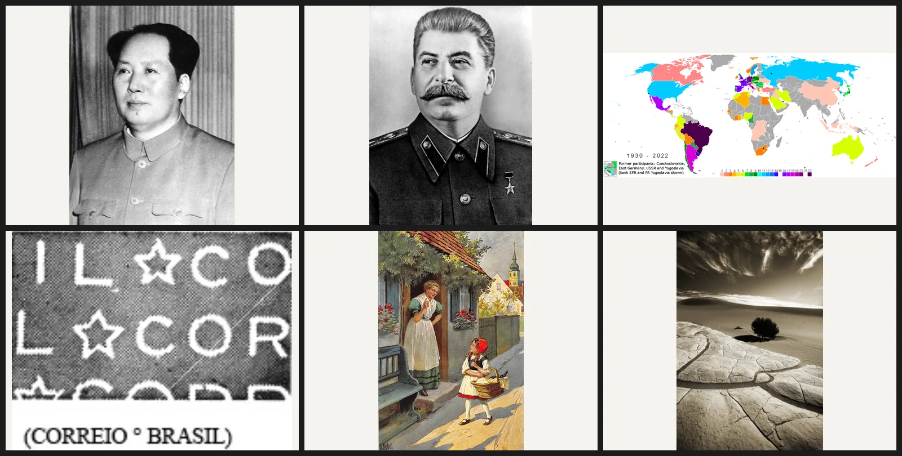
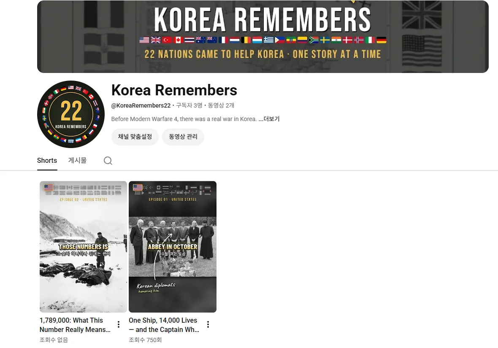

تُدخل نصًا واحدًا ومجلد صور، فيركّب كلود الخط الزمني في بريمير بنفسه. بنيتُ هذا الطريق خلال ثلاثة أيام وأخرجتُ أربعة مقاطع قصيرة مدة كل منها نحو دقيقتين وخمسين ثانية.

<small>لقطة مكتملة. شريط الأعلام والنص الكبير والنص المساعد وموضع الصورة، وضعها كلها الكود</small>

## لماذا اثنتان وعشرون دولة

أرسلت اثنتان وعشرون دولة جنودًا أو طواقم طبية إلى الحرب الكورية: ست عشرة دولة مقاتلة وست دول دعم طبي. اخترتُ هذا موضوعًا للقناة لثلاثة أسباب.

| السبب | التفصيل |
|---|---|
| التوقيت | صدرت لعبة مودرن وورفير 4 في 23 أكتوبر 2026. حملتها حرب في شبه الجزيرة الكورية تبدأ بغزو كوري شمالي شامل، وبطلها جندي كوري جنوبي. لاعبو العالم يبحثون عن كوريا في هذه الفترة |
| حجم المادة | لكل دولة وحداتها ومعاركها وأشخاصها. اثنتان وعشرون دولة تمتد إلى مئات الحلقات. كتبتُ حتى الآن 145 نصًا |
| السوق | من بين الدول المشاركة، الولايات المتحدة وبريطانيا وكندا وأستراليا ونيوزيلندا وهولندا ودول الشمال وألمانيا ترتفع فيها أسعار الإعلانات |

السبب الثالث هو الأكبر فعلًا. العمل بالكورية وحدها يعني سوقًا من خمسين مليونًا، ثم تنقسم داخليًا. لذلك اخترتُ **الإنجليزية أساسًا، وفي حلقة كل دولة وحدها أضع ترجمة بلغتها وعلمها معاملةً خاصة**. الحيلة أن يرى أحدهم بلده مُبرزًا فيأخذ يقلّب الحساب سائلًا: "هل بلدي موجود أيضًا؟" أما بقية اللغات فأتركها للدبلجة التلقائية في يوتيوب. اسم القناة Korea Remembers، حساب واحد، حلقة كل يوم.

الشعور امتنان لا غضب. كون الصانع كوريًا يصير هو الصدق نفسه.

## حلّلتُ المراجع لأحسم التصميم

لم أبنِ على الحدس. أنزلتُ مقاطع القنوات التي أقصدها وفككتها. قناة Hystoria الإندونيسية (142 ألف مشترك) أرتني البنية، أما القواعد البصرية فأنزلتُ لها ثلاثة مقاطع من Silent Souls Stories (175 ألف مشترك) بأداة yt-dlp وفحصتها لقطةً لقطة.

| ما وجدته في المراجع | ما طبّقته في مقاطعي |
|---|---|
| لا مؤثرات انتقال تقريبًا. مجرد قطع، مع سحبة خفيفة تستقر بعد القطع مباشرة | كل قطع يُسحب من 104% إلى 100.5% ثم يُدفع ببطء حتى 106% |
| متوسط المشهد ثانيتان | متوسط القطع نحو ثلاث ثوانٍ، والافتتاحية من 1.3 إلى 1.7 |
| وميض أبيض 0.6 ثانية عند الانتقالات الكبرى فقط | مرة أو مرتين فقط، حيث تنعطف الحكاية |
| الترجمة من كلمة إلى ثلاث بحروف كبيرة في وسط الشاشة | تدرّج ينزل من الأبيض إلى الأصفر، في الوسط |

<small>الخرائط ليست مستعارة بل يرسمها الكود. بيانات خط الساحل وحدها من مصادر مفتوحة، وما عداها مرسوم</small>

وأضفتُ شيئين من عندي. شريط الأعلام الاثنين والعشرين يبقى أعلى الشاشة طوال الفيديو، وفي اللحظة التي يقول فيها التعليق "اليوم، الولايات المتحدة" يكبر ذلك العلم وحده بمقدار 1.45 مرة بإطار ذهبي بينما تهبط البقية إلى الأبيض والأسود. والخرائط لا أستعيرها بل أرسمها: ملمس ورقي، ساحل بالحبر، خطوط موج عند الشاطئ، المتوازية الثامنة والثلاثون، صناديق عناوين مرقّمة، أسهم حركة حمراء. لكل مشهد خريطة مختلفة.

## الصوت في كتلة واحدة، والتوقيت يضبطه التفريغ

في البداية وضعتُ مسارًا إرشاديًا بصوت ويندوز المدمج. جاء الحكم في كلمة واحدة: قمامة.

الآن أصنعه في موقع Gemini AI Studio. المهم **إدخال النص كله في كتلة كلام واحدة مع سطر فارغ بين المشاهد وتشغيله دفعة واحدة**. لو صنعته مشهدًا مشهدًا تغيّر الصوت تغيّرًا خفيفًا. الصوت واحد فقط، Riko. يخرج تعليق مدته دقيقتان وخمسون ثانية في ملف واحد.

<small>الشاشة التي يُصنع فيها التعليق. لا يظهر حقل الكتابة إلا بعد الضغط على "Create new dialog"</small>

ثم يأتي الجوهر. أُعيد تفريغ ملف التعليق بأداة faster-whisper **لاستخراج الثانية التي تُنطق فيها كل كلمة.** عندئذ لا حاجة لمطابقة الترجمة يدويًا. إن كُتب في قائمة اللقطات "هذه الصورة تبدأ عند كلمة Hungnam"، يبحث الكود عن زمنها الحقيقي ويضع اللقطة. دقة المحاذاة من 95 إلى 98 بالمئة في الحلقة.

الترجمة سطران. السطر الكبير من كلمة إلى ثلاث بلغة تلك الدولة، والسطر الصغير تحته بالإنجليزية. وفي حلقات الدول الناطقة بالإنجليزية يكون السطر السفلي بالكورية. كانت الكورية تتكسر إلى أجزاء أصغر من اللازم، فأعدتُ تجميعها حسب المعنى. الجزء الأقل من تسعة أحرف، أو الذي لم يكتمل معناه، يُدمج مع التالي، ويمتد السطر حتى ثمانية عشر حرفًا. في حلقة واحدة نزلت 139 قطعة إلى 66.

## كلود يركّب بريمير بنفسه

هنا يدخل MCP. أستخدم اثنين.

| MCP | ما يفعله |
|---|---|
| Premiere Pro MCP | فتح المشروع وحفظه باسم آخر، وتركيب الخط الزمني عبر `execute_extendscript`، والتصدير |
| Playwright (متصفح Whale، منفذ التنقيح 9222) | توليد الصوت وتنزيله في AI Studio، وجمع المواد من الأرشيف الوطني الأمريكي ومن DigitaltMuseum، وجدولة الرفع على يوتيوب وإنستغرام |

الترتيب كالتالي. جانب بايثون (`premiere_prep.py`) يركّب الصور مسبقًا بمقاس 1080×1920، ويرسم الترجمات وبطاقات الأسماء وحروف الفرشاة والخرائط كتسلسلات PNG، ثم ينتج ملف `plan.json` واحدًا. بعدها يُرسل سطر ExtendScript واحد عبر MCP الخاص ببريمير. يقرأ ذلك السطر الخطة ويملأ ثمانية مسارات.

<small>الخط الزمني بعد التركيب. لا أحد يسحب هذه المقاطع واحدًا واحدًا</small>

V1 للصور والخرائط، V2 لشريط الأعلام، V3 لبطاقات الأسماء والأسهم وحروف الفرشاة الكورية، V4 لبطاقات النص والنهاية والوميض الأبيض، V5 للترجمة الكبيرة، V6 للترجمة المساعدة، A1 للتعليق، A2 للموسيقى. تضم الحلقة الواحدة أكثر من 250 مقطعًا ولا يضعها إنسان.

ما تعلمته أثناء الأتمتة أن الحكم نفسه يمكن وضعه في الكود. يحصل كل مشهد على درجة أهمية من تعليقه. الكلمات المفتاحية مثل Medal of Honor وfirst وcaptured وkilled ثلاث درجات، والرقم الكبير ثلاث، وعبارة الشكر ثلاث، والكلمة المفتاحية التي تظهر لأول مرة في الحلقة درجتان. المشاهد التي تتجاوز ست درجات وحدها يُسمح لها بحروف الفرشاة الصفراء، وما دون ذلك يحذفها الكود تلقائيًا. وركّبتُ المؤثرات الصوتية بنفسي ببايثون كي لا تعلق في الترخيص: دويّ الشعار، وحفيف الوميض، وطقطقة البطاقة، ودقّة، وحكّة الفرشاة، خمسة في المجموع.

## حين لا يثق الكود بما جمعه الكود

المواد جمعها الكود أيضًا. يمسح ويكيميديا كومنز دولةً دولة ويرتّب التراخيص في ثلاث درجات: حرّ (الملك العام وCC0)، ونسب المصدر (CC BY)، والمشاركة بالمثل (CC BY-SA). أما غير التجاري ومنع الاشتقاق فلا يُؤخذان.

لكنني حين فتحتُ الحصيلة الأولى، وجدتُ صور الفلبين المئة والأربع عشرة كلها بين عامي 1992 و2016. فعاليات سياسية فلبينية وزيارة بابوية. السبب أن التصنيف الفرعي الوحيد لـ`Philippines in the Korean War` كان رجلًا من قدامى المحاربين صار رئيسًا، والنزول مستويين من هناك جرّ معه مقاطع آبيك. فمنعتُ النزول إلى التصنيفات التي تأخذ شكل أسماء أشخاص، وأضفتُ مصفاة سنوات 1949–1956، وقسمتُ الحكم ثلاثة: يُؤخذ، يُراجَع، يُترك.

وكانت خاصية "البحث بالكلمة" التي أضفتها بعد ذلك ثغرة أكبر. شغّلتُ ألمانيا ككلمة بحث فعادت 110 ملفات: مسابقة تصوير للجيش الأمريكي عام 2007، وطوابع برازيلية، وخرائط مشاركات كأس العالم، ورسوم متحركة سوفييتية.

<small>ما عاد من البحث عن "ألمانيا". الملفات المئة والعشرة كلها على هذا النحو</small>

كان اختبار الصلة يعتمد أيضًا على مسار التصنيف الذي جُرّ منه الملف، ونتيجة البحث تُكتب فيها كلمة البحث نفسها داخل ذلك المسار، فكان كل شيء يمر. أطفأتُ البحث افتراضيًا، والملفات المستبعدة البالغة 704 بحجم 5.2 غيغابايت صارت في مجلد حجر بدل أن تُحذف. وخفضتُ عدد الصور المكتوب من 1,658 إلى 1,040. من يخطط على رقم منفوخ يجد الرقم نفسه ثقوبًا لاحقًا.

## أين نحن الآن

<small>القناة فُتحت للتو. أول سطر في التعريف: "Before Modern Warfare 4, there was a real war in Korea."</small>

اكتملت النسخ الكاملة من US-01، سفينة SS Meredith Victory في هونغنام، إلى US-04، فرقة المهام سميث، وتُرفع إلى يوتيوب وإنستغرام بواقع حلقة يوميًا. الحلقة الأولى هنا: [One Ship, 14,000 Lives — and the Captain Who Gave Up Everything](https://youtube.com/shorts/D4IVNaqsKUQ). والتالية حكاية هَدنر وبراون.

أما ما تبقّى من العمل فمتراكم في الجانب البشري. خمس دول لا تملك عشر صور بعد، ولا يمكن صنع فيديو لها الآن. صور ألمانيا وإيطاليا من تلك الحقبة موجودة في الأرشيف الوطني الكوري كسجلات غير رقمية فقط، فيلزم تقديم طلب نسخة يتطلب تحقق الهوية. وحلقات الدول غير الناطقة بالإنجليزية تحتاج تعليقًا بلغتها ومراجعة من ناطق أصلي.
