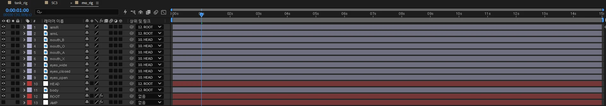
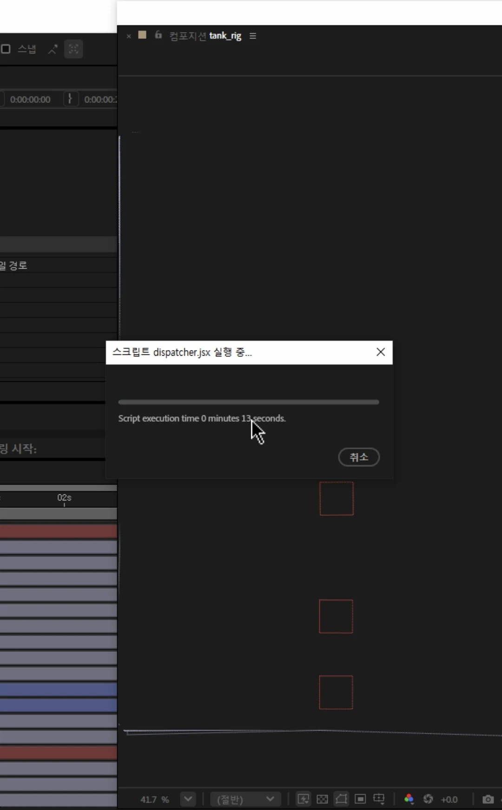

لا أعرف رسم الرسوم المتحركة، لكنني فتحتُ مع الذكاء الاصطناعي قناة شورتس لحكايات متحركة. اسمها Tiny Tale Troupe: خمس شخصيات ثابتة تؤدي حكاية شعبية مختلفة في كل حلقة. الشخصيات مرسومة بالكود، والحركة من تحريك After Effects، والخلفيات مصنوعة بـGemini.

<small>مشهد من الحلقة 1 «الفأس الذهبية». الخلفية من Gemini، والشخصيات مرسومة بالكود ومحرّكة في After Effects</small>

الحلقة 1 هنا: [Tiny Tale Troupe الحلقة 1](https://youtube.com/shorts/Rechu83_CdA)

## خمسة ممثلين وقصة مختلفة كل مرة

استعرتُ الفكرة من South Park. الممثلون أنفسهم يغيّرون الدور والزي فقط ليؤدوا حكاية مختلفة، ويسأل السطر الأول والأخير «ماذا كنت ستفعل؟». لا أحتاج إلى تصميم شخصيات جديدة، ويتعلق المشاهدون بها.

<small>الأبطال الخمسة. من اليسار: مو، بابا، نانا، كيكي، تانك</small>

| الشخصية | المظهر | ماذا تمثل للمشاهد |
|---|---|---|
| مو | شاب نحيل في العشرينات، شعر مدبب، سماوي | «أنا». إنسان عادي: طيب، لكنه يكره الخسارة ويتأثر بالإغراء |
| بابا | رجل بدين في الأربعينات، أصلع بشارب، بنفسجي | من تشاهده وأنت تشتمه. الشرير، الملك، الغني |
| نانا | جدة منحنية في السبعينات، عصا، أخضر | من تضع الاختبار. الحكيمة، الساحرة |
| كيكي | فتاة في العاشرة، ضفيرتان، أصفر | تخدع بابا بذكائها فتريح المشاهد |
| تانك | امرأة طويلة في الثلاثينات، شعر أحمر قصير، أحمر | القوة والقواعد. جدار، أو حليف غير متوقع |

جعلتُ العرق والعمر وشكل الجسم مختلفة عمدًا، لأن القناة موجهة لمشاهدين من كل العالم.

## صور الذكاء الاصطناعي أعطتني شخصًا مختلفًا كل مرة

في البداية أردتُ توليد الشخصيات بالذكاء الاصطناعي أيضًا. على Higgsfield استخدمتُ Nano Banana Pro لصنع ثلاث صور لبابا، مع تغيير درجة البساطة فقط.

<small>ثلاث صور لبابا من الوصف نفسه مع تغيير البساطة فقط (مولّدة بالذكاء الاصطناعي)</small>

لم تكن أي منها سيئة. المشكلة أن **الصور الثلاث كانت لثلاثة أشخاص مختلفين**. حتى بالوصف نفسه، يعطي التوليد التالي شخصية أخرى. هذا لا يصلح لقناة يجب أن يظهر فيها الممثلون أنفسهم كل حلقة. كتبتُ «mitten hands» لأقصد يدًا بلا أصابع، فألبسه قفازات برتقالية حقيقية، وكان ذلك مضحكًا.

وكانت الثلاث معقدة جدًا للتحريك أيضًا. كان المطلوب مستوى South Park: جسم كتلة واحدة، عينان بيضاوان كبيرتان، فم خط واحد، والتمييز بالشعر والقبعة واللون فقط. لذلك بدل أداة رسم، رسمتُ ملفات SVG مباشرة بـPython. بلا رصيد، والشخصية نفسها كل مرة، ويمكن تبديل التعابير والقبعات كقطع غيار.

## لا تتحرك إلا بعد تقطيعها أجزاءً

الاختبار الأول جعل صورة كاملة واحدة تقفز فقط. بدا الجسم وكأنه يرتجف بشكل غير طبيعي. درستُ تحريك الرسوم المقطوعة من جديد وقسّمتُ كل شخصية إلى أجزاء.

<small>شخصية واحدة مقسمة إلى ساقين وجذع ورأس وذراعين وعينين وأفواه</small>

كل جزء في مكانه على اللوحة نفسها، فتكديسها يعيد الرسم الأصلي. الذراعان تدوران عند الكتف، والرأس عند الرقبة. هناك أربعة أفواه: مغلق، مفتوح قليلًا، مفتوح واسعًا، ومستدير.

<small>للالتفات يُستبدل الرسم كله. المنظر الخلفي بلا عينين ولا فم</small>

التقسيم يصنع وصلات. ارفع الذراع فينفتح الكتف، أمِل الرأس فتطفو الرقبة. جعلتُ أطراف المفاصل مستديرة لتتداخل، ثم جمعتُ كل الأذرع والرؤوس عند أقصى دوران في ورقة واحدة لأفحص الفجوات.

<small>ورقة فحص بأذرع ورؤوس مدارة لأقصى حد للتأكد من أن الوصلات لا تنفتح</small>

## لماذا انتقلتُ إلى After Effects

في البداية كنتُ أصيّر الحركة بالكود أيضًا وأجمعها في Premiere. لكن تبيّن أن أداء الشخصية أهم من الصوت. تبدو الشخصية حية حين يطابق الفم الكلمات، وتمتد اليد عند الكلمة المؤكدة، ويهتز الرأس عند «لا». وضع إطارات مفتاحية لذلك في Premiere مشهدًا بمشهد يعني عشرات استدعاءات الذكاء الاصطناعي لكل مشهد.

في After Effects، بعد بناء الهيكل مرة واحدة، تتولى التعابير البرمجية الباقي. الآن أُدخل تسجيل الحوار ونصه فقط، فيحدث هذا:

| الجزء | ما يحدث تلقائيًا |
|---|---|
| الفم | يختار واحدًا من أربعة أفواه حسب تهجئة كل كلمة، ويتبدل قبل الصوت بنبضة واحدة |
| العينان | ترمشان قبل الكلام مباشرة، وبعد الانتهاء، وكل 3 ثوانٍ تقريبًا أثناء الاستماع |
| الرأس والجسم | عند no أو not يهز الرأس ويميل للخلف، وعند علامة الاستفهام يميل الرأس |
| الذراعان | عند كلمات مثل this وmine وyou يشير نحو الطرف الآخر، وعند علامة التعجب يرفع الذراع عاليًا |

<small>الهيكل في خط زمن After Effects. طبقات الذراعين والفم والعينين والرأس مربوطة بـHEAD وROOT</small>

<small>سكربت أرسله Claude يعمل داخل After Effects، والأجزاء تُحمّل في تركيبة tank_rig</small>

<small>سطر واحد مقطّع إلى سبع لحظات. العينان تغمضان وتنفتحان، الأفواه تتغير، والذراع تمتد عند كلمة إشارة</small>

كل ما أقرره في كل حلقة سطر واحد لكل مشهد: من يقول أي حوار. الحركة مقطّعة 15 مرة في الثانية. الحركة المتقطعة قليلًا عن قصد تناسب هذا الأسلوب. After Effects موصول بـClaude عبر MCP، الذي يشغّل السكربتات ويجمع المشاهد.

## تركتُ الخلفيات لـGemini

الخلفيات لا تحتوي على أشخاص، لذا يتقنها الذكاء الاصطناعي. وصفتُ المشهد لـGemini، ثم طلبتُ في المحادثة نفسها «أبقِ التخطيط وبسّط أسلوب الرسم فقط»، على خطوتين. خرجت بركة الحلقة 1 مناسبة من المحاولة الأولى.

وكانت هناك أخطاء أيضًا. «بسيط، 10 ألوان» جعلها باهتة، و«أغراض كثيرة وإحساس معيشي» جعلها كالصورة الفوتوغرافية. الآن أرفع صورة حديقة جيدة واحدة وأكتب «بأسلوب الرسم نفسه تمامًا كالصورة المرفقة»، ثم أذكر المكان وخمسة أو ستة أغراض فقط. أطلب ترك 40% السفلى أرضًا فارغة، لأن الشخصيات تقف هناك. علامة نجمة Gemini في الزاوية السفلية اليمنى أزيلها بـPython.

## أربع حلقات حتى الآن

<small>قناة Tiny Tale Troupe</small>

رفعتُ أربع حلقات: الفأس الذهبية، عازف المزمار، موجينا، وكيس الحكايات. لم أرسم صورة واحدة بيدي، ومع ذلك خرجت رسوم متحركة تتكلم فيها الشخصيات وتشير. تساءلتُ إن كان شيء كهذا ممكنًا بالذكاء الاصطناعي، وهو ممكن فعلًا. لكن البنية التي تسمح لي بإعادة استخدام الشخصيات نفسها كانت أهم من ذكاء اصطناعي يولّد الصور.
