tvN's 100 Days of Lies only makes sense if Lee Ga-gyeong (Kim Yoo-jung) dies in episode 2, so I stopped watching after episode 2.

It is tvN's 20th-anniversary special, starring Kim Yoo-jung, Park Jin-young, Kim Hyun-joo, Lee Moo-saeng and Jin Seon-kyu.
It is directed by Yoo In-sik of 'Extraordinary Attorney Woo' and written by Ryu Bo-ri of 'Do You Like Brahms?'.
With that lineup, I couldn't help having high expectations.

Let me say this first.
If I get this sharp, I have no comeback when someone says "So how good are your own videos?"
The broadcast slot was probably fixed first, with pressure to fill in the details during shooting.
A scene the writer wanted cut may have been pushed through from above, and the directors and actors probably felt the awkwardness while filming.
I also know the people who made it likely felt its shortcomings more than anyone.
Still, as a viewer and as someone who does the same kind of work, I want to write down what I felt, carefully but honestly.

The scene illustrations in this post are real screenshots redrawn in a Korean ink-wash style with Gemini.

## Backstory announced in dialogue instead of shown

Around 18:28 in episode 1, Ga-gyeong's past comes out in a string of lines.

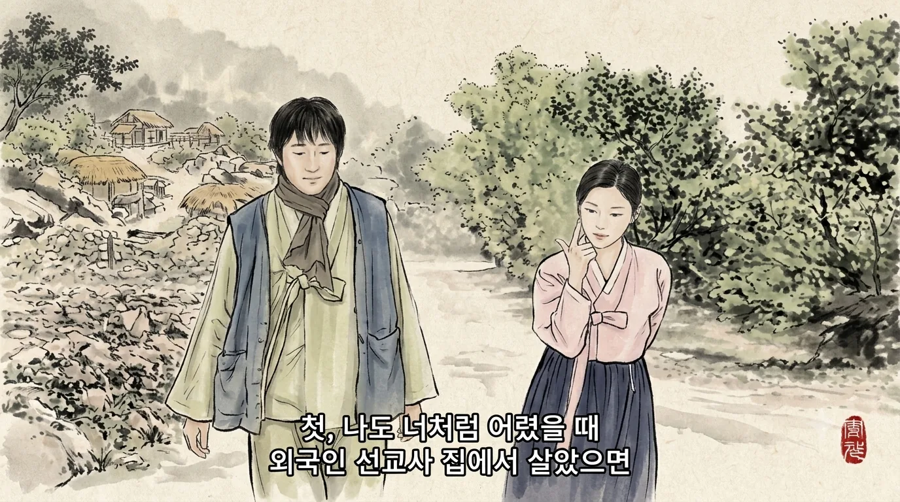

"If I had lived in a foreign missionary's house when I was young like you…", "I got framed for stealing food and beaten…", and then "I really did steal that bread back then."

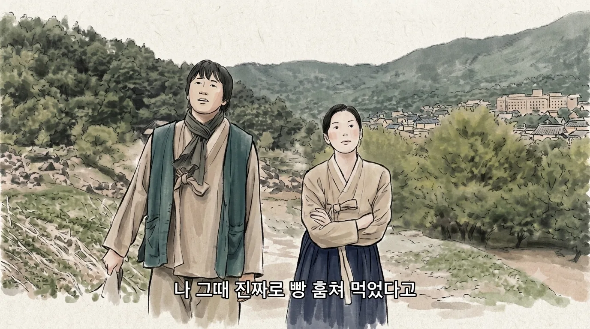

I understand they wanted to give her the character of a quick-witted kid who survived on lies and acting.
The problem is that they did it the flattest way possible: with dialogue.
Thirty seconds of young Ga-gyeong actually stealing bread and crying her way past the adults would have made her far deeper.

At 22:52 comes the line "Three years ago you stole my money to stow away on a ship and ran off…"

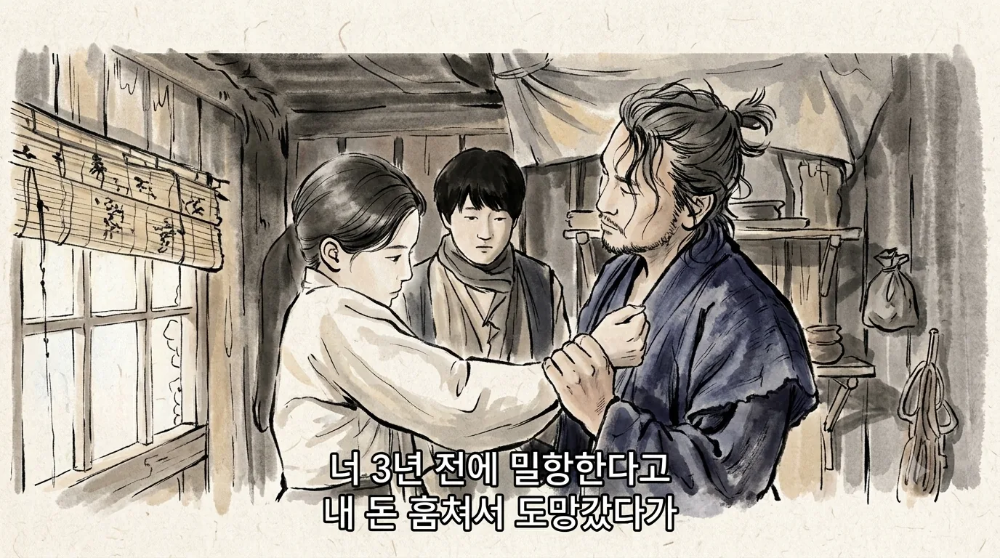

To convince us she has a dream of leaving, they need to show something, a flashback or an action.
Shouting "Economy, recover!" doesn't revive the economy, and one line of dialogue doesn't create a character.

On the other side there is The Outlaws.
Ma Seok-do (Ma Dong-seok) first appears in the middle of a street where many Korean-Chinese live, where men are facing off with kitchen knives.
Ma Seok-do is on the phone handling work, steps in front of them and tells the person on the line, "The kids are fighting."

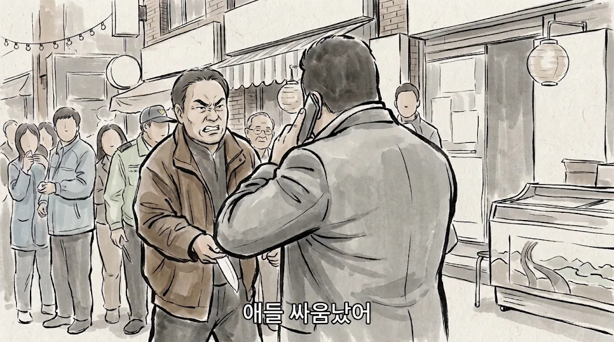

A scene with kitchen knives flying is, to him, just kids fighting.
He says it offhandedly, and the impact is huge.
Without even hanging up, he settles the whole thing.

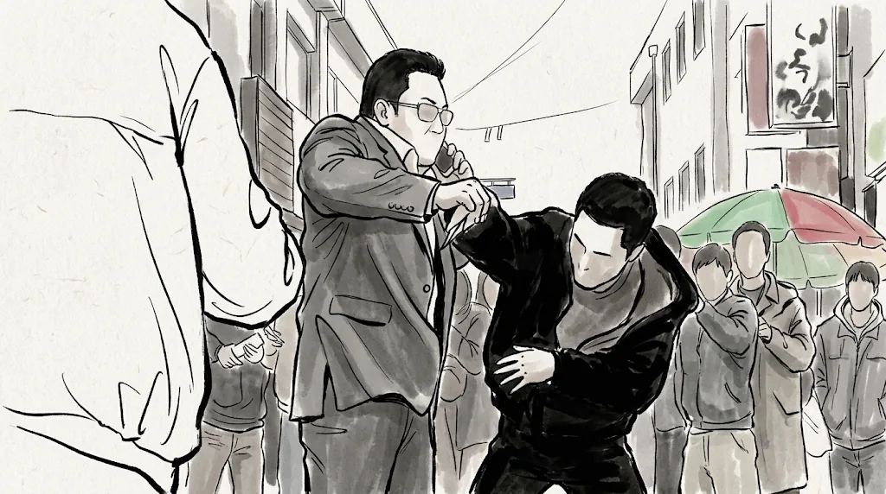

He doesn't beat anyone up, and nobody tells us he is tough.
Yet the audience believes it immediately.

If this drama's writers had written The Outlaws, it would probably have gone like this.

> Junior detective: Wow, boss! I heard you've already locked up ten robbers this month alone! You'll get the best violent-crimes detective trophy again this year, just like last year!
> (Ma Dong-seok grins. End of scene.)

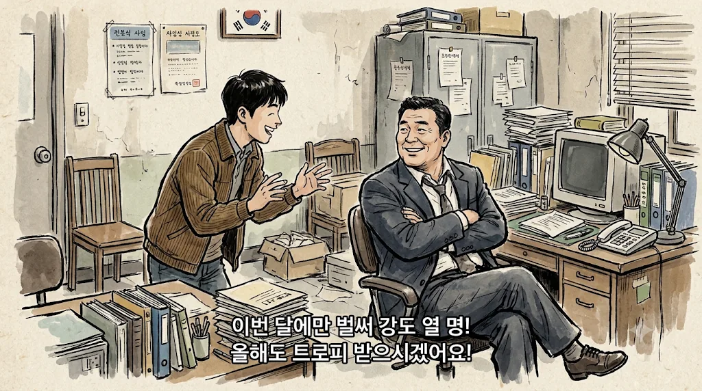

And the trophy scene never comes.
It feels like they rush through exposition and characterization like homework, tick "setup delivered" and move on. That is why I dislike this kind of directing.
Maybe they are saving the stowaway story to unpack properly later, but somehow I think that one line is all there is.

The belly wrap at 28:31 in episode 1 is the same.
Independence activist Yoo So-ran (Kim Hyun-joo) simply says it herself: what's in her belly is not a baby but a wrap, "I'll keep wearing this wrap."

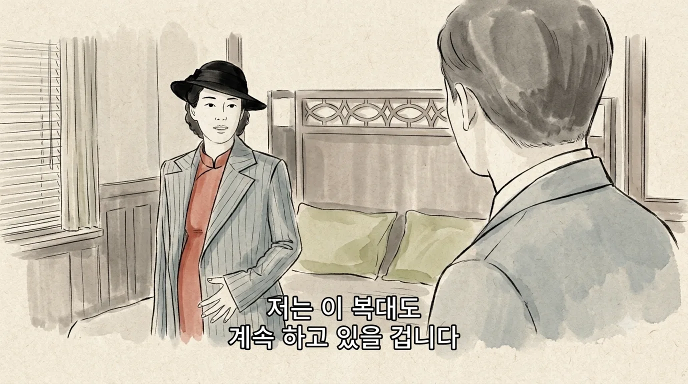

Just showing her smoking a cigarette or tipping back a drink would have let us notice on our own: "Wait, is there nothing in there?"
Since they went out of their way to point it out, I assumed she was hiding a weapon or documents in it.
But it's just a wrap, and the wrap itself is barely shown on screen.
You could call it a way of honoring a lost child, but in the end it looks like they saved on pregnancy makeup by covering it with a line.

## Japanese security that suddenly disappears

Around 52:32 in episode 1, Political Affairs Superintendent Sato Shinichi (Jin Seon-kyu) arrives escorted by several cars.

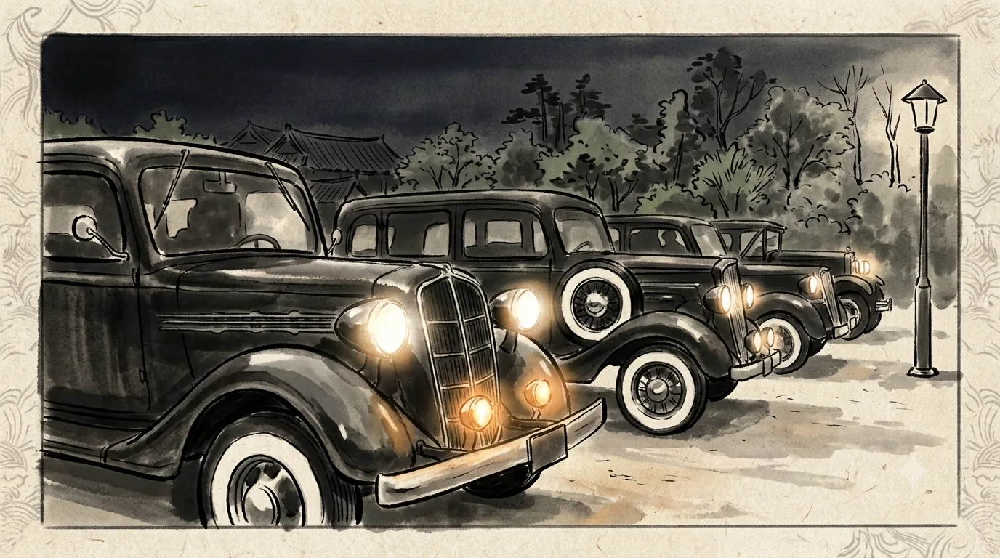

But after a gunfight breaks out inside the house, at 14:30 in episode 2 they send him off alone in a single car because he is angry.

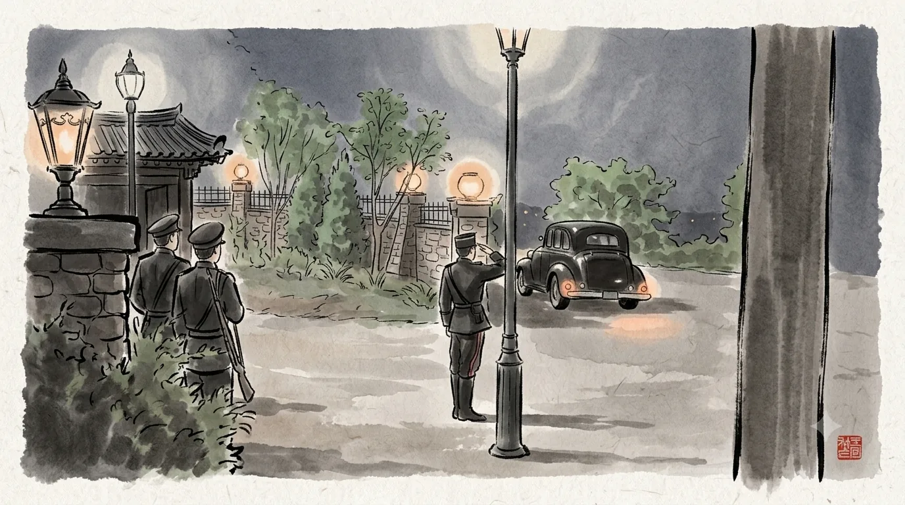

Nobody knows how many accomplices are outside or whether there is a bomb.
That the organization guarding the number two of the Government-General doesn't find this strange is the strangest part.

The gunfight itself is the same.
The first shot rings out at 2:02 in episode 2, and the guards break in through the window at 6:54.
In those roughly five minutes, 22 bullets are fired.

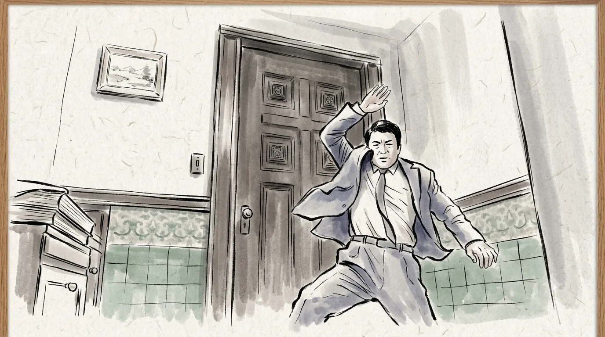

The person inside is their highest superior.
Yet the guards just bang on the door from outside.
Guards politely knocking whether their boss dies or not. For five straight minutes all I thought was, "Shouldn't they be breaking the door down by now?"

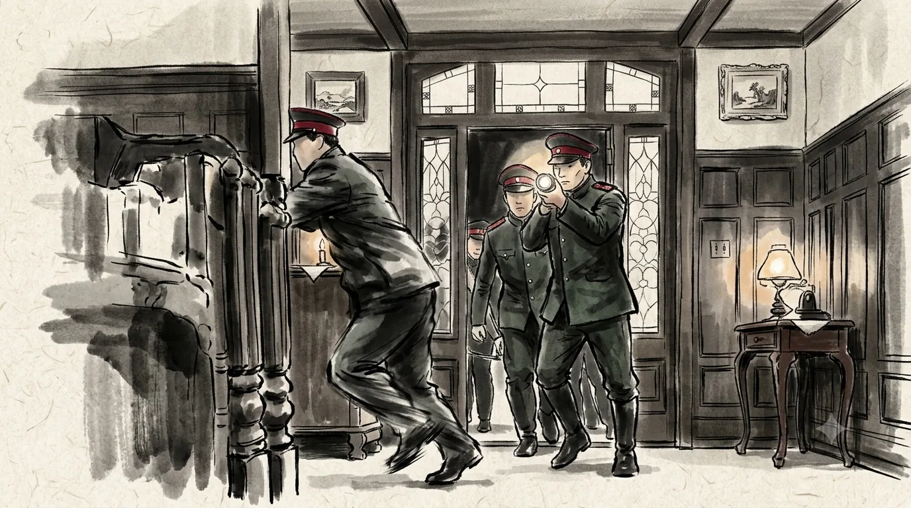

## Independence fighters dragged around by a petty thief

An organization that kills people for the country's independence lets Lee Ga-gyeong, an outsider who learned who they are, live.
And she openly says, "It's not like anyone is paying me."

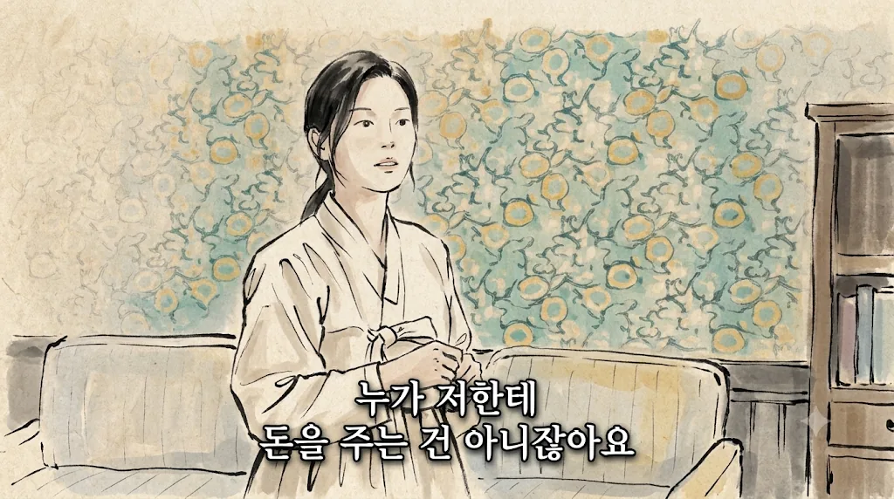

When secrecy is everything and the whole operation is at stake, this makes no sense.
That is why I said this story only makes sense if Ga-gyeong dies in episode 2.

Ga-gyeong steals the independence fighters' bullets, then walks into their hideout to sell them back.
While openly saying she stole them.
Around 59:17 in episode 1 she even taunts Yoo So-ran: "I'll scream and make a scene."

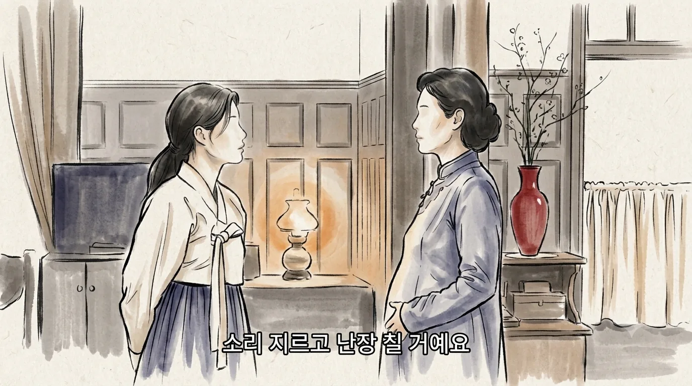

There are plenty of ways to subdue her without a gun.
In fact, later on, when an independence fighter points a gun at her from behind, only then does she get scared.
A petty thief taking control in front of people who have put their lives on the line for their country felt like it treated the independence fighters far too lightly, and it bothered me.

The gunfight earlier is the same.
The one who fired shots and caused chaos in that house is Yoo So-ran's ex-husband.
He is also an independence fighter, but he seems to belong to a different independence group, not Yoo So-ran's.
I understand the setup that there are several groups that move separately and can't communicate with each other, but the way it is shown makes the independence fighters look far too foolish.

## My bar is high because of Mr. Sunshine

I think I got this sharp because of Mr. Sunshine.
That drama had no flat characters, and it lacked nothing in period detail, psychology, directing or story.

On top of that, 100 Days of Lies seems to want to tell a similar story.
Eugene Choi (Lee Byung-hun) had never thought about independence, but he slowly gets drawn in by people who throw away their lives simply because they were born in Joseon, and ends up on that path himself.
Lee Ga-gyeong, a pickpocket whose dream is to save money and leave for America, will probably walk that path too.
Same era, same subject, a similar character arc, so I couldn't help holding it to a sharper standard.

Between the backstory told in dialogue and the scenes that don't hold together, I just can't take it anymore.
So I turned it off after episode 2.
