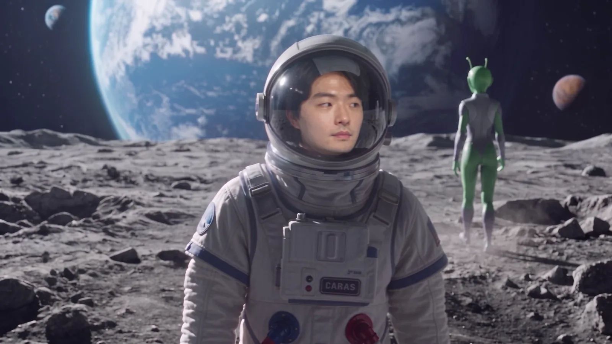
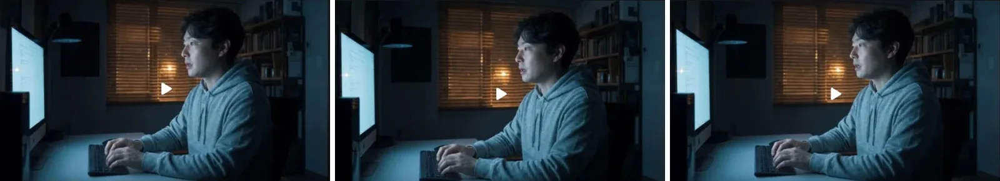
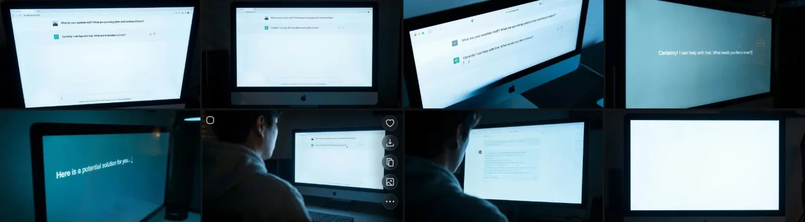
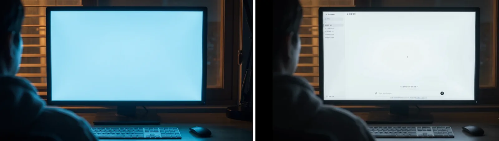
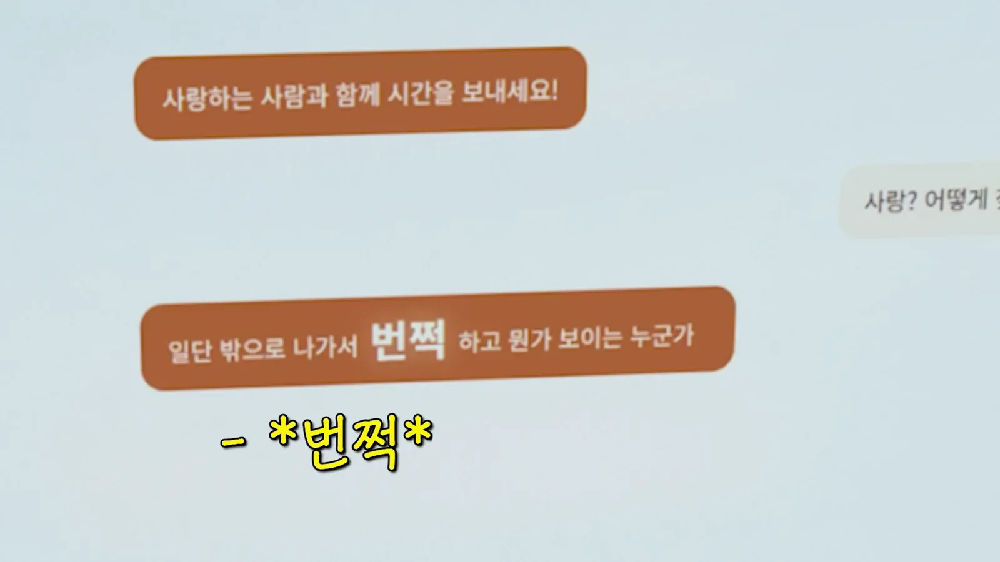
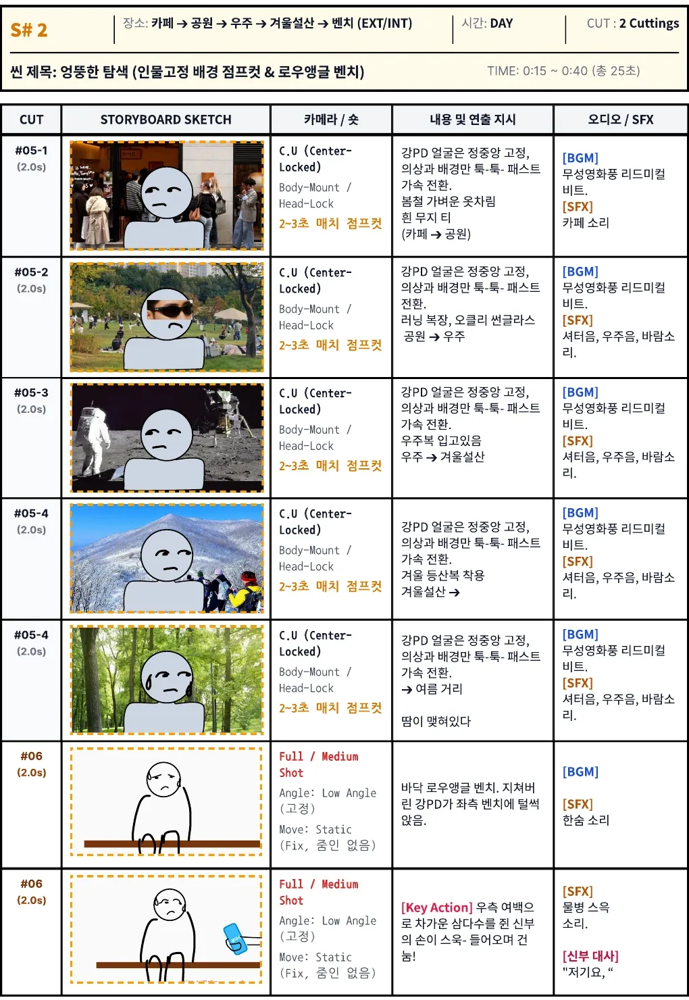
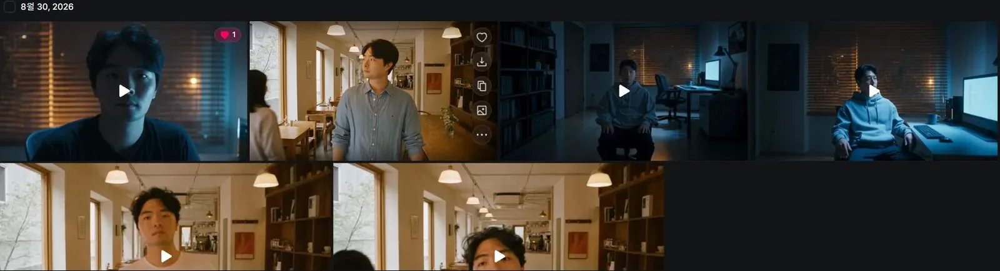
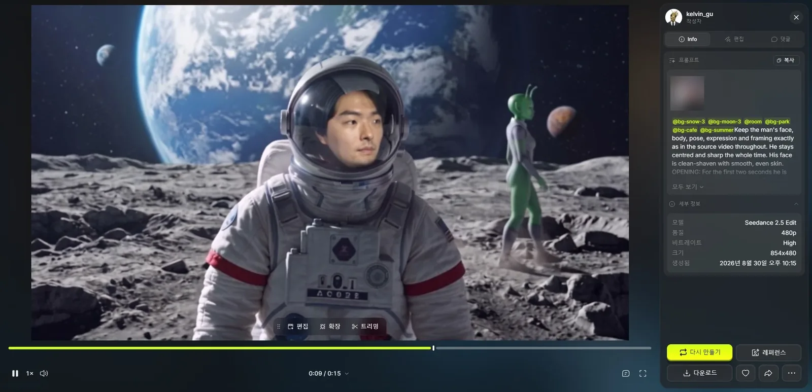
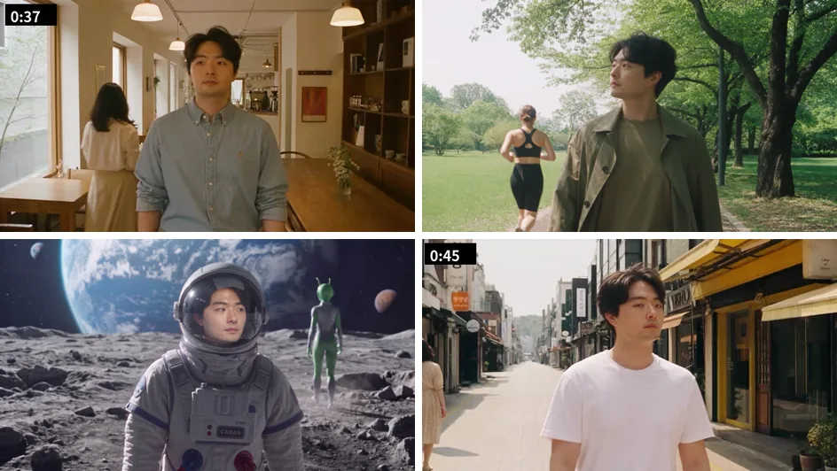

For the S#1 workroom in our wedding film I made three shots in Cinema Studio and composited only the monitor screen from HTML. For the S#2 wandering scenes I reran a 15-second GoPro selfie clip through Seedance 2.5 Edit six times in one day.

In [part 1](/en/posts/higgsfield-wedding-film/) I covered the storyboard and the Higgsfield prep. Part 2 covers what comes after the opening, up to about 47 seconds into the film. For the generation records I went through the video detail pages on my Higgsfield account one by one and checked the model, resolution, time and prompt.


<small>0:41 in the final cut. The moon, from the wandering scenes (AI-generated). The walk and expression are straight from my GoPro footage</small>

## Three workroom shots in Cinema Studio

S#1 is the workroom at night. The storyboard had it at 15 seconds, 0:00 to 0:15, but with the Beat motorcycle opening in front (that's in [part 1](/en/posts/higgsfield-wedding-film/)) and a longer conversation, it ran to 0:35 in the final cut.

As I wrote in part 1, I started the workroom images on August 29. First the location image, then an image with me sitting in it, then I animated that image. For the animation step I used Higgsfield's Cinema Studio. It's a video model where you pick a camera, lens, aperture and genre to shoot like a movie.

| Generated | Resolution | What it shows |
|---|---|---|
| Aug 31, 01:03 | 1080p | Typing, seen from the side, saying "AI, what's the surest way for a person to be happy?" |
| Sep 2, 01:27 | 1080p | Regenerated with the same line |
| Sep 2, 01:29 | 1080p | "Love? How do I find someone like that?" |

The settings were the same for all three. 8 seconds, camera Modern, lens Halation Vintage, aperture f/1.4, genre Drama 2020s.


<small>Left is from August 31, middle and right from September 2, all Cinema Studio</small>

In the credit table from part 1, Cinema Studio cost 20 to 72 credits a run. For 8 seconds, 720p was 20 and 1080p was 45 to 72. I went straight to 1080p for all three, with no 480p test.

## In the end I composited the monitor screen from HTML

The real star of the workroom scene is the monitor. The screen where the AI answers how to be happy has to be readable for the story to move. I tried twice to make that screen with AI.

At 01:37 on September 2 I made one 480p video with Seedance 2.5. The prompt, in Korean, asked for "a conversation with AI on screen like the example photo," "in light mode." Then on September 6 I went at it again with images. At 1:31 p.m., and again between 4:17 and 4:26, I made several images with Nano Banana Pro and Seedream 5.0 Pro to "close up on the part of this monitor with the AI's answer." At 4:28 I also tried Angles once, which changes the camera angle.


<small>Monitor close-up attempts on September 6. The text came out in English or mushy, and the last one is a blank screen</small>

None of it was usable. The text on screen was English, not Korean, and even then it was nonsense like "What are your question stuff?" The closer the shot, the mushier the letters. Every line on this screen had to match the captions, so roughly similar letters weren't good enough.

So I changed approach. **I made the monitor a blank screen, built the chat screen separately in HTML, recorded it, and composited it onto the monitor in Premiere.**


<small>Left is the blank monitor I made for compositing (AI-generated), right is the result with the HTML chat screen on it</small>

In the final cut the screen flows like this. The AI answers "Spend time with someone you love!", I type "Love? How…", three dots blink, and then: "First, go outside and someone will show up who makes something flash before your eyes! Go meet people."


<small>0:31 in the final cut. The "flash" comes back later in the bench and wedding hall scenes</small>

The storyboard line was "Go outside. When you meet your true match, something will flash before your eyes!" In the final cut it became chat-style. With HTML I just type the text, so changes like this cost no credits.

## The wandering scenes started from a GoPro selfie

S#2 is a 25-second scene the storyboard called "the odd search." Kang PD goes outside as the AI said and wanders through odd places looking for the flash.

I had two reasons for including it.

| Reason | What it does |
|---|---|
| The feeling of searching for the flash | It gives the sense of roaming around looking for the "flash" the AI talked about |
| Reminding everyone it's AI | Hiking a snowy mountain, a spacesuit on the moon, an alien walking by: nobody could really film these. It's the stretch where the screen says "This is AI, don't be confused" |

The second reason turned out to matter more than I expected. After the film, quite a few older guests asked when I had found the time to go film all of this. Many of them thought I had actually shot it. That's how hard AI video has become to tell from the real thing. **A video made with AI needs a stretch where it's clearly recognizable as AI.** This scene played that role.


<small>S#2 storyboard. The face stays locked in the center of the frame, and only outfit and background switch every 2–3 seconds</small>

| Cut | Location | Outfit | Sound |
|---|---|---|---|
| #05-1 | Cafe → park | Light spring clothes, plain white tee | Rhythmic silent-film beat, cafe noise |
| #05-2 | Park → space | Running gear, Oakley sunglasses | Shutter sound, space sound, wind |
| #05-3 | Space → winter snowy mountain | Spacesuit | Same |
| #05-4 | Winter snowy mountain → summer street | Winter hiking gear | Same |
| #05-4 | Summer street | Beads of sweat | Same |
| #06 | Low-angle bench from the ground | Exhausted, flops onto the bench on the left | A sigh |

For the camera, the storyboard said "C.U (Center-Locked), Body-Mount / Head-Lock." The face is pinned to the center of the frame as if the camera were strapped to the body, and only the world changes. If I made that from scratch with AI, the face's position and size would differ from place to place. So I shot it myself.

I filmed 15 seconds of selfie footage walking with a GoPro. I put that clip into Seedance 2.5 Edit. Edit keeps the motion of the source video and redraws only what the prompt specifies, so the walk, expression and camera shake stay as they are and only the background and outfit get swapped. For locations I called the location elements from part 1 (@bg-cafe, @bg-park, @bg-moon, @bg-snow, @bg-summer). The source clip shows the inside of my home, so I didn't include it here.

## Seedance 2.5 Edit, six runs on August 30

I generated the wandering scene six times on August 30, from 6 p.m. to just before 11 p.m. Five were 480p tests, and only the last was 1080p.


<small>Seedance 2.5 Edit history on August 30. Thumbnails are first frames, so the earlier ones start in a cafe and the later ones in the workroom</small>

| Version | Generated | Resolution | What changed |
|---|---|---|---|
| v1 | 18:10 | 480p | Called five location elements and wrote only a timed cut list like "0.0s cafe white tee → 1.6s park running gear → 3.2s moon spacesuit…" |
| v2 | 19:30 | 480p | Added "the camera is handheld and walks with him; background and person share the same camera movement" |
| v3 | 21:17 | 480p | Added the workroom element (@room) so he sits in the workroom for the first 2 seconds and then stands. Added "reference images are for environment, lighting and clothes only; do not copy the person" |
| v3 again | 21:22 | 480p | Regenerated with the same prompt |
| v4 | 22:15 | 480p | Rewrote the full 15 seconds as a timeline (below) |
| v4 final | 22:41 | 1080p | Swapped the snowy mountain and moon elements to @bg-snow-5 and @bg-moon-4 for the final |

v1 was a cut list. Just what second, where, and what outfit. v2 added one line on camera movement. A selfie cam shakes with every step, so the instruction was to move the background with the same shake so it reads as one frame.

The 2 seconds of getting up in the workroom in v3 were the bridge from S#1 to S#2. "Do not copy the person" narrowed what to take from the location references to environment, lighting and clothes.

For v4 I rewrote the prompt from scratch. The opening that's still on the detail page:

```
@bg-snow-3 @bg-moon-3 @room @bg-park @bg-cafe @bg-summer
Keep the man's face, body, pose, expression and framing exactly
as in the source video throughout. He stays centred and sharp
the whole time. His face is clean-shaven with smooth, even skin.
OPENING: For the first two seconds he is ...
```


<small>The v4 480p detail page. Model, resolution, size and time stay in the right panel. I blurred the source video thumbnail in the panel</small>

Split by item, the v4 instructions were:

| Item | Instruction |
|---|---|
| Face | Face, body, pose, expression and framing exactly as in the source. Centered and sharp to the end. Clean-shaven smooth skin |
| Opening | Sits in the monitor's light, stands up at 2 seconds. Camera stays at eye level, no low angle |
| Location changes | Hard cuts between five locations after 4 seconds. I set a time for each location |
| Clothes and light | Separate outfit and lighting for each location |
| Gaze | "Searching for the flash." Looks around left to right only twice |
| Passers-by | In each location a woman passes by, seen from behind. A different person every time, no men |
| Walk | A walk that gets more tired with each location |

The final 1080p run was 132.73 credits. As I noted in part 1, I matched that figure by transaction time, and 480p tests started at 19.26 credits, so this one run ate most of the six. By the transaction history, close to 300 credits went out on August 30 alone.

## A little over 10 seconds in the final cut

The most fun part of the results was the passers-by. In the cafe a woman walks past from behind, in the park a woman in running gear jogs by. On the moon a green alien walks past. The prompt only said "woman, from behind," but as I said earlier, the alien is a device that makes it obvious this is AI, so I kept it.


<small>From top left: cafe, park, moon, summer street (AI-generated). The face position is exactly as in the original selfie footage</small>

In the final cut the wandering scenes start in the cafe at 0:36, pass through the park, moon, snowy mountain and summer street, and end around 0:47. The storyboard's 25 seconds shrank to a little over 10. The storyboard's last cut, #06, flopping onto the bench, hands off to the bench scene I made separately in part 3.

If I made the same scenes again, I'd do this.

| What to do | Why |
|---|---|
| Composite any screen with readable text from the start | I went at the monitor with AI twice, on September 2 and September 6. A screen where the text has to be exact couldn't be nailed by generation |
| Use a timeline from v1 | Going from a cut list to a timeline took four runs. Writing what happens at each second and how the camera moves from the start cuts down on tests |
| Write each reference's role into the prompt | I only wrote what to take from the location images in v3 |

Part 3 is the bench scene. How I ran one high-angle shot seven times, how I pulled the low-angle water bottle shot eight times on September 6 alone, and the prompt principles that set in along the way.
