When putting my face into AI video, **one reference photo matching the shot's angle looked far more like me than a character loaded with front, side, up and down photos.** A face that's small and far away didn't come out well either way.

I learned this on the bench scene of our wedding film. I ran one high-angle image seven times, and generated the low-angle shot of being handed water eight times on September 6 alone. I struggled this much because the low-angle composition was hard to describe in words, and the more I reran it, the less the face looked like me. Prompt principles like using frame ratios instead of meters also set in on this scene.

[Part 1](/en/posts/higgsfield-wedding-film/) was the storyboard and prep, [part 2](/en/posts/higgsfield-wedding-film-2/) the workroom and wandering scenes. Part 3 covers roughly 0:47 to 1:04 of the final cut, where I sit down on a bench worn out from wandering and my wife hands me water. I checked the videos on the detail pages in my Higgsfield account, and the seven image runs in my Claude conversation from August 31.

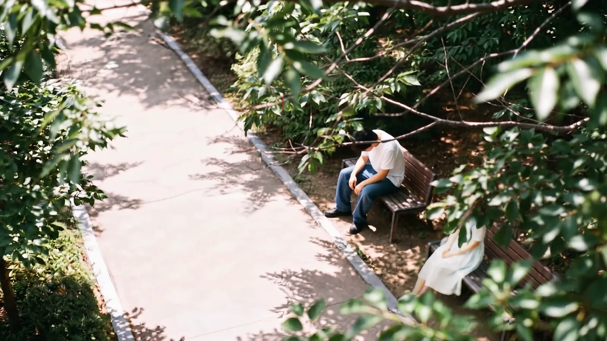
<small>0:50 in the final cut. The bench seen from a high angle (AI-generated). Getting this one composition took seven runs</small>

## Three cameras for the bench scene

In the storyboard the bench is the last cut of S#2 (#06) and the start of the S#3 meeting. Worn out from wandering, I flop onto a bench, and the person sitting next to me offers a water bottle. That person is my wife.

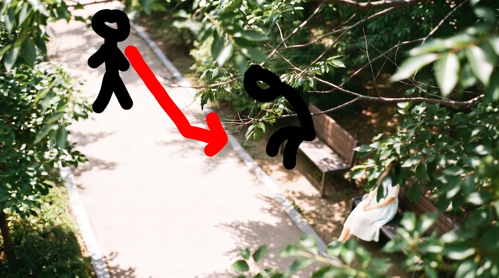
<small>Scene 3 blocking. I drew the walk from the path to the bench directly on top of an AI image</small>

I split the scene across three cameras.

| Camera | Position | What it does |
|---|---|---|
| A, high angle | Looking down from a tree | Me walking up and sitting, and my wife with her face hidden by leaves |
| B, low angle | Bench seat height | A hand holding a water bottle comes in from off screen toward me, sitting exhausted |
| C, POV | My eye level | I look at the offered bottle, look up, and my wife's face appears (#07) |

After C the storyboard numbers continue. #08 my dazed face turning, #09 a sudden zoom into the eye, #10 the montage inside the eye, #11 zooming back out to a smiling face. The #10 montage is our real photos, so it's not included here.

In A I hid my wife's face with leaves, so her face would first appear in C, right after the bottle.

## Seven runs for one high-angle image

For shot A I made the image first. The order was: lock the image, then make the video with it as the first frame. I generated the image with Nano Banana Pro. In the early hours of August 31 I ran it about seven times in one conversation.

| Run | What I changed | Result |
|---|---|---|
| 1 | Put the previous day's result in as a reference and asked for four things at once: "open up the path, cover the bride with leaves at top right, black hair, white dress" | Only the hair color changed. The line telling it to keep the reference as is overrode every other instruction |
| 2 | Step 1 of the two-step method. Remove the people, keep only the path and leaves | Two benches became one, the camera moved closer, and the leaves didn't cover the bench. The bench at least had to be long so there'd be room for me to sit |
| 3 | Fresh generation. Height 4 m, distance 8 m, 25 degrees, 35 mm, two benches | The two benches came out facing each other front to back. Then she couldn't hand me the bottle from the side. I needed "side by side across the frame," not "front and back" |
| 4 | One bench placed horizontally, bride at the far right of the frame, 3.5 m, 7 m, 27 degrees | The leaves still didn't cover her. The word `cover` was too weak |
| 5 | Moved the sun from behind the bride to behind the camera (front light), removed lines like "she is small" and conditionals | Front light, horizontal bench, 27 degrees all right. But each run got closer. Meters weren't working |
| 6 | Dropped the angle, kept only height and horizontal distance. 12 m, person at 1/8 of frame height, bench at 1/4 of frame width, path in the lower 2/3, leaves in the top right 1/4, "everything above her chest is behind the leaves" | Distance, position and tree were just right. The path came out diagonal and looked awkward |
| 7 | Path `roughly horizontally`, paving in a single pattern | Two benches again. I changed it to `Exactly one bench`, and the empty seat to `wide enough for another person to sit down` |

In run 4 I changed the leaf sentence. Instead of "the leaves cover her face," I wrote it as a state: `Her face is hidden behind these leaves`. I took out words like `clearly visible`, since they could actually pull focus toward that part.

The sun position in run 5 mattered too. At first I put the sun behind my wife. But backlight is only needed in the C POV shot, where she appears blocking the sun. For A and B I switched to front light with the sun behind the camera.

The core of the run 7 prompt:

```
The camera is 3.5 metres above the ground. The horizontal distance
from the camera to the bench is 12 metres.
A paved walking path runs roughly horizontally across the frame ...
The empty path fills the lower two thirds of the frame.
Exactly one wooden park bench ... occupies about one quarter of the frame width.
... her figure occupies about one eighth of the frame height.
The left half of the bench seat is clearly empty and unoccupied,
wide enough for another person to sit down beside her.
Everything above her chest is hidden behind these leaves.
```

One thing never worked. The leaves didn't cover my wife by a single pixel. Every time they sat politely in the top right corner of the frame. The model seemed to draw the leaves as part of a background tree rather than as foreground. I also asked whether I could set the generation order, but there was no such option.

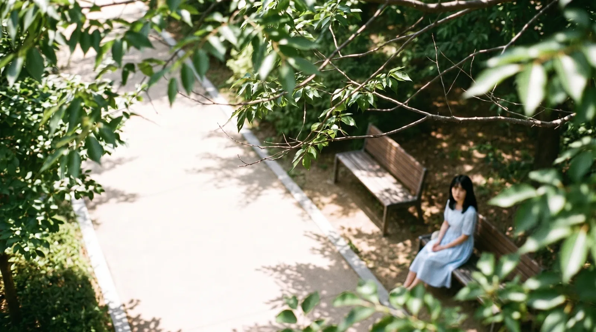
<small>The run I picked myself from the history list when I'd had enough (AI-generated). A blue dress, and the leaves don't cover her</small>

In the end I pulled up the list and picked one myself. The dress was blue, but it had the best distance, bench and path of the lot. For the leaves, I decided to lay real leaf footage over it in Premiere. I finished the chosen image in Gemini, uploaded it back to Higgsfield, and it became the first frame of the A video.

I made the video at 4:59 a.m. on September 6. Only this shot used Seedance 2 instead of Seedance 2.5. The prompt: "@강준구-cinema walks along the path and flops down on the bench, camera fixed." 1080p, and only this one run is in the history.

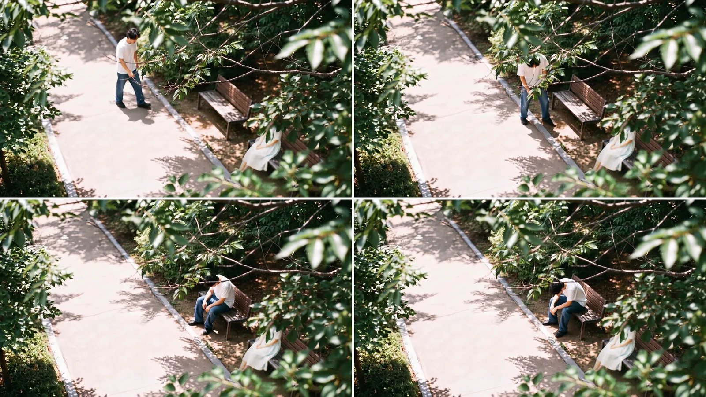
<small>0:48 to 0:51 in the final cut (AI-generated). In the final cut the dress is white and foreground leaves cover my wife</small>

In the final cut this shot runs about 4 seconds, from 0:48 to 0:51. One image that took seven runs became 4 seconds.

## The low-angle water handoff, eight runs on September 6

Shot B looks at me from bench seat height. The backrest stretches long from the right of the frame, I sit exhausted at its far end, and a hand holding a water bottle comes in from off screen right. The hand belongs to my wife, off screen, sitting at the camera end of the bench.

Right after settling A, the question of matching this space came up in the conversation. In A, my wife sits at the far right of the frame and I sit on the left. In B the camera goes to her seat and looks at me along the length of the bench. The logic holds, but viewers could get left and right mixed up.

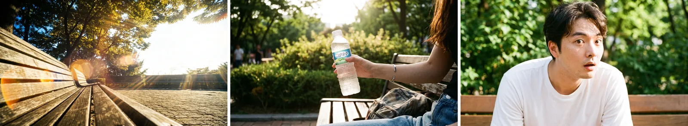
<small>Bench scene images I made earlier on August 30 (AI-generated). Low-angle empty bench, a hand with a water bottle, a surprised face</small>

I generated the low-angle video eight times on September 6, from 5 a.m. to 8:20 a.m. All with Seedance 2.5.

| Generated | Resolution | What I changed |
|---|---|---|
| 05:08 | 480p | English prompt. At 3.8–4.5 s a hand with a bottle from the right, at 4.5–5.5 s he looks at the bottle, no surprise |
| 05:45 | 480p | Regenerated |
| 05:53 | 1080p | Regenerated |
| 06:12 | 480p | Switched to a Korean prompt I wrote myself: "white short-sleeve tee, jeans… fanning his shirt as if hot… a hand offering water from the right of the frame… doesn't act surprised" |
| 06:20 | 1080p | Made the fanning "light and slow" |
| 07:26 | 1080p | Added "strictly follow the camera composition of the reference image" |
| 07:48 | 480p | Added a timeline. 0–2 s sigh, 2–6 s shirt fanning, 6–8 s hand with bottle |
| 08:20 | 1080p | Final, with the timeline above |

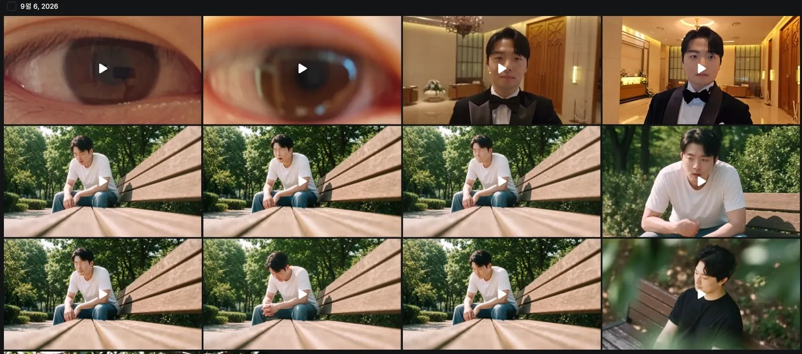
<small>September 6 history. The middle two rows are the low-angle bench shots. Same composition, but the face differs a little each run. The eye and tuxedo clips in the top row are part 4 scenes</small>

There were two reasons for eight runs. One was that the low angle itself was hard to describe. Camera at bench seat height, the backrest stretching long from the right of the frame, me at its far end, the hand coming in from off screen on the camera side. Spelling out that space in words wasn't easy. Adding "strictly follow the camera composition of the reference image" at 07:26 was an attempt to hand the composition I couldn't put in words over to the image. The other was the face. While I was fixing the timing of the hand and my reaction, the face drifted further from me with each run.

"No surprise" was in there from the first run to the last. In this shot I'm just a tired guy; the startled look belongs to #08 later.

After three runs in English I switched to my own Korean prompt. The last thing I added was the timeline. As with the wandering scenes in part 2, once I wrote what happens at which second, the hand's timing fell into place.

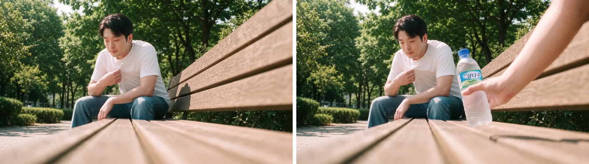
<small>0:52 and 0:54 in the final cut (AI-generated). A hand with a water bottle comes in next to me as I fan my shirt</small>

## For the face, one angle-matched photo beats a character

The biggest thing I got out of the bench scene was about face references.

On Higgsfield I had character elements bundling several photos of my face. @강준구 holds 7 photos, and the Soul character @강준구-cinema holds 17 at different angles and places like cafes, restaurants and the wedding shoot (the screen is in [part 1](/en/posts/higgsfield-wedding-film/)). You call the name in the prompt and it draws that face. The high-angle video called @강준구-cinema, and the September 6 low-angle prompts also started by calling a character, like "@char_jungu white short-sleeve tee, jeans…". Convenient, but on the bench scene it didn't work well.


<small>The Soul character @강준구-cinema with 17 photos. Adding more didn't make the face look more like me</small>

First, faces far away were a problem. In shots like the high angle, where the person is only about 1/8 of the frame height, the face didn't come out well. In the low angle, too, I'm sitting deep in the frame, so the face isn't big. On top of that, with each run the face drifted a little further from me.

So here's what I learned. Rather than calling a character that mixes many angles, putting in just one photo of my face taken at an angle close to the shot I'm making gave a much better face. Mixing angles seemed to average each one into a face that's nobody. The "angle matching" principle in [part 1](/en/posts/higgsfield-wedding-film/) came from this scene.

| Method | Result |
|---|---|
| Character element (bundles like @강준구 with 7 photos or @강준구-cinema with 17) | Easy to call. When the face is small or you keep rerunning, it gradually stops being me |
| One face photo matched to the shot's angle | Better face. Takes the effort of picking the right photo for each shot |
| A small face far away | Doesn't come out well either way. Frame shots that need a face up close |

## My POV looking at the bottle, and a face that turns only the head

Shot C (#07) I made first, in the early hours of September 2. Four days before B.

In the conversation I called this shot "water bottle POV," and that went wrong once. Claude understood it as the bottle's point of view and wrote the prompt that way. What I meant was **my eyes looking at the offered bottle**. The hand is my wife's, and the camera rising from the bottle to her face is my gaze rising. Only after fixing that did the positions of the bottle and hand line up.

I also dropped the word `soft veil`. I meant light spreading softly, but in a wedding video it risked being read as a bridal veil. For the glow I used `lens flare` and `bloom`.

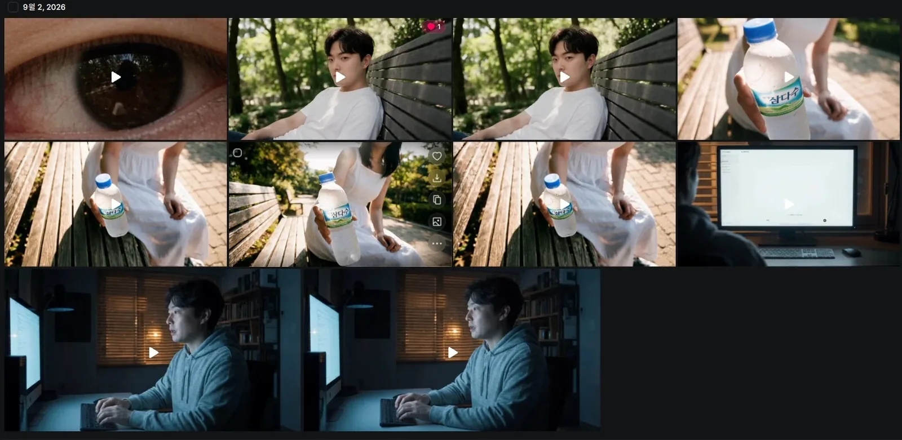
<small>September 2 history. The middle row and top right are the bottle POV shots, the middle two in the top row are my turning face (#08)</small>

I made the bottle POV shot starting from an image. My wife offering the bottle, seen from my eye level. For her face reference I put in all three photos, as I wrote in part 1.

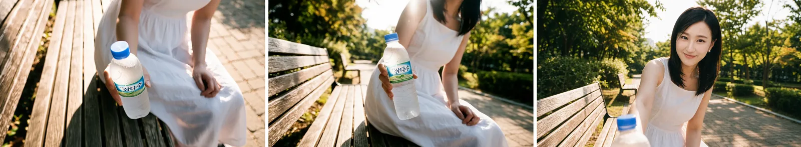
<small>The image stage of the bottle POV shot (AI-generated). The face is AI-made</small>

I made the video four times.

| Generated | Model | Resolution | What I changed |
|---|---|---|---|
| 03:06 | Cinema Studio Video | 480p | First try |
| 03:13 | Seedance 2.5 | 480p | Switched to a timeline. 0–1 s bottle, 1–2.2 s tilt up following the arm, 2.2–3.3 s backlit sun flare, 3.3–4.2 s she leans and blocks the sun, 4.2–6 s smile and line |
| 03:19 | Seedance 2.5 | 480p | Added "he is taller than she" |
| 03:25 | Seedance 2.5 | 1080p | Final |

The structure I settled on September 1 was one continuous 12-second shot. No split into two cuts: the rack focus from the bottle to my wife inside one shot, and an end frame where the flare clears and her face is sharp. The actual Seedance prompt shrank to the 6-second timeline above.

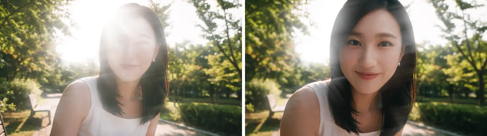
<small>0:58 and 0:59 in the final cut (AI-generated). My wife's face emerges from the flare</small>

Next is #08. I made it twice the same day at 03:47 and 03:54 with Seedance 2.5 at 1080p. The camera slowly moves in on a dazed face that has turned only its head, then at 2–3 seconds gets sucked into the eye.

The posture mattered. The torso and shoulders stay facing forward on the bench, and only the head turns toward the camera. The twist in the neck has to show. If the body turns too, he's already someone in a conversation. Only the head turning keeps it the moment he has just looked over in surprise. I wrote mouth slightly open, `not smiling`.

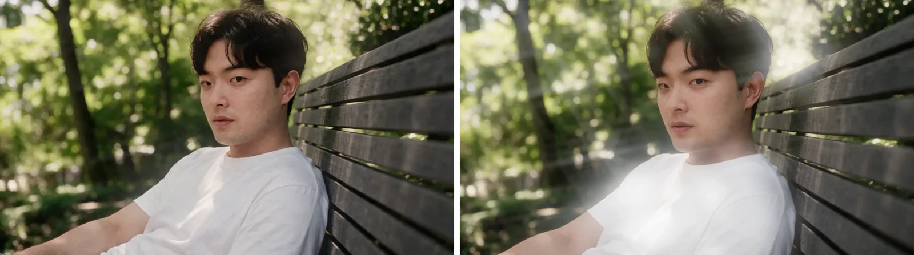
<small>1:00 and 1:01 in the final cut (AI-generated). Body facing forward on the bench, only the head turned</small>

#11 is the opposite, a zoom out from the eye. I first made it at 03:55 on September 2 at 1080p, and remade it on September 3 at 00:17 (480p), and 00:28 and 00:41 (1080p). The line is "Yes, I'd like that." His gaze isn't into the lens; it passes beside it, up and behind the camera, looking up at my wife standing there. A faint smile.

## Prompt principles that set in on the bench scene

When I opened a new chat on September 1, I wrapped up the trial and error so far as principles and handed them over. Most came from the seven high-angle runs. The eight low-angle runs came after, on September 6.

| Principle | Details |
|---|---|
| Frame ratios, not meters | Even writing 4 m, 8 m, 12 m, each run got closer. It only worked as fractions, like a person at 1/8 of the frame height and the bench at 1/4 of the frame width |
| Only height and horizontal distance | Writing height, angle and distance makes them clash. Give height and horizontal distance and the angle follows |
| Don't tell it to hide things | Stacking `not visible`, `heavily shaded`, `face is not readable` turns the whole person to mush. Write a state, like `Her face is hidden behind these leaves` |
| Foreground by distance from the lens | To keep leaves in the foreground, pin the distance from the lens, like `just 30cm from the lens, heavily blurred`. Otherwise they become a background tree |
| Path `roughly horizontally` | `diagonally` gives an in-between angle |
| No conditionals | `Two people could sit side by side` gets ignored or draws two people. `Exactly one bench`, and the empty seat as `wide enough for another person to sit down` |
| Two-step method | Use it when the reference beats the text. First make a result with the problem element removed, then use that as the reference and add only what you want. Twice the credits, but more reliable than fixing over and over |
| Merge location and person in the image | Don't throw in location and person separately at the video stage. Combine them in one image, then animate |
| Face: one angle-matched photo | One face photo matched to the shot's angle beats a character bundling many angles. Mixing angles averages them and the face collapses |

The leaf cover was the one thing these principles didn't solve. I only noted the method of pinning lens distance; in practice I finished the image stage and moved on to another approach.

If I made the same scene again, I'd do this.

| What to do | Why |
|---|---|
| Use one angle-matched photo for the face from the start | Running with character elements, the face stopped being me a bit more each run |
| Use frame ratios for composition from the start | High-angle runs 3–5 gave meters and angles, and the distance never matched |
| Fix one thing per run | Changing four things at once in run 1, only one took and I couldn't tell where the rest got stuck |
| Name each shot by whose POV it is | One phrase, "water bottle POV," threw off the bottle and hand positions. I should have written "my POV looking at the bottle" from the start |
| Use a timeline for motion | I'd already run the low angle six times before adding a timeline |
| Move what AI can't do to editing early | I only handed the leaf cover to Premiere after four failed runs in a row |

Part 4 is the wedding hall scene. The match cut where, out of the eye, I'm standing in a tuxedo in front of the wedding hall, the first frame I pulled 10 times in 3 minutes with GPT Image, putting a bow tie onto real selfie footage, and wrapping up the edit with a full credit tally.
