For the final wedding hall selfie scene of our wedding film, **after two AI-only versions I ended up putting footage of myself acting into Seedance 2.5 Edit and swapping only the outfit and location.** The opening that pulls out of the eye went inside that same shot.

[Part 1](/en/posts/higgsfield-wedding-film/) was the storyboard and prep, [part 2](/en/posts/higgsfield-wedding-film-2/) the workroom and wandering scenes, [part 3](/en/posts/higgsfield-wedding-film-3/) the bench scene. Part 4 covers 1:48 to 2:15, where the picture ends: me in a tuxedo, talking to the guests in the wedding hall lobby, then setting the camera on the floor. For the generation records I opened the image and video detail pages on my Higgsfield account one by one and checked model, resolution, time and prompt. At the end I wrote down what I thought after finishing all four parts.

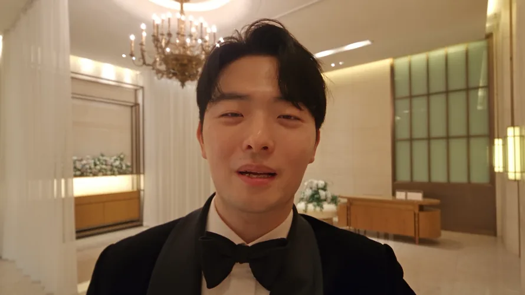
<small>10 seconds into the final selfie shot. The outfit and location were put onto footage of me actually acting, with AI</small>

## From the eye straight into the wedding hall

S#4 is the scene that links the film to reality. The on-screen me talks to the guests on a selfie cam in the wedding hall, lowers the camera, and ends with "Everyone, please turn around." When the film goes off, the real groom's entrance begins.

In the first storyboard, at the end of #11 I planned to cover the lens with my palm to black out the frame and then move to the wedding hall. I cut that. At nearly two minutes in, adding one more device would drag. I judged that a match cut straight from the smiling #11 face on the bench to me in a tuxedo would hit harder.

The handover document I made when moving Claude chats had only the conclusion "palm blackout removed," not this reason. I write about that separately below.

I drew how the camera would move inside the wedding hall directly on top of a photo I took at the actual venue.

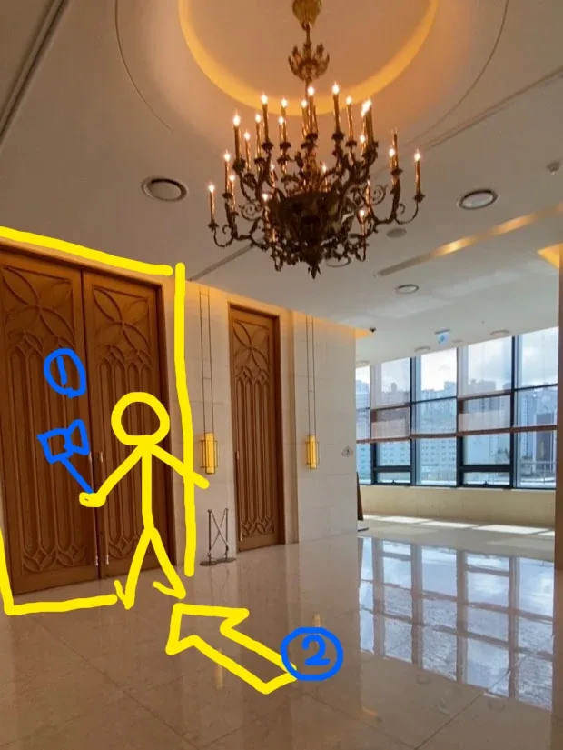
<small>Scene 4 blocking. ① is the handheld selfie cam, ② is the camera set down on the floor</small>

| Camera | What it does |
|---|---|
| ① Selfie cam | I hold the camera at arm's length, filming my face as I talk to the guests |
| ② Floor | After talking I lower the camera and set it on the floor. It faces the wedding hall doors |

This drawing didn't stay a drawing. In the final version I put it in as a reference image as is.

## From the bench smile to the AI selfie cam, September 2–3

The wedding hall scene starts at the bench. I had to make the front of the match cut first, the smiling #11 face.

From 10:41 to 11:44 p.m. on September 2 I kept generating images for this one shot. At first with GPT Image 2 (quality Medium, 1344x752). In just the 3 minutes from 10:50 to 10:53, 10 images came out. Then I tried Nano Banana Pro with one line, "a lovely smile," and pulled three more with the same English prompt. Somewhere in there is also a Seedream 5.0 Pro run where I only wrote "He's fat... make him lose some weight."

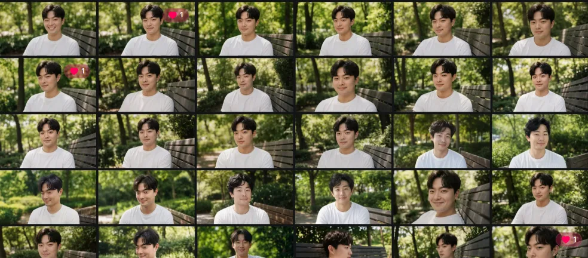
<small>Image history from the night of September 2. More than twenty smiling faces in almost the same composition</small>

I wrote the prompt by the principles set in part 3. I pinned down first that every direction is relative to the camera, then split posture, gaze, expression, face, background, light and lens into paragraphs.

| Item | Prompt content |
|---|---|
| First line | All directions are relative to the camera; frame left is the viewer's left |
| Posture | Torso turned toward the camera so the shoulders nearly face the lens, back straight, both hands on the thighs |
| Gaze | Just beside the lens, very slightly to frame right. Meeting the eyes of the person sitting there |
| Expression | Mouth closed, corners clearly lifted, crinkles at the eyes. The face of someone who has found what he was looking for |
| Face | Eye spacing, eyelids, nose, cheekbones, jawline, philtrum and lip thickness exactly as in the reference photo. `Do not average these features`; don't slim the face or smooth the skin |
| Frame | 50 mm, 1.5 m away, seated eye level, bust shot cut at mid-chest, 35 mm film texture |

In part 3, the #08 turning face kept the body facing forward and turned only the head. #11 is the opposite: the body turns toward the camera too. The startled moment has passed, and he's answering the person sitting across from him.

I made the #11 video from this image with Seedance 2.5 on September 3 at 0:17 (480p), and 0:28 and 0:41 (1080p). From a frame filled with the eye it pulls out fast for 2 seconds and stops on a bust shot, the dazed eyes sharpen, a smile spreads, and at about 3.5 seconds he says "Yes, I'd like that." The 0:41 version added "hold the smile 5.0–7.0" at the end, in Korean.

Once the smile was set, I moved the same face into the wedding hall. At 11:52 p.m. on September 2 I put a few images into Seedream 5.0 Pro (2k) as references and wrote one line: "Change into a black suit, and change the background to this location." The references were two photos of me in a suit and a photo of the wedding hall lobby.

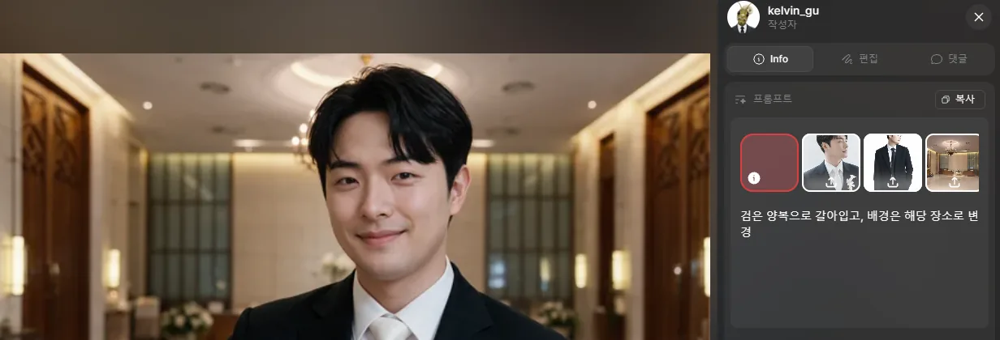
<small>Seedream 5.0 Pro. The face smiling on the bench came straight into the wedding hall lobby</small>

The expression and face angle carried over almost exactly from the bench smile. The two sides of the match cut had to line up like this. But the tie came out white. At 11:56 I put this result back in as a reference and corrected it: "wearing a black bow tie instead of a white tie" (1k). That became the first frame of the AI selfie cam.

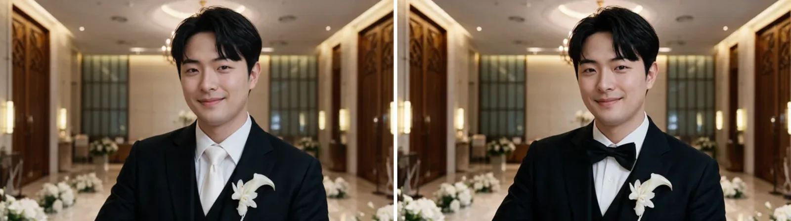
<small>September 2, 23:52 and 23:56 (AI-generated). Only the tie changed</small>

With a first frame in hand I went straight to video. On September 3 at 0:09 and 0:43 I made the selfie cam twice with Seedance 2.5 at 480p. In between that same day I also ran the #11 zoom-out.

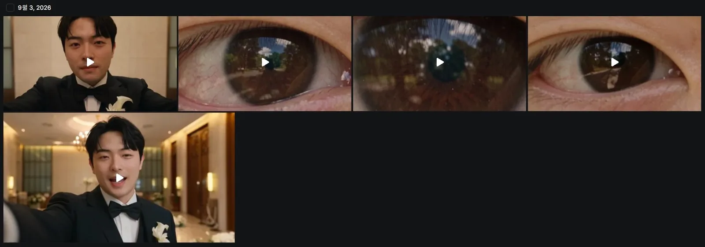
<small>September 3 video history. Top left and bottom left are the AI selfie cam, the other three are the #11 eye zoom-out</small>

The two versions differed in lines and length.

| Generated | Length | Content |
|---|---|---|
| 0:09 | 10 s | Holds an action cam at arm's length and keeps talking. "I came all this way looking for happiness." "It really does flash" (small laugh) "The surest way for a person to be happy, I think I found it today." Frame fixed throughout |
| 0:43 | 8 s | Keeps only the first line, lowers the camera from 2.6 s. The camera spins and shakes as if dropping to the floor, and at 4.2 s lands on the marble floor. From 5 s you see closed wooden doors past my shoe heels and trouser hems |

The 0:43 version was the first to put the move from ① to ② in the storyboard and drawing into video. The prompt got longer too. I wrote how the camera and body move at each time, like "one continuous shot from a single camera," "behind the camera, large wooden doors with a Gothic arch pattern are closed," "the camera turns to face the other way as it's lowered," "it's set on the floor with the lens looking forward and slightly up."

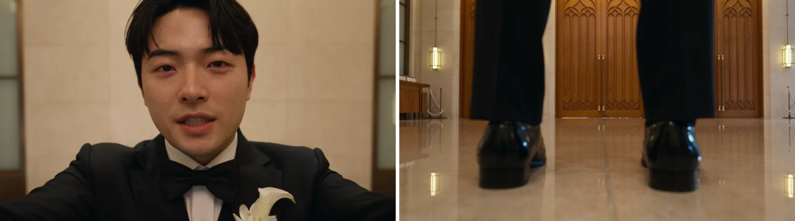
<small>1 s and 6 s of the September 3, 0:43 version (AI-generated). Shoes and doors stood in front of the camera on the floor</small>

Neither version made it into the final cut. The final lines are "Waking up to find yourself in front of the wedding hall, I guess that's what this means," "Really, a flash, like light," "I'm going in now," and "Everyone, please turn around." Different from the September 3 lines.

I dropped them because of the delivery. The selfie cam Seedance made sounded way too cheesy and reeked of AI. No matter how many times I reran it, I didn't think it could be saved, so I dropped it. I'll post the failed clip separately and attach it here so you can see just how cheesy it was.

## Putting a tuxedo on footage I acted myself, four runs on September 6

The last shot started not from an AI-made person but from selfie footage of me acting.

I shot the selfie at home on my phone camera. Shooting with the GoPro would have added wide-angle distortion. So I shot with the phone but acted as if I were shooting with a GoPro. Heh.

The mouth shapes as I talk, the head movement, even the hand lowering the camera and setting it on the floor are exactly what I did. In the prompt I wrote to change the room in the source into the wedding hall lobby. The job here was to swap only the outfit and the location.

On September 6 I ran it four times between 1:10 and 3:53 p.m.

| Generated | Model | Resolution | What changed |
|---|---|---|---|
| 13:10 | Higgsfield Genjutsu object swap | 480p | Acting, face and camera movement kept; bow tie added; jacket and shirt into a satin-lapel tuxedo; room into the wedding hall lobby; wooden doors in front of the lowered camera |
| 14:18 | Seedance 2.5 Edit | 480p | Same instructions in Seedance Edit |
| 14:43 | Seedance 2.5 Edit | 480p | Added an opening pulling out of an extreme close-up of the eye. Face follows the reference photo, not the source; outfit a matte suit with no satin; location at the spot of the figure in the blocking drawing |
| 15:53 | Seedance 2.5 Edit | 1080p | Final of the above. 22 seconds |

The first run was a Genjutsu object swap. The prompt's first sentence: "Keep this man's performance as is. His face and identity, the movement of lips and jaw as he speaks, head movement, posture, and the timing of every action." I told it to keep the camera as is too. Even the shake on the way down and the way it settles on the floor.

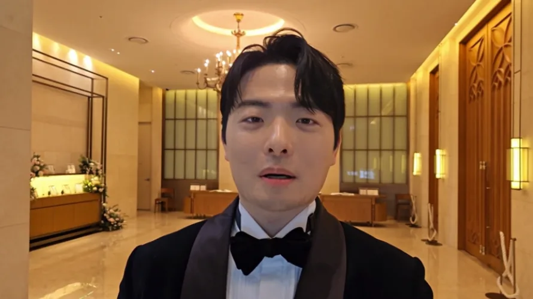
<small>Genjutsu object swap, September 6, 13:10 (AI composite). The lapels came out with a satin sheen</small>

The wedding hall lobby and tuxedo went on well. But the lapels were shiny satin. I had literally written "satin-lapel tuxedo" in the prompt, so that's what came out. At 14:18 I moved the same instructions to Seedance 2.5 Edit, and at 14:43 I replaced the outfit sentence entirely: "A plain black suit, all matte wool, no satin, no sheen, no contrasting lapel trim."

It wasn't only the outfit that changed at 14:43.

| Sentence | What changed |
|---|---|
| Opening | Starts on an extreme close-up with the eye and pupil filling the frame, and in the first second pulls straight back along the lens axis. Fast at first, slow on arrival. The iris becomes an eye, the eye a face, and it stops on the source's bust shot |
| Face | Face and hairstyle follow the reference photo, not the source video |
| Location | The wedding hall lobby in the reference image. The figure drawn in that image only marks where to stand and never appears on screen |
| Continuity | One continuous take with no cuts or dissolves, exactly one person |

The wedding hall image I used as a reference is the blocking drawing shown above. I put it in with the yellow figure still drawn on it and told it in text that the figure was a position marker. The drawing didn't show up on screen.

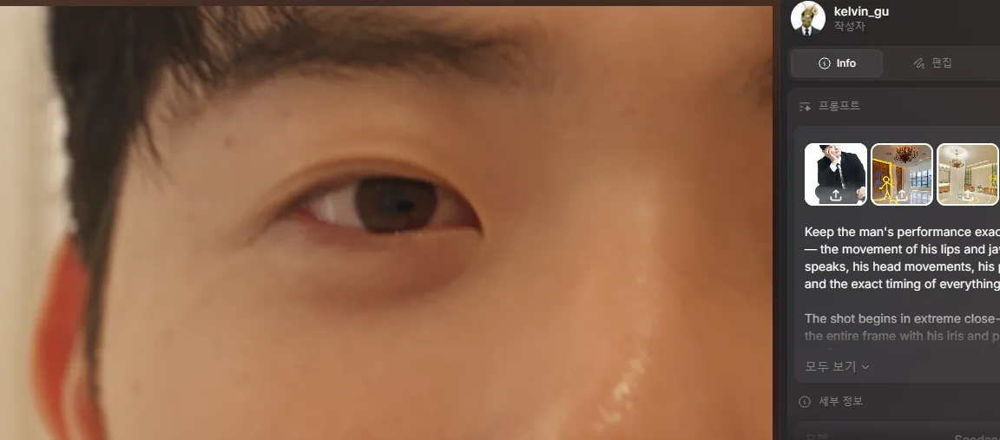
<small>1 second into the final version. The blocking drawing with the yellow figure went into the references as is</small>

With the eye pull-out inside this shot, placing it right after the eye zoom-in and the real montage from part 3 made the transition from the eye into the wedding hall. At 15:53 I ran the same prompt at 1080p, and that went into the final cut from 1:48.

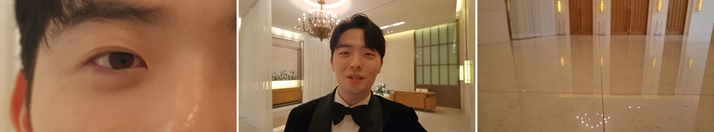
<small>0:01, 0:03 and 0:17 of the final version. Out of the eye, talking, setting the camera on the floor</small>

Compared with the AI-only September 3 version, the ending is different. In the September 3 version, shoes stood in front of the floor camera. The final version follows how I actually set the camera down, so only the doors show beyond the floor.

## Wrapping up the edit, and the handover hole

The finished shots were joined in Premiere. The project file is `20260909_식중영상.prproj`. The monitor screen from part 2 was composited from an HTML recording, and the high-angle problem from part 3, where the leaves didn't cover my wife, was solved by laying real leaf footage over it.

I worked on two monitors. The program monitor on the left screen, the timeline on the right.

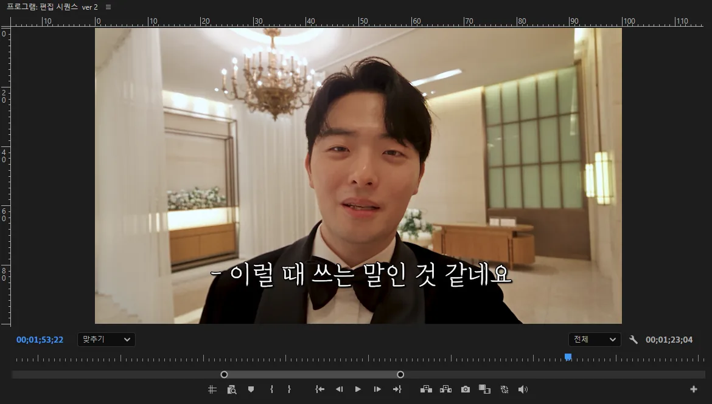
<small>The program monitor on the left screen. 1:53, with captions over the last selfie shot</small>

The sequence is called "Edit sequence ver 2." The same project also has ver 3, "Jeju pre-ceremony film" for the Jeju reception, and "Sequence 06" open. The last frame is the selfie shot paused at 1:53.

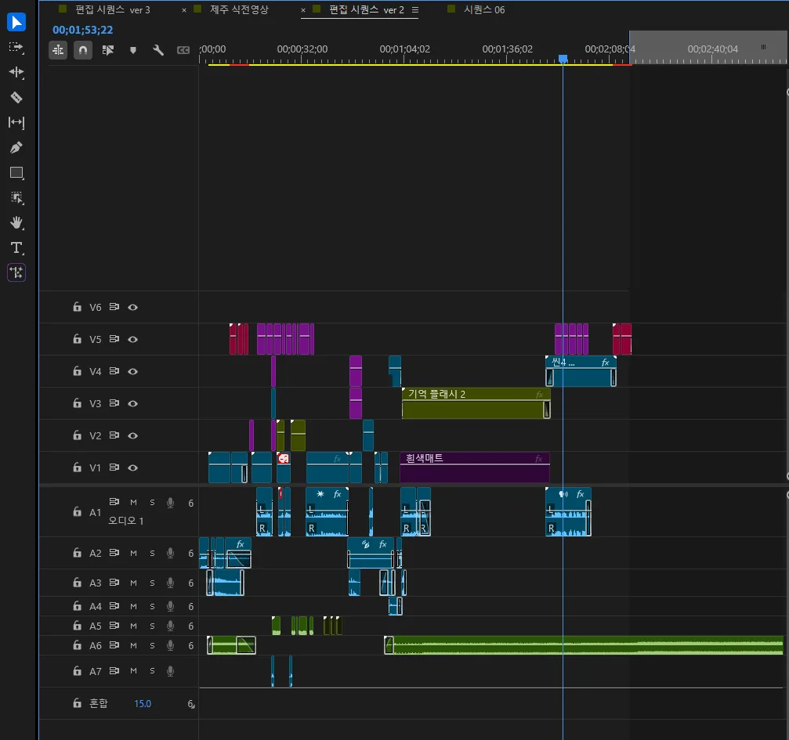
<small>The timeline on the right screen. 5 video tracks, 7 audio tracks. The playhead is on the scene 4 selfie</small>

The timeline used five video tracks and seven audio tracks. "Memory flash 2" and "White matte," running long in the middle, sit at 1:04 to 1:44, the montage inside the eye. After that, the "Scene 4" clip on V4 is the selfie made in this post. The music runs on A6 from start to finish. This is the final timeline.

Going back through the records this time, I also confirmed how I made the Beat parody opening at the very front. At 8:06 p.m. on September 5, Higgsfield Genjutsu motion transfer (720p, 12 seconds) swapped just the face. The side-by-side with the original is in [part 1](/en/posts/higgsfield-wedding-film/).

The final file is 4 minutes 5 seconds. The picture ends at 2:15, and after that it's music over a black screen. It played right before the groom's entrance at the 1 p.m. ceremony on September 19, and after the on-screen me said "Everyone, please turn around," the real entrance followed. The YouTube video on the blog is that file cut to 2:20, keeping only 5 seconds of black.

[Watch the finished film on YouTube](https://youtu.be/J8hFwc1LpUQ)

What's left is the handover. As I wrote in [part 1](/en/posts/higgsfield-wedding-film/), Claude started on my wife's account and moved to mine. The conversations didn't carry over between accounts, so I pasted a handover document summarized by the previous chat into the new one. When I tried to continue from that document, too much had been left out to make progress.

On August 31 in a new chat I found the cause. The handover document wasn't the whole conversation but a summary of just the conclusions and principles. So I had Claude read the entire original conversation, which was saved as a Word file on Google Drive. It was 253,348 characters. The first read was a version cut off around 246,000 characters; I got it again and read to the end.

Comparing them, this is what the document had dropped.

| Missing | What the original conversation had |
|---|---|
| Face reference | The document only said "use 3 photos directly as references." Missing were the conclusion that many photos average each angle and the face collapses, and the reason that a photo at an angle close to the shot works best |
| #07 bottle POV | That it's one continuous 12-second shot, not two cuts, with a rack focus passing from the bottle to my wife |
| Dress color | Light sky blue, chosen because white blows out in summer sun and stands out too much in the high angle |
| High angle | That my wife should be hidden by leaves so you pass over her as background at first and see her on a second look |
| #08 and #11 posture | Turning only the head, and a gaze passing beside the lens to up behind the camera |
| #11 palm blackout | Only the conclusion "removed." The reason, that one more device at nearly two minutes would drag, and the decision to go with a match cut instead, existed only in the original |

I couldn't find the face reference conclusion right away even in the original. I corrected it by restating what I remembered. A photo taken at an angle close to the shot is best; if there isn't one, use a good front photo and a good profile.

From the document alone, the Claude in the new chat didn't know why "removed," and following the document's "3 photos directly" for face references went against the conclusion I remembered. I hit the same problem of re-explaining every time the chat changed in my blog work too, and now I keep the rules and state in a GitHub repository outside the chat, which each new chat reads before starting. I wrote about that in the post on [building a GitHub brain for AI](/en/posts/github-brain-for-claude/).

I don't have big regrets about the film itself. I did as much as I could, the reactions were good, and I learned a lot about filmmaking. So rather than "if I did it again," I'm noting what I'd carry over if I make something new.

| What to carry over | Why |
|---|---|
| Talking scenes from footage I act myself, from the start | I dropped the September 3 AI selfie cam because the delivery was cheesy and smelled of AI. The final was real acting footage dressed in a new outfit and location |
| Specify the material of clothing from the start | Writing "satin-lapel tuxedo" got satin, and fixing it to matte took one more run |
| Use the blocking drawing directly as a reference | Telling it the figure was a position marker kept it off screen and only set the position |
| Keep connected shots inside one shot | Putting the eye pull-out inside the selfie shot finished the match cut at the generation stage |
| Hand over conclusions together with reasons | A document without reasons didn't move anything forward, and I had to reread the 250,000-character original |

If I make another one, I want to make better use of Edit mode and make something far cooler than this time.

## Making it with AI was no shortcut

**Making a film with AI was absolutely not easy.** It may have been a harder road than shooting it myself. I didn't start it to take the easy way in the first place. That's why I think it was a meaningful challenge.

The dates in this series are only the ones with records. In reality I'd been planning bit by bit for at least a month before that. I revised the storyboard so many times I lost count. Just what's on record adds up to this.

| Stage | Record |
|---|---|
| Planning | Bit by bit for at least a month before the recorded dates. Storyboard revisions beyond counting |
| Storyboard | "Kang PD pre-ceremony film final integrated storyboard sheet," last saved August 27 at 11:21 p.m. |
| Images | Dozens per scene. Seven runs for one high-angle image in part 3, over twenty for the single bench smile shot in this post |
| Video | 36 from August 30 to September 6. 19 tests at 480p, 16 at 1080p |
| Credits | 563 credits for just the latest 140 transactions through August 31. 1,000 new credits came in on September 3 |
| Conversations | Several Claude chats, a handover document, rereading a 250,000-character original |
| Editing | Project file from September 9, 5 video tracks, 7 audio tracks |
| Screening | September 19, 1 p.m., right before the groom's entrance |

It took a lot of thought, time and effort. Honestly, along the way you can't help saying that paying a company to do it is the best…

Still, what I thought while making it points the other way. Making video with AI lets you try a huge number of things. Running a high-angle image seven times or pulling the same low angle eight times in a day is something you'd never dare on a real set. More roads have opened up for video makers.

And the fundamentals from years of making video naturally carry over to AI video. In this film too, writing the storyboard, splitting the bench scene into three cameras, going with a match cut instead of a palm blackout, and assembling it in Premiere at the end were all things I already did. What changed is that the limits of space came off. I can make a snowy mountain, the moon or a wedding hall lobby into scenes without going there. So **I think the more solid your fundamentals, the more you can shine in AI video.**

I had to study again doing this too. I needed to properly know the shot terms and film grammar I'd picked up by watching others. High angle, low angle, tilt-up, rack focus, match cut, bust shot, lens field of view and distance: only by naming them precisely in the prompt did I get close to the shot I wanted. The bottle and hand positions going wrong because of one phrase, "water bottle POV," was in the end a terminology problem too. There's so, so much to learn. It's an excuse, but that's why there are a lot of scenes I'm not happy with.

One aside. I thought it might be fun to automate the very job people pay companies for and turn it into a service myself. Because the hurdle is pretty high. I've been using AI pretty hard and have made quite a lot of video, and after doing this all the way through, there still seemed to be a long way to go. Which means a lot of people probably can't do it yet. I smelled money. Ha.
