I made the 2-minute film played right before the groom's entrance at our wedding with Higgsfield. I barely shot anything; most of what's on screen is AI-generated images and video.

Making it, I learned that AI video doesn't come out of one button press. **It was about deciding what to hand to the AI and what I had to do myself.** It was never the easy road. Still, it was a challenge worth taking on.

The ceremony was on September 19 at 1 p.m. When the film ends, the on-screen me says "Everyone, please turn around," and at that moment the real me walks in through the back door. The finished film is on YouTube.

[Watch the finished film on YouTube](https://youtu.be/J8hFwc1LpUQ)

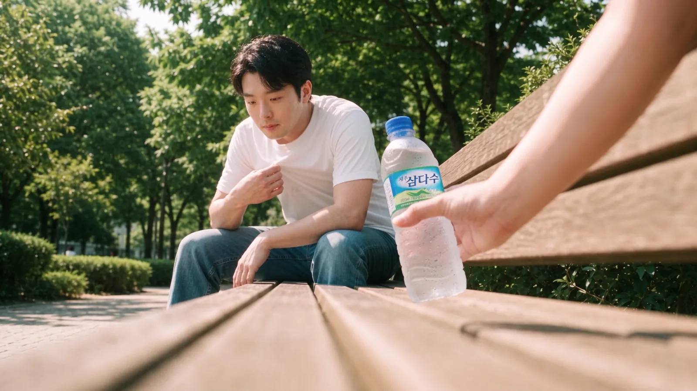
<small>0:53 in the final cut. The low-angle bench shot. The hand offering the water is my wife's (AI-generated)</small>

The process was long, so I split it into four parts, each with one question.

| Part | Scenes | Question |
|---|---|---|
| Part 1 | Opening and prep | At a wedding with no performance and no wedding song, what holds the guests' attention? |
| [Part 2](/en/posts/higgsfield-wedding-film-2/) | Workroom, wandering | What do you do about the things AI can't do? |
| [Part 3](/en/posts/higgsfield-wedding-film-3/) | Bench | Why does my face stop looking like me? |
| [Part 4](/en/posts/higgsfield-wedding-film-4/) | Wedding hall, edit | Why doesn't AI acting work when it talks? |

The main text focuses on where I got stuck and what I changed because of it. The run-by-run record of dates, models and prompts is collected at the end of each part under "Trial-and-error log."

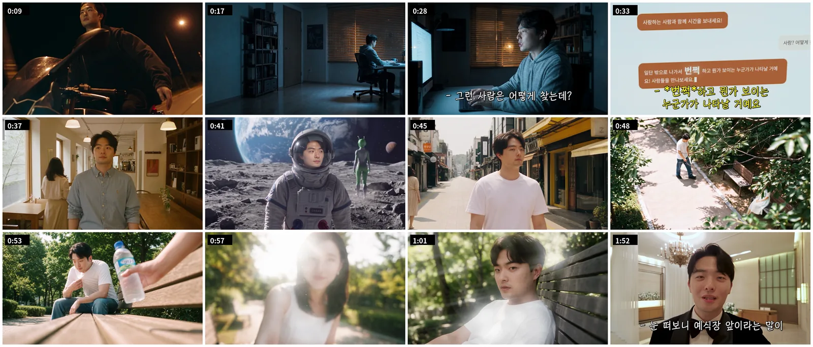
<small>Frames from the final cut in order. I left out the real photos and videos from the montage inside the eye</small>

## No performance, no song, so I bet on the first shot

The reason I made this film is simple. Our wedding had no performance. No wedding song either. The guests needed at least one thing to enjoy.

The middle of the film includes our dating footage. But if you just string dating clips together, it's boring, guaranteed. The goal was to show our dates and still make the guests feel "huh, that was fun."

People don't really care what video I make or what dates we went on. They look at whether it's fun or not. And I figured that gets decided in the first shot. **So the most important call in this film was what to open with.**

After a lot of choosing, I went with a parody of the motorcycle scene from the Korean film "Beat": riding a motorcycle down a night road with both arms spread wide. It wasn't in the storyboard; I added it to the very front later.

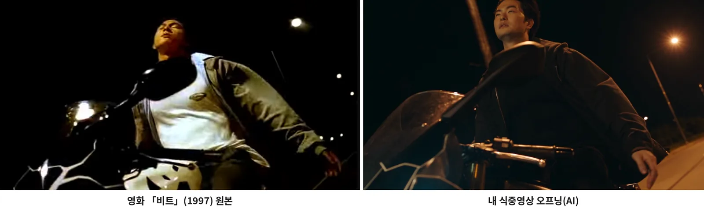
<small>Left is the original from "Beat," right is 0:09 in the final cut (AI-generated). Same angle, same streetlights, only the face is mine</small>

I chose it on two criteria.

| Criterion | Why |
|---|---|
| A scene people of all ages know | Guests of many ages sit in a wedding hall |
| Fun and surprising even if you don't know it | Someone who doesn't know the original should still notice right away, "is this AI?" |

Making it was actually simple. I gave Higgsfield Genjutsu's motion transfer one motorcycle clip and one photo of my face, and wrote a single line: "Change the face of the person in the video to the reference image."

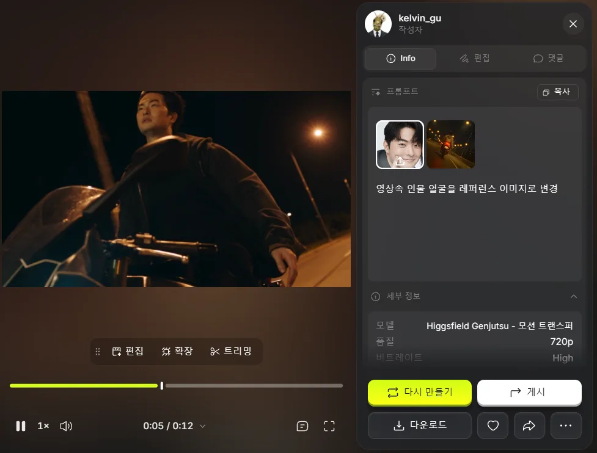
<small>Genjutsu motion transfer. One face photo and a one-line prompt swapped only the face</small>

Subtitles "Lonely me" and "I want to be happy" roll over the motorcycle, and that lonely guy cuts to his desk in the workroom, where the main story begins. Looking back, this one scene carried the whole film. I haven't properly captured how the guests reacted yet. I tried a cross-cut with footage from the hall, but apart from the first burst of laughter the reactions didn't come through. The video company shot separate guest-reaction footage that hasn't arrived yet; when it does, I'll re-edit the reactions and post them here.

## The story starts by asking AI about happiness

I kept the plot simple from the start. Kang PD asks an AI how to be happy, goes outside as the AI tells him, wanders through strange places, meets someone who offers him water on a park bench, and walks into the wedding hall.

| Scene | Location | What happens | Storyboard length |
|---|---|---|---|
| S#1 | Workroom (night) | He asks the AI, "What's the surest way for a person to be happy?" The answer: "Go outside. When you meet your true match, something will flash! before your eyes" | 0:00–0:15 |
| S#2 | Cafe → park → moon → snowy mountain → summer street | His face stays dead center while only his clothes and the background keep switching. At the end he flops down, exhausted, on a bench | 0:15–0:40 |
| S#3 | Park bench | A water bottle comes in from the side; he looks up, the backlight clears, and there's my wife. A sudden zoom into the eye, and a montage of real photos and videos plays inside it | 0:40–2:00 |
| S#4 | Wedding hall waiting room | From that expression straight into a tuxedo, he talks to the guests on a selfie cam, then at the door: "Please look behind you" | 2:00–2:20 |

The storyboard laid out camera, direction and sound for each shot on one sheet. While working I called it a pre-ceremony film, but it actually played mid-ceremony, right before the groom's entrance.

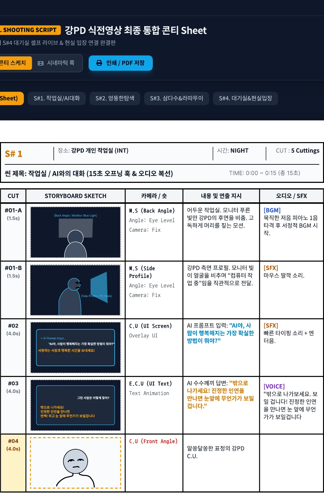
<small>S#1 workroom. Even the lines on the AI chat screen and the sound effects are written down</small>

S#3 is the climax. The tilt-up from the water bottle to my wife's face, the backlit lens flare, the Ratatouille-style pull into the eye, and the montage inside it take up the most cells in the storyboard. It also took the most credits and time.

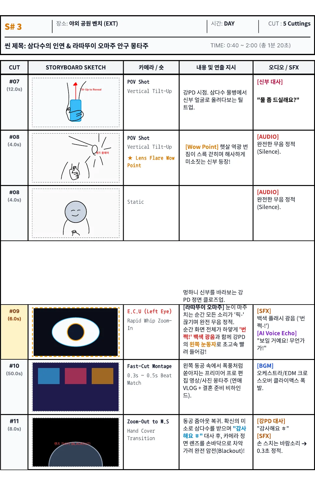
<small>S#3 bench. The bride's line "Would you like some water?", #09 eye zoom-in, #10 montage</small>

S#4 is where the film connects to the room. The on-screen me talks on a selfie cam in the waiting room, lowers the camera, and when the film cuts off the real entrance music starts.

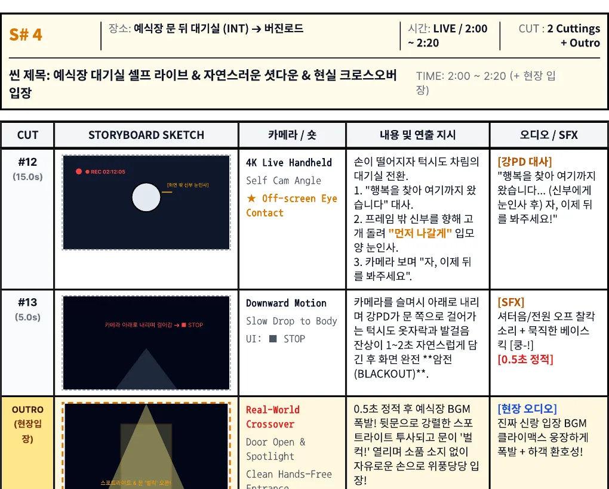
<small>S#4. The last scene, linking the film to the real entrance</small>

The storyboard ran 2 minutes 20 seconds; the final picture ends at 2:15. The montage was planned at 50 seconds and got much shorter, and the lines changed too. How they changed is in parts 3 and 4.

## What I settled before handing it to AI

I used two AI tools together: Higgsfield for image and video generation, Claude for prompt design and reviewing results. I connected Higgsfield to Claude as a connector, so Claude generated directly and even checked my balance and transaction history.

There were three principles I kept to the end.

| Principle | Why |
|---|---|
| Location image → image with the person in that location → video | If I threw the location and the person in separately at the video stage, they drifted apart. An image given as the first frame went into the video as is |
| Faces from one photo shot at an angle close to the shot | Putting front, side and looking-down photos in all at once averaged each angle and the face fell apart. Details in part 3 |
| Check video at 480p first, 1080p only at the end | One 1080p run cost as much as six 480p tests |

Locations were saved as Higgsfield elements. I made a wedding hall, snowy mountain, moon, workroom, summer street, park and cafe, then called them in prompts with an @.

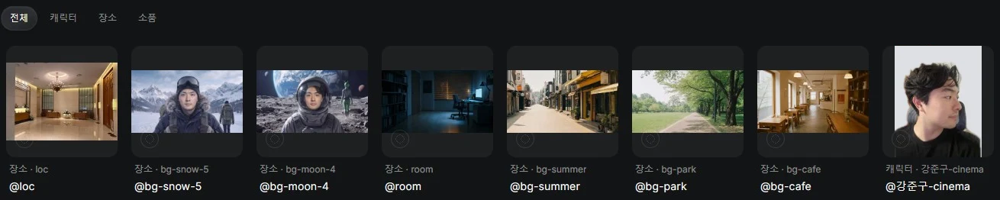
<small>Seven location elements and one character element saved in Higgsfield. I replaced the home background in the character photo with a solid color</small>

I shot and uploaded my face separately by angle. At first I thought the more photos I added, the closer it would get to my face. It was the opposite. That's the core of part 3.

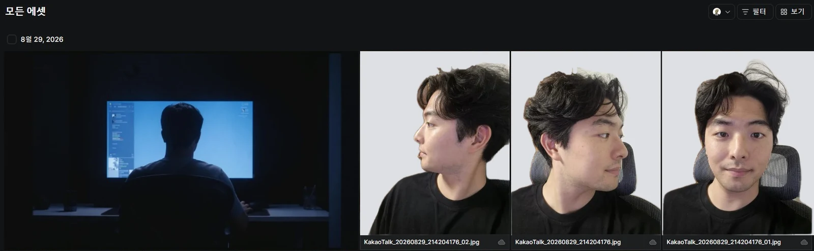
<small>Face photos uploaded to the project. Profile, 45 degrees and front, shot separately. The inside of my home was visible, so I replaced only the background with a solid color</small>

One note on money. My Higgsfield account is on the Plus plan, with 1,000 credits arriving on the 3rd of every month. I had Claude page through the transaction history to the end to check: **leftover credits don't roll over to the next month; they disappear.** So right before the reset there was no reason to save, and right after it I hesitated over even one video. Most credits went to video. An image costs 2 credits, while a video run went anywhere from around 20 to over 130 credits.

## If I made something like this again

Things I missed during prep cost me credits and time later. If I did the same thing again, I'd go in this order.

| What to do | Why |
|---|---|
| Write down, for each shot, "whose point of view, looking at what" | I only wrote "water bottle POV," and Claude read it as the bottle's point of view. It was my point of view looking at the bottle |
| Keep decisions and their reasons in one file | Moving Claude accounts, I only passed on a summary and every reason disappeared (part 4) |
| Make 480p test → 1080p a rule from the start | One 132-credit run costs as much as six tests |
| Turn on the connector only for generation | The tool descriptions alone ate a big chunk of Claude usage every turn |

Part 2 is the workroom and the wandering scene: why AI couldn't make a monitor screen where the text had to be exact, why I shot the scene myself where the face position had to stay fixed, and the story of older guests who thought we'd actually filmed all of it.

## Trial-and-error log

Here's the process I cut from the main text, kept as is. For anyone trying the same thing, this part may be more useful.

Beat opening: September 5 at night, Higgsfield Genjutsu motion transfer, 720p, 12 seconds. One motorcycle clip and one photo of my face; the prompt was the single line "Change the face of the person in the video to the reference image."

Working period: about eleven days, from August 27, when I saved the storyboard, to September 6, when I generated the last video. I'd been planning on and off for at least a month before that. The storyboard PDF is called "Kang PD pre-ceremony film final integrated storyboard sheet," with S#1 to S#4 stacked vertically.

Two Claude accounts: I started Claude on my wife's account. It understood my scene descriptions so well that I ended up making my own account and upgrading to Max. The conversations from my wife's account didn't carry over, so I made a handover document and pasted it in, but that document kept only the conclusions and dropped every reason. Higgsfield was on my own account from the start.

Higgsfield connector:

| What happened | Cause | What I changed |
|---|---|---|
| One conversation filled 4% of Max usage, and a few more messages took it to 7% | The Higgsfield connector has about 80 tools, and their descriptions rode along every turn even unused. Lookups like 100 transaction records also kept piling up | Turned the connector on only for generation; planning and script talks happened in new conversations with it off |
| Claude could list generations but couldn't see the images | The list only returns IDs and URLs, and Claude couldn't open the images themselves | I pointed out which cell on screen to pick |

First image: I created a "wedding film" project in Higgsfield and started uploading material on August 29. That day I started with the S#1 workroom.

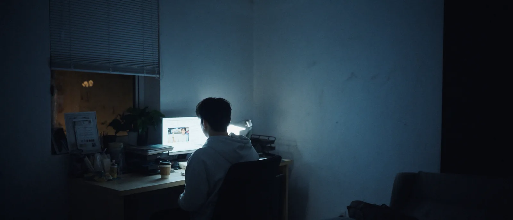
<small>Workroom image made at 5 p.m. on August 29 (AI-generated). The final cut used a different composition</small>

Location element versions: the snowy mountain and the moon went through several versions, up to @bg-snow-5 and @bg-moon-4.

How the face reference rule was settled: the first character elements (@char_jungu, @char_sumin) were based on one photo each, so the faces came out weak. So I added more photos to the elements and also fed photos directly as references per shot. Then I learned that mixing angles averages them out, and changed the rule.

| Priority | Photo to use as reference |
|---|---|
| 1 | Exactly one photo shot at an angle similar to the shot you're making |
| 2 | If there's no such photo, one good front shot and one good profile |
| Never | Front, side and looking-down photos all at once. All three directions get averaged together |

This rule wobbled once with my wife's face. I had three photos of her: facing front; turned 45 degrees with eyes forward; and turned 45 degrees with eyes lowered. I needed her face as seen looking down from my seat on the bench, so Claude suggested using only the third, the closest angle. I thought her lowered eyes in that photo wouldn't come out properly, so I put in all three. A rule is a rule, but you have to weigh each photo's expression too.

I also pinned facial features down in words: eye spacing, eyelid shape, nose bridge width, cheekbone height, jawline angle, philtrum length and lip thickness, ending with `Do not average these features`.

Two character elements: @강준구 holds 7 photos, mixing suits from our wedding photo shoot and everyday photos.

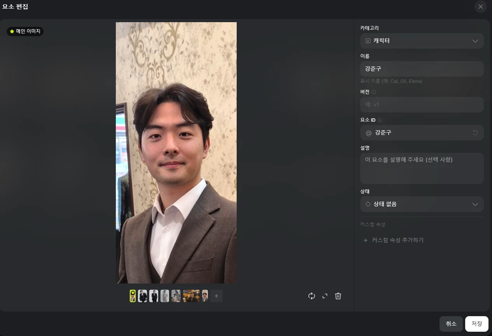
<small>The @강준구 element. One main image and six extra photos</small>

The Soul character (@강준구-cinema) holds 17 photos of me taken in different places, and 25 credits went out under a Soul ID line in the transactions. But it can only be called from Soul Cinema, not from Nano Banana Pro or Cinema Studio, so I didn't use it for most shots. On September 6 I called it for one shot, walking up to the bench and sitting down, with Seedance 2.

<small>@강준구-cinema. 17 photos with different angles and places: a cafe, a restaurant, our wedding shoot</small>

Credits: 1,000 credits arrive on the 3rd of every month at 11 a.m. (Korea time). The August 3 record had a line reclaiming 843 leftover credits right next to a line granting 1,000 new ones. Per-run costs by model, from the transaction history:

| Model | Type | Cost per run (credits) |
|---|---|---|
| Nano Banana Pro | Image | 2 |
| GPT Image 2.0 | Image | 0.5–8.5 (17x difference depending on settings) |
| Cinema Studio 4.0 | Video | 20–72 |
| Seedance 2.5 | Video | 19.26–132.73 |

On August 31 I grouped the latest 140 transactions by model: of 563 credits total, 8 video runs took 356 credits (63%). Nano Banana Pro made 38 images for just 76 credits. The 132.73 credits that went out in one go was the final Seedance 2.5 Edit 1080p run I made at 10:41 p.m. (Korea time) on August 30. I spent close to 300 credits that day alone.

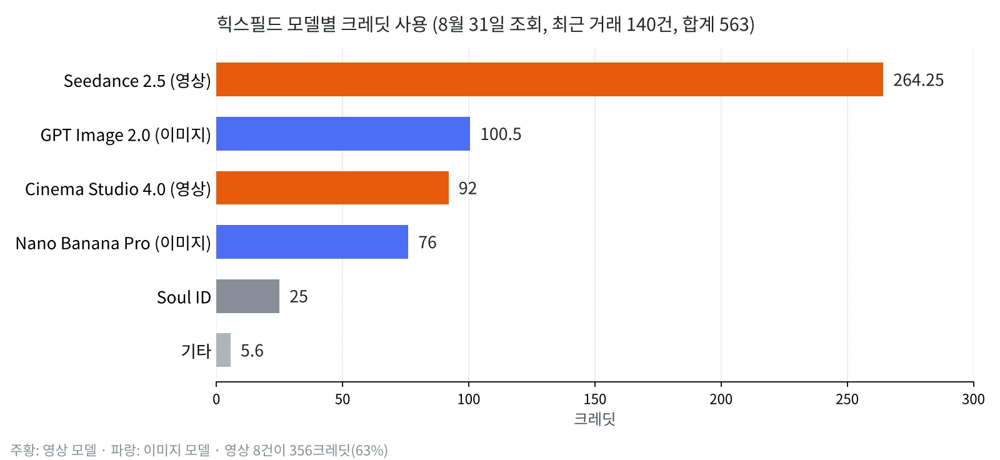
<small>The 140 transactions checked on August 31, summed by model (drawn from the transaction history)</small>

Video models: from August 30 to September 6 I generated 36 videos on my account. 19 were 480p tests and 16 were 1080p.

| Model | Count | Scenes |
|---|---|---|
| Seedance 2.5 | 20 | Bench POV tilt-up, eye zoom-in and zoom-out, wedding hall AI selfie cam |
| Seedance 2.5 Edit | 9 | Wandering scene (swapping background and clothes on real footage), wedding hall selfie cam, the shot pulling out of the eye |
| Cinema Studio | 4 | Three talking shots in the workroom, one bench POV tilt-up |
| Higgsfield Genjutsu | 2 | Face swap (motion transfer), changing clothes on the selfie cam (object swap) |
| Seedance 2 | 1 | Walking up to the bench and sitting down |
