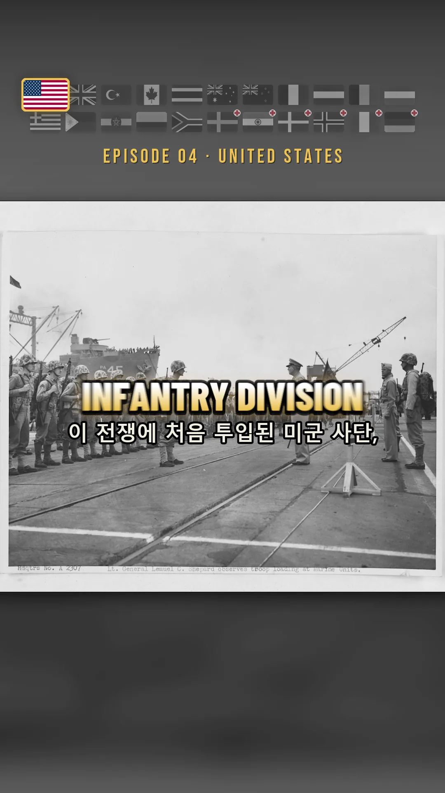
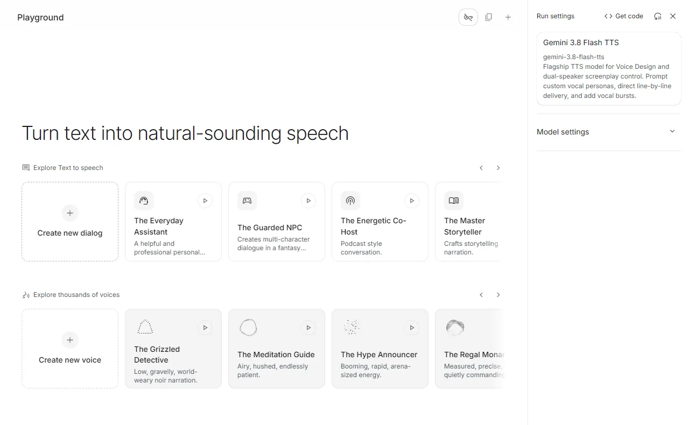
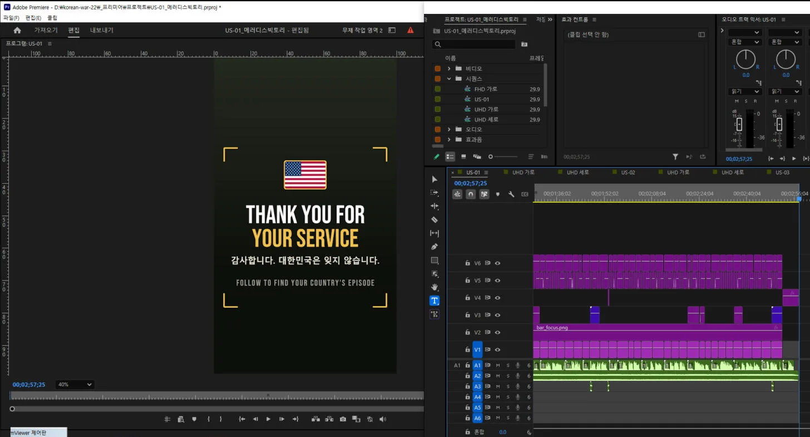
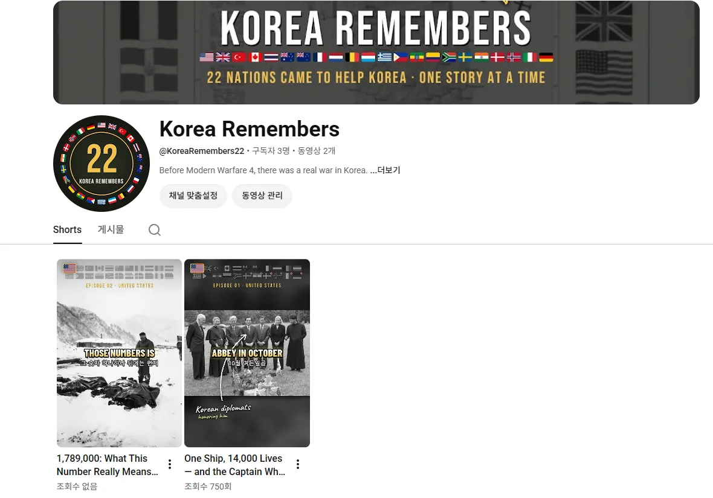

Feed it one script and a photo folder, and Claude assembles the Premiere timeline itself. Over three days I built that path and produced four shorts of about two minutes fifty seconds each.

<small>A finished frame. The flag strip, the large caption, the sub-caption and the photo placement were all positioned by code</small>

## Why 22 nations

Twenty-two countries sent troops or medical staff to the Korean War: 16 combat nations and 6 medical support nations. I chose this as channel material for three reasons.

| Reason | Detail |
|---|---|
| Timing | Modern Warfare 4 launched on 23 October 2026. Its campaign is a Korean peninsula war that opens with a full North Korean invasion, and the protagonist is a South Korean private. Gamers worldwide are searching for Korea right now |
| Volume | Every nation has units, battles and people to talk about. Twenty-two nations stretch to hundreds of episodes. I have 145 scripts written already |
| Market | Among the participating nations, the United States, Britain, Canada, Australia, New Zealand, the Netherlands, the Nordics and Germany all carry high ad rates |

The third one is really the biggest. Working only in Korean means a market of fifty million, and that gets split further. So I went with **English as the base, with each nation's own episode getting that nation's language subtitles and flag as special treatment**. The play is to make someone who sees their own country highlighted go digging through the profile asking "is my country in here too?". The rest of the languages I leave to YouTube's automatic dubbing. The channel is Korea Remembers, one account, one episode a day.

The emotion is gratitude, not anger. The fact that a Korean is making it becomes the sincerity by itself.

## I analyzed references to settle the design

I didn't build on instinct. I pulled down videos from the channels I'm aiming at and took them apart. Indonesia's Hystoria (142K subscribers) showed me the structure, and for the visual grammar I downloaded three shorts from Silent Souls Stories (175K subscribers) with yt-dlp and picked them apart frame by frame.

| What I found in the references | What I applied to my videos |
|---|---|
| Almost no transition effects. Just a cut, plus a slight pull that settles right after the cut | Each cut pulls from 104% to 100.5%, then pushes slowly to 106% |
| Scenes average 2 seconds | Cuts average about 3 seconds, the opening 1.3 to 1.7 |
| White flash of 0.6 seconds only on major transitions | Only once or twice, where the story turns |
| Captions are 1 to 3 words in capitals, centered on screen | A gradient falling from white to yellow, centered |

<small>The maps aren't borrowed, they're drawn by code. Only the coastline data comes from open sources; everything else is drawn</small>

I added two things of my own. A strip of 22 flags sits at the top of the screen for the whole video, and the instant the narration says "today, the United States" that one flag grows 1.45 times with a gold border while the rest drop to grayscale. And the maps aren't borrowed, I draw them: paper texture, ink coastline, wave lines along the shore, the 38th parallel, numbered title boxes, red movement arrows. Every scene gets a different map.

## The voice comes in one block, the timing comes from transcription

At first I laid down a guide track with the built-in Windows voice. The verdict was one word. Garbage.

Now I make it in the Gemini AI Studio web app. The important part is **putting the entire script into a single speech block with blank lines between scenes and running it in one go**. Generate it scene by scene and the voice shifts subtly. I use one voice only, Riko. A two-minute-fifty narration comes out as one file.

<small>The screen where the narration is made. You have to press "Create new dialog" before a text field appears</small>

Then comes the core. I run the narration wav back through faster-whisper to **pull out the second at which each word is spoken.** That means no hand-matching of captions. If the cut list says "this photo starts on the word 'Hungnam'", the code finds that word's actual time and places the cut. Alignment accuracy comes out at 95 to 98 percent per episode.

The captions are two lines. The large line is 1 to 3 words in that nation's language, the small line beneath is English. For English-speaking nations the lower line is Korean. The Korean was breaking into fragments that were too small, so I regrouped it by meaning. A fragment under nine characters, or one whose sense hasn't closed, merges with the next, and a line can run to eighteen characters. In one episode that took 139 fragments down to 66.

## Claude assembles Premiere directly

This is where MCP comes in. I use two.

| MCP | What it does |
|---|---|
| Premiere Pro MCP | Opening and saving projects under a new name, assembling the timeline via `execute_extendscript`, exporting |
| Playwright (Whale, debug port 9222) | Generating and downloading voice in AI Studio, collecting material from the U.S. National Archives and DigitaltMuseum, scheduling uploads to YouTube and Instagram |

The order goes like this. The Python side (`premiere_prep.py`) pre-composites the photos at 1080×1920, draws captions, name tags, brush lettering and maps as PNG sequences, and produces a single `plan.json`. Then one line of ExtendScript goes out through the Premiere MCP. That script reads the plan and fills eight tracks.

<small>The finished timeline. Nobody drags these clips in one at a time</small>

V1 photos and maps, V2 the flag strip, V3 name tags, arrows and Korean brush lettering, V4 text cards, ending and white flashes, V5 the large captions, V6 the sub-captions, A1 narration, A2 music. One episode holds more than 250 clips and no human places them.

What I learned while automating is that judgment can be put into code too. Each scene gets an importance score from its narration. Key words like Medal of Honor, first, captured, killed score 3, a large number scores 3, a word of thanks scores 3, and a key word appearing for the first time in that episode scores 2. Only scenes over 6 points may use the yellow brush lettering, and below that the code removes it automatically. I also synthesized the sound effects in Python so no license could catch them: a logo boom, a flash whoosh, card typing, a thud and a brush stroke, five in all.

## When code can't trust what code collected

The material was collected by code as well. It scrapes Wikimedia Commons by nation and sorts licenses into three tiers: free (public domain, CC0), attribution (CC BY), and share-alike (CC BY-SA). Non-commercial and no-derivatives are not taken.

But when I opened the first collection, all 114 Philippine photos were from between 1992 and 2016. Philippine political events and a papal visit. The cause was that the only subcategory of `Philippines in the Korean War` was a man who had been a war veteran and became president, and going two levels down from there dragged in APEC footage. I blocked descent into categories shaped like personal names, added a 1949–1956 year filter, and split the verdict into three: take, check, discard.

The keyword search I added afterwards was the bigger hole. I ran Germany as a search term and got back 110 files: a 2007 U.S. Army photography contest, Brazilian stamps, World Cup appearance maps, a Soviet cartoon.

<small>What came back from searching "Germany". All 110 were like this</small>

The relevance test was also using the category path the file had been dragged in through, and a search result has the search term written straight into that path, so anything passed. I turned search off by default, and the 704 rejected files, 5.2GB, now sit in a quarantine folder rather than being deleted. I wrote the photo count down from 1,658 to 1,040. Plan on an inflated number and it turns into holes later.

## Where it stands

<small>The channel has only just opened. The first line of the description reads "Before Modern Warfare 4, there was a real war in Korea."</small>

Full cuts exist from US-01, the SS Meredith Victory at Hungnam, through US-04, Task Force Smith, and they go up to YouTube and Instagram one a day. Episode 1 is [One Ship, 14,000 Lives — and the Captain Who Gave Up Everything](https://youtube.com/shorts/D4IVNaqsKUQ). Next is the story of Hudner and Brown.

The remaining work is piled up on the human side. Five nations with fewer than ten photos can't be made into videos yet. For Germany and Italy the period photographs exist only as non-digital records at Korea's National Archives, so a copy request requiring identity verification has to be filed. Episodes for non-English nations need their own narration and a native-speaker review.
