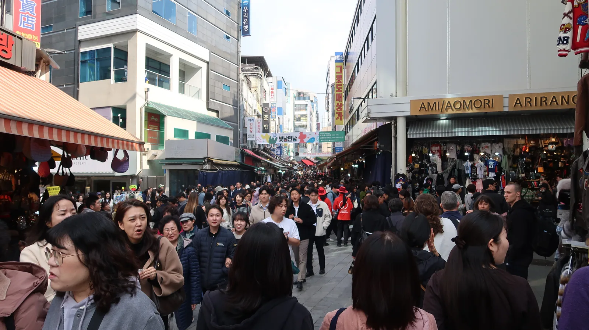
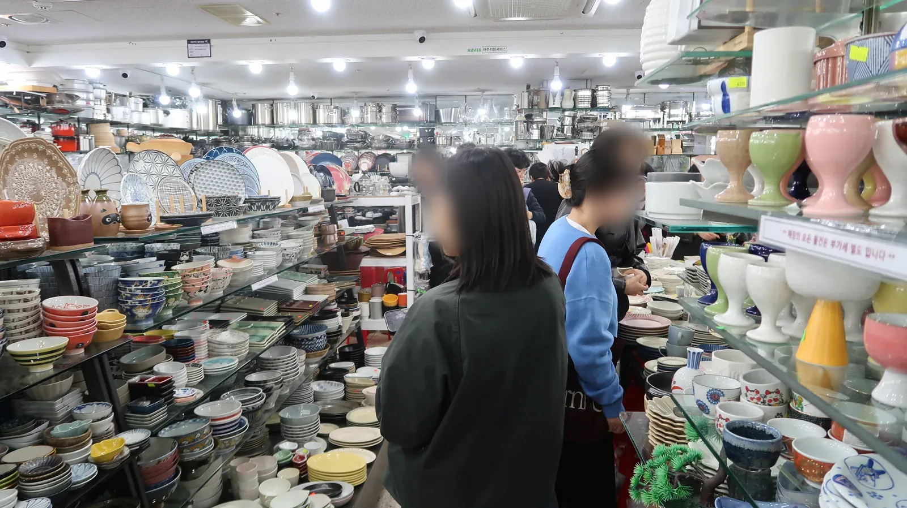
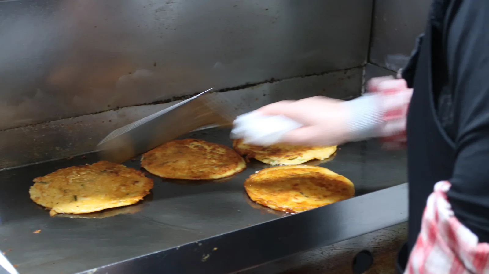

On Friday, October 30, my wife and I went to Namdaemun Market, skipped Dongmyo because of the crowds, and moved on to Wolmido.

## Namdaemun Market, packed even at Friday lunchtime

We usually follow the same route. We take a light walk around Namdaemun Market, look at some tableware, and then head to Dongmyo. But Namdaemun Market has become a hot spot lately, and even at Friday lunchtime it was incredibly crowded.

The tableware arcade was busy too. Plates, pots and spoons were stacked almost to the ceiling, and my wife kept stopping in front of the dishes. We spent more than 30 minutes walking around inside.

## Naengmyeon at Buwon Myeonok

We had lunch at Buwon Myeonok. Mung bean pancakes were frying nonstop on the griddle by the entrance, and the walls were covered with signatures from past visitors.

We ordered mul-naengmyeon and bibim-naengmyeon. The food was good.

After lunch we browsed an imported snack shop. The snacks my wife picked piled up in the basket one by one.

## Three and a half hours to Wolmido

There were too many people, so we skipped Dongmyo this time. We hung around the market a little longer and then left for Wolmido, but the traffic was so bad that it took three and a half hours. It was already night when we arrived, and unlike the market in the afternoon, the seaside promenade was almost empty.

Dinner was grilled clams. Cheese corn and clams went on the grill together.

Before heading home, I took a photo of my wife in front of a giant chicken statue.

