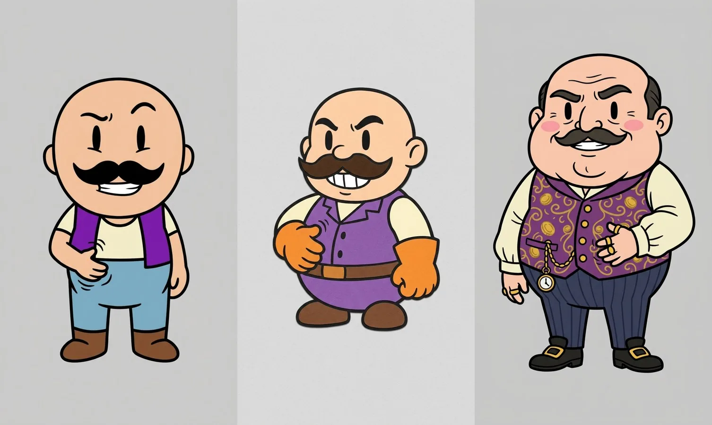
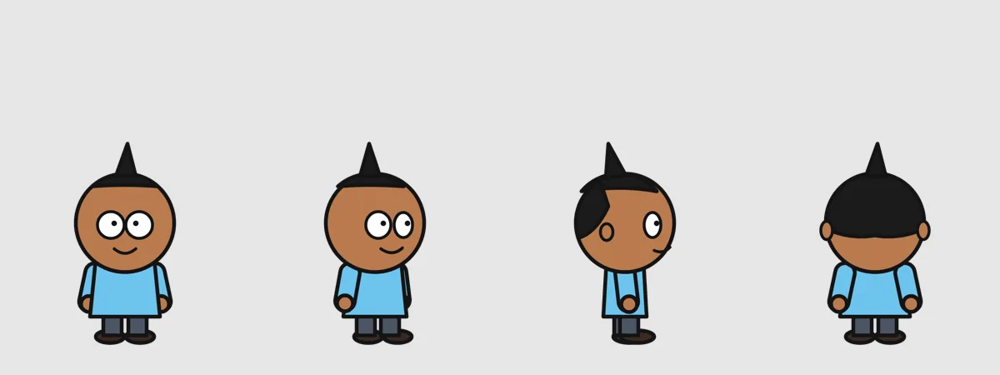
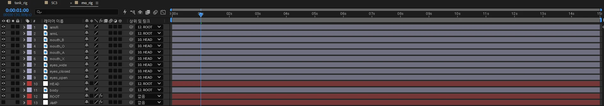
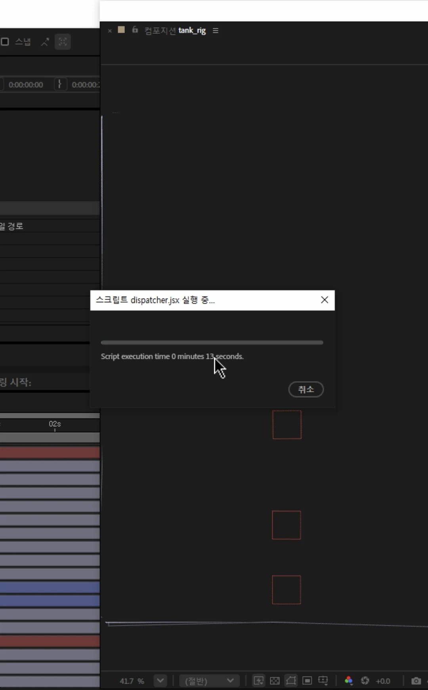

I can't draw animation, but with AI I opened a fairy-tale animation shorts channel. It's called Tiny Tale Troupe: five fixed characters act out a different folk tale in every episode. The characters are drawn in code, the motion comes from After Effects rigging, and the backgrounds are made with Gemini.

<small>A scene from episode 1, "The Golden Axe." Background by Gemini; characters drawn in code and animated in After Effects</small>

Episode 1 is here: [Tiny Tale Troupe episode 1](https://youtube.com/shorts/Rechu83_CdA)

## Five actors, a different story every time

I borrowed the format from South Park. The same actors change only their roles and costumes to perform a different tale, and the first and last lines ask "What would you do?" I never have to design new characters, and viewers grow attached to them.

<small>The five leads. From left: Mo, Baba, Nana, Kiki, Tank</small>

| Character | Look | What they are to the viewer |
|---|---|---|
| Mo | Skinny man in his 20s, spiky hair, sky blue | "Me." An ordinary person: kind, but hates losing out and gives in to temptation |
| Baba | Heavy man in his 40s, bald with a mustache, purple | The one you love to hate. Villain, king, rich man |
| Nana | Hunched grandmother in her 70s, cane, green | The one who sets the test. Sage, witch |
| Kiki | 10-year-old girl, pigtails, yellow | Outwits Baba and gives the viewer relief |
| Tank | Tall woman in her 30s, short red hair, red | Strength and rules. A wall, or an unexpected ally |

I deliberately made race, age and body type all different, because the channel is for viewers around the world.

## AI images gave me a different person every time

At first I wanted to generate the characters with AI too. On Higgsfield I used Nano Banana Pro to make three images of Baba, changing only how simple he looked.

<small>Three Baba images from the same description, varying only the level of simplicity (AI-generated)</small>

None of them were bad. The problem was that **the three images were three different people**. Even with the same description, generating again gave a different character. That doesn't work for a channel where the same actors must appear every episode. I wrote "mitten hands" to mean hands without fingers, and it put actual orange gloves on him, which was funny.

All three were also too complex to animate. It needed to be South Park level: one lump for a body, big white eyes, a single line for a mouth, and characters told apart only by hair, hats and color. So instead of an image tool, I drew SVGs directly in Python. It costs zero credits, gives the same character every time, and lets me swap expressions or hats like parts.

## It only moves once it's cut into parts

The first test just made a single whole image bounce. It looked like the body was shaking unnaturally. I studied cutout animation rigging again and split each character into parts.

<small>One character split into legs, torso, head, arms, eyes and mouths</small>

Every part sits in its own place on the same canvas, so stacking them rebuilds the original drawing. Arms rotate at the shoulder, the head at the neck. There are four mouths: closed, slightly open, wide open, and round.

<small>To turn a character, the whole drawing is swapped. The back view has no eyes or mouth</small>

Splitting into parts creates seams. Raise an arm and the shoulder opens up; tilt the head and the neck floats. I rounded the joint ends so they overlap, then gathered every arm and head at full rotation on one sheet to check for gaps.

<small>A check sheet with arms and heads rotated to the max to make sure the seams don't open</small>

## Why I moved to After Effects

At first I rendered the motion in code too and assembled it in Premiere. But character acting turned out to matter more than the voice. A character looks alive when the mouth matches the words, a hand goes out on the stressed word, and the head shakes on "no." Keyframing that in Premiere scene by scene meant dozens of AI calls per scene.

In After Effects, once the rig is built, expressions handle the rest. Now I just feed in the voice line and its text, and this happens:

| Part | What happens automatically |
|---|---|
| Mouth | Picks one of four mouths from the spelling of each word and switches one tick before the sound |
| Eyes | Blink just before speaking, after finishing, and about every 3 seconds while listening |
| Head and body | On no or not, shakes the head and leans back; on a question mark, tilts the head |
| Arms | On words like this, mine or you, points with the arm toward the other character; on an exclamation mark, raises it high |

<small>The rig in the After Effects timeline. Arm, mouth, eye and head layers are parented to HEAD and ROOT</small>

<small>A script sent by Claude running inside After Effects. The parts are being loaded into the tank_rig comp</small>

<small>One line sliced into seven moments. Eyes close and open, mouths change, and the arm goes out on a pointing word</small>

All I decide per episode is one line per scene: who says which line. The motion is stepped at 15 updates per second. Moving a little choppily on purpose suits this art style. After Effects is connected to Claude through MCP, which runs the scripts and assembles the scenes.

## I left the backgrounds to Gemini

Backgrounds have no people in them, so AI handles them well. I described the scene to Gemini, then in the same chat asked it to "keep the layout and only simplify the art style," in two steps. The pond for episode 1 came out right on the first try.

There were missteps too. "Simple, 10 colors" made it bland, and "lots of props, lived-in feel" made it look like a photo. Now I upload one good park image and say "in exactly the same art style as the attached image," then list just the place and five or six props. I ask for the bottom 40% to be empty floor, since that's where the characters stand. The Gemini star mark in the bottom right corner gets removed with Python.

## Four episodes so far

<small>The Tiny Tale Troupe channel</small>

I've uploaded four episodes: The Golden Axe, The Pied Piper, Mujina, and The Story Bag. I didn't draw a single picture by hand, yet the result is animation where characters talk and gesture. I wondered whether something like this could be made with AI, and it can. But the structure that lets me keep using the same characters mattered more than an AI that generates pictures.
