tvN का 100 Days of Lies तभी समझ में आता है जब ली गा-ग्योंग (किम यू-जंग) एपिसोड 2 में मर जाए, इसलिए मैंने एपिसोड 2 के बाद देखना बंद कर दिया।

यह tvN की 20वीं सालगिरह का खास ड्रामा है, जिसमें किम यू-जंग, पार्क जिन-यंग, किम ह्यून-जू, ली मू-सेंग और जिन सन-ग्यू हैं।
निर्देशन 'Extraordinary Attorney Woo' के यू इन-सिक का है और लेखन 'Do You Like Brahms?' की र्यू बो-री का।
ऐसी टीम देखकर उम्मीद न रखना मुश्किल था।

पहले एक बात साफ़ कर दूँ।
अगर मैं इतनी सख़्ती से बात करूँ, तो कोई कहे "तो तुम्हारे वीडियो कितने अच्छे हैं?" तो मेरे पास कोई जवाब नहीं।
शायद प्रसारण का स्लॉट पहले तय हुआ होगा, और शूटिंग के दौरान ब्योरे भरने का दबाव रहा होगा।
जो सीन लेखक हटाना चाहती थीं, वह ऊपर से ज़बरदस्ती रखा गया हो सकता है, और निर्देशकों व कलाकारों ने भी शूटिंग में अटपटापन महसूस किया होगा।
मैं यह भी जानता हूँ कि बनाने वालों ने इसकी कमियाँ सबसे ज़्यादा महसूस की होंगी।
फिर भी, एक दर्शक के तौर पर और यही काम करने वाले के तौर पर, मैं जो महसूस किया उसे सावधानी से, पर ईमानदारी से लिखना चाहता हूँ।

इस पोस्ट के सीन चित्र असली स्क्रीनशॉट हैं, जिन्हें Gemini से कोरियाई स्याही-चित्र शैली में दोबारा बनाया गया है।

## दिखाने के बजाय डायलॉग से बताई गई पृष्ठभूमि

एपिसोड 1 में लगभग 18:28 पर गा-ग्योंग का अतीत लगातार डायलॉग में सामने आता है।

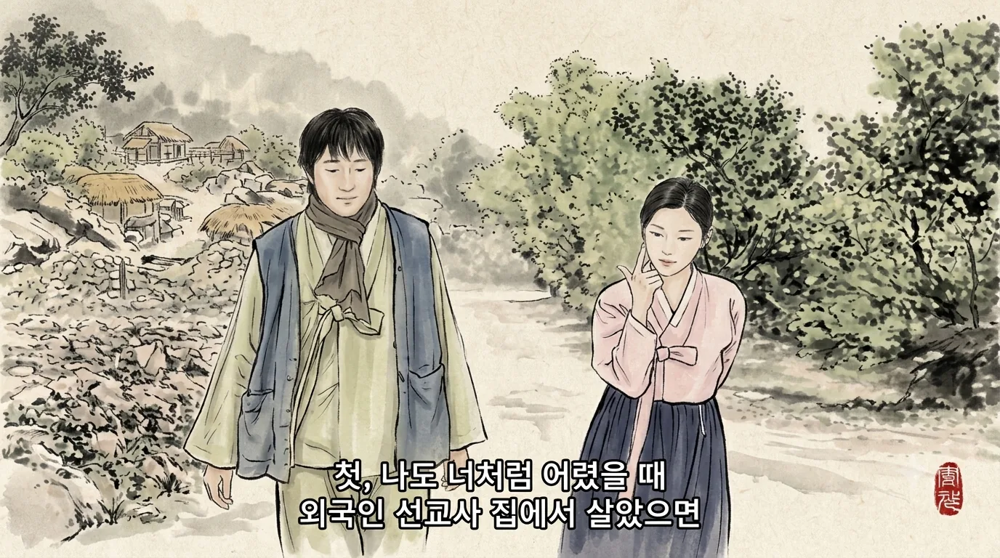

"काश मैं भी तुम्हारी तरह बचपन में किसी विदेशी मिशनरी के घर में रही होती…", "खाना चुराने का इल्ज़ाम लगा और पिटाई हुई…", और फिर "उस वक़्त मैंने सच में रोटी चुराई थी।"

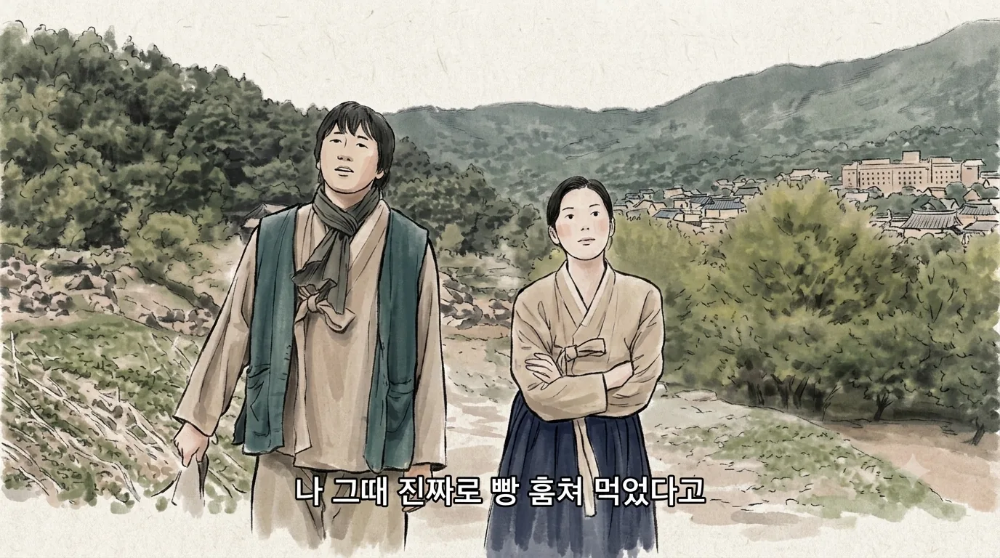

मैं समझता हूँ कि वे उसे एक चालाक बच्ची का किरदार देना चाहते थे जो झूठ और अभिनय से बची रही।
दिक़्क़त यह है कि उन्होंने सबसे सपाट तरीक़ा चुना: डायलॉग।
अगर नन्ही गा-ग्योंग को सच में रोटी चुराते और रो-धोकर बड़ों को बहलाते हुए सिर्फ़ 30 सेकंड दिखाया जाता, तो यह किरदार कहीं गहरा होता।

22:52 पर डायलॉग आता है: "तीन साल पहले तुम मेरे पैसे चुराकर जहाज़ में छिपकर भागने निकली थीं…"

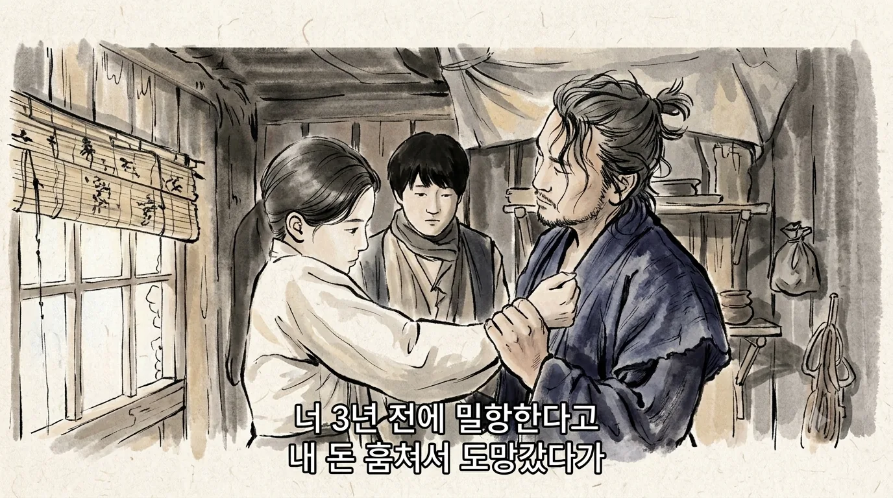

यह मनवाने के लिए कि उसका कहीं चले जाने का सपना है, कुछ दिखाना ज़रूरी है, फ़्लैशबैक या कोई काम।
"अर्थव्यवस्था, सुधर जाओ!" चिल्लाने से अर्थव्यवस्था नहीं सुधरती, और एक डायलॉग से किरदार नहीं बनता।

दूसरी तरफ़ है The Outlaws।
मा सोक-दो (मा डोंग-सोक) पहली बार ऐसी गली के बीच दिखता है जहाँ बहुत से कोरियाई-चीनी लोग रहते हैं, और जहाँ आदमी रसोई के चाकू लेकर आमने-सामने खड़े हैं।
मा सोक-दो फ़ोन पर काम की बात करते हुए उनके सामने आ खड़ा होता है और फ़ोन पर कहता है, "बच्चों की लड़ाई हो रही है।"

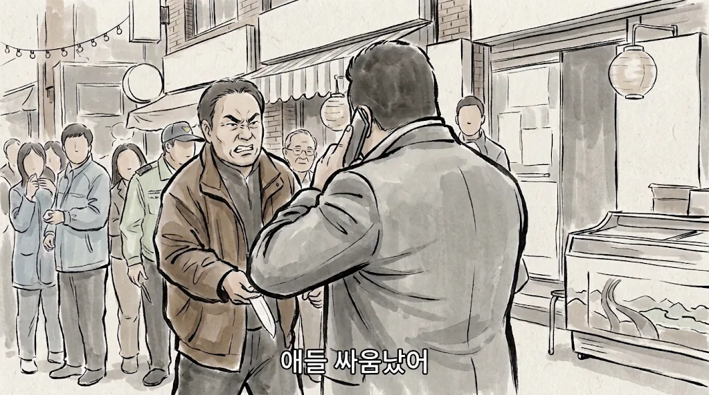

रसोई के चाकुओं वाला यह मंज़र उसके लिए बस बच्चों की लड़ाई है।
बात लापरवाही से कही गई है, पर असर ज़बरदस्त है।
फ़ोन काटे बिना ही वह पूरा मामला निपटा देता है।

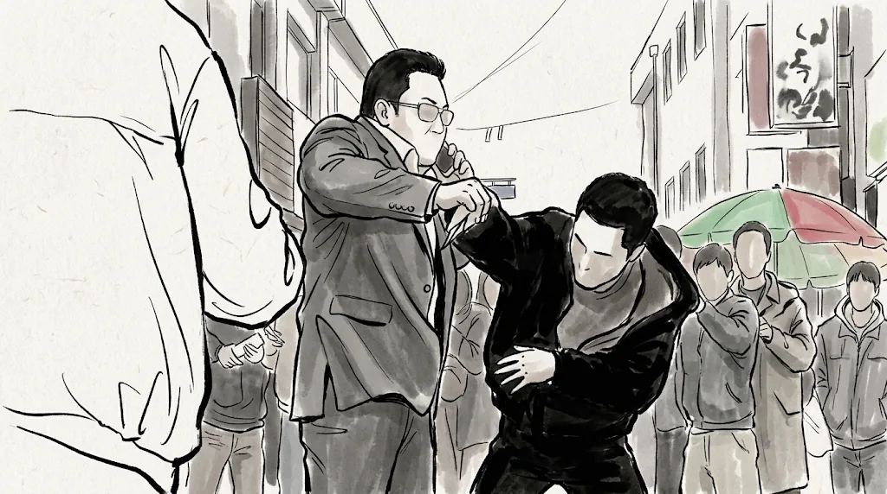

उसने किसी को पीटा नहीं, और किसी ने हमें नहीं बताया कि वह ताक़तवर है।
फिर भी दर्शक फ़ौरन मान लेते हैं।

अगर इस ड्रामा के लेखकों ने The Outlaws लिखी होती, तो शायद ऐसा होता।

> जूनियर जासूस: वाह भैया! सुना है इस महीने ही आपने दस लुटेरे अंदर कर दिए! इस साल भी पिछले साल की तरह सबसे अच्छे क्राइम डिटेक्टिव की ट्रॉफ़ी आपको ही मिलेगी!
> (मा डोंग-सोक मुस्कुराता है। सीन ख़त्म।)

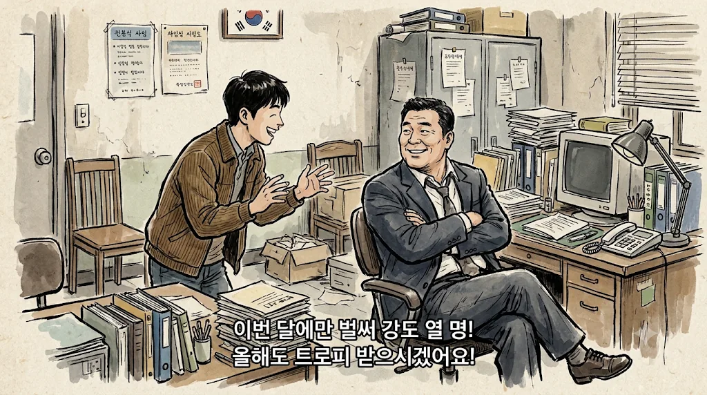

और ट्रॉफ़ी मिलने वाला सीन कभी नहीं आता।
लगता है जैसे हालात समझाना और किरदार गढ़ना होमवर्क की तरह निपटाया गया, "पृष्ठभूमि बता दी" पर टिक लगाया और आगे बढ़ गए। इसीलिए मुझे ऐसा निर्देशन नापसंद है।
हो सकता है जहाज़ वाली कहानी बाद में ठीक से खोलने के लिए बचाकर रखी हो, पर न जाने क्यों लगता है कि बस यही एक डायलॉग है।

एपिसोड 1 के 28:31 वाला पेट का पट्टा भी ऐसा ही है।
आज़ादी की सेनानी यू सो-रान (किम ह्यून-जू) ख़ुद ही कह देती है कि पेट में बच्चा नहीं, पट्टा है: "मैं यह पट्टा पहने ही रहूँगी।"

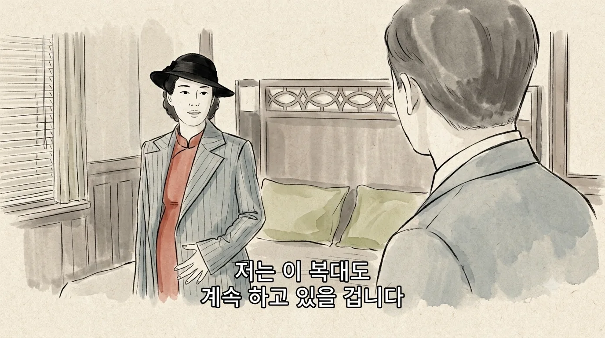

अगर उसे बस सिगरेट पीते या जाम उठाते दिखा दिया जाता, तो हम ख़ुद समझ जाते: "अरे, पेट में कुछ नहीं है क्या?"
जब इसे इतनी ख़ास तौर पर बताया गया, तो मुझे लगा उसमें कोई हथियार या दस्तावेज़ छिपा होगा।
पर वह बस पट्टा है, और वह भी परदे पर ठीक से नहीं दिखता।
इसे खोए बच्चे की याद कहा जा सकता है, पर आख़िर में लगता है जैसे गर्भवती मेकअप का ख़र्च बचाने के लिए एक डायलॉग से काम चला लिया गया।

## अचानक ग़ायब होती जापानी सुरक्षा

एपिसोड 1 में लगभग 52:32 पर राजनीतिक मामलों के अधीक्षक सातो शिनइची (जिन सन-ग्यू) कई गाड़ियों के क़ाफ़िले में पहुँचते हैं।

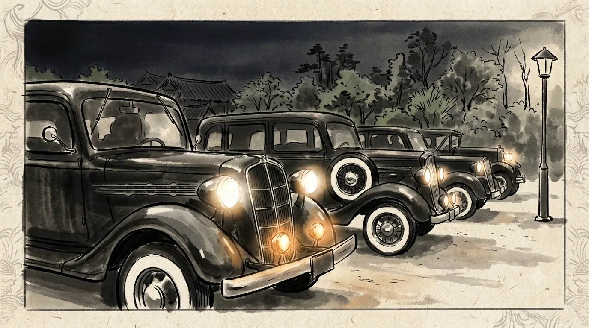

लेकिन घर के अंदर गोलीबारी के बाद, एपिसोड 2 के 14:30 पर, ग़ुस्से में होने की वजह से उन्हें अकेले एक गाड़ी में भेज दिया जाता है।

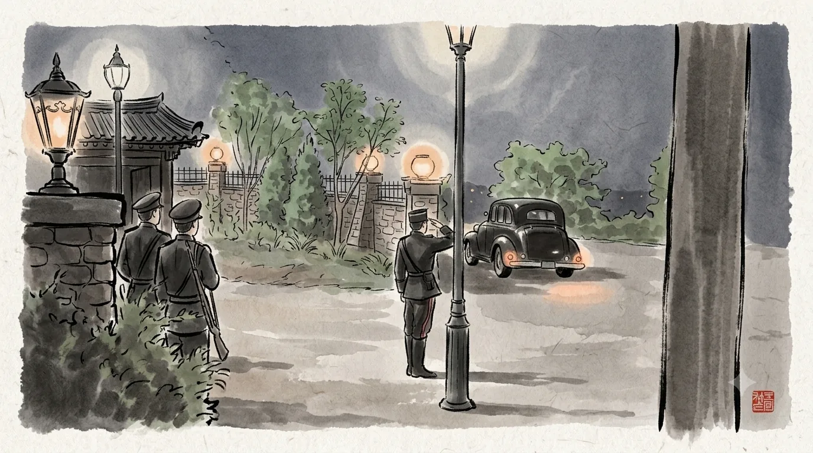

किसी को नहीं पता कि बाहर कितने साथी हैं या कोई बम है या नहीं।
गवर्नर-जनरल दफ़्तर के नंबर दो की रक्षा करने वाले संगठन को यह अजीब नहीं लगता, यही सबसे अजीब है।

गोलीबारी भी ऐसी ही है।
एपिसोड 2 में 2:02 पर पहली गोली चलती है, और गार्ड 6:54 पर खिड़की तोड़कर अंदर आते हैं।
उन लगभग पाँच मिनटों में 22 गोलियाँ चलती हैं।

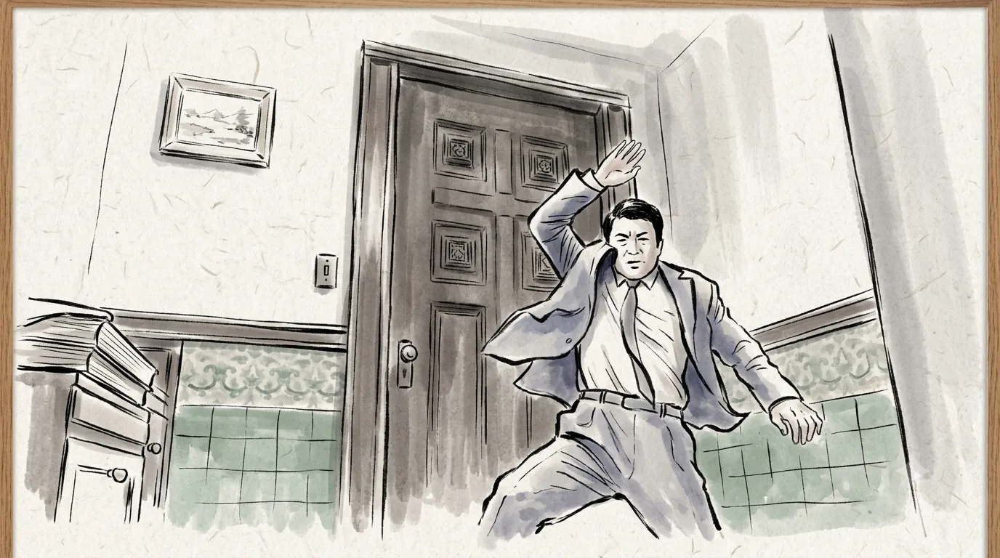

अंदर उनका सबसे बड़ा अफ़सर है।
फिर भी गार्ड बाहर से बस दरवाज़ा पीटते रहते हैं।
अफ़सर मरे या जिए, तमीज़ से दस्तक देते गार्ड। पूरे पाँच मिनट मैं यही सोचता रहा, "क्या अब तक इन्हें दरवाज़ा तोड़ नहीं देना चाहिए?"

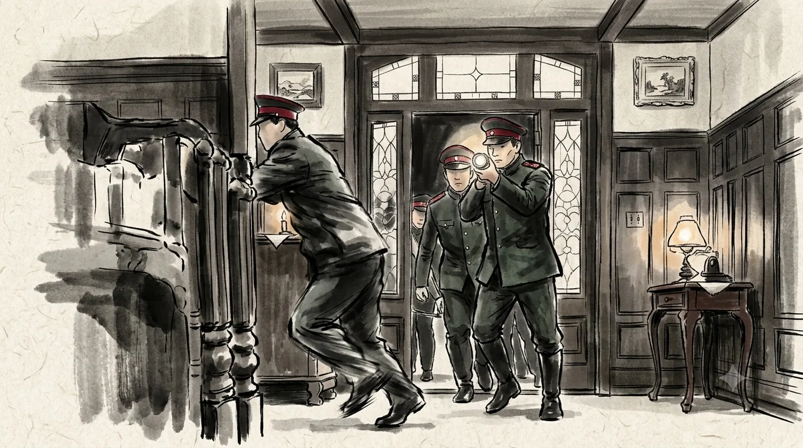

## एक छोटी चोर के इशारों पर चलते आज़ादी के सेनानी

देश की आज़ादी के लिए जान लेने वाला संगठन ली गा-ग्योंग को ज़िंदा छोड़ देता है, जबकि वह बाहरी है और उनकी असलियत जान चुकी है।
और वह खुलेआम कहती है, "कोई मुझे पैसे तो नहीं दे रहा।"

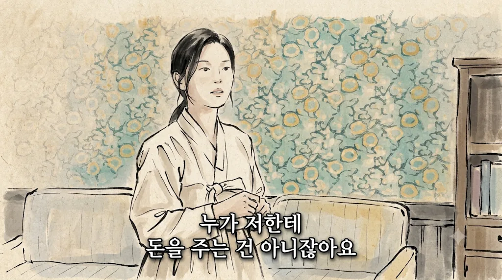

जब गोपनीयता ही सब कुछ हो और पूरे अभियान का नतीजा दाँव पर हो, तब यह बेतुका है।
इसीलिए मैंने कहा कि यह कहानी तभी समझ में आती है जब गा-ग्योंग एपिसोड 2 में मर जाए।

गा-ग्योंग सेनानियों की गोलियाँ चुराती है, फिर उन्हें बेचने उनके अड्डे पर पहुँच जाती है।
वह भी खुलेआम यह कहते हुए कि चोरी उसी ने की।
एपिसोड 1 के लगभग 59:17 पर तो वह उल्टा यू सो-रान को उकसाती भी है: "मैं चिल्लाऊँगी और हंगामा करूँगी।"

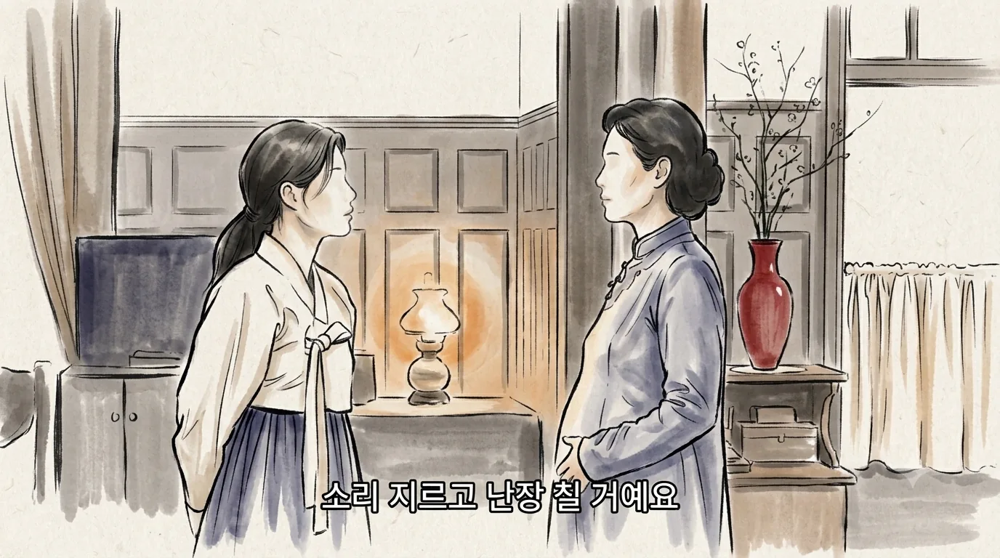

उसे बंदूक़ के बिना भी क़ाबू करने के कई तरीक़े हैं।
और सच में, उसके बाद जब एक सेनानी पीछे से बंदूक़ तानता है, तभी जाकर वह डरती है।
देश के लिए जान दाँव पर लगाने वालों के सामने एक छोटी चोर का कमान सँभाल लेना, सेनानियों को बहुत हल्के में लेने जैसा लगा, और यह मुझे बुरा लगा।

पहले वाली गोलीबारी भी ऐसी ही है।
उस घर में गोलियाँ चलाकर हंगामा मचाने वाला यू सो-रान का पूर्व पति है।
वह भी आज़ादी का सेनानी है, पर यू सो-रान के संगठन का नहीं, शायद किसी दूसरे संगठन का लगता है।
कई गुट हैं जो अलग-अलग चलते हैं और आपस में बात नहीं कर पाते, यह सेटअप मैं समझता हूँ, पर जिस तरह दिखाया गया उससे सेनानी हद से ज़्यादा बेवक़ूफ़ लगने लगे।

## मेरा पैमाना Mr. Sunshine की वजह से ऊँचा है

मुझे लगता है मैं इतना सख़्त Mr. Sunshine की वजह से हुआ।
उस ड्रामा में एक भी सपाट किरदार नहीं था, और ऐतिहासिक ब्योरे, मनोविज्ञान, निर्देशन या कहानी, किसी में कोई कमी नहीं थी।

ऊपर से, 100 Days of Lies मिलती-जुलती कहानी कहना चाहता लगता है।
यूजीन चोई (ली ब्युंग-हुन) ने कभी आज़ादी के बारे में सोचा तक नहीं था, पर जोसॉन में पैदा होने भर से जान देने वालों में वह धीरे-धीरे घुलता गया और आख़िर में उसी राह पर आ गया।
पैसे जमा करके अमेरिका जाने का सपना देखने वाली जेबकतरी ली गा-ग्योंग भी शायद उसी राह पर चलेगी।
वही दौर, वही विषय, मिलता-जुलता किरदार का सफ़र, इसलिए मुझसे सख़्त पैमाना लगाए बिना रहा नहीं गया।

डायलॉग से निपटाई गई पृष्ठभूमि हो या बेतुके सीन, अब मुझसे और बर्दाश्त नहीं होता।
इसलिए मैंने एपिसोड 2 पर बंद कर दिया।
