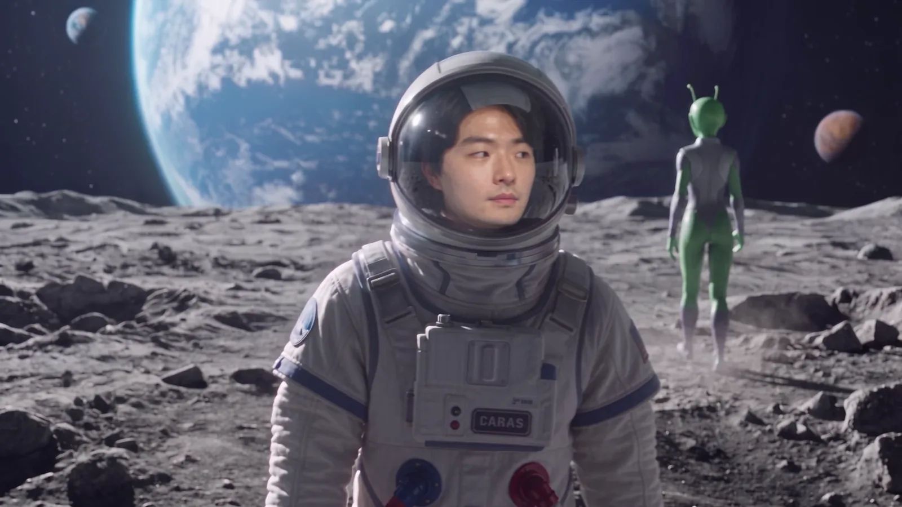
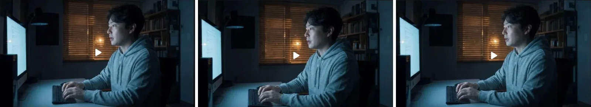
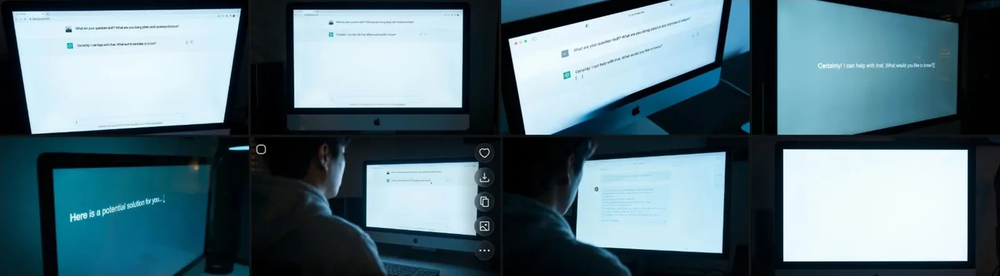
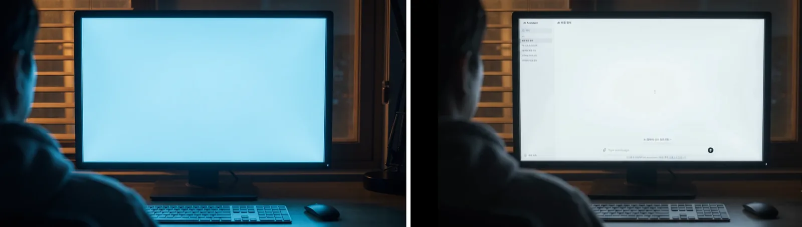
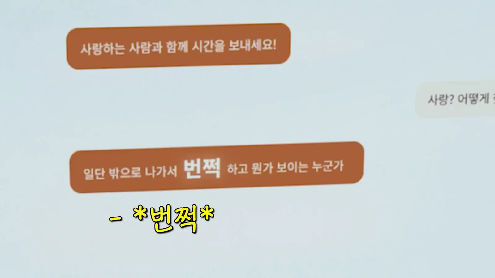
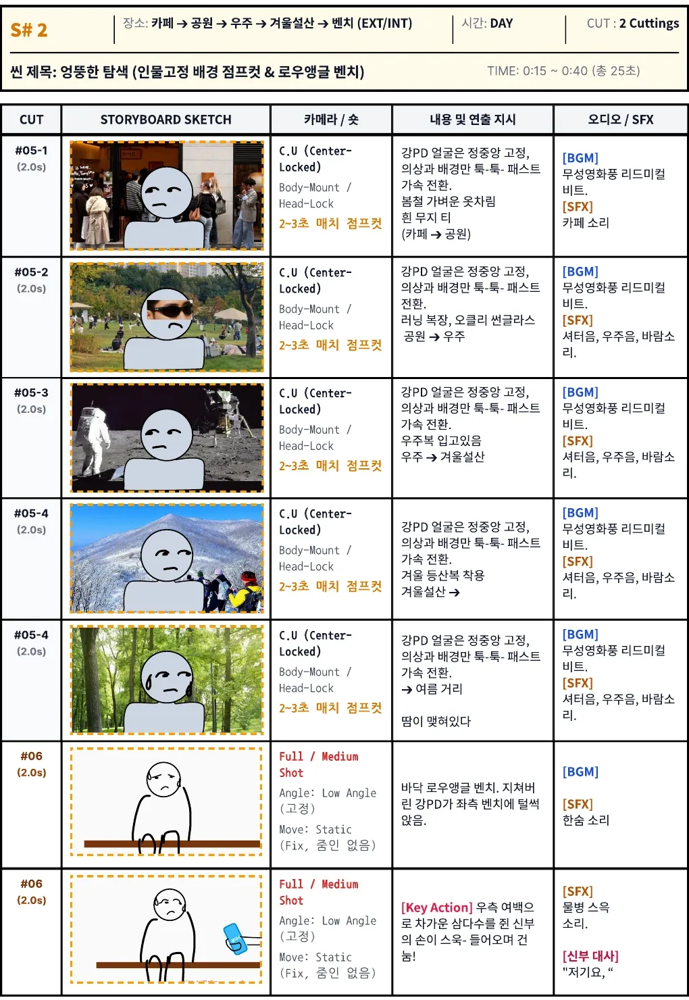
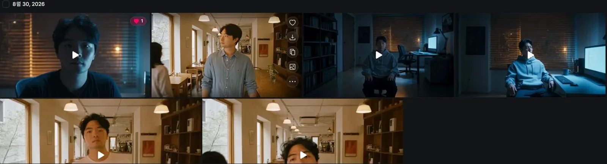
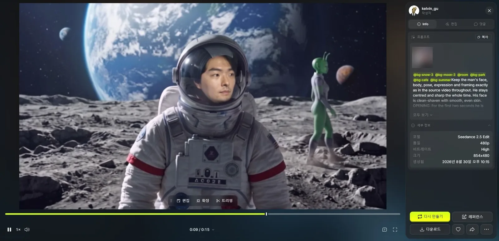
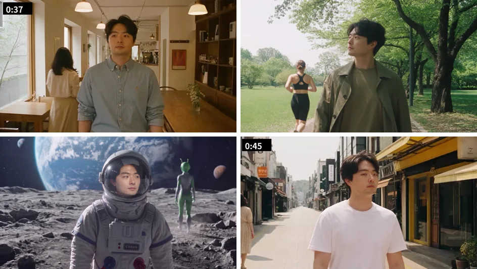

हमारी शादी की फ़िल्म के S#1 वर्करूम के लिए मैंने Cinema Studio से तीन शॉट बनाए और सिर्फ़ मॉनिटर स्क्रीन HTML से जोड़ी। S#2 भटकने वाले सीन के लिए GoPro की 15 सेकंड की सेल्फ़ी क्लिप को एक दिन में छह बार Seedance 2.5 Edit से दोबारा चलाया।

[भाग 1](/hi/posts/higgsfield-wedding-film/) में स्टोरीबोर्ड और Higgsfield की तैयारी लिखी थी। भाग 2 ओपनिंग के बाद से फ़िल्म के करीब 47 सेकंड तक का हिस्सा है। जनरेशन के रिकॉर्ड के लिए मैंने अपने Higgsfield अकाउंट में वीडियो डिटेल पेज एक-एक करके खोले और मॉडल, रेज़ोल्यूशन, समय और प्रॉम्प्ट जाँचे।


<small>फ़ाइनल कट में 0:41। भटकने वाले सीन में चाँद (AI से बना)। चाल और भाव सीधे मेरी GoPro फ़ुटेज से हैं</small>

## वर्करूम Cinema Studio से तीन शॉट में

S#1 रात का वर्करूम है। स्टोरीबोर्ड में यह 0:00 से 0:15 तक 15 सेकंड का था, लेकिन आगे Beat वाली मोटरसाइकिल ओपनिंग जुड़ने (यह [भाग 1](/hi/posts/higgsfield-wedding-film/) में है) और बातचीत लंबी होने से फ़ाइनल कट में 0:35 तक गया।

जैसा भाग 1 में लिखा, वर्करूम की तस्वीरें 29 अगस्त से बनानी शुरू कीं। पहले लोकेशन की तस्वीर, फिर उसमें मुझे बिठाई तस्वीर, फिर उस तस्वीर को चलाया। चलाने के चरण में Higgsfield का Cinema Studio इस्तेमाल किया। यह वीडियो मॉडल है जिसमें कैमरा, लेंस, अपर्चर और जॉनर चुनकर फ़िल्म की तरह शूट किया जाता है।

| बनाने का समय | रेज़ोल्यूशन | क्या है |
|---|---|---|
| 31 अगस्त 01:03 | 1080p | साइड से टाइप करते हुए कहता है, "AI, इंसान के ख़ुश रहने का सबसे पक्का तरीका क्या है?" |
| 2 सितंबर 01:27 | 1080p | उसी डायलॉग से दोबारा बनाया |
| 2 सितंबर 01:29 | 1080p | "प्यार? ऐसे इंसान को कैसे ढूँढूँ?" |

तीनों की सेटिंग एक थी। 8 सेकंड, कैमरा Modern, लेंस Halation Vintage, अपर्चर f/1.4, जॉनर Drama 2020s।


<small>बाएँ 31 अगस्त की, बीच और दाएँ 2 सितंबर की Cinema Studio क्लिप</small>

भाग 1 की क्रेडिट तालिका में Cinema Studio एक बार में 20 से 72 क्रेडिट का था। 8 सेकंड के लिए 720p पर 20 और 1080p पर 45 से 72। तीनों शॉट बिना 480p टेस्ट के सीधे 1080p में बनाए।

## मॉनिटर स्क्रीन आख़िरकार HTML से जोड़ी

वर्करूम सीन का असली हीरो मॉनिटर है। AI जहाँ ख़ुश रहने का तरीका बताता है, वह स्क्रीन पढ़ी जा सके तभी कहानी आगे बढ़ती है। यह स्क्रीन AI से बनाने की दो बार कोशिश की।

2 सितंबर 01:37 पर Seedance 2.5 से एक 480p वीडियो बनाया। प्रॉम्प्ट में कोरियाई में लिखा कि "उदाहरण तस्वीर की तरह स्क्रीन पर AI से बातचीत" दिखे, "लाइट मोड में"। फिर 6 सितंबर को तस्वीरों से फिर कोशिश की। दोपहर 1:31 पर, और फिर 4:17 से 4:26 के बीच, Nano Banana Pro और Seedream 5.0 Pro से "इस मॉनिटर के AI जवाब वाले हिस्से का क्लोज़-अप" वाली कई तस्वीरें बनाईं। 4:28 पर कैमरा एंगल बदलने वाला Angles भी एक बार आज़माया।


<small>6 सितंबर की मॉनिटर क्लोज़-अप कोशिशें। अक्षर अंग्रेज़ी में आए या बिगड़ गए, और आख़िरी में स्क्रीन बिल्कुल ख़ाली है</small>

कोई भी इस्तेमाल लायक नहीं था। स्क्रीन पर कोरियाई नहीं, अंग्रेज़ी थी, और वह भी "What are your question stuff?" जैसे बेतुके वाक्य। जितना क्लोज़-अप, अक्षर उतने बिगड़े। इस स्क्रीन की हर लाइन कैप्शन से मेल खानी थी, इसलिए मिलते-जुलते अक्षरों से काम नहीं चलता।

तो तरीका बदला। **मॉनिटर को ख़ाली स्क्रीन बनाया, चैट स्क्रीन अलग से HTML में बनाकर रिकॉर्ड की, और Premiere में मॉनिटर की जगह जोड़ दी।**


<small>बाएँ जोड़ने के लिए बनाया ख़ाली मॉनिटर (AI से बना), दाएँ HTML चैट स्क्रीन लगाने के बाद का नतीजा</small>

फ़ाइनल कट में स्क्रीन ऐसे चलती है। AI जवाब देता है, "जिससे प्यार करते हो उसके साथ समय बिताओ!", मैं टाइप करता हूँ, "प्यार? कैसे…", तीन बिंदु टिमटिमाते हैं, और फिर आता है: "पहले बाहर जाओ, कोई ऐसा मिलेगा जिससे आँखों के सामने कुछ चमकेगा! लोगों से मिलो।"


<small>फ़ाइनल कट में 0:31। यह "चमक" आगे बेंच और शादी हॉल के सीन में फिर आती है</small>

स्टोरीबोर्ड का डायलॉग था, "बाहर जाइए। सच्चा साथी मिलते ही आँखों के सामने कुछ चमकेगा!" फ़ाइनल कट में यह चैट वाले अंदाज़ में बदल गया। HTML में अक्षर सीधे लिखने होते हैं, इसलिए ऐसे बदलाव में कोई क्रेडिट नहीं लगा।

## भटकने वाले सीन GoPro सेल्फ़ी से शुरू हुए

S#2 स्टोरीबोर्ड में "अजीब खोज" नाम का 25 सेकंड का सीन है। AI के कहे मुताबिक बाहर निकला Kang PD चमक ढूँढते हुए अजीब जगहों पर भटकता है।

यह सीन डालने की दो वजहें थीं।

| वजह | क्या करता है |
|---|---|
| चमक ढूँढने का एहसास | AI की कही "चमक" को ढूँढते हुए इधर-उधर घूमने का एहसास देता है |
| याद दिलाना कि यह AI है | बर्फ़ीले पहाड़ पर चढ़ाई, चाँद पर स्पेससूट, गुज़रता एलियन: इन्हें कोई सच में शूट नहीं कर सकता। यह वह हिस्सा है जहाँ स्क्रीन कहती है, "यह AI है, उलझिए मत" |

दूसरी वजह सोच से ज़्यादा अहम निकली। फ़िल्म के बाद काफ़ी बुज़ुर्ग मेहमानों ने पूछा कि यह सब शूट करने कब गए। कई लोगों को लगा कि सच में शूट किया है। यानी AI वीडियो को असली से अलग पहचानना इतना मुश्किल हो गया है। **AI से बने वीडियो में ऐसा हिस्सा ज़रूर होना चाहिए जहाँ साफ़ पता चले कि यह AI है।** यही काम इस सीन ने किया।


<small>S#2 स्टोरीबोर्ड। चेहरा स्क्रीन के बीच टिका रहता है, सिर्फ़ कपड़े और बैकग्राउंड हर 2–3 सेकंड में बदलते हैं</small>

| कट | जगह | पहनावा | आवाज़ |
|---|---|---|---|
| #05-1 | कैफ़े → पार्क | हल्के बसंती कपड़े, सादी सफ़ेद टी-शर्ट | मूक फ़िल्म जैसी लयबद्ध बीट, कैफ़े की आवाज़ |
| #05-2 | पार्क → अंतरिक्ष | दौड़ने के कपड़े, Oakley चश्मा | शटर की आवाज़, अंतरिक्ष की आवाज़, हवा |
| #05-3 | अंतरिक्ष → सर्दियों का बर्फ़ीला पहाड़ | स्पेससूट | वही |
| #05-4 | बर्फ़ीला पहाड़ → गर्मियों की सड़क | सर्दियों के पहाड़ी कपड़े | वही |
| #05-4 | गर्मियों की सड़क | पसीने की बूँदें | वही |
| #06 | ज़मीन से लो-एंगल बेंच | थककर बाईं बेंच पर धम्म से बैठता है | आह की आवाज़ |

कैमरे के लिए स्टोरीबोर्ड में "C.U (Center-Locked), Body-Mount / Head-Lock" लिखा था। जैसे कैमरा शरीर से बँधा हो, चेहरा स्क्रीन के बीच गड़ा रहता है और सिर्फ़ दुनिया बदलती है। यह शुरू से AI से बनाने पर हर जगह चेहरे की जगह और आकार अलग हो जाते। इसलिए मैंने ख़ुद शूट किया।

GoPro पकड़कर चलते हुए 15 सेकंड की सेल्फ़ी फ़ुटेज शूट की। वह क्लिप Seedance 2.5 Edit में डाली। Edit असली वीडियो की हरकत रखता है और सिर्फ़ प्रॉम्प्ट में बताई चीज़ें दोबारा बनाता है, इसलिए चाल, भाव और कैमरे का हिलना वैसा ही रहता है और सिर्फ़ बैकग्राउंड और कपड़े बदलते हैं। जगहों के लिए भाग 1 में बनाए लोकेशन एलिमेंट (@bg-cafe, @bg-park, @bg-moon, @bg-snow, @bg-summer) बुलाए। असली क्लिप में घर के अंदर दिखता है, इसलिए यहाँ नहीं डाली।

## Seedance 2.5 Edit, 30 अगस्त को छह बार

भटकने वाला सीन 30 अगस्त शाम 6 बजे से रात 11 बजे से पहले तक छह बार बनाया। पाँच 480p टेस्ट थे और सिर्फ़ आख़िरी 1080p।


<small>30 अगस्त की Seedance 2.5 Edit हिस्ट्री। थंबनेल पहला फ़्रेम है, इसलिए पहले वाले कैफ़े से और बाद वाले वर्करूम से शुरू होते हैं</small>

| वर्ज़न | बनाने का समय | रेज़ोल्यूशन | क्या बदला |
|---|---|---|---|
| v1 | 18:10 | 480p | पाँच लोकेशन एलिमेंट बुलाए और सिर्फ़ समय के हिसाब से कट की सूची लिखी, जैसे "0.0 सेकंड कैफ़े सफ़ेद टी → 1.6 सेकंड पार्क दौड़ने के कपड़े → 3.2 सेकंड चाँद स्पेससूट…" |
| v2 | 19:30 | 480p | जोड़ा, "कैमरा हाथ में है और साथ चलता है; बैकग्राउंड और इंसान एक ही कैमरा मूवमेंट साझा करते हैं" |
| v3 | 21:17 | 480p | वर्करूम एलिमेंट (@room) जोड़ा ताकि पहले 2 सेकंड वह वर्करूम में बैठा रहे और फिर उठे। जोड़ा, "रेफ़रेंस तस्वीरें सिर्फ़ माहौल, रोशनी और कपड़ों के लिए हैं; इंसान की नक़ल मत करो" |
| v3 फिर से | 21:22 | 480p | उसी प्रॉम्प्ट से दोबारा बनाया |
| v4 | 22:15 | 480p | पूरे 15 सेकंड को समय-सारिणी में फिर से लिखा (नीचे) |
| v4 फ़ाइनल | 22:41 | 1080p | बर्फ़ीले पहाड़ और चाँद के एलिमेंट @bg-snow-5 और @bg-moon-4 में बदलकर फ़ाइनल |

v1 कट की सूची थी। बस कौन सा सेकंड, कहाँ और कौन से कपड़े। v2 में कैमरा मूवमेंट की एक लाइन जुड़ी। सेल्फ़ी कैम हर कदम पर हिलता है, इसलिए निर्देश था कि बैकग्राउंड भी उसी तरह हिले ताकि सब एक फ़्रेम लगे।

v3 में वर्करूम से उठने वाले 2 सेकंड S#1 से S#2 तक का पुल थे। "इंसान की नक़ल मत करो" वह वाक्य था जिसने लोकेशन रेफ़रेंस से लेने वाली चीज़ें माहौल, रोशनी और कपड़ों तक सीमित कीं।

v4 में प्रॉम्प्ट शुरू से दोबारा लिखा। डिटेल पेज पर बचा शुरुआती हिस्सा:

```
@bg-snow-3 @bg-moon-3 @room @bg-park @bg-cafe @bg-summer
Keep the man's face, body, pose, expression and framing exactly
as in the source video throughout. He stays centred and sharp
the whole time. His face is clean-shaven with smooth, even skin.
OPENING: For the first two seconds he is ...
```


<small>v4 480p का डिटेल पेज। मॉडल, रेज़ोल्यूशन, आकार और समय दाईं ओर रहते हैं। पैनल में असली वीडियो का थंबनेल धुँधला कर दिया</small>

v4 के निर्देश बिंदुवार:

| बिंदु | निर्देश |
|---|---|
| चेहरा | चेहरा, शरीर, मुद्रा, भाव और फ़्रेमिंग बिल्कुल असली जैसे। स्क्रीन के बीच, आख़िर तक साफ़। शेव की हुई चिकनी त्वचा |
| ओपनिंग | मॉनिटर की रोशनी में बैठा है, 2 सेकंड पर उठता है। कैमरा आँख की ऊँचाई पर, लो-एंगल मना |
| जगह बदलना | 4 सेकंड के बाद पाँच जगहों में हार्ड कट। हर जगह का समय तय किया |
| कपड़े और रोशनी | हर जगह के कपड़े और रोशनी अलग से लिखे |
| नज़र | "चमक ढूँढ रहा है।" बाएँ से दाएँ सिर्फ़ दो बार देखता है |
| गुज़रने वाले | हर जगह एक औरत पीछे से गुज़रती है। हर बार अलग, कोई आदमी नहीं |
| चाल | हर नई जगह के साथ और थकती चाल |

आख़िरी 1080p वाला एक रन 132.73 क्रेडिट का था। भाग 1 की तरह यह आँकड़ा ट्रांज़ैक्शन के समय से मिलाया है, और 480p टेस्ट 19.26 क्रेडिट से शुरू होता था, तो छह में से इसी एक ने ज़्यादातर खाया। ट्रांज़ैक्शन हिस्ट्री के हिसाब से 30 अगस्त को अकेले करीब 300 क्रेडिट गए।

## फ़ाइनल कट में बस 10 सेकंड से थोड़ा ज़्यादा

नतीजों में सबसे मज़ेदार गुज़रने वाले लोग थे। कैफ़े में एक औरत पीछे से गुज़रती है, पार्क में दौड़ने के कपड़ों में एक औरत दौड़ती है। चाँद पर हरा एलियन गुज़रता है। प्रॉम्प्ट में सिर्फ़ "औरत, पीछे से" लिखा था, लेकिन जैसा पहले कहा, एलियन साफ़ दिखाता है कि यह AI है, इसलिए उसे रहने दिया।


<small>ऊपर बाएँ से: कैफ़े, पार्क, चाँद, गर्मियों की सड़क (AI से बना)। चेहरे की जगह बिल्कुल असली सेल्फ़ी जैसी है</small>

फ़ाइनल कट में भटकने वाले सीन 0:36 पर कैफ़े से शुरू होकर पार्क, चाँद, बर्फ़ीले पहाड़ और गर्मियों की सड़क से गुज़रते हुए करीब 0:47 पर ख़त्म होते हैं। स्टोरीबोर्ड के 25 सेकंड घटकर 10 सेकंड से थोड़ा ज़्यादा रह गए। स्टोरीबोर्ड का आख़िरी कट #06, बेंच पर धम्म से बैठना, भाग 3 में अलग से बने बेंच सीन में जाता है।

यही सीन फिर बनाऊँ तो ऐसे करूँगा।

| क्या करना | वजह |
|---|---|
| जिस स्क्रीन पर अक्षर दिखें, उसे शुरू से जोड़ना | मॉनिटर को AI से बनाने में 2 सितंबर और 6 सितंबर दो बार लगा। जहाँ अक्षर सटीक चाहिए, वह जनरेशन से नहीं बना |
| v1 से ही समय-सारिणी | कट सूची से समय-सारिणी तक पहुँचने में चार रन लगे। शुरू से ही लिखें कि किस सेकंड क्या होता है और कैमरा कैसे चलता है, तो टेस्ट कम होते हैं |
| प्रॉम्प्ट में हर रेफ़रेंस की भूमिका लिखना | लोकेशन तस्वीर से क्या लेना है, यह v3 में जाकर लिखा |

भाग 3 बेंच सीन है। एक हाई-एंगल शॉट को सात बार कैसे चलाया, पानी की बोतल देने वाला लो-एंगल शॉट 6 सितंबर को एक ही दिन में आठ बार कैसे बनाया, और तब कौन से प्रॉम्प्ट नियम पक्के हुए।
