AI वीडियो में अपना चेहरा डालते समय, **सामने, साइड, ऊपर और नीचे की ढेर सारी तस्वीरों वाले किरदार से कहीं ज़्यादा मेरे जैसी वह एक रेफ़रेंस तस्वीर लगी जिसका एंगल शॉट से मेल खाता था।** दूर का छोटा चेहरा किसी भी तरीके से ठीक नहीं बना।

यह बात मुझे हमारी शादी की फ़िल्म के बेंच सीन में समझ आई। एक हाई-एंगल तस्वीर सात बार चलाई, और पानी थमाने वाला लो-एंगल शॉट सिर्फ़ 6 सितंबर को आठ बार बनाया। इतनी मेहनत इसलिए लगी कि लो-एंगल कंपोज़िशन शब्दों में समझाना मुश्किल था, और जितनी बार दोबारा चलाया, चेहरा उतना कम मेरे जैसा रहा। मीटर की जगह स्क्रीन के अनुपात लिखने जैसे प्रॉम्प्ट नियम भी इसी सीन में पक्के हुए।

[भाग 1](/hi/posts/higgsfield-wedding-film/) स्टोरीबोर्ड और तैयारी था, [भाग 2](/hi/posts/higgsfield-wedding-film-2/) वर्करूम और भटकने वाले सीन। भाग 3 फ़ाइनल कट में करीब 0:47 से 1:04 तक है, जहाँ भटककर थका मैं बेंच पर बैठता हूँ और मेरी पत्नी पानी देती है। वीडियो मैंने अपने Higgsfield अकाउंट के डिटेल पेज पर जाँचे, और तस्वीर के सात रन 31 अगस्त की Claude बातचीत से।

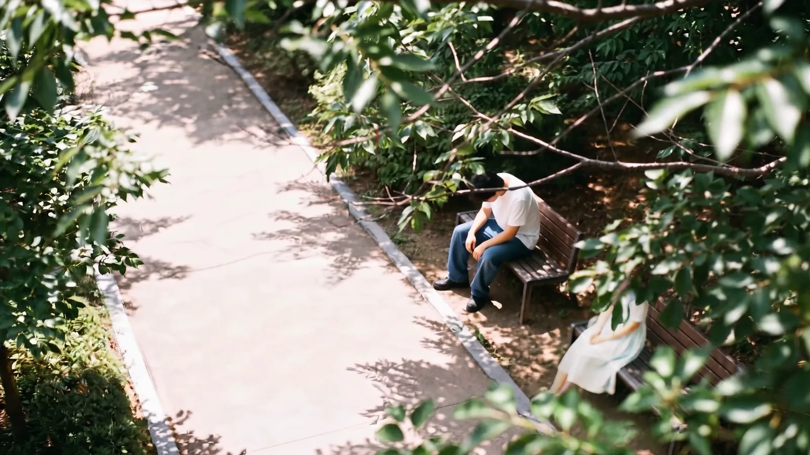
<small>फ़ाइनल कट में 0:50। हाई-एंगल से दिखती बेंच (AI से बनी)। इस एक कंपोज़िशन के लिए सात रन लगे</small>

## बेंच सीन तीन कैमरों से बना

स्टोरीबोर्ड में बेंच S#2 का आख़िरी कट (#06) और S#3 की मुलाक़ात की शुरुआत है। भटककर थका मैं बेंच पर धम्म से बैठता हूँ, और बगल में बैठा इंसान पानी की बोतल बढ़ाता है। वह मेरी पत्नी है।

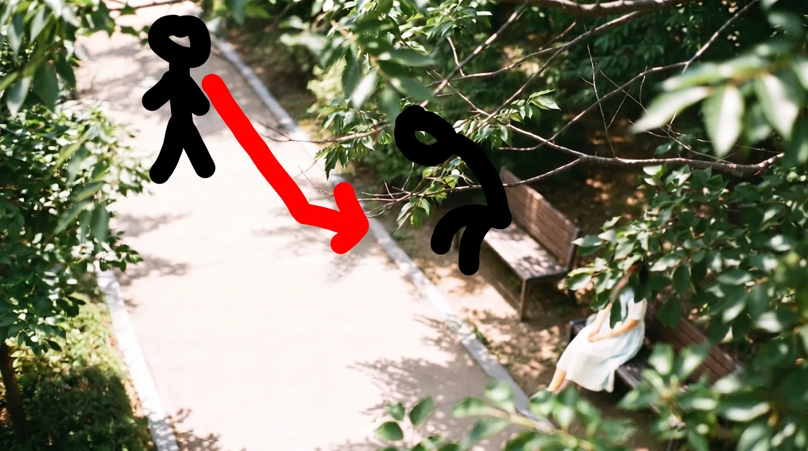
<small>सीन 3 का मूवमेंट डिज़ाइन। रास्ते से बेंच तक चलना मैंने AI तस्वीर के ऊपर ख़ुद बनाया</small>

सीन को तीन कैमरों में बाँटा।

| कैमरा | जगह | क्या करता है |
|---|---|---|
| A हाई-एंगल | पेड़ के ऊपर से नीचे देखता | चलकर बैठता मैं, और पत्तों से ढके चेहरे वाली मेरी पत्नी |
| B लो-एंगल | बेंच की सीट की ऊँचाई | थककर बैठे मेरी ओर स्क्रीन के बाहर से बोतल पकड़ा हाथ आता है |
| C नज़रिया | मेरी आँख की ऊँचाई | बढ़ाई बोतल देखता हूँ, ऊपर देखता हूँ, और पत्नी का चेहरा दिखता है (#07) |

C के बाद स्टोरीबोर्ड के नंबर चलते हैं। #08 मेरा हक्का-बक्का मुड़ता चेहरा, #09 अचानक आँख में ज़ूम, #10 आँख के अंदर मोंटाज, #11 फिर ज़ूम-आउट होकर मुस्कुराता चेहरा। #10 का मोंटाज हमारी असली तस्वीरें हैं, इसलिए यहाँ नहीं डाला।

A में पत्नी का चेहरा पत्तों से ढका, ताकि चेहरा पहली बार C में बोतल के ठीक बाद दिखे।

## एक हाई-एंगल तस्वीर पर सात रन

शॉट A के लिए पहले तस्वीर बनाई। क्रम था: तस्वीर पक्की करो, फिर उसे पहला फ़्रेम बनाकर वीडियो। तस्वीर Nano Banana Pro से बनाई। 31 अगस्त की सुबह एक बातचीत में करीब सात बार चलाई।

| रन | क्या बदला | नतीजा |
|---|---|---|
| 1 | पिछले दिन का नतीजा रेफ़रेंस में डालकर चार चीज़ें एक साथ: "रास्ता खोलो, ऊपर दाएँ पत्तों से दुल्हन ढको, बाल काले, सफ़ेद ड्रेस" | सिर्फ़ बालों का रंग बदला। रेफ़रेंस को वैसा ही रखने वाले वाक्य ने बाकी सारे निर्देश दबा दिए |
| 2 | दो-चरण तरीके का पहला चरण। इंसान हटाओ, सिर्फ़ रास्ता और पत्ते | दो बेंच एक हो गई, कैमरा पास आ गया, और पत्तों ने बेंच नहीं ढकी। कम से कम बेंच लंबी होनी चाहिए ताकि मेरे बैठने की जगह हो |
| 3 | नए सिरे से। ऊँचाई 4 मी, दूरी 8 मी, 25 डिग्री, 35mm, दो बेंच | दो बेंच आगे-पीछे आमने-सामने आईं। तब वह बगल से बोतल नहीं दे सकती। "आगे-पीछे" नहीं, "स्क्रीन पर दाएँ-बाएँ साथ-साथ" चाहिए था |
| 4 | एक बेंच आड़ी, दुल्हन स्क्रीन के दाएँ छोर पर, 3.5 मी, 7 मी, 27 डिग्री | पत्तों ने फिर नहीं ढका। `cover` शब्द कमज़ोर था |
| 5 | सूरज को दुल्हन के पीछे से कैमरे के पीछे किया (सामने की रोशनी), "वह छोटी है" जैसे वाक्य और "अगर" वाले वाक्य हटाए | सामने की रोशनी, आड़ी बेंच, 27 डिग्री सही। लेकिन हर रन में और पास आता गया। मीटर काम नहीं कर रहे थे |
| 6 | एंगल हटाया, सिर्फ़ ऊँचाई और क्षैतिज दूरी। 12 मी, इंसान स्क्रीन की ऊँचाई का 1/8, बेंच स्क्रीन की चौड़ाई का 1/4, रास्ता नीचे के 2/3 में, पत्ते ऊपर दाएँ 1/4 में, "छाती से ऊपर सब पत्तों के पीछे" | दूरी, जगह और पेड़ बिल्कुल ठीक। रास्ता तिरछा आया और अटपटा लगा |
| 7 | रास्ता `roughly horizontally`, फ़ुटपाथ एक ही पैटर्न | फिर दो बेंच बन गईं। `Exactly one bench` और ख़ाली जगह को `wide enough for another person to sit down` किया |

रन 4 में पत्तों का वाक्य बदला। "पत्ते चेहरा ढकते हैं" की जगह स्थिति के रूप में लिखा: `Her face is hidden behind these leaves`। `clearly visible` जैसे शब्द हटा दिए, क्योंकि वे उल्टा उसी हिस्से पर ध्यान खींच सकते थे।

रन 5 में सूरज की जगह भी मायने रखती थी। पहले सूरज पत्नी के पीछे रखा था। लेकिन बैकलाइट सिर्फ़ C वाले नज़रिए के शॉट में चाहिए, जहाँ वह सूरज को ढकते हुए दिखती है। A और B में सूरज कैमरे के पीछे रखकर सामने की रोशनी की।

रन 7 के प्रॉम्प्ट का मुख्य हिस्सा:

```
The camera is 3.5 metres above the ground. The horizontal distance
from the camera to the bench is 12 metres.
A paved walking path runs roughly horizontally across the frame ...
The empty path fills the lower two thirds of the frame.
Exactly one wooden park bench ... occupies about one quarter of the frame width.
... her figure occupies about one eighth of the frame height.
The left half of the bench seat is clearly empty and unoccupied,
wide enough for another person to sit down beside her.
Everything above her chest is hidden behind these leaves.
```

फिर भी एक चीज़ आख़िर तक नहीं हुई। पत्तों ने पत्नी को एक पिक्सेल भी नहीं ढका। हर बार पत्ते स्क्रीन के ऊपर दाएँ कोने में चुपचाप पड़े रहे। लगता था मॉडल पत्तों को आगे की चीज़ नहीं, पीछे के पेड़ का हिस्सा बनाता है। मैंने पूछा भी कि क्या बनाने का क्रम तय कर सकते हैं, पर ऐसा विकल्प नहीं था।

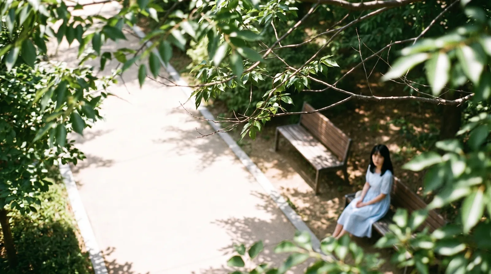
<small>थककर हिस्ट्री सूची से ख़ुद चुना रन (AI से बना)। नीली ड्रेस, और पत्ते पत्नी को नहीं ढकते</small>

आख़िर में सूची खोलकर मैंने ख़ुद चुना। ड्रेस नीली थी, लेकिन दूरी, बेंच और रास्ता सबसे अच्छे थे। पत्तों के लिए तय किया कि Premiere में असली पत्तों की फ़ुटेज ऊपर लगाऊँगा। चुनी तस्वीर Gemini से पूरी करके फिर Higgsfield पर डाली, और वह A वीडियो का पहला फ़्रेम बनी।

वीडियो 6 सितंबर सुबह 4:59 पर बनाया। सिर्फ़ यही शॉट Seedance 2.5 नहीं, Seedance 2 से था। प्रॉम्प्ट: "@강준구-cinema रास्ते पर चलकर आता है और बेंच पर धम्म से बैठता है, कैमरा स्थिर।" 1080p, और हिस्ट्री में बस यही एक रन है।

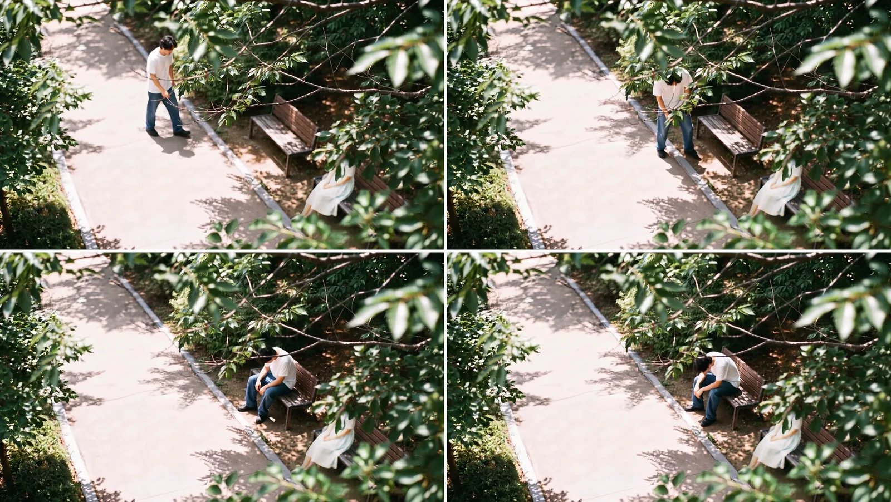
<small>फ़ाइनल कट में 0:48 से 0:51 (AI से बना)। फ़ाइनल कट में ड्रेस सफ़ेद है और आगे के पत्ते पत्नी को ढकते हैं</small>

फ़ाइनल कट में यह शॉट 0:48 से 0:51 तक करीब 4 सेकंड है। सात रन वाली एक तस्वीर 4 सेकंड बनी।

## पानी देने वाला लो-एंगल, 6 सितंबर को आठ बार

शॉट B बेंच की सीट की ऊँचाई से मुझे देखता है। पीठ टिकाने का हिस्सा स्क्रीन के दाएँ से लंबा फैला है, मैं उसके छोर पर थका बैठा हूँ, और स्क्रीन के दाएँ बाहर से बोतल पकड़ा हाथ आता है। हाथ की मालिक मेरी पत्नी है, स्क्रीन के बाहर, कैमरे की तरफ़ बेंच के छोर पर बैठी।

A तय होते ही बातचीत में इस जगह को मिलाने की बात आई। A में पत्नी स्क्रीन के दाएँ छोर पर और मैं बाएँ बैठता हूँ। B में कैमरा पत्नी की जगह जाकर बेंच की लंबाई की दिशा में मुझे देखता है। तर्क सही है, पर देखने वाले दाएँ-बाएँ में उलझ सकते थे।

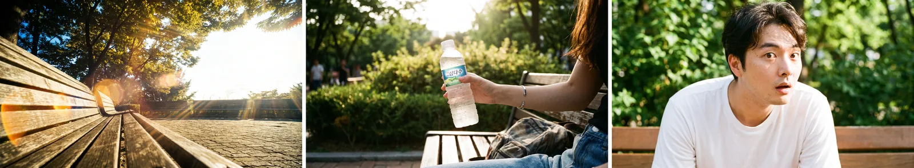
<small>30 अगस्त को पहले बना रखी बेंच सीन की तस्वीरें (AI से बनी)। ख़ाली बेंच लो-एंगल, बोतल पकड़ा हाथ, हैरान चेहरा</small>

लो-एंगल वीडियो 6 सितंबर सुबह 5 बजे से 8:20 तक आठ बार बनाया। सब Seedance 2.5 से।

| बनाने का समय | रेज़ोल्यूशन | क्या बदला |
|---|---|---|
| 05:08 | 480p | अंग्रेज़ी प्रॉम्प्ट। 3.8–4.5 सेकंड पर दाएँ से बोतल वाला हाथ, 4.5–5.5 सेकंड पर बोतल देखता है, हैरान नहीं होता |
| 05:45 | 480p | दोबारा बनाया |
| 05:53 | 1080p | दोबारा बनाया |
| 06:12 | 480p | अपना लिखा कोरियाई प्रॉम्प्ट: "सफ़ेद आधी बाँह की टी, जींस… गर्मी से जैसे कपड़े झलता है… स्क्रीन के दाएँ से पानी देता हाथ… हैरान नहीं होता" |
| 06:20 | 1080p | झलना "हल्का और धीमा" किया |
| 07:26 | 1080p | जोड़ा, "रेफ़रेंस तस्वीर की कैमरा कंपोज़िशन पूरी तरह मानो" |
| 07:48 | 480p | समय-सारिणी जोड़ी। 0–2 सेकंड आह, 2–6 सेकंड कपड़े झलना, 6–8 सेकंड बोतल वाला हाथ |
| 08:20 | 1080p | ऊपर की समय-सारिणी से फ़ाइनल |

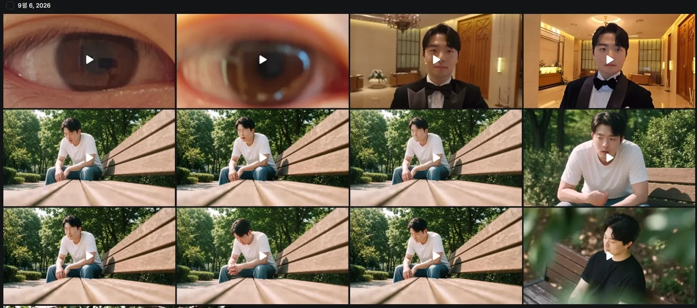
<small>6 सितंबर की हिस्ट्री। बीच की दो पंक्तियाँ बेंच लो-एंगल हैं। कंपोज़िशन वही, पर हर रन में चेहरा थोड़ा अलग। ऊपर की आँख और टक्सीडो वाली क्लिप भाग 4 के सीन हैं</small>

आठ बार चलाने की दो वजहें थीं। एक, लो-एंगल को समझाना ही मुश्किल था। कैमरा बेंच की सीट की ऊँचाई पर, पीठ का हिस्सा स्क्रीन के दाएँ से लंबा फैला, मैं उसके छोर पर, हाथ स्क्रीन के बाहर कैमरे की तरफ़ से आता है। यह जगह शब्दों में समझाना आसान नहीं था। 07:26 पर "रेफ़रेंस तस्वीर की कैमरा कंपोज़िशन पूरी तरह मानो" जोड़ना भी जो शब्दों में नहीं बनता, उसे तस्वीर पर छोड़ने की कोशिश थी। दूसरी वजह चेहरा था। हाथ आने का समय और प्रतिक्रिया ठीक करते-करते, हर रन के साथ चेहरा मुझसे और दूर होता गया।

"हैरान नहीं होता" पहले रन से आख़िरी तक रहा। इस शॉट में मैं बस एक थका इंसान हूँ; हैरानी से देखने का काम बाद का #08 करता है।

तीन बार अंग्रेज़ी में चलाने के बाद अपना लिखा कोरियाई प्रॉम्प्ट लगाया। आख़िर में समय-सारिणी जोड़ी। भाग 2 के भटकने वाले सीन की तरह, किस सेकंड क्या होता है लिखते ही हाथ आने का समय बैठ गया।

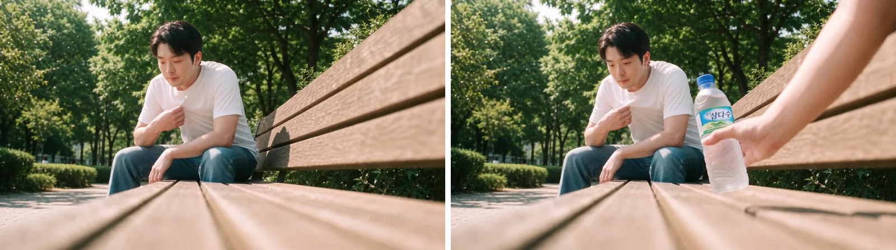
<small>फ़ाइनल कट में 0:52 और 0:54 (AI से बना)। कपड़े झलते मेरे बगल में बोतल वाला हाथ आता है</small>

## चेहरे के लिए किरदार से बेहतर एंगल से मेल खाती एक तस्वीर

बेंच सीन से सबसे बड़ी सीख चेहरे के रेफ़रेंस की थी।

Higgsfield पर मेरे चेहरे की कई तस्वीरें जोड़ने वाले किरदार एलिमेंट थे। @강준구 में 7 तस्वीरें, और Soul किरदार @강준구-cinema में कैफ़े, रेस्तराँ, शादी के फ़ोटोशूट जैसे अलग एंगल और जगहों की 17 तस्वीरें ([भाग 1](/hi/posts/higgsfield-wedding-film/) में स्क्रीन डाली है)। प्रॉम्प्ट में नाम बुलाओ तो उसी चेहरे से बनाता है। हाई-एंगल वीडियो में @강준구-cinema बुलाया, और 6 सितंबर के लो-एंगल प्रॉम्प्ट भी "@char_jungu सफ़ेद आधी बाँह की टी, जींस…" जैसे किरदार बुलाकर शुरू हुए। सुविधाजनक था, लेकिन बेंच सीन में ठीक से नहीं चला।


<small>17 तस्वीरों वाला Soul किरदार @강준구-cinema। ज़्यादा डालने से चेहरा ज़्यादा मेरे जैसा नहीं हुआ</small>

पहली समस्या दूर का चेहरा था। हाई-एंगल जैसे शॉट में, जहाँ इंसान स्क्रीन की ऊँचाई का करीब 1/8 होता है, चेहरा ठीक नहीं बना। लो-एंगल में भी मैं स्क्रीन के अंदर गहराई में बैठा हूँ, इसलिए चेहरा बड़ा नहीं है। ऊपर से हर रन में चेहरा थोड़ा-थोड़ा मुझसे दूर खिसकता गया।

तो यह समझ आया। कई एंगल मिलाने वाले किरदार को बुलाने के बजाय, बन रहे शॉट जैसे एंगल से खींची मेरे चेहरे की सिर्फ़ एक तस्वीर रेफ़रेंस में डालने से चेहरा कहीं बेहतर बना। एंगल मिलाने पर हर एंगल का औसत बनकर ऐसा चेहरा बनता लगा जो किसी का नहीं। [भाग 1](/hi/posts/higgsfield-wedding-film/) में लिखा "एंगल मैचिंग" नियम इसी सीन से निकला।

| तरीका | नतीजा |
|---|---|
| किरदार एलिमेंट (@강준구 की 7, @강준구-cinema की 17 जैसी जोड़ी तस्वीरें) | बुलाना आसान। चेहरा छोटा हो या बार-बार चलाओ तो धीरे-धीरे मैं नहीं रहता |
| शॉट के एंगल से मेल खाती चेहरे की एक तस्वीर | चेहरा बेहतर बनता है। हर शॉट के लिए सही तस्वीर चुनने की मेहनत लगती है |
| दूर का छोटा चेहरा | किसी भी तरीके से ठीक नहीं बनता। जहाँ चेहरा दिखाना हो, शॉट पास से लें |

## बोतल देखता मेरा नज़रिया और सिर्फ़ सिर मोड़ता चेहरा

शॉट C (#07) पहले बनाया, 2 सितंबर तड़के। क्रम में B से चार दिन पहले।

बातचीत में इस शॉट को "पानी की बोतल POV" कहा था, और यह एक बार गड़बड़ हुआ। Claude ने इसे बोतल का नज़रिया समझकर प्रॉम्प्ट लिखा। मेरा मतलब था **बढ़ाई गई बोतल को देखती मेरी नज़र**। हाथ पत्नी का है, और कैमरे का बोतल से पत्नी के चेहरे तक उठना मेरी नज़र का उठना है। यह ठीक करने के बाद ही बोतल और हाथ की जगह मेल खाई।

`soft veil` शब्द भी हटाया। मतलब था रोशनी का नरमी से फैलना, लेकिन शादी के वीडियो में इसे घूँघट समझे जाने का ख़तरा था। रोशनी के फैलाव के लिए `lens flare` और `bloom` लिखा।

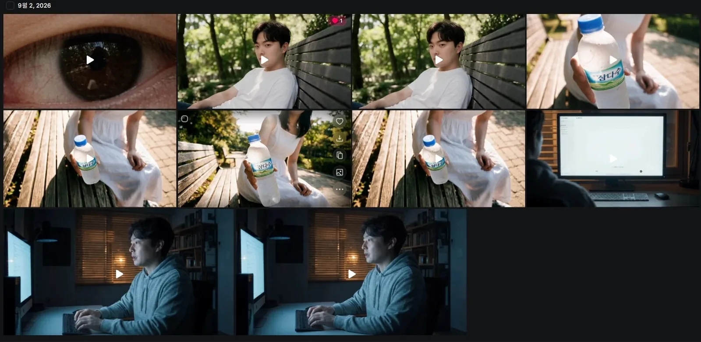
<small>2 सितंबर की हिस्ट्री। बीच की पंक्ति और ऊपर दाएँ बोतल वाले नज़रिए के शॉट हैं, ऊपर की पंक्ति के बीच वाले दो मेरा मुड़ता चेहरा (#08)</small>

बोतल वाले नज़रिए का शॉट तस्वीर से शुरू किया। मेरी आँख की ऊँचाई से दिखती, बोतल बढ़ाती पत्नी। उनके चेहरे के रेफ़रेंस में, जैसा भाग 1 में लिखा, तीनों तस्वीरें डालीं।

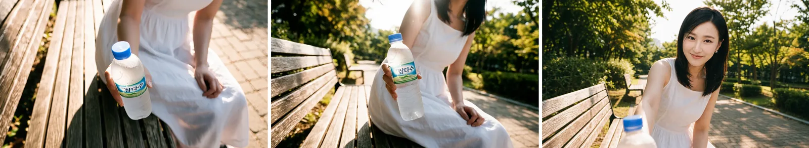
<small>बोतल वाले नज़रिए के शॉट का तस्वीर वाला चरण (AI से बना)। चेहरा AI से बना है</small>

वीडियो चार बार बनाया।

| बनाने का समय | मॉडल | रेज़ोल्यूशन | क्या बदला |
|---|---|---|---|
| 03:06 | Cinema Studio Video | 480p | पहली कोशिश |
| 03:13 | Seedance 2.5 | 480p | समय-सारिणी पर गया। 0–1 सेकंड बोतल, 1–2.2 सेकंड बाँह के साथ टिल्ट-अप, 2.2–3.3 सेकंड बैकलाइट फ़्लेयर, 3.3–4.2 सेकंड पत्नी झुककर सूरज ढकती है, 4.2–6 सेकंड मुस्कान और डायलॉग |
| 03:19 | Seedance 2.5 | 480p | "he is taller than she" जोड़ा |
| 03:25 | Seedance 2.5 | 1080p | फ़ाइनल |

1 सितंबर को तय ढाँचा 12 सेकंड का एक लगातार शॉट था। दो कट में नहीं बाँटा: बोतल से पत्नी तक रैक फ़ोकस एक ही शॉट में, और आख़िरी फ़्रेम में फ़्लेयर हटकर चेहरा साफ़। असल Seedance प्रॉम्प्ट ऊपर की 6 सेकंड की समय-सारिणी में सिमट गया।

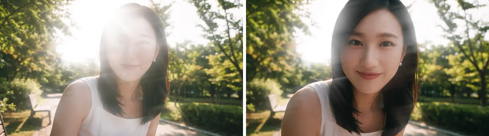
<small>फ़ाइनल कट में 0:58 और 0:59 (AI से बना)। फ़्लेयर के बीच से पत्नी का चेहरा उभरता है</small>

अगला #08 है। उसी दिन 03:47 और 03:54 पर Seedance 2.5 1080p से दो बार बनाया। सिर्फ़ सिर मोड़े हक्के-बक्के चेहरे की ओर धीरे-धीरे बढ़ते हुए 2–3 सेकंड पर आँख में खिंच जाने वाला शॉट।

मुद्रा अहम थी। धड़ और कंधे बेंच की सीध में, सिर्फ़ सिर कैमरे की ओर मुड़ता है। गर्दन का मरोड़ दिखना चाहिए। शरीर भी मुड़ जाए तो वह पहले से बात कर रहा इंसान बन जाता है। सिर्फ़ सिर मुड़े तभी अभी-अभी चौंककर देखने का पल ज़िंदा रहता है। मुँह थोड़ा खुला, और `not smiling` लिखा।

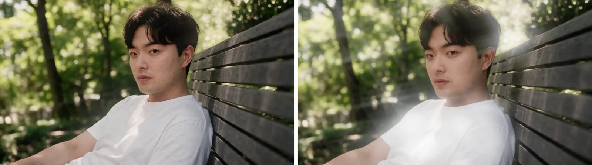
<small>फ़ाइनल कट में 1:00 और 1:01 (AI से बना)। शरीर बेंच की सीध में, सिर्फ़ सिर मुड़ा</small>

#11 उल्टा, आँख से ज़ूम-आउट वाला शॉट है। 2 सितंबर 03:55 पर पहली बार 1080p में बनाया, और 3 सितंबर को 00:17 (480p), 00:28 और 00:41 (1080p) पर फिर बनाया। डायलॉग है "हाँ, ज़रूर।" नज़र लेंस में नहीं, लेंस के बगल से गुज़रकर कैमरे के पीछे ऊपर, खड़ी पत्नी को देखती है। भाव हल्की मुस्कान।

## बेंच सीन में पक्के हुए प्रॉम्प्ट नियम

1 सितंबर को नई चैट खोलते समय अब तक के ट्रायल-एरर को नियमों में समेटकर आगे दिया। ज़्यादातर हाई-एंगल के सात रन से निकले। लो-एंगल के आठ रन उसके बाद 6 सितंबर को हुए।

| नियम | क्या |
|---|---|
| मीटर नहीं, स्क्रीन का अनुपात | 4 मी, 8 मी, 12 मी लिखने पर भी हर रन में पास आता गया। इंसान स्क्रीन की ऊँचाई का 1/8, बेंच चौड़ाई का 1/4 जैसे भिन्न में लिखने पर ही असर हुआ |
| सिर्फ़ ऊँचाई और क्षैतिज दूरी | ऊँचाई, एंगल और दूरी सब लिखो तो आपस में टकराते हैं। ऊँचाई और क्षैतिज दूरी दो, एंगल अपने आप आता है |
| छिपाने को मत कहो | `not visible`, `heavily shaded`, `face is not readable` जमा करने से पूरा इंसान धुँधला जाता है। `Her face is hidden behind these leaves` जैसे स्थिति लिखो |
| आगे की चीज़ लेंस से दूरी से | पत्तों को आगे रखने के लिए `just 30cm from the lens, heavily blurred` जैसे लेंस से दूरी तय करो। वरना वे पीछे का पेड़ बन जाते हैं |
| रास्ता `roughly horizontally` | `diagonally` लिखने पर बीच का अटपटा एंगल आता है |
| "अगर" वाले वाक्य नहीं | `Two people could sit side by side` अनदेखा होता है या दो लोग बन जाते हैं। `Exactly one bench`, और ख़ाली जगह `wide enough for another person to sit down` |
| दो-चरण तरीका | जब रेफ़रेंस शब्दों पर भारी पड़े। पहले समस्या वाली चीज़ हटाकर नतीजा बनाओ, फिर उसे रेफ़रेंस बनाकर सिर्फ़ चाही चीज़ जोड़ो। क्रेडिट दोगुने, पर बार-बार सुधारने से पक्का |
| जगह और इंसान तस्वीर में मिलाओ | वीडियो चरण में जगह और इंसान अलग मत दो। एक तस्वीर में मिलाकर फिर चलाओ |
| चेहरा: एंगल से मेल खाती एक तस्वीर | कई एंगल जोड़ने वाले किरदार से शॉट के एंगल से मेल खाती एक तस्वीर बेहतर। एंगल मिलाने पर औसत बनता है और चेहरा बिखर जाता है |

पत्तों से ढकना अकेली चीज़ थी जो इन नियमों से भी हल नहीं हुई। लेंस की दूरी तय करने का तरीका सिर्फ़ लिख रखा; असल में तस्वीर वाला चरण ख़त्म करके दूसरे तरीके पर चला गया।

यही सीन फिर बनाऊँ तो ऐसे करूँगा।

| क्या करना | वजह |
|---|---|
| चेहरा शुरू से एंगल से मेल खाती एक तस्वीर से | किरदार एलिमेंट से चलाने पर हर रन में चेहरा मैं कम होता गया |
| कंपोज़िशन शुरू से स्क्रीन के अनुपात में | हाई-एंगल के रन 3–5 में मीटर और एंगल लिखे, और दूरी कभी नहीं मिली |
| एक रन में एक ही बदलाव | रन 1 में चार चीज़ें एक साथ बदलीं, एक ही लगी और बाकी कहाँ अटकीं पता भी नहीं चला |
| शॉट के नाम में किसका नज़रिया, यह लिखना | "पानी की बोतल POV" जैसे एक शब्द से बोतल और हाथ की जगह गड़बड़ हुई। शुरू से "बोतल देखता मेरा नज़रिया" लिखना था |
| हरकत समय-सारिणी से | समय-सारिणी जोड़ने से पहले लो-एंगल छह बार चल चुका था |
| जो AI से न बने, उसे जल्दी एडिटिंग में | पत्तों का ढकना लगातार चार रन फ़ेल होने के बाद ही Premiere को सौंपा |

भाग 4 शादी हॉल का सीन है। आँख से बाहर निकलते ही टक्सीडो में शादी हॉल के सामने खड़े मेरे वाला मैच कट, GPT Image से 3 मिनट में 10 बार बनाया पहला फ़्रेम, असली सेल्फ़ी फ़ुटेज पर बो टाई लगाने का तरीका, और एडिट की समाप्ति के साथ पूरे क्रेडिट का हिसाब।
