हमारी शादी की फ़िल्म के शादी हॉल वाले आख़िरी सेल्फ़ी सीन के लिए, **सिर्फ़ AI वाले दो वर्ज़न के बाद, आख़िरकार मैंने ख़ुद एक्टिंग वाली फ़ुटेज Seedance 2.5 Edit में डाली और सिर्फ़ कपड़े और जगह बदली।** आँख से बाहर निकलने वाली शुरुआत भी उसी एक शॉट में डाल दी।

[भाग 1](/hi/posts/higgsfield-wedding-film/) स्टोरीबोर्ड और तैयारी था, [भाग 2](/hi/posts/higgsfield-wedding-film-2/) वर्करूम और भटकने वाले सीन, [भाग 3](/hi/posts/higgsfield-wedding-film-3/) बेंच सीन। भाग 4 फ़ाइनल कट में 1:48 से 2:15 तक है जहाँ तस्वीर ख़त्म होती है: टक्सीडो में मैं शादी हॉल की लॉबी में मेहमानों से बात करता हूँ और कैमरा फ़र्श पर रख देता हूँ। जनरेशन के रिकॉर्ड के लिए Higgsfield अकाउंट में तस्वीर और वीडियो के डिटेल पेज एक-एक कर खोले और मॉडल, रेज़ोल्यूशन, समय और प्रॉम्प्ट जाँचे। आख़िर में चारों भाग पूरे करने के बाद के विचार लिखे हैं।

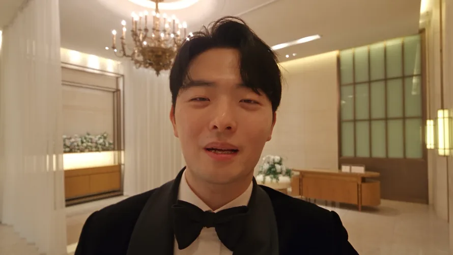
<small>फ़ाइनल सेल्फ़ी शॉट का 10वाँ सेकंड। मेरी असली एक्टिंग वाली फ़ुटेज पर कपड़े और जगह AI से पहनाए</small>

## आँख से सीधे शादी हॉल में

S#4 फ़िल्म को असलियत से जोड़ने वाला सीन है। स्क्रीन वाला मैं शादी हॉल में सेल्फ़ी कैम से मेहमानों से बात करता हूँ, कैमरा नीचे करता हूँ, और "सब लोग कृपया पीछे मुड़कर देखिए" पर ख़त्म होता है। फ़िल्म बंद होते ही असली दूल्हे की एंट्री शुरू होती है।

पहले स्टोरीबोर्ड में #11 के आख़िर में हथेली से लेंस ढककर स्क्रीन अँधेरी करने और फिर शादी हॉल में जाने का सोचा था। वह हटा दिया। करीब दो मिनट पर एक और तरकीब डालने से फ़िल्म खिंच जाती। मुझे लगा बेंच पर मुस्कुराते #11 चेहरे से सीधे टक्सीडो पर जाने वाला मैच कट ज़्यादा दमदार होगा।

Claude की चैट बदलते समय बने हैंडओवर दस्तावेज़ में सिर्फ़ "हथेली ब्लैकआउट हटाया" निष्कर्ष था, यह वजह नहीं। इसके बारे में नीचे अलग से लिखा है।

शादी हॉल के अंदर कैमरा कैसे चलेगा, यह असली हॉल में खींची तस्वीर पर ख़ुद बनाया।

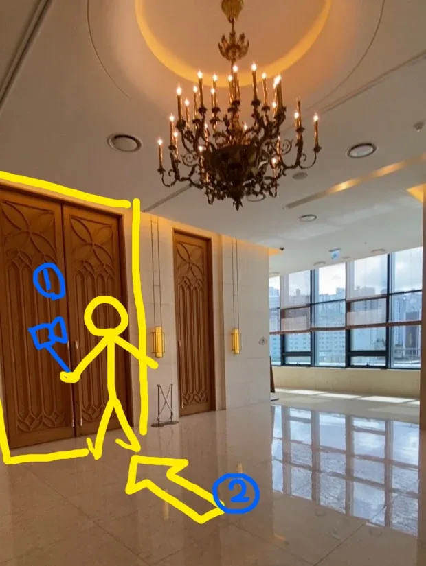
<small>सीन 4 का मूवमेंट डिज़ाइन। ① हाथ का सेल्फ़ी कैम, ② फ़र्श पर रखा कैमरा</small>

| कैमरा | क्या करता है |
|---|---|
| ① सेल्फ़ी कैम | बाँह फैलाकर पकड़े कैमरे से अपना चेहरा शूट करते हुए मेहमानों से बात करता हूँ |
| ② फ़र्श | बात ख़त्म कर कैमरा नीचे फ़र्श पर रखता हूँ। कैमरा हॉल के दरवाज़े की ओर देखता है |

यह ड्रॉइंग सिर्फ़ ड्रॉइंग नहीं रही। आख़िरी वर्ज़न में इसे वैसा ही रेफ़रेंस तस्वीर के रूप में डाला।

## बेंच की मुस्कान से AI सेल्फ़ी कैम तक, 2–3 सितंबर

शादी हॉल का सीन बेंच से शुरू होता है। मैच कट का अगला हिस्सा, #11 का मुस्कुराता चेहरा, पहले बनाना था।

2 सितंबर रात 10:41 से 11:44 तक इसी एक शॉट की तस्वीरें बनाता रहा। पहले GPT Image 2 (क्वालिटी Medium, 1344x752)। सिर्फ़ 10:50 से 10:53 के 3 मिनट में 10 तस्वीरें निकलीं। फिर Nano Banana Pro में "प्यारी मुस्कान" एक लाइन डालकर देखा, और उसी अंग्रेज़ी प्रॉम्प्ट से तीन और बनाईं। बीच में Seedream 5.0 Pro पर सिर्फ़ "मोटा है... थोड़ा पतला करो" लिखकर चलाया एक रन भी है।

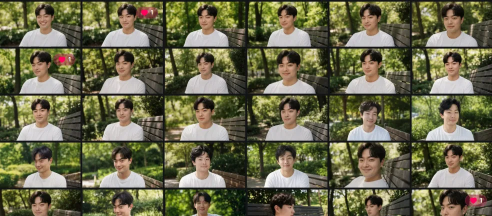
<small>2 सितंबर रात की इमेज हिस्ट्री। लगभग एक ही कंपोज़िशन में बीस से ज़्यादा मुस्कुराते चेहरे</small>

प्रॉम्प्ट भाग 3 में तय नियमों से लिखा। पहले पक्का किया कि हर दिशा कैमरे के हिसाब से है, फिर मुद्रा, नज़र, भाव, चेहरा, बैकग्राउंड, रोशनी और लेंस को अलग पैराग्राफ़ में बाँटा।

| बिंदु | प्रॉम्प्ट में क्या |
|---|---|
| पहली लाइन | हर दिशा कैमरे के हिसाब से; स्क्रीन का बायाँ देखने वाले का बायाँ |
| मुद्रा | धड़ कैमरे की ओर घुमाया ताकि कंधे लगभग लेंस के सामने हों, पीठ सीधी, दोनों हाथ जाँघों पर |
| नज़र | लेंस के ठीक बगल में, स्क्रीन के दाएँ ज़रा सा हटकर। वहाँ बैठे इंसान से नज़र मिलाता है |
| भाव | मुँह बंद, होंठों के कोने साफ़ ऊपर, आँखों के किनारे झुर्रियाँ। जो ढूँढ रहा था वह मिल गया, ऐसा चेहरा |
| चेहरा | आँखों की दूरी, पलकें, नाक, गाल की हड्डी, जबड़ा, होंठ के ऊपर का हिस्सा और होंठों की मोटाई बिल्कुल रेफ़रेंस तस्वीर जैसी। `Do not average these features`; चेहरा पतला या त्वचा चिकनी मत करो |
| फ़्रेम | 50mm, 1.5 मी दूरी, बैठे हुए आँख की ऊँचाई, छाती के बीच से कटा बस्ट शॉट, 35mm फ़िल्म टेक्सचर |

भाग 3 में #08 वाले मुड़ते चेहरे में शरीर सामने रहा और सिर्फ़ सिर मुड़ा। #11 में उल्टा, शरीर भी कैमरे की ओर मुड़ा। चौंकने का पल बीत चुका है, और वह सामने बैठे इंसान को जवाब दे रहा है।

इस तस्वीर से #11 वीडियो 3 सितंबर को 00:17 (480p), 00:28 और 00:41 (1080p) पर Seedance 2.5 से बनाया। आँख से भरी स्क्रीन से 2 सेकंड में तेज़ी से पीछे हटकर बस्ट शॉट पर रुकता है, हक्की-बक्की आँखें साफ़ होती हैं, मुस्कान फैलती है, और करीब 3.5 सेकंड पर कहता है, "हाँ, ज़रूर।" 00:41 वाले में आख़िर में कोरियाई में "5.0–7.0 मुस्कान बनी रहे" जोड़ा।

मुस्कान तय होते ही वही चेहरा शादी हॉल में ले गया। 2 सितंबर रात 11:52 पर Seedream 5.0 Pro (2k) में कुछ तस्वीरें रेफ़रेंस में डालकर एक लाइन लिखी: "काले सूट में बदलो, और बैकग्राउंड इस जगह में बदलो।" रेफ़रेंस में सूट पहने मेरी दो तस्वीरें और शादी हॉल लॉबी की तस्वीर थी।

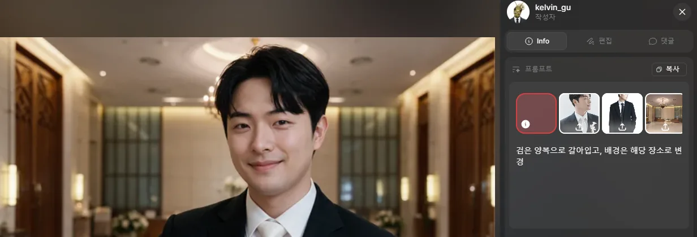
<small>Seedream 5.0 Pro। बेंच पर मुस्कुराता चेहरा सीधे शादी हॉल की लॉबी में आ गया</small>

भाव और चेहरे का एंगल बेंच की मुस्कान से लगभग वैसा ही आया। मैच कट के आगे-पीछे ऐसे ही मिलने चाहिए थे। लेकिन टाई सफ़ेद आई। 11:56 पर यह नतीजा फिर रेफ़रेंस में डालकर सुधारा: "सफ़ेद टाई की जगह काली बो टाई पहने है" (1k)। यही AI सेल्फ़ी कैम का पहला फ़्रेम बना।

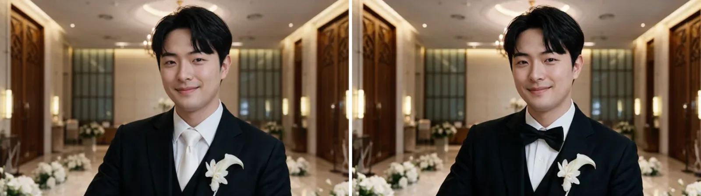
<small>2 सितंबर 23:52 और 23:56 (AI से बना)। सिर्फ़ टाई बदली</small>

पहला फ़्रेम मिलते ही सीधे वीडियो पर गया। 3 सितंबर 00:09 और 00:43 पर Seedance 2.5 480p से सेल्फ़ी कैम दो बार बनाया। उसी दिन बीच-बीच में #11 ज़ूम-आउट भी चलाया।

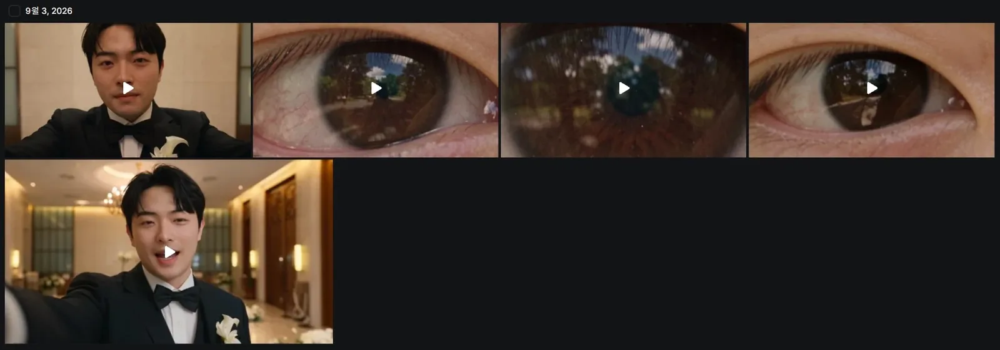
<small>3 सितंबर की वीडियो हिस्ट्री। ऊपर बाएँ और नीचे बाएँ AI सेल्फ़ी कैम, बाकी तीन #11 आँख ज़ूम-आउट</small>

दोनों वर्ज़न के डायलॉग और लंबाई अलग थे।

| बनाने का समय | लंबाई | क्या है |
|---|---|---|
| 00:09 | 10 सेकंड | एक्शन कैम बाँह फैलाकर पकड़े लगातार बोलता है। "ख़ुशी ढूँढते-ढूँढते यहाँ तक आ गया।" "सच में चमक गया" (हल्की हँसी) "इंसान के ख़ुश रहने का सबसे पक्का तरीका, लगता है आज मुझे मिल गया।" फ़्रेम आख़िर तक स्थिर |
| 00:43 | 8 सेकंड | डायलॉग में सिर्फ़ पहली लाइन, 2.6 सेकंड से कैमरा नीचे। कैमरा घूमते हुए फ़र्श पर गिरने जैसा हिलता है, और 4.2 सेकंड पर संगमरमर के फ़र्श पर रखा जाता है। 5 सेकंड से मेरे जूतों की एड़ी और पैंट के किनारे के पार बंद लकड़ी का दरवाज़ा दिखता है |

00:43 वाला पहला वर्ज़न था जिसमें स्टोरीबोर्ड और ड्रॉइंग के ① से ② तक की हरकत वीडियो में आई। प्रॉम्प्ट भी लंबा हुआ। हर समय पर कैमरा और शरीर कैसे चलते हैं, यह लिखा, जैसे "एक कैमरे से बिना कट का एक शॉट", "कैमरे के पीछे गॉथिक मेहराब नक्काशी वाला बड़ा लकड़ी का दरवाज़ा बंद है", "नीचे करते समय कैमरा उल्टी दिशा में घूमता है", "फ़र्श पर लेंस आगे थोड़ा ऊपर देखते हुए रखा जाता है"।

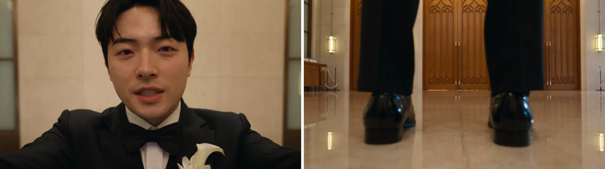
<small>3 सितंबर 00:43 वाले वर्ज़न का 1 और 6 सेकंड (AI से बना)। फ़र्श पर रखे कैमरे के आगे जूते और दरवाज़ा खड़े हुए</small>

ये दोनों वर्ज़न फ़ाइनल कट में नहीं गए। फ़ाइनल कट के डायलॉग हैं, "आँख खुली तो शादी हॉल के सामने, शायद इसी को कहते हैं," "सच में चमक की तरह," "अब अंदर चलता हूँ," और "सब लोग कृपया पीछे मुड़कर देखिए।" 3 सितंबर वाले डायलॉग से अलग।

छोड़ने की वजह बोलने का अंदाज़ था। Seedance से बना सेल्फ़ी कैम बहुत ज़्यादा चिपचिपा लगा, और AI की गंध साफ़ आती थी। कितनी बार भी दोबारा चलाया, लगा कि इसे बचाया नहीं जा सकता, इसलिए छोड़ दिया। वह अंदाज़ कितना चिपचिपा था, यह दिखाने के लिए फ़ेल हुआ वीडियो अलग से डालकर यहीं लगाऊँगा।

## अपनी एक्टिंग वाली फ़ुटेज को टक्सीडो पहनाना, 6 सितंबर चार रन

आख़िरी शॉट AI के बनाए इंसान से नहीं, मेरी अपनी एक्टिंग वाली सेल्फ़ी फ़ुटेज से शुरू हुआ।

सेल्फ़ी घर में फ़ोन कैमरे से शूट की। GoPro से शूट करता तो वाइड-एंगल डिस्टॉर्शन आता। इसलिए फ़ोन से शूट की, पर ऐसे एक्टिंग की जैसे GoPro से शूट कर रहा हूँ। हेहे।

बोलते समय मुँह की बनावट, सिर की हरकत, कैमरा नीचे करके फ़र्श पर रखने वाले हाथ तक, सब वैसा ही है जैसा मैंने किया। प्रॉम्प्ट में लिखा कि असली फ़ुटेज के कमरे को शादी हॉल की लॉबी में बदलो। यहाँ काम सिर्फ़ कपड़े और जगह बदलने का था।

6 सितंबर दोपहर 1:10 से 3:53 तक चार बार चलाया।

| बनाने का समय | मॉडल | रेज़ोल्यूशन | क्या बदला |
|---|---|---|---|
| 13:10 | Higgsfield Genjutsu ऑब्जेक्ट स्वैप | 480p | एक्टिंग, चेहरा और कैमरे की हरकत वैसी ही; बो टाई जोड़ी; जैकेट और शर्ट को सैटिन लैपल टक्सीडो; कमरे को शादी हॉल लॉबी; नीचे रखे कैमरे के आगे लकड़ी का दरवाज़ा |
| 14:18 | Seedance 2.5 Edit | 480p | वही निर्देश Seedance Edit में |
| 14:43 | Seedance 2.5 Edit | 480p | आँख के बेहद क्लोज़-अप से बाहर निकलने वाली शुरुआत जोड़ी। चेहरा असली फ़ुटेज नहीं, रेफ़रेंस तस्वीर जैसा; कपड़े बिना सैटिन का मैट सूट; जगह ड्रॉइंग में बनी आकृति वाली जगह |
| 15:53 | Seedance 2.5 Edit | 1080p | ऊपर वाले का फ़ाइनल। 22 सेकंड |

पहला रन Genjutsu का ऑब्जेक्ट स्वैप था। प्रॉम्प्ट का पहला वाक्य: "इस आदमी की एक्टिंग वैसी ही रखो। चेहरा और पहचान, बोलते समय होंठ और जबड़े की हरकत, सिर की हरकत, मुद्रा, और हर हरकत की टाइमिंग।" कैमरा भी वैसा ही रखने को कहा। नीचे जाते समय का हिलना और फ़र्श पर टिकना तक।

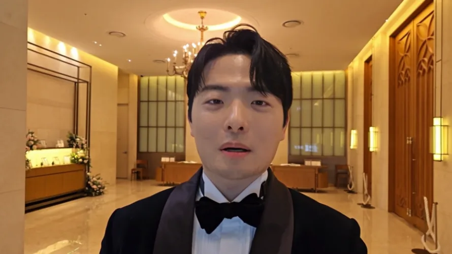
<small>6 सितंबर 13:10 Genjutsu ऑब्जेक्ट स्वैप (AI कंपोज़िट)। लैपल पर सैटिन की चमक आ गई</small>

शादी हॉल लॉबी और टक्सीडो अच्छे से लगे। बदले में लैपल चमकदार सैटिन थे। प्रॉम्प्ट में ख़ुद "सैटिन लैपल टक्सीडो" लिखा था, तो वही आया। 14:18 पर वही निर्देश Seedance 2.5 Edit में ले गया, और 14:43 पर कपड़ों वाला वाक्य पूरी तरह बदल दिया: "सादा काला सूट, पूरा मैट ऊन, न सैटिन, न चमक, न लैपल पर कंट्रास्ट सजावट।"

14:43 पर सिर्फ़ कपड़े नहीं बदले।

| वाक्य | क्या बदला |
|---|---|
| शुरुआत | आँख और पुतली से भरी स्क्रीन वाले बेहद क्लोज़-अप से शुरू होकर पहले सेकंड में लेंस की सीध में सीधे पीछे हटता है। शुरू में तेज़, पहुँचते समय धीमा। आइरिस आँख बनती है, आँख चेहरा, और असली फ़ुटेज के बस्ट शॉट पर रुकता है |
| चेहरा | चेहरा और बालों का अंदाज़ असली वीडियो नहीं, रेफ़रेंस तस्वीर जैसा |
| जगह | रेफ़रेंस तस्वीर वाली शादी हॉल लॉबी। उस तस्वीर में बनी आकृति सिर्फ़ खड़े होने की जगह का निशान है, और स्क्रीन पर कभी नहीं आती |
| जुड़ाव | बिना कट या डिज़ॉल्व का एक लगातार टेक, ठीक एक इंसान |

रेफ़रेंस में डाली शादी हॉल की तस्वीर वही ऊपर वाली ड्रॉइंग है। पीली आकृति बनी हुई ही डाली, और शब्दों में बताया कि वह जगह का निशान है। ड्रॉइंग स्क्रीन पर नहीं आई।

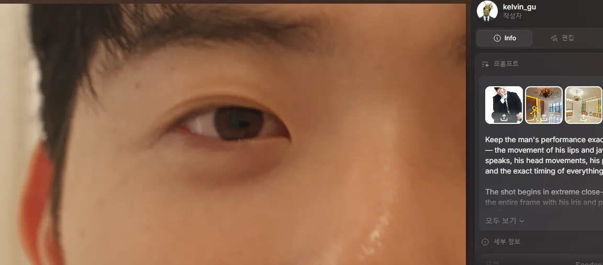
<small>फ़ाइनल वर्ज़न का पहला सेकंड। पीली आकृति वाली ड्रॉइंग रेफ़रेंस में वैसी ही गई</small>

आँख से बाहर निकलने वाली शुरुआत इसी शॉट में डालने से, भाग 3 के आँख वाले ज़ूम-इन और असली मोंटाज के ठीक बाद इसे लगाने पर आँख से शादी हॉल तक का जुड़ाव बन गया। 15:53 पर उसी प्रॉम्प्ट से 1080p चलाया, और यही फ़ाइनल कट में 1:48 से गया।

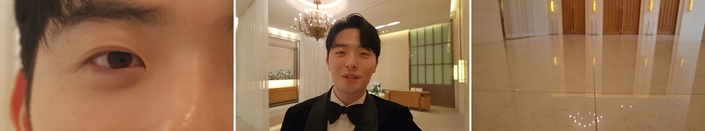
<small>फ़ाइनल वर्ज़न के 0:01, 0:03 और 0:17। आँख से निकलकर बोलता है, और कैमरा फ़र्श पर रखता है</small>

सिर्फ़ AI वाले 3 सितंबर के वर्ज़न से तुलना करें तो आख़िरी दृश्य अलग है। 3 सितंबर वाले में फ़र्श के कैमरे के आगे जूते खड़े थे। फ़ाइनल में मेरे असली कैमरा रखने की हरकत चली, इसलिए फ़र्श के पार सिर्फ़ दरवाज़ा दिखता है।

## एडिट की समाप्ति और हैंडओवर का छेद

बने हुए शॉट Premiere में जोड़े। प्रोजेक्ट फ़ाइल का नाम `20260909_식중영상.prproj` है। भाग 2 वाली मॉनिटर स्क्रीन HTML रिकॉर्डिंग से जोड़ी, और भाग 3 के हाई-एंगल में पत्तों के पत्नी को न ढकने की समस्या असली पत्तों की फ़ुटेज ऊपर लगाकर हल की।

काम करते समय दो मॉनिटर इस्तेमाल किए। बाईं स्क्रीन पर प्रोग्राम मॉनिटर, दाईं पर टाइमलाइन।

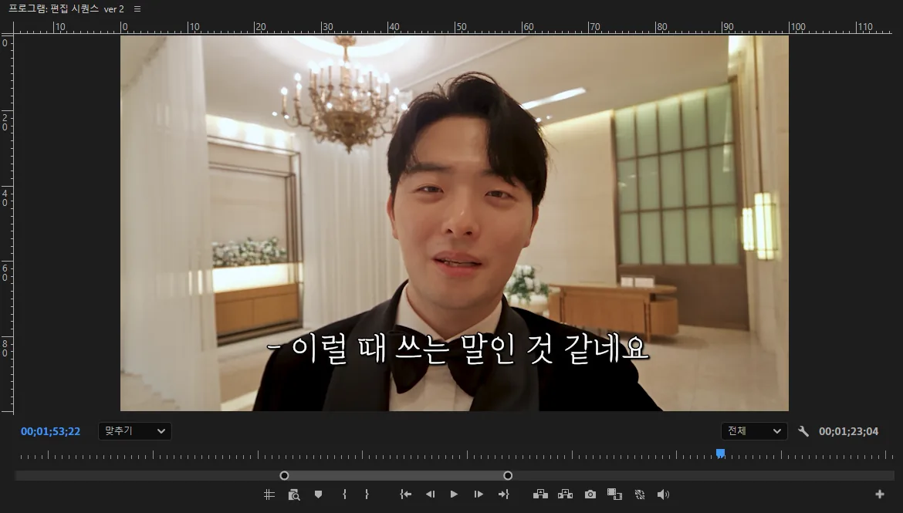
<small>बाईं स्क्रीन का प्रोग्राम मॉनिटर। 1:53, आख़िरी सेल्फ़ी शॉट पर कैप्शन</small>

सीक्वेंस का नाम "एडिट सीक्वेंस ver 2" है। उसी प्रोजेक्ट में ver 3, जेजू रिसेप्शन के लिए "जेजू प्री-सेरेमनी फ़िल्म" और "सीक्वेंस 06" भी खुले हैं। आख़िरी स्क्रीन 1:53 पर रुका सेल्फ़ी शॉट है।

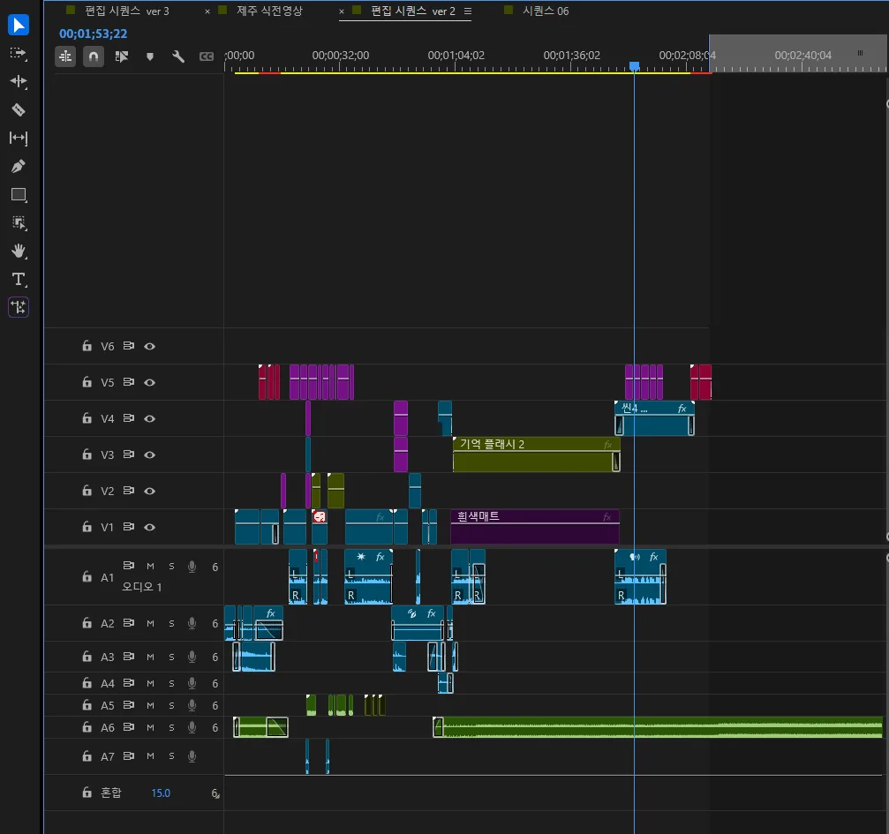
<small>दाईं स्क्रीन की टाइमलाइन। 5 वीडियो ट्रैक, 7 ऑडियो ट्रैक। प्लेहेड सीन 4 की सेल्फ़ी पर है</small>

टाइमलाइन में पाँच वीडियो और सात ऑडियो ट्रैक लगे। बीच में लंबे फैले "मेमोरी फ़्लैश 2" और "सफ़ेद मैट" 1:04 से 1:44 पर हैं, आँख के अंदर वाला मोंटाज हिस्सा। उसके बाद V4 की "सीन 4" क्लिप इस पोस्ट में बनी सेल्फ़ी है। संगीत A6 पर शुरू से आख़िर तक चलता है। यही फ़ाइनल टाइमलाइन है।

इस बार रिकॉर्ड दोबारा देखते हुए सबसे आगे वाली Beat पैरोडी ओपनिंग कैसे बनी, यह भी पक्का किया। 5 सितंबर रात 8:06 पर Higgsfield Genjutsu मोशन ट्रांसफ़र (720p, 12 सेकंड) से सिर्फ़ चेहरा बदला। असली के साथ रखी तस्वीर [भाग 1](/hi/posts/higgsfield-wedding-film/) में है।

फ़ाइनल फ़ाइल 4 मिनट 5 सेकंड की है। तस्वीर 2:15 पर ख़त्म होती है और उसके बाद काली स्क्रीन पर सिर्फ़ संगीत चलता है। 19 सितंबर दोपहर 1 बजे के समारोह में दूल्हे की एंट्री से ठीक पहले चली, और स्क्रीन वाले मेरे "सब लोग कृपया पीछे मुड़कर देखिए" कहने के बाद असली एंट्री हुई। ब्लॉग पर डाला YouTube वीडियो इसी को 2:20 पर काटकर, काली स्क्रीन सिर्फ़ 5 सेकंड छोड़कर बना है।

[पूरी फ़िल्म YouTube पर देखें](https://youtu.be/J8hFwc1LpUQ)

बची बात हैंडओवर की है। जैसा [भाग 1](/hi/posts/higgsfield-wedding-film/) में लिखा, Claude पत्नी के अकाउंट से शुरू होकर मेरे अकाउंट में आया। बातचीत अकाउंट के पार नहीं आई, तो पिछली चैट ने जो हैंडओवर दस्तावेज़ बनाया, उसे नई चैट में चिपकाया। उस दस्तावेज़ से काम आगे बढ़ाने लगा तो इतना कुछ छूटा था कि काम बढ़ा ही नहीं।

31 अगस्त को नई चैट में वजह मिली। हैंडओवर दस्तावेज़ पूरी बातचीत नहीं, सिर्फ़ निष्कर्षों और नियमों का सारांश था। तो Google Drive पर Word फ़ाइल में बची पूरी असली बातचीत Claude को पढ़वाई। वह 253,348 अक्षर की थी। पहली बार करीब 246,000 अक्षर पर कटा वर्ज़न पढ़ा गया; फिर से लेकर आख़िर तक पढ़वाया।

तुलना करने पर दस्तावेज़ से यह सब छूटा था।

| क्या छूटा | असली बातचीत में क्या था |
|---|---|
| चेहरे का रेफ़रेंस | दस्तावेज़ में सिर्फ़ "3 तस्वीरें सीधे रेफ़रेंस में" था। यह निष्कर्ष छूटा कि ज़्यादा तस्वीरों से हर एंगल का औसत बनकर चेहरा बिखरता है, और यह वजह कि शॉट जैसे एंगल वाली तस्वीर सबसे अच्छी है |
| #07 बोतल वाला नज़रिया | यह कि दो कट नहीं, 12 सेकंड का एक लगातार शॉट है, जिसमें रैक फ़ोकस से बोतल से पत्नी तक फ़ोकस जाता है |
| ड्रेस का रंग | हल्का आसमानी, चुना क्योंकि गर्मियों की धूप में सफ़ेद उड़ जाता है और हाई-एंगल में बहुत चुभता है |
| हाई-एंगल | यह कि पत्नी पत्तों से ढकी हो ताकि पहली बार बैकग्राउंड लगे और दोबारा देखने पर दिखे |
| #08 और #11 की मुद्रा | सिर्फ़ सिर मोड़ना, और लेंस के बगल से गुज़रकर कैमरे के पीछे ऊपर देखती नज़र |
| #11 हथेली ब्लैकआउट | सिर्फ़ "हटाया" निष्कर्ष। करीब दो मिनट पर एक और तरकीब से फ़िल्म खिंचेगी, यह वजह, और बदले में मैच कट का फ़ैसला सिर्फ़ असली में था |

चेहरे के रेफ़रेंस वाला निष्कर्ष असली में भी तुरंत नहीं मिला। मुझे जो याद था, वह दोबारा बताकर सुधारा। शॉट जैसे एंगल से खींची तस्वीर सबसे अच्छी; वह न हो तो एक अच्छी सामने वाली और एक अच्छी साइड वाली।

नई चैट का Claude सिर्फ़ दस्तावेज़ देखकर नहीं जानता था कि "हटाया" क्यों, और चेहरे के रेफ़रेंस में दस्तावेज़ के "3 तस्वीरें सीधे" पर चलने से मुझे याद निष्कर्ष के उल्टा हो जाता। हर बार चैट बदलने पर फिर से समझाने की यही समस्या ब्लॉग के काम में भी आई, और अब नियम और स्थिति चैट के बाहर GitHub रिपॉज़िटरी में रखता हूँ, जिसे हर नई चैट शुरू करने से पहले पढ़ती है। इसके बारे में [GitHub पर AI का दिमाग़ बनाने वाली पोस्ट](/hi/posts/github-brain-for-claude/) में लिखा है।

फ़िल्म को लेकर ख़ास पछतावा नहीं है। जितना कर सकता था किया, प्रतिक्रिया अच्छी रही, और वीडियो के बारे में बहुत सीखा। इसलिए "फिर से करूँ तो" की बजाय यह लिख रहा हूँ कि कुछ नया बनाऊँ तो क्या साथ ले जाऊँगा।

| क्या साथ ले जाना | वजह |
|---|---|
| बोलने वाले सीन शुरू से अपनी एक्टिंग वाली फ़ुटेज से | 3 सितंबर का AI सेल्फ़ी कैम चिपचिपे अंदाज़ और AI की गंध की वजह से छोड़ा। फ़ाइनल असली एक्टिंग फ़ुटेज पर कपड़े और जगह पहनाया वर्ज़न था |
| कपड़ों का कपड़ा तक शुरू से बताना | "सैटिन लैपल टक्सीडो" लिखा तो सैटिन आया, और मैट करने में एक रन और लगा |
| ड्रॉइंग सीधे रेफ़रेंस में | आकृति को जगह का निशान बताने से वह स्क्रीन पर नहीं आई और सिर्फ़ जगह तय हुई |
| जुड़े शॉट एक ही शॉट में | आँख से निकलने वाली शुरुआत सेल्फ़ी शॉट में डालने से मैच कट जनरेशन के चरण में ही पूरा हुआ |
| हैंडओवर में निष्कर्ष और वजह साथ | बिना वजह वाले दस्तावेज़ से कुछ आगे नहीं बढ़ा, और 2.5 लाख अक्षर की असली बातचीत दोबारा पढ़नी पड़ी |

अगर फिर से बनाऊँ, तो Edit मोड का और बेहतर इस्तेमाल करके इस बार से कहीं शानदार काम बनाना चाहता हूँ।

## AI से बनाना आसान रास्ता नहीं था

**AI से वीडियो बनाना बिल्कुल आसान नहीं था।** शायद ख़ुद शूट करने से भी कठिन रास्ता था। शुरू ही आसानी के लिए नहीं किया था। इसलिए मुझे लगता है यह एक सार्थक चुनौती थी।

इस सीरीज़ में लिखी तारीख़ें सिर्फ़ वे हैं जिनका रिकॉर्ड बचा। असल में उससे कम से कम एक महीना पहले से थोड़ा-थोड़ा प्लान कर रहा था। स्टोरीबोर्ड इतनी बार बदला कि गिनती नहीं। सिर्फ़ रिकॉर्ड में जो बचा, वही इतना है।

| चरण | रिकॉर्ड |
|---|---|
| योजना | रिकॉर्ड की तारीख़ों से कम से कम एक महीना पहले से थोड़ा-थोड़ा। स्टोरीबोर्ड के बदलाव अनगिनत |
| स्टोरीबोर्ड | "Kang PD प्री-सेरेमनी फ़िल्म फ़ाइनल इंटीग्रेटेड स्टोरीबोर्ड शीट", आख़िरी बार सेव 27 अगस्त रात 11:21 |
| तस्वीरें | हर सीन की दर्जनों। भाग 3 में एक हाई-एंगल तस्वीर पर सात रन, इस पोस्ट में बेंच मुस्कान के एक शॉट पर बीस से ज़्यादा |
| वीडियो | 30 अगस्त से 6 सितंबर तक 36। 480p टेस्ट 19, 1080p 16 |
| क्रेडिट | 31 अगस्त तक सिर्फ़ हाल के 140 ट्रांज़ैक्शन में 563 क्रेडिट। 3 सितंबर को 1,000 नए क्रेडिट आए |
| बातचीत | कई Claude चैट, हैंडओवर दस्तावेज़, 2.5 लाख अक्षर की असली बातचीत दोबारा पढ़ना |
| एडिटिंग | 9 सितंबर की प्रोजेक्ट फ़ाइल, 5 वीडियो ट्रैक, 7 ऑडियो ट्रैक |
| प्रदर्शन | 19 सितंबर दोपहर 1 बजे, दूल्हे की एंट्री से ठीक पहले |

सोच, समय और मेहनत बहुत लगी। सच कहूँ तो करते-करते अपने आप मुँह से निकलता है कि पैसे देकर किसी कंपनी को सौंपना ही सबसे…

फिर भी बनाते हुए जो ख़याल आया, वह उल्टी तरफ़ है। AI से वीडियो बनाने में सच में बहुत सारी कोशिशें की जा सकती हैं। हाई-एंगल तस्वीर सात बार चलाना, एक ही लो-एंगल एक दिन में आठ बार बनाना, असली शूटिंग सेट पर सोचा भी नहीं जा सकता। वीडियो बनाने वालों के लिए ज़्यादा रास्ते खुल गए हैं।

और अब तक वीडियो बनाते हुए जो बुनियादी हुनर सीखा, वह AI वीडियो में भी ज़ाहिर तौर पर काम आता है। इस फ़िल्म में भी स्टोरीबोर्ड बनाना, बेंच सीन को तीन कैमरों में बाँटना, हथेली ब्लैकआउट की जगह मैच कट चुनना, और आख़िर में Premiere में जोड़ना, सब वही काम थे जो पहले से करता था। बदला यह कि जगह की बंदिश हट गई। बर्फ़ीला पहाड़, चाँद या शादी हॉल की लॉबी, बिना वहाँ गए सीन बना सकते हैं। इसलिए **मुझे लगता है जिसका बुनियादी हुनर जितना पक्का, वह AI वीडियो में उतना ज़्यादा चमक सकता है।**

यह करते हुए मुझे भी फिर से पढ़ना पड़ा। देख-देखकर सीखे शॉट के नाम और फ़िल्म की व्याकरण ठीक से जाननी पड़ी। हाई-एंगल, लो-एंगल, टिल्ट-अप, रैक फ़ोकस, मैच कट, बस्ट शॉट, लेंस का व्यू एंगल और दूरी तक, प्रॉम्प्ट में नाम सही-सही लिखने पर ही चाहा शॉट करीब आया। "पानी की बोतल POV" जैसे एक शब्द से बोतल और हाथ की जगह गड़बड़ाना भी आख़िर में शब्दावली की समस्या थी। सीखने को बहुत, बहुत कुछ है। बहाना है, पर इसीलिए कई सीन से मन नहीं भरा।

एक बात और। जिस काम के लिए लोग कंपनी को पैसे देते हैं, उसे ख़ुद ऑटोमेट करके सर्विस बनाना भी मज़ेदार हो सकता है, ऐसा लगा। क्योंकि रुकावट काफ़ी ऊँची है। मैं AI काफ़ी मेहनत से इस्तेमाल कर रहा हूँ और वीडियो भी काफ़ी बनाए हैं, फिर भी यह पूरा करके लगा कि अभी लंबा रास्ता बाकी है। मतलब बहुत लोग अभी यह नहीं कर पा रहे होंगे। पैसे की ख़ुशबू आई। हाहा।
