हमारी शादी में दूल्हे की एंट्री से ठीक पहले चली 2 मिनट की फ़िल्म मैंने Higgsfield से बनाई। मैंने लगभग कुछ भी शूट नहीं किया; स्क्रीन पर जो दिखता है उसका ज़्यादातर हिस्सा AI से बनी तस्वीरें और वीडियो हैं।

बनाते हुए समझ आया कि AI वीडियो एक बटन दबाने से नहीं निकलता। **यह तय करने का काम था कि AI को क्या सौंपना है और मुझे ख़ुद क्या करना है।** यह रास्ता बिल्कुल आसान नहीं था। फिर भी यह चुनौती लेने लायक थी।

शादी 19 सितंबर को दोपहर 1 बजे थी। फ़िल्म ख़त्म होते ही स्क्रीन वाला मैं कहता हूँ "सब लोग एक बार पीछे मुड़कर देखिए," और उसी पल असली मैं पीछे के दरवाज़े से अंदर आता हूँ। पूरी फ़िल्म YouTube पर है।

[पूरी फ़िल्म YouTube पर देखें](https://youtu.be/J8hFwc1LpUQ)

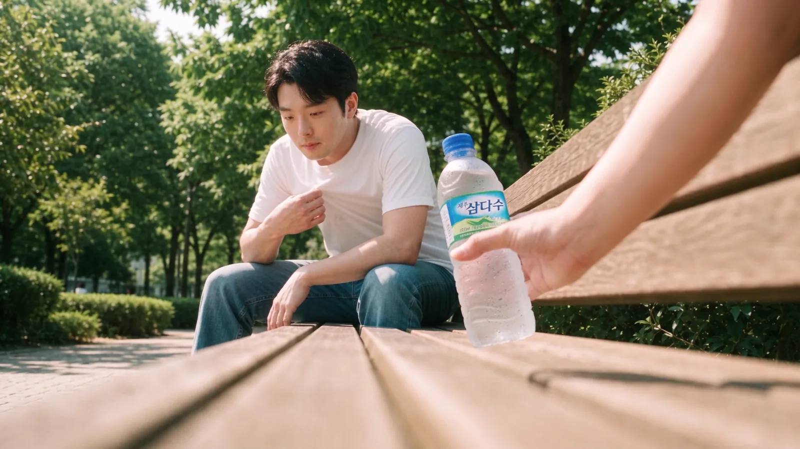
<small>फ़ाइनल कट में 0:53। बेंच का लो-एंगल शॉट। पानी देने वाला हाथ मेरी पत्नी का है (AI से बना)</small>

प्रक्रिया लंबी थी, इसलिए मैंने इसे चार भागों में बाँटा, हर भाग में एक सवाल।

| भाग | सीन | सवाल |
|---|---|---|
| भाग 1 | शुरुआत और तैयारी | बिना परफ़ॉर्मेंस और बिना गाने वाली शादी में मेहमानों का ध्यान किससे बाँधें? |
| [भाग 2](/hi/posts/higgsfield-wedding-film-2/) | वर्करूम, भटकना | जो काम AI नहीं कर सकता, उसका क्या करें? |
| [भाग 3](/hi/posts/higgsfield-wedding-film-3/) | बेंच | मेरा चेहरा धीरे-धीरे मेरा क्यों नहीं रहता? |
| [भाग 4](/hi/posts/higgsfield-wedding-film-4/) | शादी हॉल, एडिट | बोलते समय AI की एक्टिंग क्यों नहीं चलती? |

मुख्य हिस्सा इस पर है कि मैं कहाँ अटका और उसकी वजह से क्या बदला। हर कोशिश की तारीख़, मॉडल और प्रॉम्प्ट वाला रिकॉर्ड हर भाग के आख़िर में "आज़माइश का रिकॉर्ड" के नीचे रखा है।

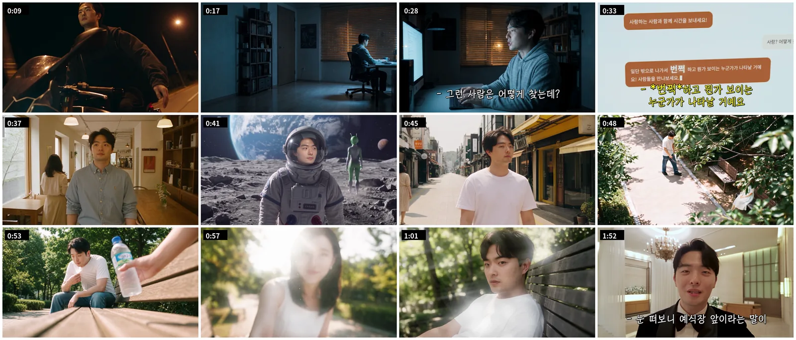
<small>फ़ाइनल कट के फ़्रेम क्रम से। आँख के अंदर वाले मोंटाज की असली तस्वीरें और वीडियो मैंने नहीं डाले</small>

## न परफ़ॉर्मेंस, न गाना, इसलिए पहले सीन पर दाँव लगाया

यह फ़िल्म बनाने की वजह सीधी है। हमारी शादी में कोई परफ़ॉर्मेंस नहीं था। कोई गाना भी नहीं। मेहमानों के लिए मज़े की कम से कम एक चीज़ चाहिए थी।

फ़िल्म के बीच में हमारी डेट की फ़ुटेज भी है। लेकिन डेट की क्लिप बस जोड़ दो तो वह पक्का बोरिंग होगा। मक़सद यह था कि हमारी डेट दिखाते हुए भी मेहमानों को लगे "अरे, मज़ेदार चीज़ देखी।"

लोगों को इससे ज़्यादा फ़र्क नहीं पड़ता कि मैं कौन-सा वीडियो बनाता हूँ या हम कहाँ डेट पर गए। वे देखते हैं कि मज़ा आ रहा है या नहीं। और मुझे लगा यह पहले सीन में ही तय हो जाता है। **इसलिए इस फ़िल्म का सबसे अहम फ़ैसला था कि शुरुआत किससे करें।**

बहुत छाँटने के बाद मैंने कोरियाई फ़िल्म "Beat" के मोटरसाइकिल सीन की पैरोडी चुनी: रात की सड़क पर मोटरसाइकिल चलाते हुए दोनों बाँहें फैलाना। यह स्टोरीबोर्ड में नहीं था; बाद में मैंने इसे सबसे आगे जोड़ा।

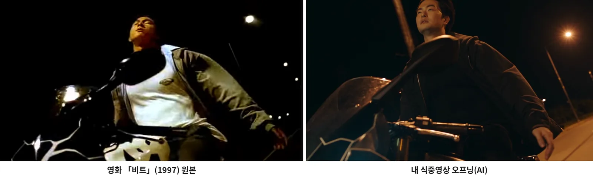
<small>बाएँ "Beat" का असली सीन, दाएँ फ़ाइनल कट का 0:09 (AI से बना)। वही एंगल, वही स्ट्रीटलाइट, बस चेहरा मेरा</small>

मैंने इसे दो पैमानों पर चुना।

| पैमाना | वजह |
|---|---|
| हर उम्र के लोग जानते हों | शादी हॉल में हर उम्र के मेहमान बैठे होते हैं |
| न जानने पर भी मज़ेदार और हैरान करने वाला | जिसे असली फ़िल्म नहीं पता, वह भी तुरंत समझ जाए "यह AI है क्या?" |

बनाना असल में आसान था। मैंने Higgsfield Genjutsu के मोशन ट्रांसफ़र को एक मोटरसाइकिल क्लिप और अपने चेहरे की एक फ़ोटो दी, और एक लाइन लिखी: "वीडियो में दिख रहे व्यक्ति का चेहरा रेफ़रेंस इमेज से बदलो।"

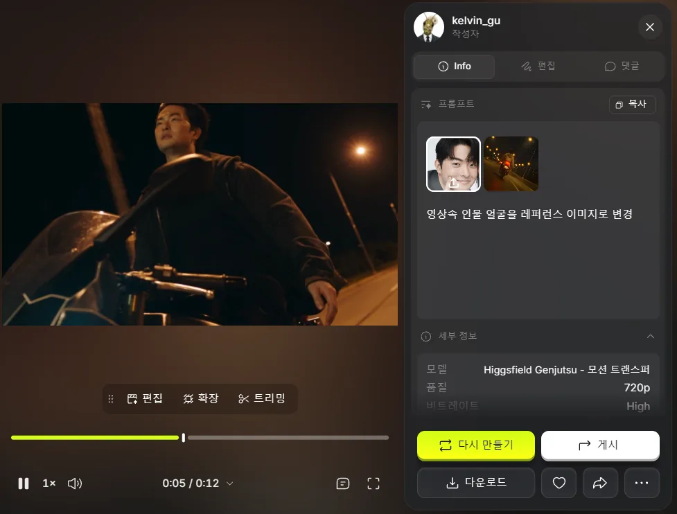
<small>Genjutsu मोशन ट्रांसफ़र। एक फ़ोटो और एक लाइन के प्रॉम्प्ट से सिर्फ़ चेहरा बदला</small>

मोटरसाइकिल पर "अकेला मैं" और "मुझे ख़ुश रहना है" सबटाइटल गुज़रते हैं, और वह अकेला आदमी वर्करूम की डेस्क पर पहुँचता है, जहाँ मुख्य कहानी शुरू होती है। पीछे देखूँ तो इसी एक सीन ने पूरी फ़िल्म खींच ली। मेहमानों का रिएक्शन मैं अभी ठीक से नहीं दिखा पाया। हॉल की फ़ुटेज के साथ एक बार क्रॉस-कट करके देखा, पर पहली हँसी के अलावा रिएक्शन ठीक से नहीं पकड़ में आए। वीडियो कंपनी ने मेहमानों का रिएक्शन अलग से शूट किया है जो अभी नहीं आया; आते ही रिएक्शन दोबारा एडिट करके यहाँ लगाऊँगा।

## कहानी AI से ख़ुशी के बारे में पूछने से शुरू होती है

कहानी मैंने शुरू से सीधी रखी। Kang PD AI से ख़ुश रहने का तरीक़ा पूछता है, AI के कहने पर बाहर निकलता है, अजीब-अजीब जगहों पर भटकता है, पार्क की बेंच पर पानी देने वाली किसी से मिलता है, और शादी हॉल में आ जाता है।

| सीन | जगह | क्या होता है | स्टोरीबोर्ड में लंबाई |
|---|---|---|---|
| S#1 | वर्करूम (रात) | वह AI से पूछता है, "इंसान के ख़ुश होने का सबसे पक्का तरीक़ा क्या है?" जवाब: "बाहर जाइए। सच्चा साथी मिलेगा तो आँखों के सामने कुछ चमकेगा!" | 0:00–0:15 |
| S#2 | कैफ़े → पार्क → चाँद → बर्फ़ीला पहाड़ → गर्मियों की सड़क | चेहरा स्क्रीन के ठीक बीच में रहता है, बस कपड़े और बैकग्राउंड बदलते रहते हैं। आख़िर में वह थककर बेंच पर धम्म से बैठ जाता है | 0:15–0:40 |
| S#3 | पार्क की बेंच | बगल से पानी की बोतल आती है; वह सिर उठाता है, पीछे की रोशनी हटती है, और मेरी पत्नी दिखती है। अचानक आँख में ज़ूम, और उसके अंदर असली तस्वीरों और वीडियो का मोंटाज | 0:40–2:00 |
| S#4 | शादी हॉल का वेटिंग रूम | उसी भाव से सीधे टक्सीडो में, वह सेल्फ़ी कैम पर मेहमानों से बात करता है, फिर दरवाज़े पर: "पीछे देखिए" | 2:00–2:20 |

स्टोरीबोर्ड में हर शॉट का कैमरा, निर्देशन और आवाज़ एक शीट पर लिखी। काम करते हुए मैं इसे शादी से पहले की फ़िल्म कहता था, पर असल में यह समारोह के बीच, दूल्हे की एंट्री से ठीक पहले चली।

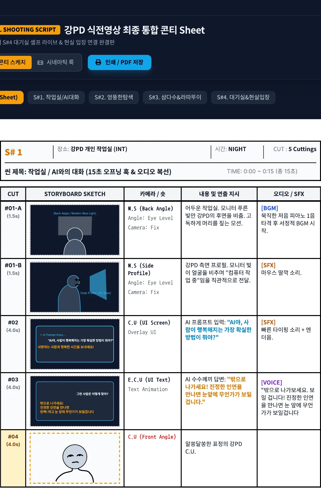
<small>S#1 वर्करूम। AI चैट स्क्रीन की लाइनें और साउंड इफ़ेक्ट तक लिखे हैं</small>

S#3 क्लाइमैक्स है। बोतल से पत्नी के चेहरे तक टिल्ट-अप, पीछे की रोशनी वाला लेंस फ़्लेयर, Ratatouille की तरह आँख में खिंच जाना, और उसके अंदर का मोंटाज स्टोरीबोर्ड में सबसे ज़्यादा जगह लेते हैं। क्रेडिट और समय भी सबसे ज़्यादा यहीं गए।

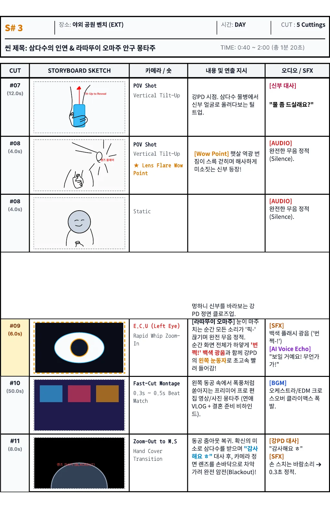
<small>S#3 बेंच। दुल्हन की लाइन "थोड़ा पानी लेंगे?", #09 आँख में ज़ूम, #10 मोंटाज</small>

S#4 वह हिस्सा है जो हॉल से जुड़ता है। स्क्रीन वाला मैं वेटिंग रूम में सेल्फ़ी कैम पर बात करता है, कैमरा नीचे रखता है, और फ़िल्म बंद होते ही असली एंट्री का संगीत शुरू होता है।

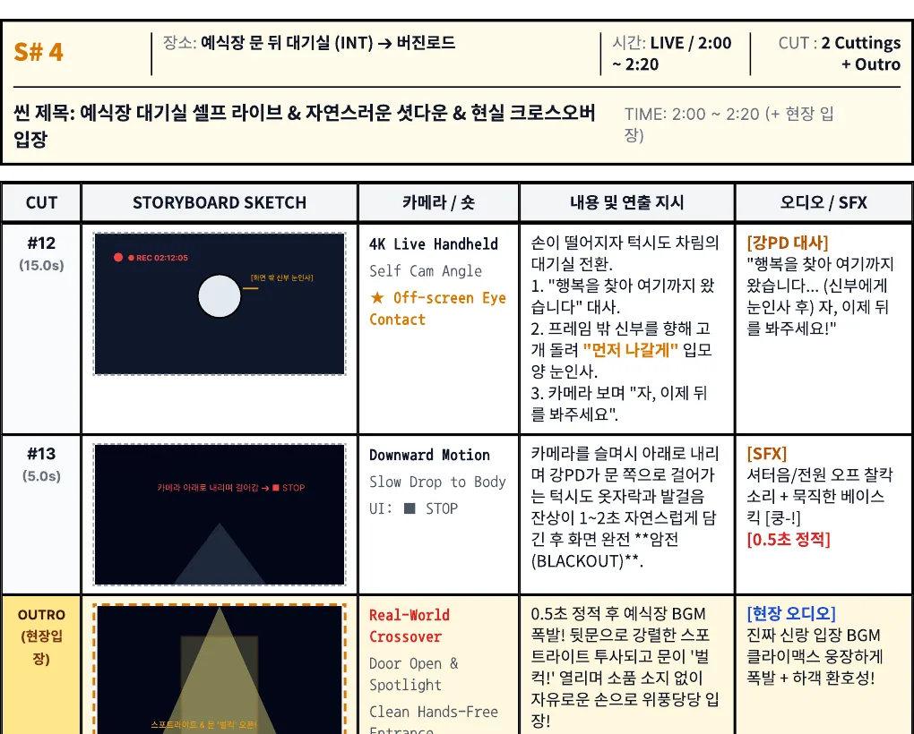
<small>S#4। फ़िल्म को असली एंट्री से जोड़ने वाला आख़िरी सीन</small>

स्टोरीबोर्ड 2 मिनट 20 सेकंड का था; फ़ाइनल कट की तस्वीर 2:15 पर ख़त्म होती है। मोंटाज 50 सेकंड का सोचा था जो काफ़ी छोटा हो गया, और डायलॉग भी बदले। कैसे बदले, यह भाग 3 और 4 में है।

## AI को सौंपने से पहले क्या तय किया

मैंने दो AI टूल साथ में इस्तेमाल किए: तस्वीर और वीडियो बनाने के लिए Higgsfield, प्रॉम्प्ट डिज़ाइन और नतीजे जाँचने के लिए Claude। Higgsfield को Claude से कनेक्टर के रूप में जोड़ा, तो Claude ख़ुद बनाता था और बैलेंस व ट्रांज़ैक्शन हिस्ट्री तक देखता था।

तीन उसूल मैंने आख़िर तक निभाए।

| उसूल | वजह |
|---|---|
| जगह की तस्वीर → उस जगह में इंसान वाली तस्वीर → वीडियो | वीडियो के स्टेज पर जगह और इंसान अलग-अलग डालो तो दोनों बेमेल हो जाते थे। पहले फ़्रेम में दी गई तस्वीर वीडियो में वैसी ही आती थी |
| चेहरा शॉट से मिलते एंगल की एक फ़ोटो से | सामने, बगल और नीचे देखती फ़ोटो एक साथ डालने पर हर एंगल का औसत बनकर चेहरा बिगड़ जाता था। विस्तार भाग 3 में |
| वीडियो पहले 480p में जाँचो, 1080p सिर्फ़ आख़िर में | एक बार 1080p, छह बार 480p टेस्ट जितना महँगा था |

जगहें Higgsfield के एलिमेंट के रूप में सेव कीं। शादी हॉल, बर्फ़ीला पहाड़, चाँद, वर्करूम, गर्मियों की सड़क, पार्क और कैफ़े बनाकर प्रॉम्प्ट में @ से बुलाया।

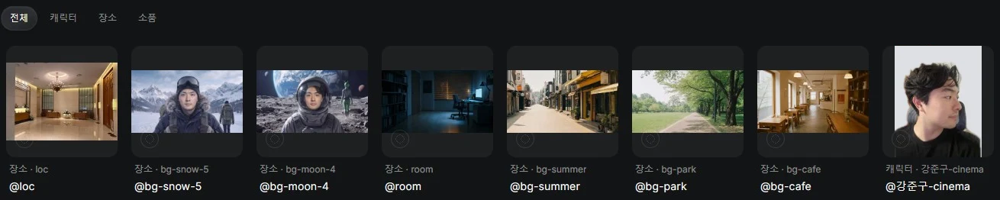
<small>Higgsfield में सेव सात जगह वाले एलिमेंट और एक कैरेक्टर एलिमेंट। कैरेक्टर फ़ोटो का घर वाला बैकग्राउंड सादे रंग से बदला</small>

चेहरा मैंने हर एंगल से अलग-अलग खींचकर अपलोड किया। पहले लगा था जितनी ज़्यादा फ़ोटो, उतना मेरे जैसा। उल्टा हुआ। यही भाग 3 का केंद्र है।

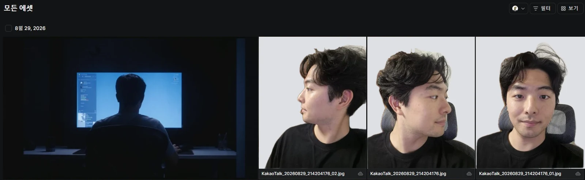
<small>प्रोजेक्ट में अपलोड चेहरे की फ़ोटो। बगल, 45 डिग्री और सामने, अलग-अलग खींची। घर का अंदर दिख रहा था, इसलिए सिर्फ़ पीछे का हिस्सा सादे रंग से बदला</small>

पैसों पर एक बात। मेरा Higgsfield अकाउंट Plus प्लान पर है, हर महीने की 3 तारीख़ को 1,000 क्रेडिट आते हैं। मैंने Claude से ट्रांज़ैक्शन हिस्ट्री आख़िर तक पलटवाकर पक्का किया: **बचे क्रेडिट अगले महीने नहीं जाते; ग़ायब हो जाते हैं।** इसलिए रीसेट से ठीक पहले बचाने की कोई वजह नहीं थी, और रीसेट के ठीक बाद एक वीडियो पर भी हिचकता था। ज़्यादातर क्रेडिट वीडियो में गए। एक तस्वीर 2 क्रेडिट की, जबकि एक बार का वीडियो लगभग 20 से 130 से ज़्यादा क्रेडिट तक।

## अगर ऐसा कुछ फिर बनाऊँ

तैयारी में छूटी चीज़ों की वजह से बाद में बहुत क्रेडिट और समय गया। वही काम फिर करूँ तो इस क्रम में करूँगा।

| क्या करूँ | वजह |
|---|---|
| हर शॉट में लिखूँ "किसकी नज़र, क्या देखते हुए" | मैंने बस "बोतल POV" लिखा और Claude ने उसे बोतल की नज़र समझा। असल में वह बोतल देखती मेरी नज़र थी |
| फ़ैसले और उनकी वजहें एक फ़ाइल में रखूँ | Claude अकाउंट बदलते समय सिर्फ़ सारांश दिया और सारी वजहें खो गईं (भाग 4) |
| 480p टेस्ट → 1080p को शुरू से नियम बनाऊँ | 132 क्रेडिट वाली एक बार छह टेस्ट के बराबर है |
| कनेक्टर सिर्फ़ बनाते समय चालू करूँ | सिर्फ़ टूल के विवरण ही हर बार Claude का बड़ा हिस्सा खा जाते थे |

भाग 2 वर्करूम और भटकने वाले सीन का है: जिस मॉनिटर स्क्रीन पर लिखा हुआ बिल्कुल सही होना था वह AI क्यों नहीं बना सका, जिस सीन में चेहरे की जगह तय रहनी थी उसे मैंने ख़ुद क्यों शूट किया, और उन बुज़ुर्ग मेहमानों की बात जिन्हें लगा कि हमने सब सच में शूट किया।

## आज़माइश का रिकॉर्ड

मुख्य हिस्से से काटी गई प्रक्रिया यहाँ जस की तस रखी है। यही चीज़ आज़माने वालों के लिए यह हिस्सा ज़्यादा काम का हो सकता है।

Beat की शुरुआत: 5 सितंबर की रात, Higgsfield Genjutsu मोशन ट्रांसफ़र, 720p, 12 सेकंड। एक मोटरसाइकिल क्लिप और मेरे चेहरे की एक फ़ोटो; प्रॉम्प्ट एक लाइन "वीडियो में दिख रहे व्यक्ति का चेहरा रेफ़रेंस इमेज से बदलो।"

काम का समय: लगभग ग्यारह दिन, 27 अगस्त को स्टोरीबोर्ड सेव करने से 6 सितंबर को आख़िरी वीडियो बनाने तक। योजना उससे कम से कम एक महीना पहले से थोड़ी-थोड़ी चल रही थी। स्टोरीबोर्ड PDF का नाम "Kang PD pre-ceremony film final integrated storyboard sheet" है, S#1 से S#4 तक ऊपर-नीचे जुड़े।

दो Claude अकाउंट: मैंने Claude अपनी पत्नी के अकाउंट से शुरू किया। वह मेरे सीन के विवरण इतनी अच्छी तरह समझता था कि आख़िर में मैंने अपना अकाउंट बनाया और प्लान Max तक बढ़ाया। पत्नी के अकाउंट की बातचीत साथ नहीं आई, तो मैंने हैंडओवर डॉक्यूमेंट बनाकर चिपकाया, पर उस डॉक्यूमेंट ने सिर्फ़ नतीजे रखे और सारी वजहें गिरा दीं। Higgsfield शुरू से मेरे अपने अकाउंट पर था।

Higgsfield कनेक्टर:

| क्या हुआ | वजह | क्या बदला |
|---|---|---|
| एक बातचीत में Max का 4% इस्तेमाल भर गया, कुछ और संदेशों में 7% | Higgsfield कनेक्टर में लगभग 80 टूल हैं, और इस्तेमाल न हों तब भी उनके विवरण हर बार जाते थे। 100 ट्रांज़ैक्शन जैसे नतीजे भी जमा होते रहे | कनेक्टर सिर्फ़ बनाते समय चालू किया; योजना और स्क्रिप्ट की बातें उसे बंद रखकर नई बातचीत में कीं |
| Claude बनी चीज़ों की सूची तो दिखाता था पर तस्वीर नहीं देख पाता था | सूची में सिर्फ़ ID और पता आता है, तस्वीर Claude खोल नहीं पाता था | कौन-सी चुननी है, स्क्रीन पर कौन-सा ख़ाना है यह मैं बताता था |

पहली तस्वीर: 29 अगस्त को Higgsfield में "शादी फ़िल्म" प्रोजेक्ट बनाकर सामग्री अपलोड करनी शुरू की। उसी दिन S#1 वर्करूम से शुरू किया।

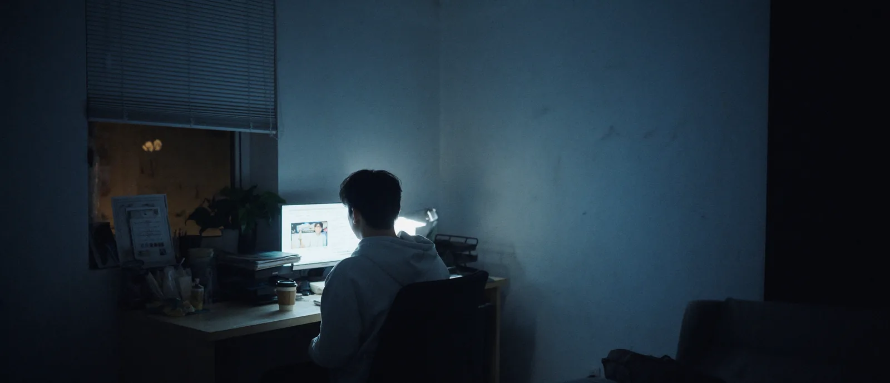
<small>29 अगस्त शाम 5 बजे बनी वर्करूम की तस्वीर (AI से बनी)। फ़ाइनल कट में दूसरा फ़्रेम गया</small>

जगह वाले एलिमेंट के वर्ज़न: बर्फ़ीले पहाड़ और चाँद के कई वर्ज़न बने, @bg-snow-5 और @bg-moon-4 तक।

चेहरे के रेफ़रेंस का नियम कैसे बना: पहले कैरेक्टर एलिमेंट (@char_jungu, @char_sumin) एक-एक फ़ोटो पर थे, इसलिए चेहरा कमज़ोर आता था। तो मैंने एलिमेंट में और फ़ोटो डालीं और हर शॉट में फ़ोटो सीधे रेफ़रेंस के रूप में भी दीं। फिर पता चला कि एंगल मिलाने से औसत बनता है, और नियम बदला।

| प्राथमिकता | रेफ़रेंस में डालने वाली फ़ोटो |
|---|---|
| 1 | बनने वाले शॉट से मिलते एंगल की ठीक एक फ़ोटो |
| 2 | ऐसी न हो तो एक अच्छी सामने वाली और एक अच्छी बगल वाली |
| मना | सामने, बगल और नीचे देखती फ़ोटो एक साथ। तीनों दिशाओं का एक साथ औसत बनता है |

यह नियम पत्नी के चेहरे पर एक बार डगमगाया। उनकी तीन फ़ोटो थीं: सामने देखती; 45 डिग्री घूमी और आँखें सामने; और 45 डिग्री घूमी और आँखें नीचे। बेंच पर बैठे मेरी नज़र से ऊपर दिखता उनका चेहरा चाहिए था, तो Claude ने सबसे क़रीबी एंगल वाली तीसरी फ़ोटो ही लेने को कहा। मुझे लगा उस फ़ोटो में झुकी आँखें ठीक नहीं आएँगी, इसलिए मैंने तीनों डालीं। नियम नियम है, पर हर फ़ोटो का भाव भी तौलना पड़ता है।

चेहरे के हिस्से शब्दों में भी पक्के किए: आँखों की दूरी, पलकों का आकार, नाक की चौड़ाई, गालों की हड्डी की ऊँचाई, जबड़े का कोण, होंठ के ऊपर की लंबाई और होंठों की मोटाई, आख़िर में `Do not average these features`।

दो कैरेक्टर एलिमेंट: @강준구 में 7 फ़ोटो हैं, शादी के फ़ोटोशूट के सूट वाली और रोज़ की फ़ोटो मिली-जुली।

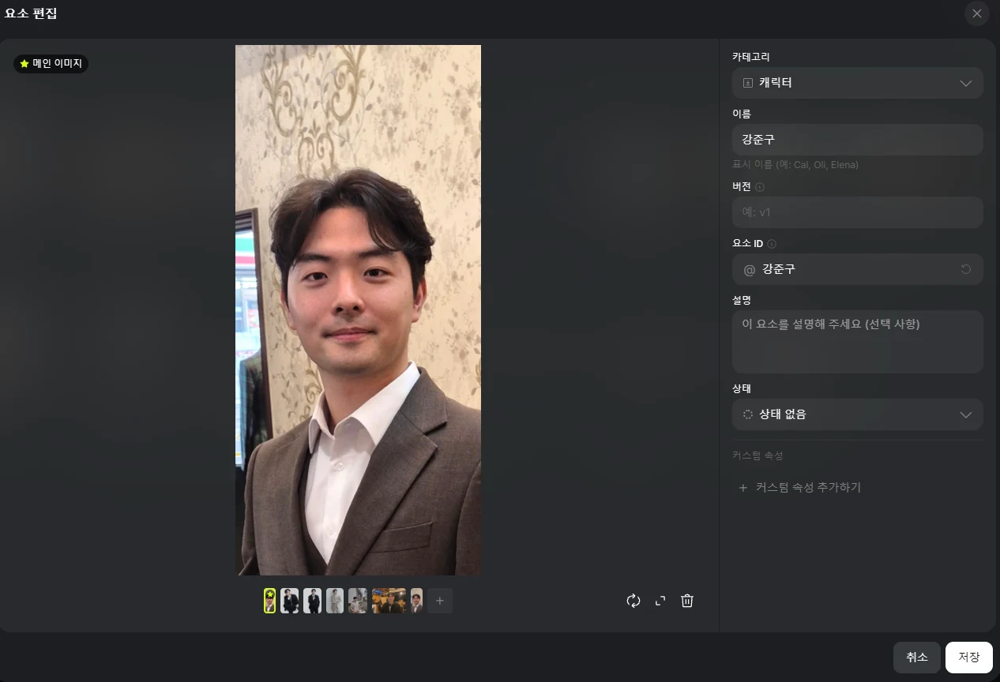
<small>@강준구 एलिमेंट। एक मुख्य तस्वीर और छह और फ़ोटो</small>

Soul कैरेक्टर (@강준구-cinema) में अलग-अलग जगहों की मेरी 17 फ़ोटो हैं, और ट्रांज़ैक्शन में Soul ID के नाम से 25 क्रेडिट गए। पर यह सिर्फ़ Soul Cinema में बुलाया जा सकता है, Nano Banana Pro या Cinema Studio में नहीं, इसलिए ज़्यादातर शॉट में इस्तेमाल नहीं हुआ। 6 सितंबर को Seedance 2 से बेंच तक चलकर बैठने वाले एक शॉट में बुलाया।

<small>@강준구-cinema। अलग एंगल और जगहों की 17 फ़ोटो: कैफ़े, रेस्टोरेंट, शादी का फ़ोटोशूट</small>

क्रेडिट: हर महीने की 3 तारीख़ सुबह 11 बजे (कोरिया समय) 1,000 क्रेडिट आते हैं। 3 अगस्त के रिकॉर्ड में बचे 843 क्रेडिट वापस लेने वाली लाइन और 1,000 नए क्रेडिट देने वाली लाइन साथ-साथ थीं। ट्रांज़ैक्शन हिस्ट्री से हर मॉडल की एक बार की क़ीमत:

| मॉडल | प्रकार | एक बार की क़ीमत (क्रेडिट) |
|---|---|---|
| Nano Banana Pro | तस्वीर | 2 |
| GPT Image 2.0 | तस्वीर | 0.5–8.5 (सेटिंग के हिसाब से 17 गुना फ़र्क) |
| Cinema Studio 4.0 | वीडियो | 20–72 |
| Seedance 2.5 | वीडियो | 19.26–132.73 |

31 अगस्त को पिछले 140 ट्रांज़ैक्शन मॉडल के हिसाब से जोड़े: कुल 563 क्रेडिट में से 8 वीडियो ने 356 क्रेडिट (63%) लिए। Nano Banana Pro ने 38 तस्वीरें बनाकर भी सिर्फ़ 76 क्रेडिट लिए। एक साथ गए 132.73 क्रेडिट 30 अगस्त रात 10:41 (कोरिया समय) का Seedance 2.5 Edit 1080p फ़ाइनल रन था। उस एक दिन में ही लगभग 300 क्रेडिट गए।

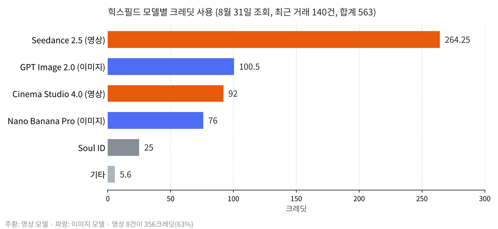
<small>31 अगस्त को देखे 140 ट्रांज़ैक्शन, मॉडल के हिसाब से जोड़े (ट्रांज़ैक्शन हिस्ट्री से ख़ुद बनाया)</small>

वीडियो मॉडल: 30 अगस्त से 6 सितंबर तक मेरे अकाउंट पर 36 वीडियो बने। 19 थे 480p टेस्ट और 16 थे 1080p।

| मॉडल | संख्या | सीन |
|---|---|---|
| Seedance 2.5 | 20 | बेंच POV टिल्ट-अप, आँख में ज़ूम-इन और ज़ूम-आउट, शादी हॉल का AI सेल्फ़ी कैम |
| Seedance 2.5 Edit | 9 | भटकने वाला सीन (असली फ़ुटेज के बैकग्राउंड और कपड़े बदलना), शादी हॉल का सेल्फ़ी कैम, आँख से बाहर निकलता शॉट |
| Cinema Studio | 4 | वर्करूम में बोलने के तीन शॉट, एक बेंच POV टिल्ट-अप |
| Higgsfield Genjutsu | 2 | चेहरा बदलना (मोशन ट्रांसफ़र), सेल्फ़ी कैम के कपड़े बदलना (ऑब्जेक्ट स्वैप) |
| Seedance 2 | 1 | बेंच तक चलकर बैठना |
