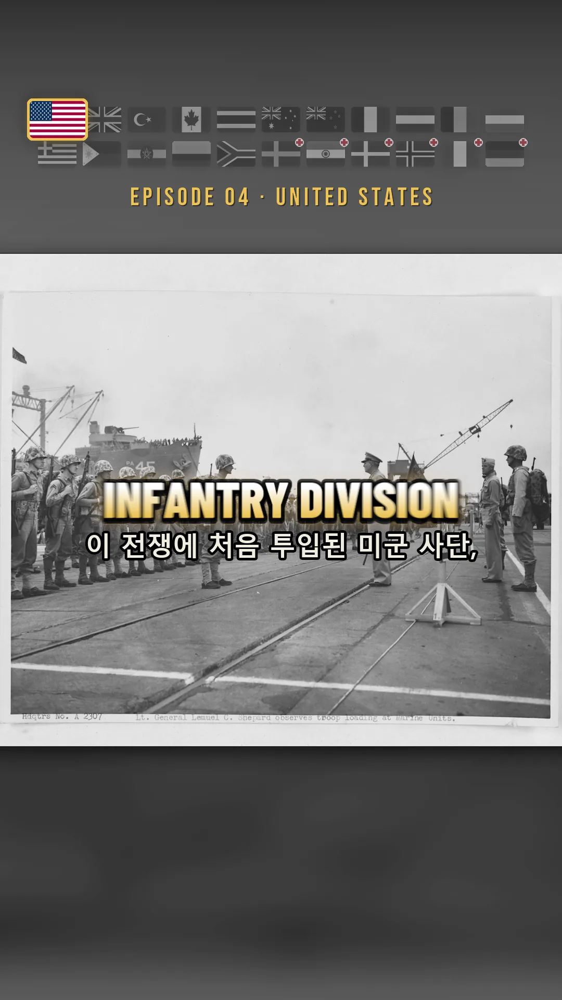
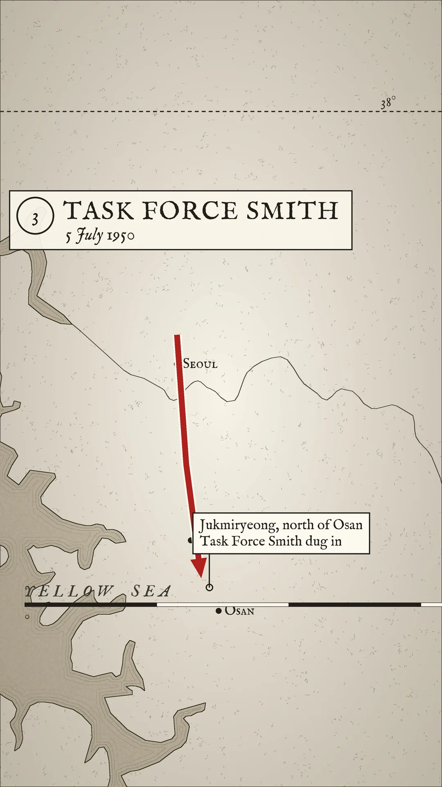
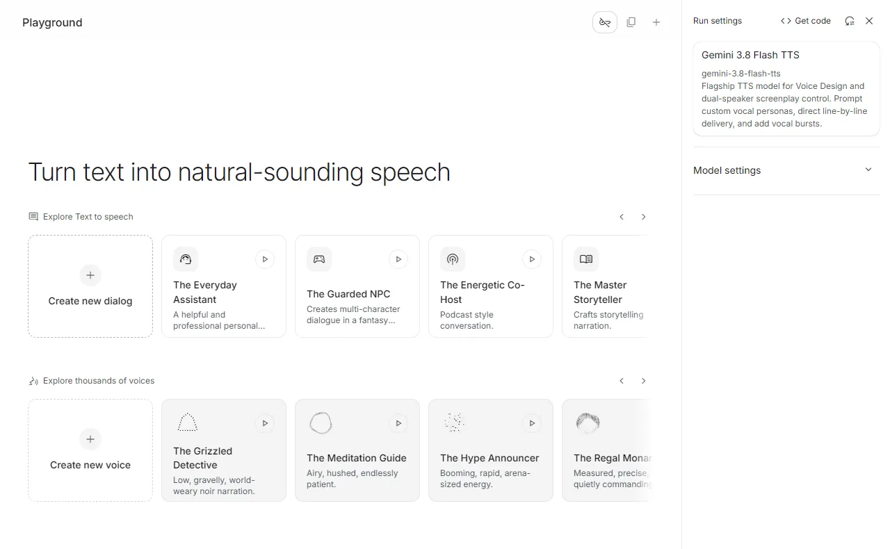
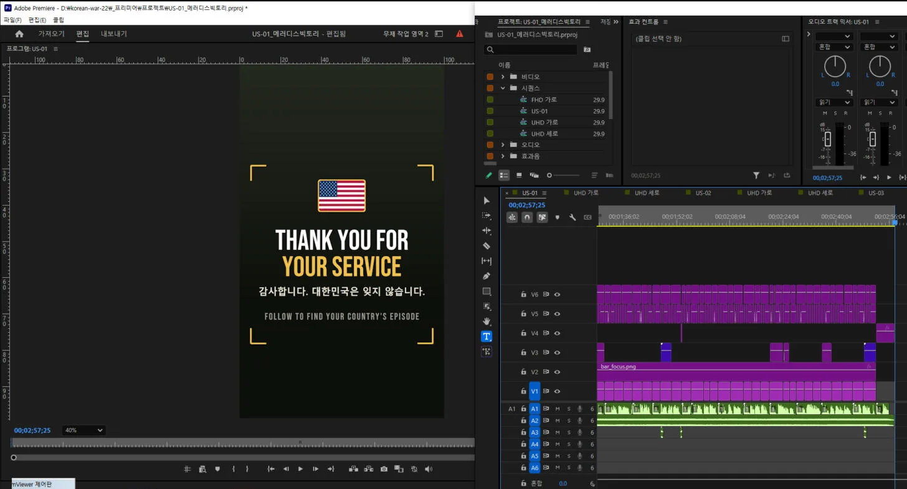
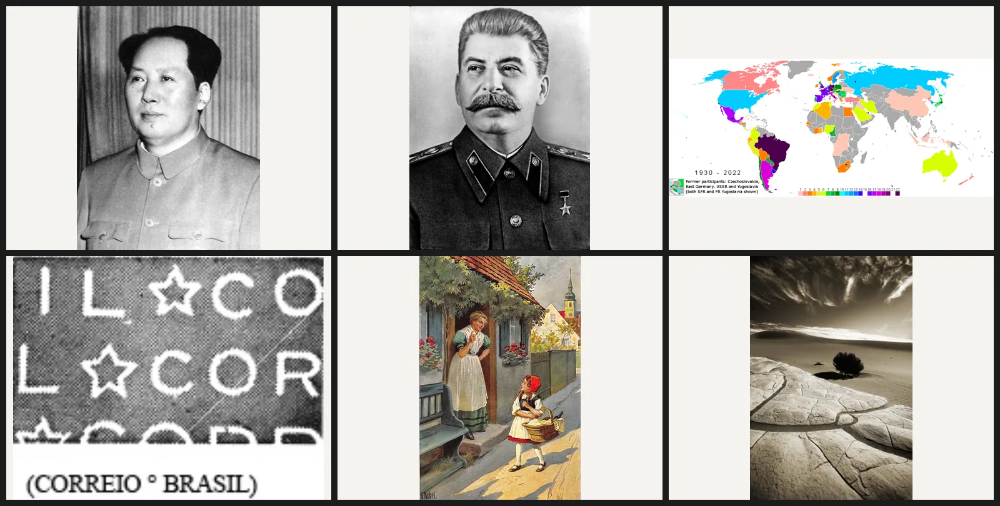
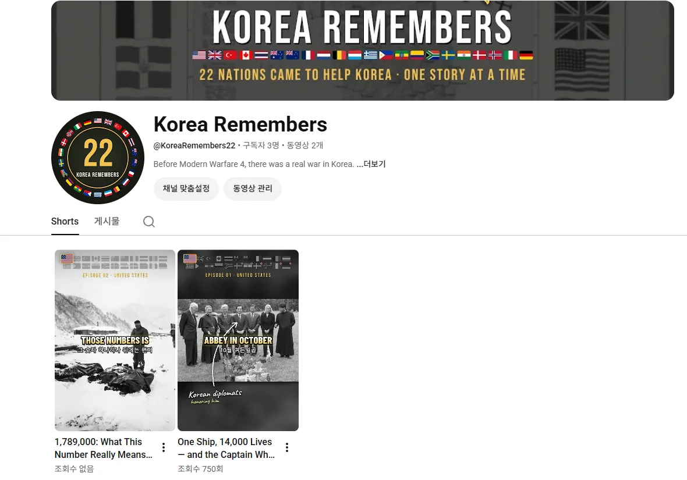

एक स्क्रिप्ट और एक फ़ोटो फ़ोल्डर डालिए, और क्लॉड ख़ुद प्रीमियर की टाइमलाइन जोड़ देता है। तीन दिन में वह रास्ता बनाकर मैंने लगभग दो मिनट पचास सेकंड के चार शॉर्ट्स निकाले।

<small>तैयार फ़्रेम। झंडों की पट्टी, बड़ा कैप्शन, सहायक कैप्शन और तस्वीर की जगह, सब कोड ने तय किया है</small>

## बाईस देश क्यों

कोरियाई युद्ध में बाईस देशों ने सेना या चिकित्सा दल भेजा था: 16 लड़ाकू देश और 6 चिकित्सा सहायता देश। इसे चैनल का विषय चुनने के तीन कारण हैं।

| कारण | विवरण |
|---|---|
| समय | मॉडर्न वॉरफ़ेयर 4 23 अक्टूबर 2026 को आया। उसका अभियान कोरियाई प्रायद्वीप का युद्ध है जो उत्तर कोरिया के पूर्ण आक्रमण से शुरू होता है, और नायक एक दक्षिण कोरियाई सिपाही है। इस समय दुनिया भर के गेमर कोरिया खोज रहे हैं |
| सामग्री | हर देश के पास अपनी टुकड़ियाँ, लड़ाइयाँ और लोग हैं। बाईस देशों से सैकड़ों कड़ियाँ बनती हैं। अभी तक 145 स्क्रिप्ट लिख चुका हूँ |
| बाज़ार | भाग लेने वाले देशों में अमेरिका, ब्रिटेन, कनाडा, ऑस्ट्रेलिया, न्यूज़ीलैंड, नीदरलैंड, नॉर्डिक देश और जर्मनी विज्ञापन दर में ऊँचे हैं |

तीसरा कारण असल में सबसे बड़ा है। सिर्फ़ कोरियाई में काम करूँ तो बाज़ार पाँच करोड़ का है और उसमें भी बँटवारा होता है। इसलिए मैंने **अंग्रेज़ी को आधार बनाया, और जिस देश की कड़ी है सिर्फ़ उसी में उस देश की भाषा के उपशीर्षक और झंडा विशेष रूप से डाले**। दाँव यह है कि अपने देश को उभरा देखकर दर्शक प्रोफ़ाइल खंगाले और पूछे, "क्या मेरा देश भी है?" बाक़ी भाषाएँ यूट्यूब की स्वचालित डबिंग पर छोड़ दीं। चैनल का नाम Korea Remembers है, एक ही खाता, रोज़ एक कड़ी।

भाव क्रोध नहीं, कृतज्ञता है। इसे एक कोरियाई बना रहा है, यही बात अपने आप सच्चाई बन जाती है।

## संदर्भ चैनलों को चीरकर डिज़ाइन तय किया

मैंने अंदाज़े से नहीं बनाया। जिन चैनलों जैसा बनाना है, उनके वीडियो उतारकर खोले। ढाँचे के लिए इंडोनेशिया का Hystoria (1.42 लाख सब्सक्राइबर), और दृश्य-व्याकरण के लिए Silent Souls Stories (1.75 लाख सब्सक्राइबर) के तीन शॉर्ट्स yt-dlp से उतारकर फ़्रेम दर फ़्रेम जाँचे।

| संदर्भ में जो मिला | मेरे वीडियो में जो लागू किया |
|---|---|
| ट्रांज़िशन प्रभाव लगभग नहीं। सिर्फ़ कट, और कट के ठीक बाद हल्का-सा खिंचाव जो थम जाता है | हर कट 104% से 100.5% तक खिंचता है, फिर धीरे-धीरे 106% तक बढ़ता है |
| दृश्य औसतन 2 सेकंड | कट औसतन लगभग 3 सेकंड, शुरुआत 1.3 से 1.7 सेकंड |
| बड़े मोड़ पर ही 0.6 सेकंड की सफ़ेद चमक | सिर्फ़ एक-दो बार, जहाँ कहानी मुड़ती है |
| उपशीर्षक 1 से 3 शब्द बड़े अक्षरों में, स्क्रीन के बीचोंबीच | सफ़ेद से पीले में ढलता ग्रेडिएंट, बीचोंबीच |

<small>नक़्शे कहीं से लिए नहीं, कोड से बनाए गए हैं। सिर्फ़ तटरेखा का डेटा खुले स्रोत से है, बाक़ी सब बनाया हुआ</small>

इसमें मैंने अपनी दो चीज़ें जोड़ीं। पूरे वीडियो में स्क्रीन के ऊपर 22 झंडों की पट्टी टिकी रहती है, और जिस क्षण कथन कहता है "आज, संयुक्त राज्य", सिर्फ़ वही झंडा 1.45 गुना बड़ा होकर सुनहरी किनारी पहन लेता है और बाक़ी श्वेत-श्याम हो जाते हैं। और नक़्शे उधार नहीं लिए, ख़ुद बनाए: काग़ज़ी बनावट, स्याही की तटरेखा, किनारे पर लहर-रेखाएँ, 38वीं समांतर, क्रमांकित शीर्षक बक्से, लाल गति-तीर। हर दृश्य का नक़्शा अलग है।

## आवाज़ एक ही ब्लॉक में, समय श्रुतलेख से

शुरू में मैंने विंडोज़ की अंतर्निहित आवाज़ से गाइड ट्रैक बिछाया। फ़ैसला एक शब्द में आया। कचरा।

अब मैं इसे जेमिनाई AI स्टूडियो की वेबसाइट पर बनाता हूँ। असली बात यह है कि **पूरी स्क्रिप्ट एक ही speech block में, दृश्यों के बीच ख़ाली पंक्ति देकर, एक ही बार में चलाई जाए**। दृश्य दर दृश्य बनाओ तो आवाज़ हल्की-हल्की बदल जाती है। आवाज़ सिर्फ़ एक, Riko। दो मिनट पचास सेकंड का कथन एक ही फ़ाइल में निकलता है।

<small>कथन बनाने की स्क्रीन। "Create new dialog" दबाने पर ही लिखने का ख़ाना आता है</small>

इसके बाद असली बात आती है। कथन की wav फ़ाइल को faster-whisper से दोबारा लिखवाकर **हर शब्द किस सेकंड पर आता है, यह निकालता हूँ।** इससे उपशीर्षक हाथ से मिलाने की ज़रूरत नहीं रहती। कट-सूची में लिखा हो "यह तस्वीर 'Hungnam' शब्द पर शुरू होगी", तो कोड उस शब्द का असली समय ढूँढकर कट रख देता है। मिलान की शुद्धता प्रति कड़ी 95 से 98 प्रतिशत रहती है।

उपशीर्षक दो पंक्तियों में हैं। बड़ी पंक्ति उस देश की भाषा में 1 से 3 शब्द, नीचे की छोटी पंक्ति अंग्रेज़ी। अंग्रेज़ीभाषी देशों की कड़ी में नीचे कोरियाई रहती है। कोरियाई के टुकड़े बहुत छोटे टूट रहे थे, इसलिए अर्थ के हिसाब से दोबारा जोड़े। नौ अक्षर से छोटा टुकड़ा, या जिसका अर्थ पूरा न हुआ हो, अगले से मिला दिया जाता है, और एक पंक्ति अठारह अक्षर तक जा सकती है। एक कड़ी में 139 टुकड़े घटकर 66 रह गए।

## प्रीमियर को क्लॉड ख़ुद जोड़ता है

यहीं MCP काम आता है। मैं दो इस्तेमाल करता हूँ।

| MCP | काम |
|---|---|
| प्रीमियर प्रो MCP | प्रोजेक्ट खोलना और दूसरे नाम से सहेजना, `execute_extendscript` से टाइमलाइन जोड़ना, निर्यात करना |
| प्लेराइट (व्हेल, डीबग पोर्ट 9222) | AI स्टूडियो में आवाज़ बनाना और उतारना, अमेरिकी राष्ट्रीय अभिलेखागार और DigitaltMuseum से सामग्री जुटाना, यूट्यूब और इंस्टाग्राम पर निर्धारित अपलोड |

क्रम ऐसा है। पायथन वाला हिस्सा (`premiere_prep.py`) तस्वीरों को पहले 1080×1920 में जोड़ता है, उपशीर्षक, नाम-पट्टियाँ, कूची के अक्षर और नक़्शे PNG अनुक्रम में बनाता है, और एक `plan.json` तैयार करता है। फिर प्रीमियर MCP से ExtendScript की एक पंक्ति भेजी जाती है। वह स्क्रिप्ट plan पढ़कर आठ ट्रैक भर देती है।

<small>जुड़ चुकी टाइमलाइन। इन क्लिपों को कोई एक-एक करके नहीं खींचता</small>

V1 तस्वीरें और नक़्शे, V2 झंडों की पट्टी, V3 नाम-पट्टियाँ, तीर और कोरियाई कूची-अक्षर, V4 पाठ कार्ड, अंत और सफ़ेद चमक, V5 बड़े उपशीर्षक, V6 सहायक उपशीर्षक, A1 कथन, A2 संगीत। एक कड़ी में 250 से ज़्यादा क्लिप होते हैं और कोई इंसान उन्हें नहीं रखता।

स्वचालित करते हुए यह समझ आया कि निर्णय भी कोड में डाले जा सकते हैं। हर दृश्य को उसके कथन से महत्त्व-अंक मिलते हैं। Medal of Honor, first, captured, killed जैसे मुख्य शब्द 3 अंक, बड़ी संख्या 3, धन्यवाद 3, और उस कड़ी में पहली बार आया मुख्य शब्द 2 अंक। 6 अंक से ऊपर वाले दृश्य ही पीले कूची-अक्षर पा सकते हैं, उससे कम पर कोड उन्हें ख़ुद हटा देता है। ध्वनि प्रभाव भी लाइसेंस में न फँसें इसलिए पायथन से ख़ुद बनाए: लोगो की गूँज, चमक की सनसनाहट, कार्ड की टंकण-ध्वनि, एक थाप और कूची की रगड़, कुल पाँच।

## जब कोड अपने ही जुटाए माल पर भरोसा न कर सके

सामग्री भी कोड ने जुटाई। वह विकिमीडिया कॉमन्स को देशवार खंगालता है और लाइसेंस तीन श्रेणियों में बाँटता है: मुक्त (पब्लिक डोमेन, CC0), श्रेय (CC BY), और समान शर्त (CC BY-SA)। ग़ैर-व्यावसायिक और बिना-बदलाव वाले नहीं लिए जाते।

पर पहला संग्रह खोला तो फ़िलीपीन्स की सभी 114 तस्वीरें 1992 से 2016 के बीच की निकलीं। फ़िलीपीन्स के राजनीतिक आयोजन और पोप की यात्रा। कारण यह था कि `Philippines in the Korean War` की इकलौती उपश्रेणी वह व्यक्ति थे जो युद्ध के अनुभवी रहकर राष्ट्रपति बने, और वहाँ से दो स्तर नीचे जाते हुए APEC के वीडियो तक खिंच आए। मैंने व्यक्ति-नाम जैसी श्रेणियों में उतरना बंद किया, 1949–1956 का वर्ष-छननी लगाया, और फ़ैसले को तीन में बाँटा: लो, जाँचो, छोड़ो।

इसके बाद जोड़ी गई "शब्द से खोज" सुविधा और बड़ा छेद निकली। जर्मनी को खोज-शब्द बनाकर चलाया तो 110 फ़ाइलें आईं: 2007 की अमेरिकी सेना फ़ोटो प्रतियोगिता, ब्राज़ील के डाक टिकट, विश्व कप भागीदारी के नक़्शे, सोवियत कार्टून।

<small>"जर्मनी" खोजने पर जो आया। सभी 110 ऐसी ही थीं</small>

कोरिया से संबंध की जाँच उस श्रेणी-पथ को भी आधार बना रही थी जिससे फ़ाइल खिंचकर आई थी, और खोज-परिणाम में वही खोज-शब्द उस पथ पर लिखा होता है, सो कुछ भी पार हो जाता था। खोज को डिफ़ॉल्ट रूप से बंद कर दिया, और छाँटी गई 704 फ़ाइलें, 5.2GB, मिटाने के बजाय अब एक अलग फ़ोल्डर में रखी हैं। तस्वीरों की संख्या 1,658 से घटाकर 1,040 लिख दी। फुलाए हुए आँकड़े पर योजना बनाओ तो वही आगे चलकर छेद बन जाता है।

## अभी की स्थिति

<small>चैनल अभी-अभी खुला है। परिचय की पहली पंक्ति है "Before Modern Warfare 4, there was a real war in Korea."</small>

US-01, हुंगनाम में SS मेरेडिथ विक्ट्री, से लेकर US-04, टास्क फ़ोर्स स्मिथ तक पूरे संस्करण बन चुके हैं और रोज़ एक यूट्यूब तथा इंस्टाग्राम पर चढ़ रहे हैं। पहली कड़ी यह है: [One Ship, 14,000 Lives — and the Captain Who Gave Up Everything](https://youtube.com/shorts/D4IVNaqsKUQ)। अगली बारी हडनर और ब्राउन की कहानी है।

बचा हुआ काम इंसान वाले हिस्से में जमा है। जिन पाँच देशों की दस से कम तस्वीरें हैं, उनका वीडियो अभी नहीं बन सकता। जर्मनी और इटली की उस दौर की तस्वीरें कोरिया के राष्ट्रीय अभिलेखागार में सिर्फ़ ग़ैर-डिजिटल अभिलेख के रूप में हैं, इसलिए पहचान सत्यापन वाली प्रतिलिपि अर्ज़ी देनी होगी। ग़ैर-अंग्रेज़ीभाषी देशों की कड़ियों के लिए उनकी अपनी भाषा का कथन और मातृभाषी जाँच अलग से चाहिए।
