Drama tvN 100 Days of Lies baru masuk akal kalau Lee Ga-gyeong (Kim Yoo-jung) mati di episode 2, jadi saya berhenti menonton setelah episode 2.

Ini proyek spesial ulang tahun ke-20 tvN, dibintangi Kim Yoo-jung, Park Jin-young, Kim Hyun-joo, Lee Moo-saeng, dan Jin Seon-kyu.
Sutradaranya Yoo In-sik dari 'Extraordinary Attorney Woo', penulisnya Ryu Bo-ri dari 'Do You Like Brahms?'.
Dengan jajaran seperti ini, saya mau tidak mau berharap banyak.

Saya sampaikan dulu satu hal.
Kalau saya setajam ini, saya tidak bisa membalas kalau ada yang bilang "Memangnya videomu sebagus apa?"
Jadwal tayang mungkin ditetapkan lebih dulu, dengan tekanan untuk mengisi detail sambil syuting.
Adegan yang ingin dibuang penulis mungkin tetap dipaksakan dari atas, dan sutradara serta aktor mungkin merasakan kecanggungan saat syuting.
Saya juga tahu para pembuatnya mungkin paling merasakan kekurangannya.
Meski begitu, sebagai penonton dan sebagai orang yang mengerjakan hal serupa, saya ingin mencatat apa yang saya rasakan, dengan hati-hati tapi jujur.

Ilustrasi adegan di tulisan ini adalah tangkapan layar asli yang digambar ulang dengan gaya lukisan tinta Korea memakai Gemini.

## Latar yang diumumkan lewat dialog, bukan diperlihatkan

Sekitar menit 18:28 episode 1, masa lalu Ga-gyeong keluar lewat dialog beruntun.

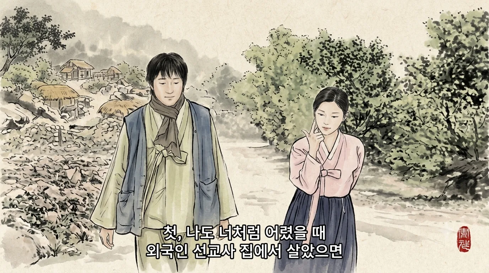

"Kalau dulu waktu kecil aku tinggal di rumah misionaris asing seperti kamu…", "Aku dituduh mencuri makanan lalu dipukuli…", lalu "Waktu itu aku memang benar-benar mencuri roti."

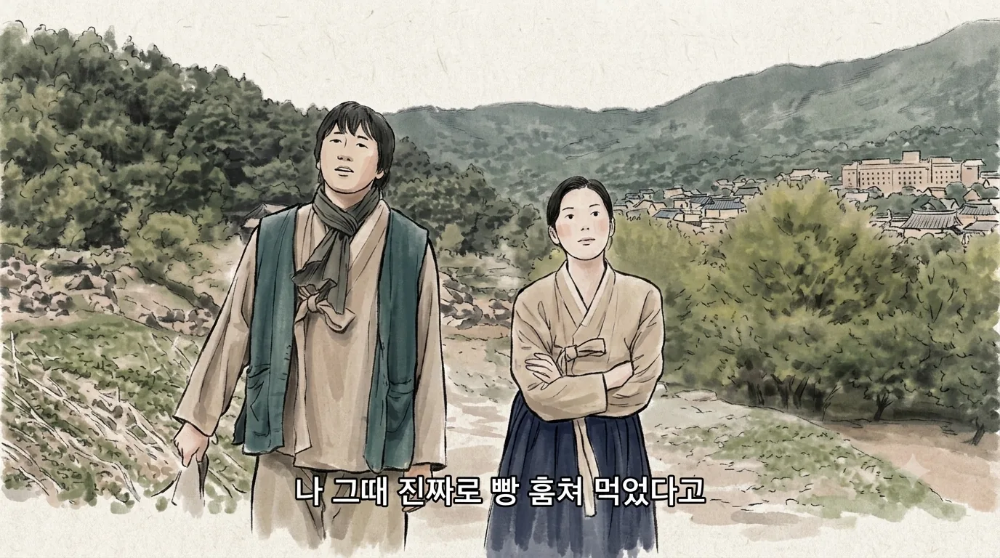

Saya paham mereka ingin memberinya karakter anak cerdik yang bertahan hidup dengan kebohongan dan akting.
Masalahnya, mereka memakai cara paling datar: dialog.
Kalau saja ada 30 detik adegan Ga-gyeong kecil benar-benar mencuri roti lalu menangis untuk mengelabui orang dewasa, tokoh ini akan jauh lebih dalam.

Di menit 22:52 muncul dialog "Tiga tahun lalu kamu mencuri uangku untuk menyelundup ke kapal lalu kabur…"

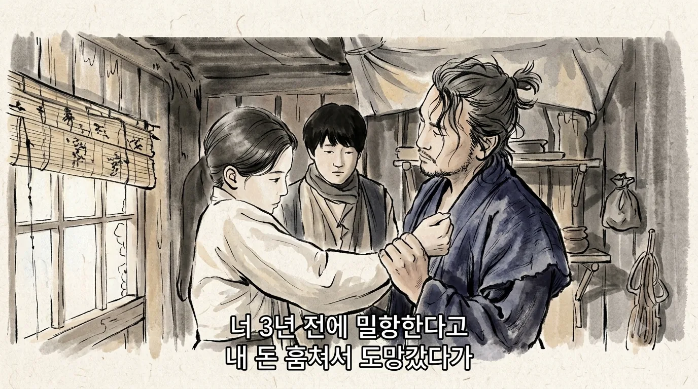

Untuk meyakinkan penonton bahwa ia punya mimpi untuk pergi, mereka harus memperlihatkan sesuatu, kilas balik atau tindakan.
Berteriak "Ekonomi, bangkitlah!" tidak membuat ekonomi bangkit, dan satu baris dialog tidak menciptakan karakter.

Sebagai pembanding, ada The Outlaws.
Ma Seok-do (Ma Dong-seok) pertama kali muncul di tengah jalan yang banyak dihuni warga Korea-Tiongkok, tempat para pria saling berhadapan dengan pisau dapur.
Ma Seok-do sedang menelepon urusan kerja, berdiri di depan mereka, lalu berkata ke lawan bicaranya, "Anak-anak lagi berantem."

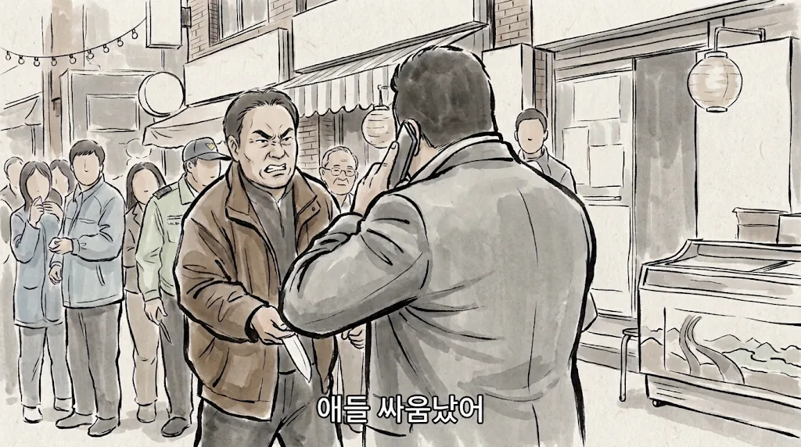

Bentrokan dengan pisau dapur baginya hanya perkelahian anak-anak.
Ucapan yang dilontarkan begitu saja, tapi dampaknya luar biasa.
Tanpa menutup telepon, ia membereskan semuanya.

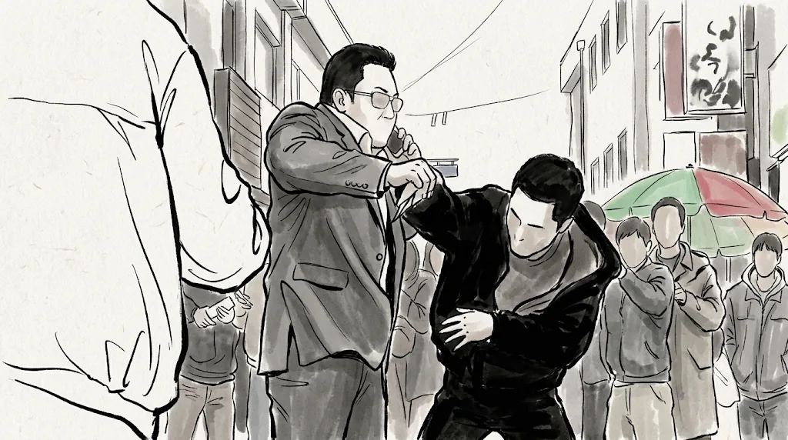

Ia tidak memukuli siapa pun, dan tidak ada yang bilang bahwa ia kuat.
Tapi penonton langsung percaya.

Kalau penulis drama ini yang menulis The Outlaws, mungkin jadinya begini.

> Detektif junior: Wah, Bang! Katanya bulan ini saja Abang sudah menjebloskan sepuluh perampok! Tahun ini pasti dapat trofi detektif kriminal terbaik lagi seperti tahun lalu!
> (Ma Dong-seok tersenyum. Adegan selesai.)

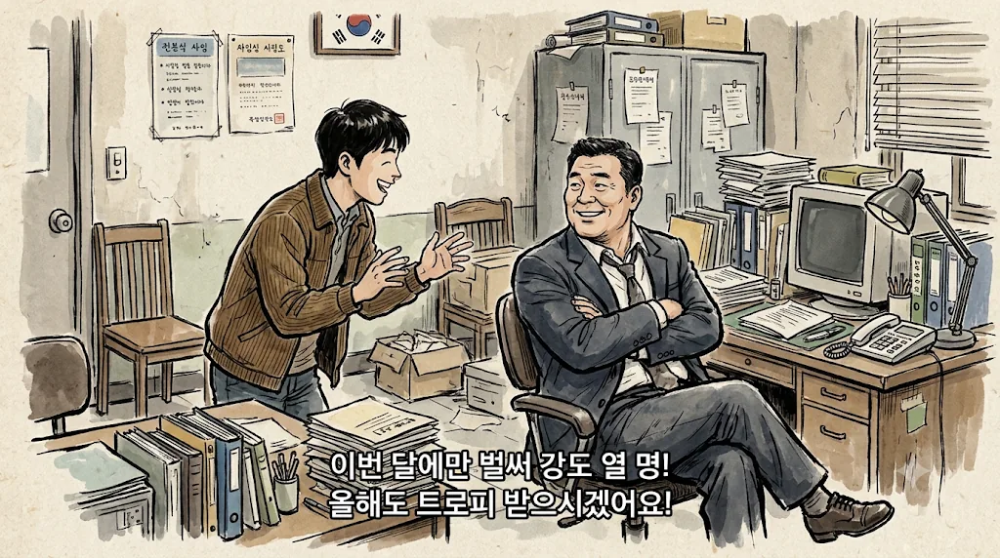

Dan adegan menerima trofi tidak pernah muncul.
Rasanya penjelasan situasi dan pembentukan karakter dikerjakan seperti PR, dicentang "latar sudah disampaikan", lalu lewat. Itulah alasan saya tidak suka penyutradaraan seperti ini.
Mungkin cerita penyelundupan itu sengaja disimpan untuk digarap nanti, tapi entah kenapa saya rasa cuma sampai satu baris itu.

Korset perut di menit 28:31 episode 1 juga sama.
Aktivis kemerdekaan Yoo So-ran (Kim Hyun-joo) sendiri yang bilang bahwa di perutnya bukan bayi melainkan korset: "Saya akan terus memakai korset ini."

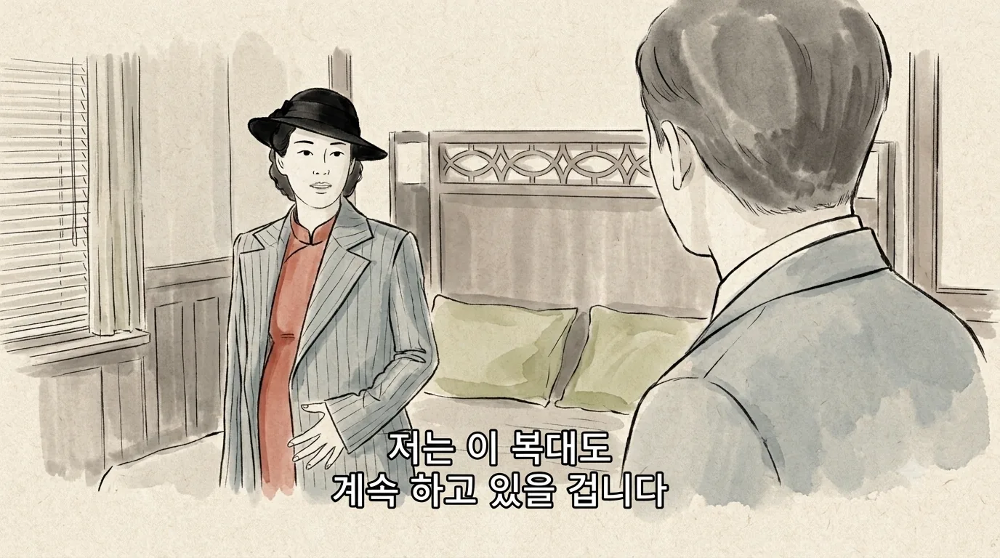

Cukup perlihatkan ia merokok atau minum, penonton akan menyadarinya sendiri: "Lho, perutnya kosong?"
Karena sampai ditekankan, saya kira ia menyembunyikan senjata atau dokumen di dalamnya.
Ternyata cuma korset, dan korsetnya pun hampir tidak diperlihatkan.
Bisa saja disebut untuk mengenang anak yang meninggal, tapi akhirnya terlihat seperti menghemat biaya riasan hamil dengan satu baris dialog.

## Pengawalan Jepang yang tiba-tiba hilang

Sekitar menit 52:32 episode 1, Pengawas Urusan Politik Sato Shinichi (Jin Seon-kyu) tiba dikawal beberapa mobil.

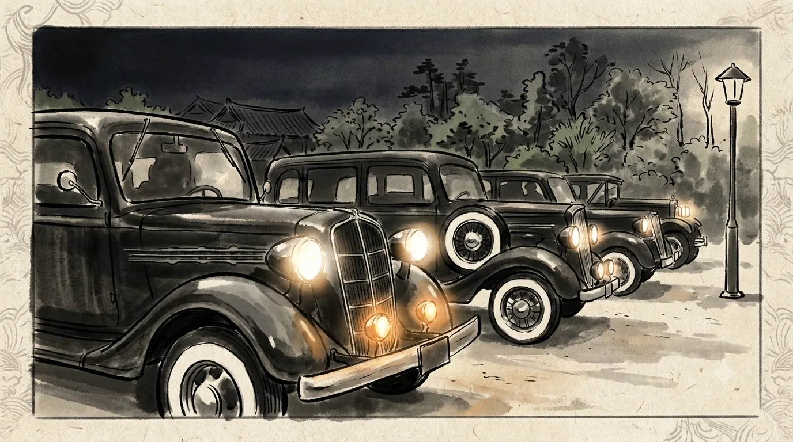

Tapi setelah baku tembak di dalam rumah, di menit 14:30 episode 2 ia dipulangkan sendirian dengan satu mobil karena sedang marah.

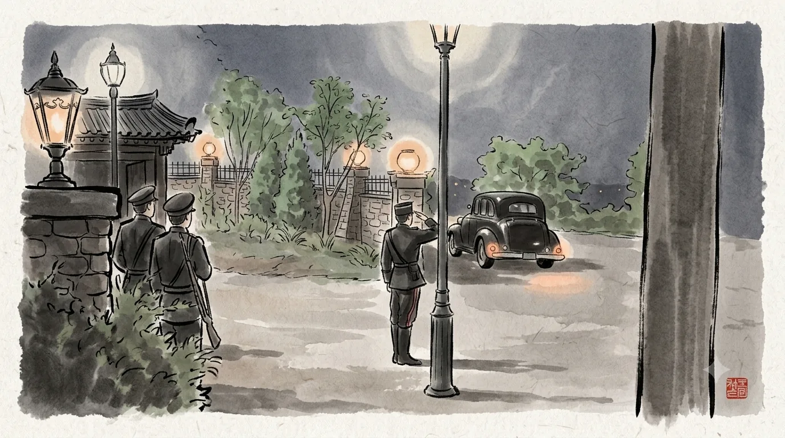

Tidak ada yang tahu berapa komplotan di luar atau apakah ada bom.
Bahwa organisasi yang menjaga orang nomor dua Pemerintah Jenderal tidak merasa ini aneh, justru itu yang paling aneh.

Baku tembaknya juga begitu.
Tembakan pertama terdengar di menit 2:02 episode 2, dan para pengawal baru memecahkan jendela dan masuk di menit 6:54.
Dalam sekitar lima menit itu, 22 peluru ditembakkan.

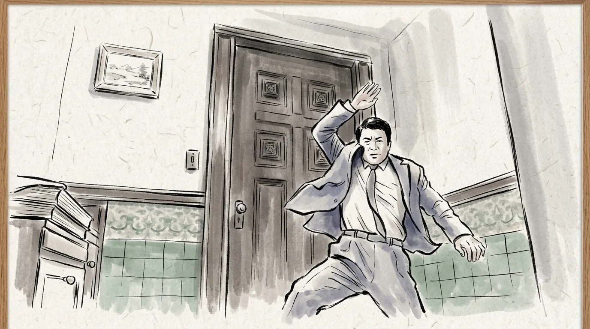

Yang ada di dalam adalah atasan tertinggi mereka.
Tapi para pengawal hanya menggedor pintu dari luar.
Pengawal yang sopan mengetuk pintu entah atasannya mati atau tidak. Selama lima menit penuh saya hanya berpikir, "Bukankah seharusnya mereka sudah mendobrak pintu?"

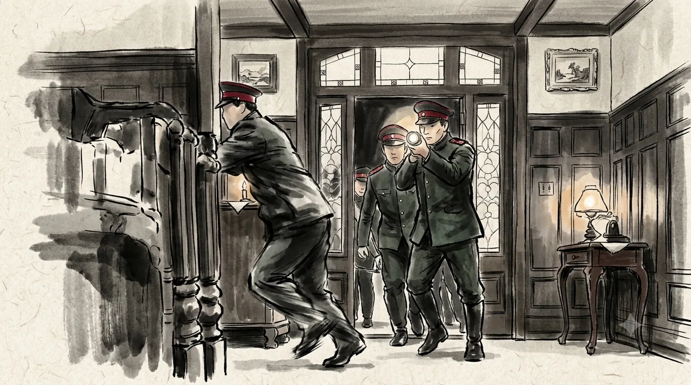

## Pejuang kemerdekaan yang dipermainkan pencuri kecil

Organisasi yang membunuh demi kemerdekaan negara membiarkan Lee Ga-gyeong, orang luar yang tahu identitas mereka, tetap hidup.
Padahal ia terang-terangan berkata, "Toh tidak ada yang membayar saya."

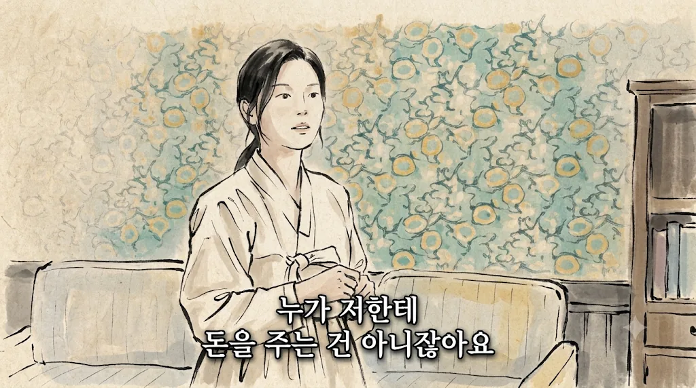

Saat kerahasiaan adalah segalanya dan nasib seluruh rencana dipertaruhkan, ini tidak masuk akal.
Itulah sebabnya saya bilang cerita ini baru masuk akal kalau Ga-gyeong mati di episode 2.

Ga-gyeong mencuri peluru para pejuang kemerdekaan, lalu datang ke markas mereka untuk menjualnya.
Sambil terang-terangan mengaku dialah yang mencurinya.
Sekitar menit 59:17 episode 1 ia bahkan menantang Yoo So-ran: "Saya akan berteriak dan bikin ribut."

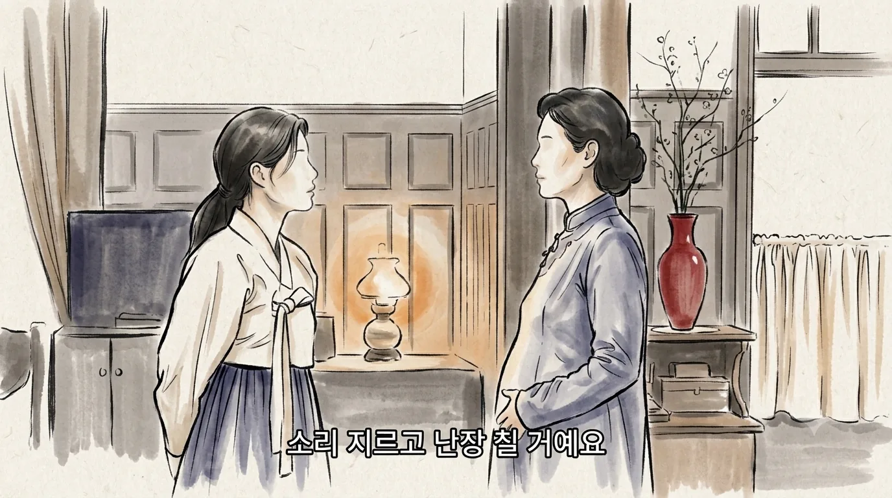

Ada banyak cara untuk menundukkannya tanpa pistol.
Buktinya, setelah itu, ketika seorang pejuang kemerdekaan mengarahkan moncong pistol dari belakang, barulah ia takut.
Pencuri kecil yang memegang kendali di depan orang-orang yang mempertaruhkan nyawa demi negara terasa terlalu meremehkan para pejuang kemerdekaan, dan itu membuat saya tidak nyaman.

Baku tembak sebelumnya juga begitu.
Yang menembak dan membuat kekacauan di rumah itu adalah mantan suami Yoo So-ran.
Ia juga pejuang kemerdekaan, tapi tampaknya berasal dari kelompok kemerdekaan lain, bukan kelompok Yoo So-ran.
Saya paham latar bahwa ada banyak kelompok yang bergerak sendiri-sendiri dan tidak saling berkomunikasi, tapi cara menampilkannya membuat para pejuang kemerdekaan terlihat terlalu bodoh.

## Standar saya tinggi karena Mr. Sunshine

Saya rasa saya jadi setajam ini karena Mr. Sunshine.
Drama itu tidak punya satu pun tokoh yang datar, dan tidak kurang apa pun dalam detail sejarah, psikologi, penyutradaraan, maupun cerita.

Ditambah lagi, 100 Days of Lies tampaknya ingin menceritakan kisah yang mirip.
Eugene Choi (Lee Byung-hun) tidak pernah memikirkan kemerdekaan, tapi perlahan terbawa oleh orang-orang yang mengorbankan nyawa hanya karena lahir di tanah Joseon, hingga akhirnya ikut menempuh jalan itu.
Lee Ga-gyeong, pencopet yang bermimpi menabung lalu pergi ke Amerika, mungkin juga akan menempuh jalan itu.
Zaman yang sama, tema yang sama, alur tokoh yang mirip, jadi saya mau tidak mau memakai standar yang lebih tajam.

Latar yang hanya diucapkan lewat dialog, ditambah adegan yang tidak masuk akal, saya sudah tidak tahan lagi.
Jadi saya berhenti di episode 2.
