Tombol X di AULA F108 Pro saya mati, jadi saya mengambil solder, lalu malah bertemu korsleting dan pad yang copot. Saya memperbaikinya dengan menguji tebakan Claude satu per satu dan menyambung kabel ke pad tombol sebelah.

🙋🏻‍♂️ Menyolder keyboard? Katanya tinggal tempel solder sebentar, beres. 🙋🏻‍♀️ Saya juga mengira begitu, haha.

<small>F108 Pro sebelum dibongkar, saat saya masih mengira cukup membetulkan satu tombol X</small>

Suatu akhir pekan saya sedang mengutak-atik keyboard sambil bermain dengan Claude. Lalu istri saya berkomentar dari samping: "Bukannya kamu mengetiknya terlalu keras?" 🤔

Saya bilang akan mengetik lebih pelan. Tapi komentar itu terus terngiang. Lalu saya melihat keyboard cantik dijual murah lewat pengiriman langsung luar negeri di Coupang, dan langsung saya beli. Sampai di sini masih cerita belanja biasa. 😛

Tulisan ini adalah catatan perbaikan yang bermula dari tombol X keyboard itu. Itu pertama kalinya saya menyolder, dan saya juga tidak punya multimeter. **Lalu kenapa saya tidak menyerah di tengah jalan?**

> **Tujuan** Menghidupkan kembali tombol X yang mati 
> **Hambatan** Pad copot saat menyolder, korsleting yang membuat dua baris tertekan bersamaan, tidak ada alat ukur 
> **Hasil** Korsleting hilang, tombol X pulih lewat jalur kabel ke pad tombol sebelah

## Kotak pertama📦 Keyboard berisik dan X yang tidak mau ditekan

<small>AULA F108 Pro Caramel Latte yang saya beli lewat Coupang, dan ulasan pembelian yang ditulis dengan otomasi Claude</small>

Yang saya beli adalah AULA F108 Pro, 104 tombol, switch Caramel Latte. Ulasannya pun saya tulis dengan otomasi Claude. Saya cukup memberi beberapa kata kunci, lalu Claude menulis ulasan dan menekan tombol kirim. Tapi begitu barang datang dan saya mengetik beberapa kata, ternyata lebih berisik dari dugaan. 😫

Kebetulan di rumah ada switch Peach yang menganggur. Keyboard ini hot-swap, jadi switch bisa dicabut dan diganti, dan saya mengganti semuanya. 👀**<mark>Saya membeli keyboard ini supaya lebih tenang, dan masalah sebenarnya justru dimulai saat switch diganti.</mark>**

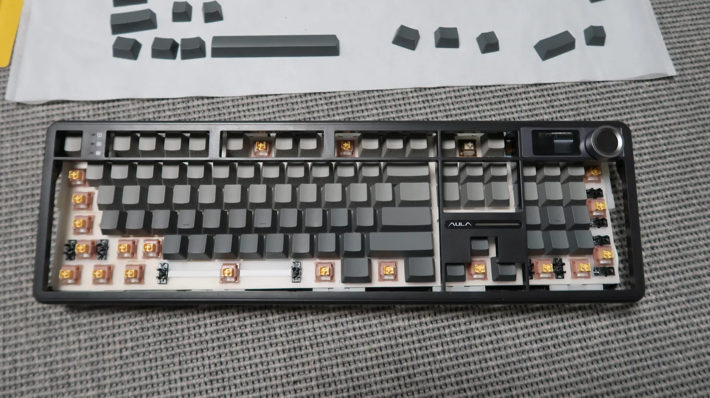
<small>F108 Pro di tengah penggantian, switch bawaan dicabut dan switch Peach dipasang</small>

Saat dites, X tidak terbaca. Saya mencoba switch lain dan beberapa cara lain, tapi tidak berubah. Saya mencari di Naver dan menemukan tulisan bahwa cukup buka papan belakang lalu sentuh sebentar dengan solder. Saya mengikuti [tulisan perbaikan tombol AULA F99 yang tidak berfungsi](https://blog.naver.com/ststeel/224044004123), dan dari situ juga saya tahu baterai wajib dicabut saat membuka casing bawah. 🤩

<small>Solder dan timah yang saya beli di Daiso dalam perjalanan pulang</small>

Saya langsung ke Daiso, membeli solder dan timah, lalu pulang. Itu pertama kalinya saya menyolder.

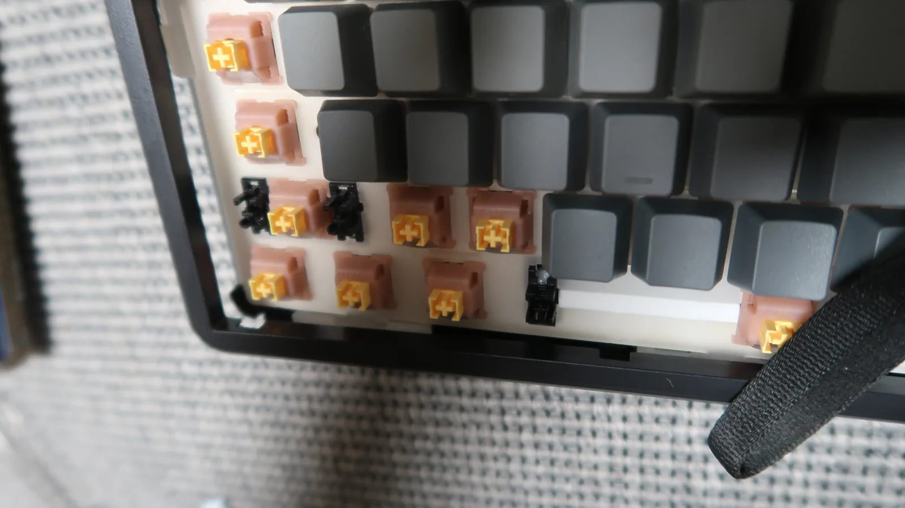
<small>Hanya keycap di sekitar celah pengunci casing bawah yang dicabut</small>

Membongkarnya ternyata lebih mudah dari dugaan. Cabut hanya keycap di sekitar celah pengunci casing bawah, masukkan benda keras apa saja ke celah itu, lalu congkel seperti tuas. Kalau hanya bagian yang perlu dicongkel pelan-pelan, casing terlepas dengan mudah. Begitu terbuka, yang pertama saya lakukan adalah mencabut baterai. 👍

| Langkah | Yang saya lakukan |
|---|---|
| 1 | Mencabut hanya keycap di sekitar celah pengunci casing bawah |
| 2 | Memasukkan alat keras ke celah dan mencongkelnya seperti tuas |
| 3 | Melepas pelan-pelan hanya bagian yang perlu |
| 4 | Mencabut sambungan baterai begitu terbuka |

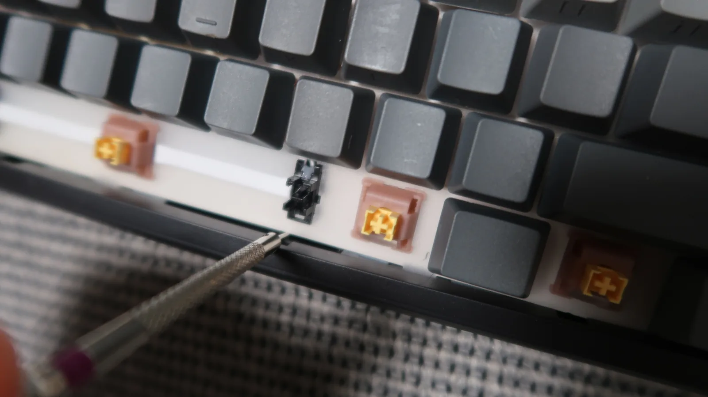
<small>Membuka casing bawah dengan alat keras sebagai tuas di celah</small>

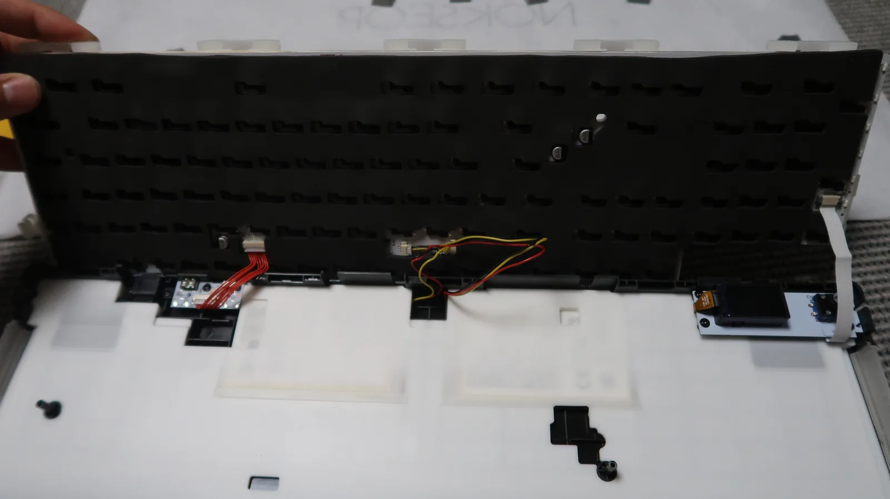
<small>Bagian dalam keyboard saat pertama dibuka, dan kabel baterai yang harus dicabut lebih dulu</small>

## Kotak kedua📦 Mencoret tebakan satu per satu bersama Claude

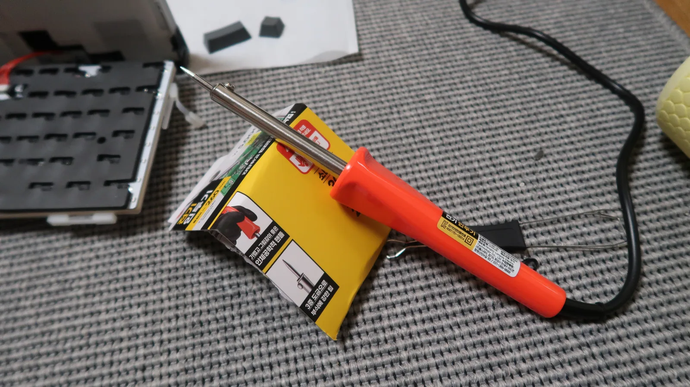
<small>Memanaskan solder Daiso untuk pertama kalinya</small>

Saya memanaskan solder dan melihat bagian belakang posisi X. Satu sisi soket sedikit menonjol. Waktu itu saya kira timahnya saja yang terangkat. 💥**Ternyata bukan timahnya: pad tembaga di papan sudah tercabut seluruhnya.** 🤯

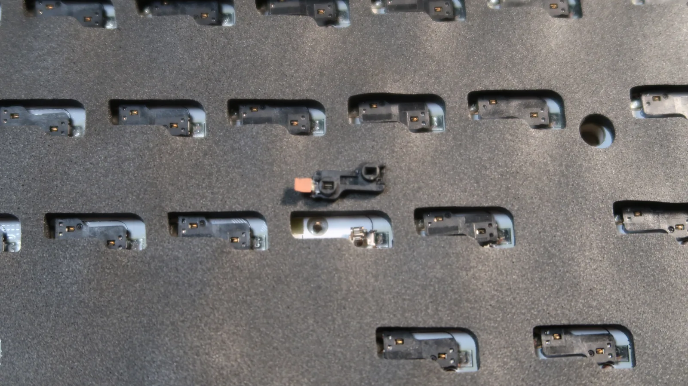
<small>Soket hot-swap X yang menonjol, saat saya belum tahu pad-nya copot</small>

<small>Soket X yang hendak saya pasang lagi tanpa tahu apa-apa</small>

Tanpa tahu apa-apa, saya menyolder soket itu kembali. Soketnya saya ambil dari posisi F10 yang tidak terpakai. Saat perbaikan pertama selesai, saya kira sudah berhasil. 😎

<small>Cara yang salah: hanya meneteskan timah leleh tanpa memanaskan papan</small>

<small>Perbaikan pertama yang waktu itu saya kira sudah benar</small>

Hasilnya malah lebih buruk. X tetap tidak bisa ditekan, dan tombol-tombol yang tidak berhubungan mulai tertekan berpasangan. Saya menekannya satu per satu di layar tes keyboard dan Notepad, dan hasilnya seperti ini.

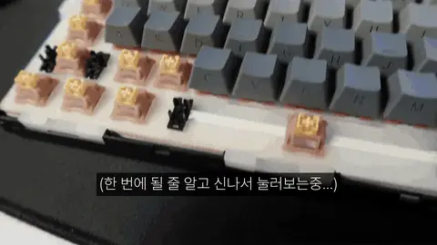
<small>Notepad tepat setelah perbaikan pertama, saat saya menekan tombol dan berharap langsung beres</small>

| Tombol ditekan | Hasil |
|---|---|
| Ctrl atau Shift | Keduanya tertekan bersamaan |
| Alt | Tertekan bersama Z |
| Spasi | Tertekan bersama B |
| . | Tertekan bersama Fn |
| ↑ | Tertekan bersama ↓ |
| A·S·D·F·G | Masing-masing normal |
| C·V·N·M | Masing-masing normal |

Dari sinilah saya dan Claude mulai benar-benar berdiskusi. Diagnosis pertama Claude adalah **korsleting jalur**, dua baris yang menempel. Setiap pasangan selalu satu tombol dari baris Shift dan tombol tepat di bawahnya di baris Ctrl. 🤔

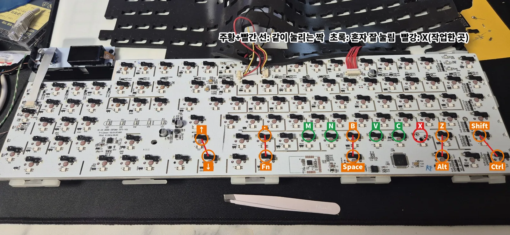
<small>Peta pasangan tombol yang tertekan bersamaan di belakang papan, setiap pasangan adalah soket yang tepat berada di atas dan di bawah</small>

Tentu saja dari awal tidak terlihat serapi ini. Saat saya mengunggah foto bagian yang copot, area pad di kiri X berwarna cokelat, bukan perak. Dikerik dengan cutter pun tidak muncul apa-apa. Pad tombol lain semuanya perak, jadi jelas pad-nya tercabut. 😮

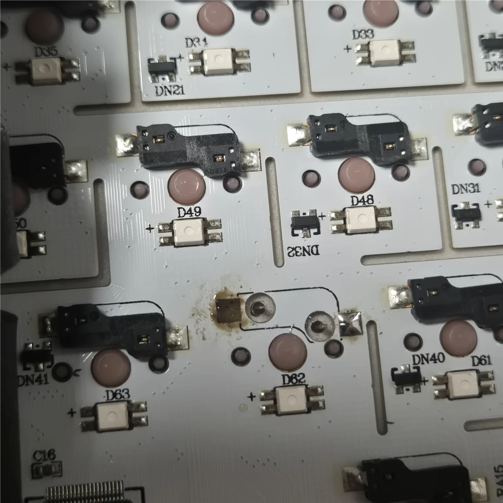
<small>Posisi X yang tinggal dasar cokelat karena pad-nya copot, dengan bekas flux terbakar di sekitarnya</small>

Yang selama ini saya sebut "pelat kecil" ternyata nama resminya pad tembaga. Itu pelat logam tipis yang memegang kaki switch, dan karena berupa tembaga yang tercetak di papan, tidak bisa diambil dari tempat lain lalu ditempel. ✔**<mark>Yang bisa dipindahkan hanya soket; pad yang hilang harus diganti dengan kabel.</mark>**

Tanpa multimeter, hanya tersisa satu cara. Perbaiki satu titik yang dicurigai, tekan lagi, lalu coret kalau tidak berubah. Claude mengusulkan kandidat, saya mencobanya dan melaporkan hasilnya. Inilah tebakan yang kami coret dengan cara itu.

| Tebakan | Yang benar-benar dicoba | Hasil |
|---|---|---|
| Rusak karena dicolok saat masih panas | Bertanya ke Claude. Jawabannya, dengan tegangan rendah 5V, kecil kemungkinan chip rusak karena panas | Dicoret |
| Serpihan logam di papan | Diambil dengan pinset | Tidak berubah |
| Bekas flux terbakar | Dibersihkan | Tidak berubah |
| Lingkaran perak di sekitar lubang adalah timah | Claude mengira timah, tapi setelah saya lihat itu kaki switch | Claude salah, dicoret |
| Gumpalan timah | Hanya menumpuk tinggi di pad, tidak menyentuh jalur sebelah | Tidak relevan |
| Kaki switch X menyentuh di dalam lubang | Mencabut switch X lalu tes | Tidak berubah |

Claude juga salah. Mengira lingkaran perak itu timah, dan awalnya menjelaskan bahwa "dua baris penuh menjadi satu", keduanya keliru. Saat saya balik bertanya bukankah banyak tombol di baris itu masih normal sendiri-sendiri, Claude langsung memperbaiki penjelasannya. Meski dua baris menempel, hanya **kolom yang punya tombol di baris atas dan bawah** yang ikut terhubung. C·V·N·M normal karena baris di bawahnya adalah spasi, jadi tidak punya pasangan. 😮

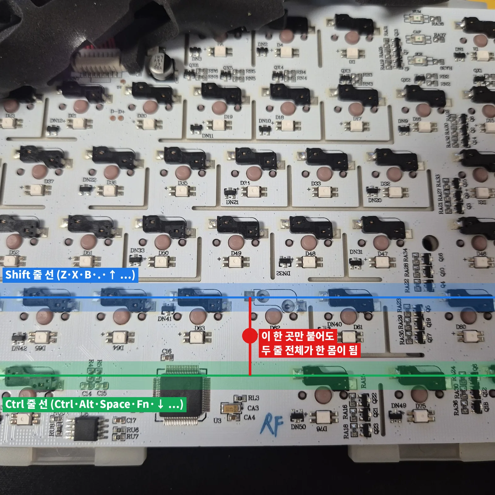
<small>Gambar di atas papan tentang jalur baris Shift dan baris Ctrl yang bersentuhan di satu titik</small>

Penjelasan ini juga saya pastikan lewat pencarian. Keyboard mengirim sinyal ke satu kolom bergantian sambil membaca baris, jadi kalau dua baris tersambung, tombol atas dan bawah terbaca bersamaan ([dokumentasi QMK](https://develop-docs.qmk.fm/how_a_matrix_works)). Saya juga jadi tahu bahwa korsleting papan dan chip kontroler yang rusak tidak bisa dibedakan dari gejalanya saja. Tapi karena titik yang saya kerjakan tepat di antara dua baris yang terhubung, saya bertaruh pada papan. 😎

## Kotak ketiga📦 Sebatang tusuk gigi dan jalan memutar ke pad sebelah

Sempat terpikir apakah harus membeli multimeter. Saya meminta Claude memikirkan versi tanpa membeli. Jawabannya: pakai layar tester keyboard itu sendiri sebagai alat ukur. 🤩

<small>Zona yang ditekan kuat dengan tusuk gigi sambil menahan Ctrl</small>

Kalau Ctrl ditahan, Shift ikut menyala di layar. Dalam keadaan itu, area di sekitar bagian yang copot ditekan-tekan dengan tusuk gigi untuk mencari titik di mana Shift padam. Tusuk gigi tidak menghantarkan listrik, jadi tidak mengacaukan hasil. Saya terus menekan sampai terdengar bunyi "tik", dan Shift mulai bekerja sendiri. 🤯

Sepertinya ujung jalur tembaga yang terangkat menyentuh jalur baris di bawahnya, lalu terlepas. 💥**<mark>Sebatang tusuk gigi menemukan korsleting yang tidak terlihat oleh mata.</mark>**

Tinggal X. Saya tidak tahu harus menyambung kaki yang pad-nya copot ke mana. Awalnya Claude menganggap sisi tombol S lebih mungkin, karena kebanyakan keyboard berbagi kolom secara diagonal seperti Z-A-Q dan X-S-W. Cara menempelkan kabel dengan tangan untuk mengecek sebelum menyolder saya ambil dari kasus perbaikan di komunitas keyboard ([kasus KeebTalk](https://www.keebtalk.com/t/need-help-fixing-lifted-pads-hotswap-socket/20075)). 🤔

<small>Tujuh kandidat titik untuk ditempel kabel, dengan pad kanan X sebagai titik tetap</small>

Untuk kabel, saya menarik satu helai dari kabel LAN dan mengupas kedua ujungnya. Saat pertama disolder, semua berfungsi kecuali X. Ternyata setelah soket terpasang, switch harus dicolok dan ditekan sambil menempelkan kabel. Dua kaki soket hanya tersambung saat switch ditekan. 😫

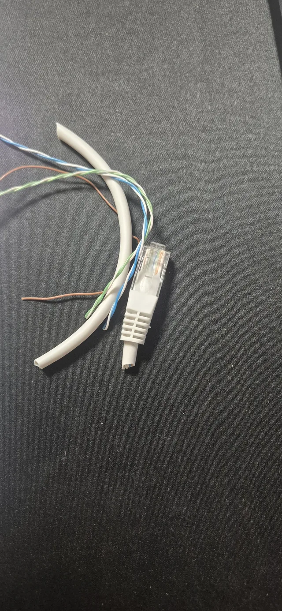
<small>Sehelai kabel dari kabel LAN dengan kedua ujung dikupas</small>

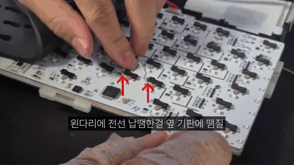
<small>Menyolder kabel di kaki kiri soket ke pad papan sebelah</small>

Dengan switch terpasang, saya menempelkan lagi dan jawabannya muncul. Ditempel ke pad D49 dan D48 di atas, muncul D. Artinya kaki di sisi yang copot sudah tersambung ke jalur yang sama dengan D. Lalu saya tempel ke pad D63 tepat di sebelahnya, dan X muncul. Bukan S yang dianggap paling mungkin oleh Claude, dan bukan pula D, kandidat berikutnya. 😮

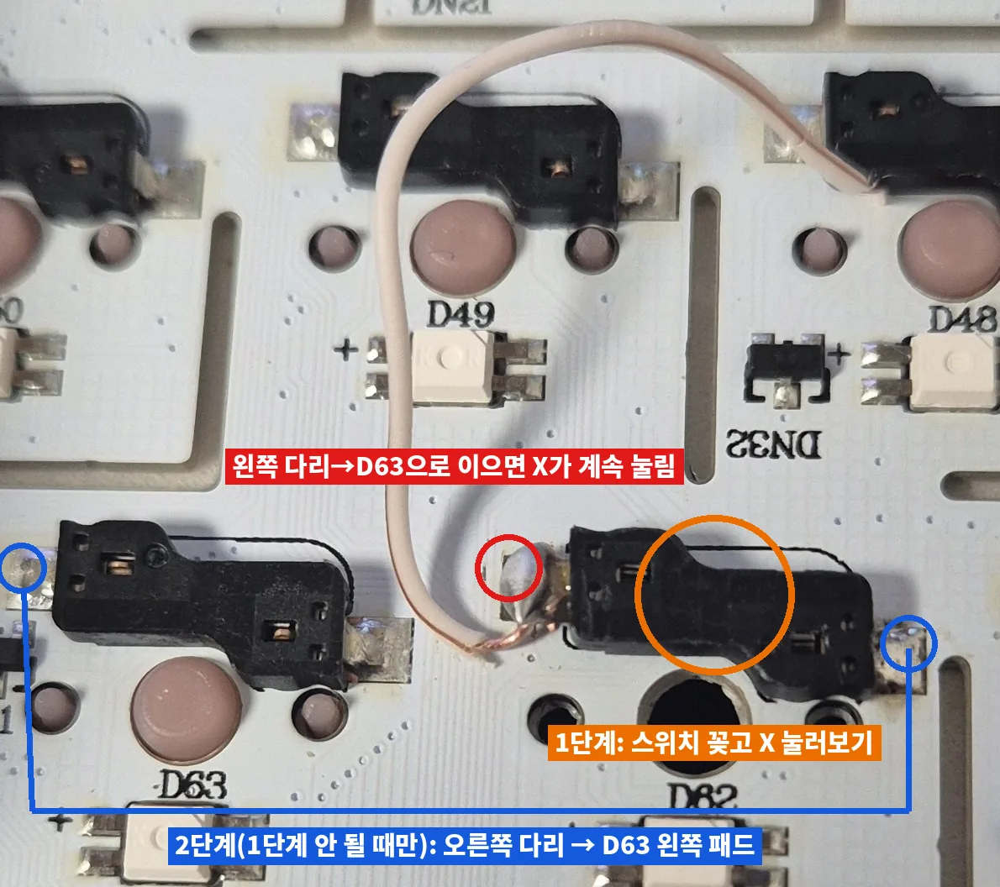
<small>Jalur kabel yang menghubungkan soket X ke pad D63 tepat di sebelahnya</small>

Intinya, sambungan yang dulu menuju papan di atas kini dibelokkan ke pad sebelah. Saat tidak ditekan tetap diam, dan saat ditekan X terbaca tepat sekali. ✔**<mark>Titik yang benar saya temukan bukan dengan menebak, tapi dengan benar-benar menempelkan kabel.</mark>**

<small>Mengecek input X di Notepad setelah perbaikan</small>

<small>Input X yang terkonfirmasi di situs tes keyboard setelah perbaikan</small>

Masih ada satu batasan. X dan C tidak bisa ditekan bersamaan. Seharusnya setiap tombol punya dioda sendiri, dan sekarang X meminjam milik C. Untuk chatting sehari-hari sama sekali tidak masalah, jadi saya biarkan dan merakit kembali. Kalau dipikir lagi, harusnya soket saya ambil dari Pause, bukan F10. 😛

| Yang tersisa | Status |
|---|---|
| X dan C bersamaan | Tidak bisa. Bisa diperbaiki dengan memindahkan kabel ke kaki dioda milik X sendiri |
| F10 | Kosong karena soketnya saya ambil. Bisa memindahkan soket Pause atau mengatur ulang tombol |
| Soket X | Lemah karena satu pad hilang. Topang soket dari belakang saat mencabut switch |

## Sebenarnya saya bisa saja menyerah

Jujur, saya bisa saja menyerah di tengah jalan. Saat korsleting terjadi, dan saat serpihan logam sudah diambil, bekas terbakar sudah dibersihkan, bahkan switch sudah dicabut tapi tidak ada yang berubah. Tapi setiap kali berdiskusi dengan Claude, selalu muncul satu hal lagi untuk dicoba, dan saya terus merasa ini akan berhasil. 🤔

Yang dilakukan Claude bukan menebak jawaban dengan tepat. Ia mendengar gejala, mengusulkan kandidat, mencoretnya berdasarkan hasil percobaan saya, dan menawarkan cara lain saat buntu. Saat saya mengunggah foto, ia menandai langsung di atasnya bagian mana yang harus dilihat. Tebakannya cukup sering salah, tapi langsung tercoret begitu dicek. 💰**<mark>Meski tidak ada yang tahu jawabannya, mencoret tebakan satu per satu dengan benar-benar mengeceknya akan membuka jalan.</mark>**

Orang yang pertama kali menyolder berhasil menyelamatkan pad yang copot tanpa multimeter. Saya jadi berpikir, era AI yang membuat hal yang tadinya mustahil jadi bisa ini menyenangkan. Mungkin bisa atau tidaknya sesuatu diperbaiki tidak terlalu ditentukan oleh keahlian, tapi oleh apakah selalu ada hal berikutnya untuk dicoba? 😎

Kalau Anda juga buntu saat memperbaiki keyboard AULA atau papan hot-swap, silakan tinggalkan komentar.

Sumber

| Sumber | Isi |
|---|---|
| [Tombol AULA F99 tidak berfungsi (bahasa Korea)](https://blog.naver.com/ststeel/224044004123) | Membuka casing bawah, mencabut baterai, menyolder ulang |
| [QMK: How a Keyboard Matrix Works](https://develop-docs.qmk.fm/how_a_matrix_works) | Matriks baris dan kolom serta cara kerja dioda |
| [KeebTalk: Need help fixing lifted pads Hotswap socket](https://www.keebtalk.com/t/need-help-fixing-lifted-pads-hotswap-socket/20075) | Menyambung pad hot-swap yang copot dengan kabel dan cara mencari titik sambungan |
