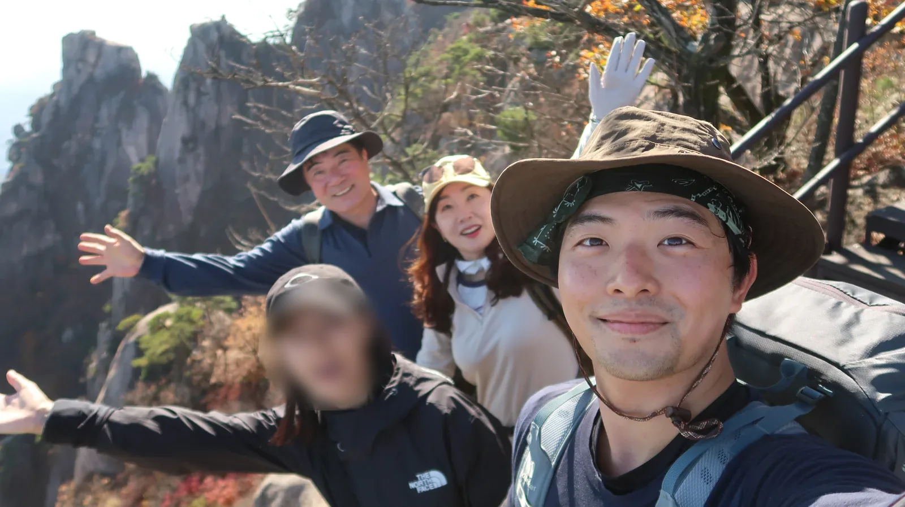
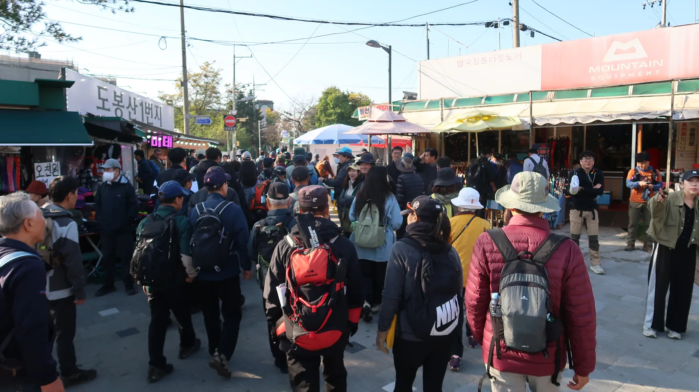
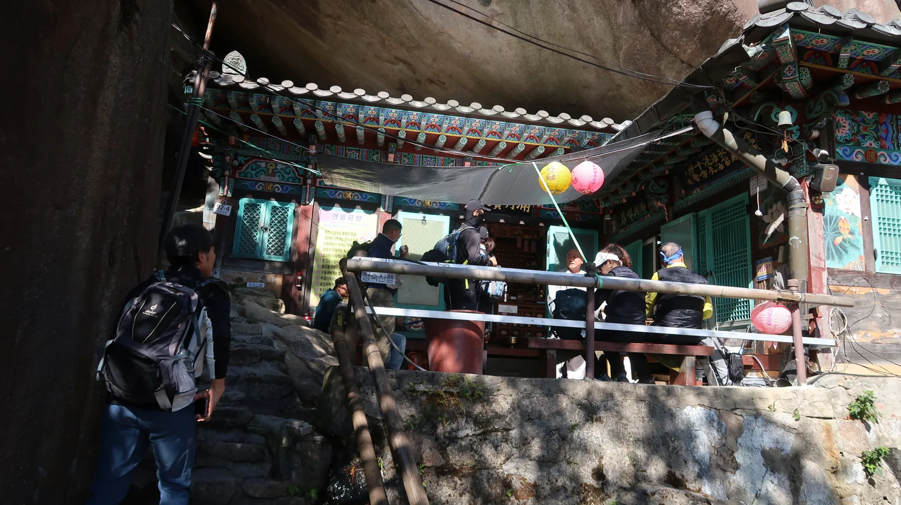
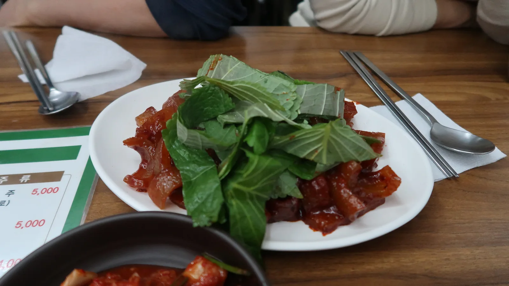

Pada 31 Oktober, akhir pekan terakhir untuk melihat gunung berwarna musim gugur, saya dan istri ikut orang tua saya mendaki Dobongsan.

## Awalnya hanya orang tua saya yang akan pergi

Awalnya hanya ibu dan ayah saya yang akan pergi. Tapi istri saya yang lebih dulu mengusulkan, "Bagaimana kalau kita ikut mertua?" Hari berikutnya diperkirakan hujan, jadi minggu ini adalah minggu terakhir untuk melihat gunung di musim gugur. Akhirnya kami memutuskan ikut.

Kami berangkat dari rumah pukul 9 pagi. Cuacanya cerah. Kami tiba di pintu masuk Dobongsan sekitar pukul 10.20, dan karena hari Sabtu, para pendaki memenuhi seluruh jalan.

## Turis asing yang banyaknya mengejutkan

Yang paling mengejutkan hari itu adalah banyaknya turis asing. Bukan satu atau dua orang, rasanya kami melihat puluhan rombongan. Banyak juga anak muda. Saya jadi berpikir, mungkin Dobongsan sekarang masuk daftar wajib kunjung para wisatawan.

Begitu masuk jalur pendakian, dedaunan musim gugur langsung terlihat. Daun maple merah bercampur di antara daun-daun kuning.

Sekitar pukul 11.30 kami duduk di atas batu untuk beristirahat. Kami berbagi ubi yang kami bawa dan minum kopi.

Sedikit lebih ke atas, kami menemukan kuil yang terletak di bawah batu besar. Para pendaki sedang beristirahat di sana.

Dari batu di dekat kuil, kota terlihat di balik maple merah. Orang tua saya berdiri berdampingan di sana dan berfoto.

## Formasi batu yang megah

Sejak sekitar pukul 1 siang, pepohonan mulai jarang dan punggung bukit berbatu terlihat sekaligus. Formasi batu Dobongsan benar-benar megah. Daunnya juga cantik sekali, dan yang paling penting, senang rasanya pergi berempat. Swafoto paling atas diambil di depan puncak batu sekitar pukul 1.30.

## Imone setelah turun

Kami turun sekitar pukul 4 sore, berjalan ke arah stasiun, lalu masuk ke tempat bernama Imone.

Kulit babi bakarnya enak, dan makgeolli setelah turun gunung terasa segar dan dingin.

