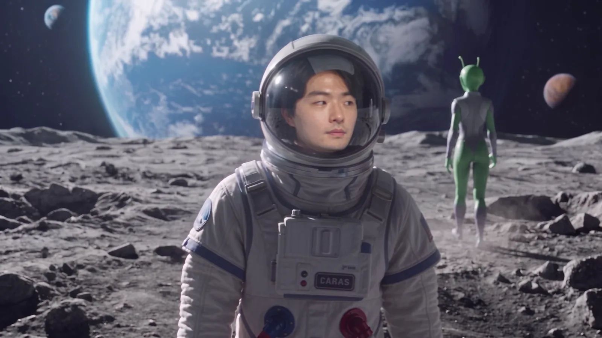
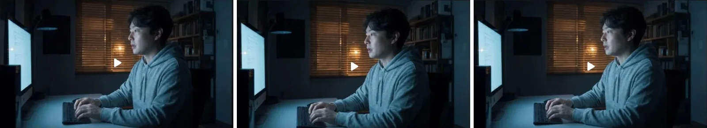
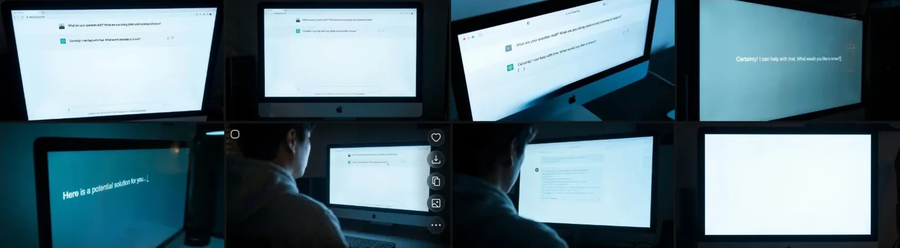
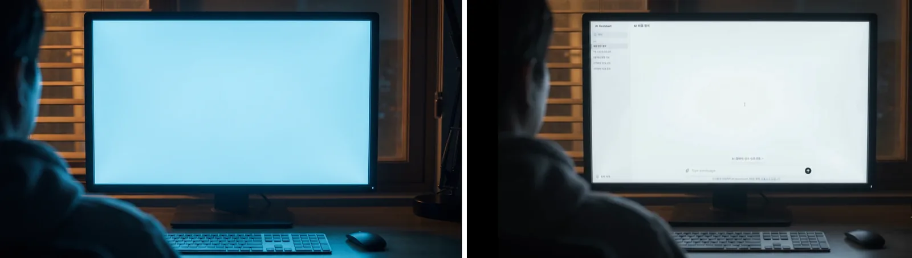
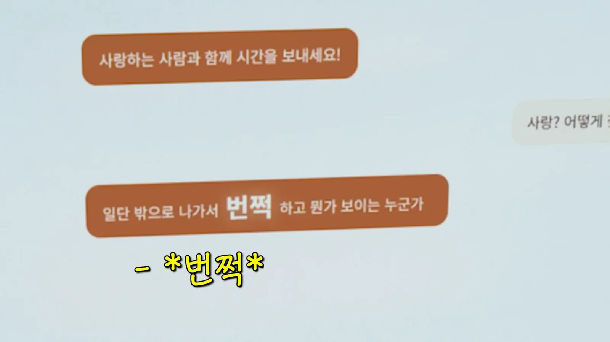
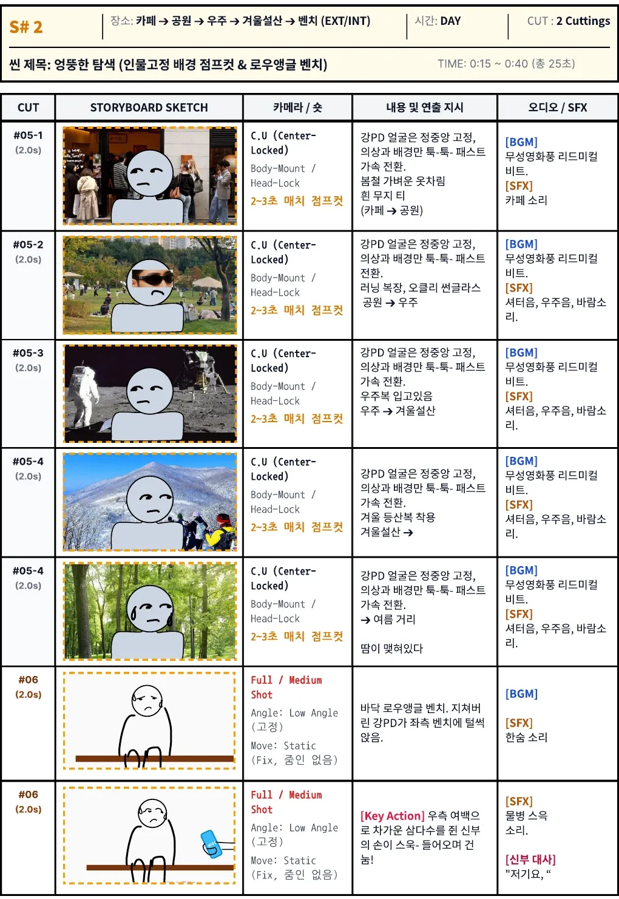
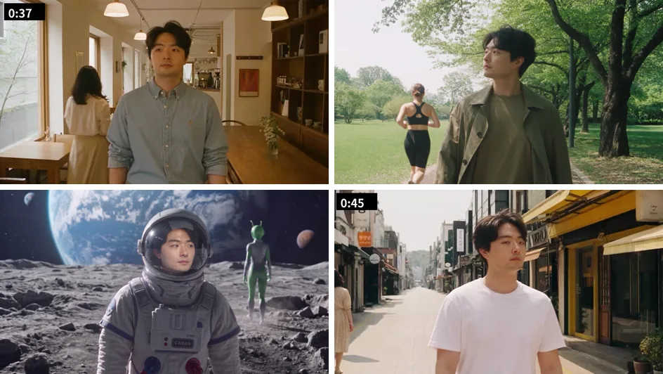
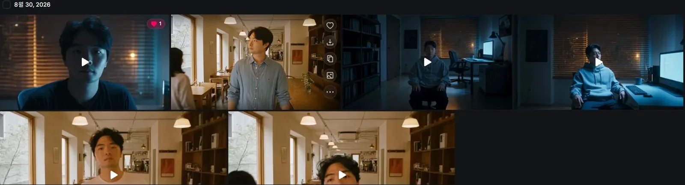
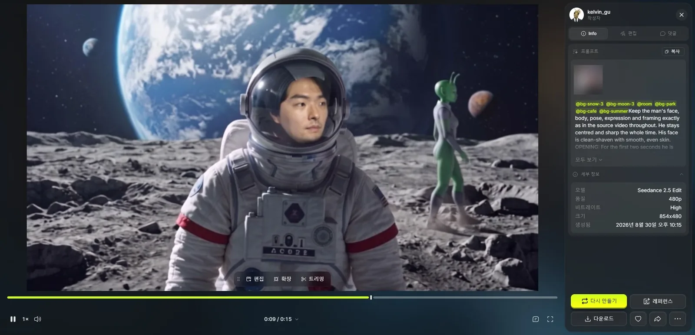

Saya tidak memaksa AI melakukan yang tidak bisa ia lakukan. **Layar monitor yang tulisannya harus tepat saya komposit, dan adegan yang wajahnya harus tetap di tempat saya rekam sendiri.** Tugas AI hanya memakaikan pakaian dan latar di atasnya.

Di [bagian 1](/id/posts/higgsfield-wedding-film/) saya membahas pembuka dan persiapan. Bagian 2 mencakup sesudah pembuka sampai sekitar detik ke-47: ruang kerja tempat saya bertanya soal bahagia ke AI, dan adegan saya berkeliaran mencari "kilat".


<small>Menit 0:41 di film jadi. Bulan, dari adegan berkeliaran (buatan AI). Langkah dan ekspresinya langsung dari rekaman GoPro saya</small>

## AI tidak bisa menulis di monitor

Adegan ruang kerja saya buat dengan Cinema Studio dari Higgsfield, model video tempat kita memilih kamera, lensa, bukaan, dan genre untuk merekam seperti film. Satu shot memperlihatkan saya mengetik dari samping dan bertanya, "AI, apa cara paling pasti supaya orang bahagia?" Shot lainnya saya balik bertanya, "Cinta? Bagaimana cara menemukan orang seperti itu?"


<small>Shot ruang kerja buatan Cinema Studio</small>

Tapi bintang sebenarnya adegan ini adalah monitornya. Layar tempat AI menjawab cara bahagia harus terbaca agar cerita jalan. Awalnya layar itu pun mau saya buat dengan AI. Sebagai video, sebagai gambar, ganti-ganti model, saya minta "close-up bagian monitor yang berisi jawaban AI."


<small>Percobaan close-up monitor. Tulisannya keluar dalam bahasa Inggris atau luntur, dan yang terakhir layar kosong</small>

Ganti model pun macetnya di tempat yang sama. Tulisan di layar berbahasa Inggris, bukan Korea, dan itu pun kalimat ngawur seperti "What are your question stuff?" Makin dekat shot-nya, makin luntur hurufnya. Setiap baris harus cocok dengan teks terjemahan, jadi tulisan yang mirip-mirip tidak cukup.

Jadi saya ganti cara. **Monitornya saya buat layar kosong, layar obrolan saya buat terpisah dengan HTML, direkam, lalu dikomposit ke monitor di Premiere.**


<small>Kiri monitor kosong untuk komposit (buatan AI), kanan hasil setelah layar obrolan HTML ditempel</small>

Pindah ke komposit memberi bonus. Kalimat di storyboard adalah "Keluarlah. Saat bertemu jodoh sejati, sesuatu akan berkilat! di depan matamu," tapi di film jadi berubah jadi gaya chat: "Keluar dulu, nanti ada seseorang yang muncul dengan kilat! Coba temui orang-orang." HTML berarti mengetik tulisan sendiri, jadi revisi seperti ini tidak memakan kredit.


<small>Menit 0:31 di film jadi. "Kilat" muncul lagi nanti di adegan bangku dan gedung pernikahan</small>

## Adegan yang berkata "ini AI"

Berikutnya S#2, adegan yang di storyboard saya namai "pencarian aneh". Kang PD keluar seperti kata AI dan berkeliaran di kafe, taman, bulan, gunung salju, dan jalan musim panas mencari kilat.


<small>Storyboard S#2. Wajah terkunci di tengah sementara pakaian dan latar berganti setiap 2–3 detik</small>

Saya memasukkan adegan ini karena dua alasan.

| Alasan | Isi |
|---|---|
| Rasa mencari kilat | Memberi kesan berkeliling mencari "kilat" yang dikatakan AI |
| Mengingatkan bahwa ini video AI | Mendaki gunung salju, baju astronaut di bulan, alien yang lewat: siapa pun tahu ini tidak mungkin direkam sungguhan. Bagian ini berkata lewat layar, "Ini AI, jangan sampai keliru" |

Alasan kedua ternyata lebih penting dari dugaan saya. Setelah film selesai, cukup banyak tamu senior bertanya kapan kami pergi merekam semua itu. Banyak yang mengira kami benar-benar syuting. Sebegitu sulitnya sekarang membedakan video AI dari kenyataan. **Film buatan AI butuh bagian yang jelas dikenali sebagai AI.** Adegan ini mengambil peran itu.

## Wajah saya rekam sendiri, AI hanya pakaian dan latar

Catatan kamera di storyboard untuk adegan ini adalah "C.U (Center-Locked), Body-Mount / Head-Lock." Wajah tertancap di tengah seolah kamera terpasang di badan, dan hanya dunianya yang berubah.

Kalau AI membuatnya dari nol, posisi dan ukuran wajah bergeser di tiap lokasi. Jadi bagian ini tidak saya serahkan ke AI. **Saya merekam sendiri 15 detik kamera selfie sambil berjalan dengan GoPro.** Lalu klip itu saya masukkan ke Seedance 2.5 Edit. Edit mempertahankan gerak video sumber dan hanya menggambar ulang yang ditentukan prompt, jadi langkah, ekspresi, dan goyangan kamera tetap seperti aslinya sementara latar dan pakaian diganti. Klip sumbernya memperlihatkan isi rumah, jadi tidak saya sertakan di sini.

Prompt pertama berupa daftar shot: hanya lokasi dan pakaian di detik keberapa. Sambil melihat hasil uji, saya menambah kalimat satu per satu. Alasannya begini.

| Kalimat yang ditambahkan | Alasan |
|---|---|
| "Kamera dipegang tangan dan ikut berjalan; latar dan orang berbagi gerak kamera yang sama" | Kamera selfie bergoyang setiap langkah. Latar harus bergoyang sama supaya terlihat satu gambar |
| 2 detik pertama ia duduk di ruang kerja (@room), lalu berdiri | Jembatan dari S#1 di ruang kerja ke S#2 |
| "Gambar referensi hanya untuk lingkungan, cahaya, dan pakaian; jangan menyalin orangnya" | Mempersempit apa yang diambil dari referensi lokasi menjadi lingkungan, cahaya, dan pakaian |
| Seluruh 15 detik sebagai jadwal waktu | Daftar shot tidak menjelaskan apa yang terjadi tiap detik dan bagaimana kamera bergerak |

Bagian paling seru dari hasilnya adalah orang yang lewat. Di tiap lokasi prompt hanya bilang "seorang wanita lewat, terlihat dari belakang." Di kafe seorang wanita lewat, di taman wanita berbaju lari berlari, dan di bulan alien hijau lewat. Seperti yang saya bilang, alien itu alat yang membuat jelas ini AI, jadi saya biarkan.


<small>Dari kiri atas: kafe, taman, bulan, jalan musim panas (buatan AI). Posisi wajah langsung dari rekaman selfie asli</small>

Di film jadi, adegan berkeliaran dimulai di kafe pada 0:36 dan berakhir sekitar 0:47. Dua puluh lima detik di storyboard menyusut jadi sedikit di atas 10 detik. Shot terakhir, terhempas di bangku, diteruskan ke adegan bangku yang saya buat terpisah di bagian 3.

Kalau membuat adegan yang sama lagi, saya akan begini.

| Yang dilakukan | Alasan |
|---|---|
| Layar yang ada tulisannya dikomposit sejak awal | Layar yang kalimatnya harus cocok dengan teks tidak bisa dibuat tepat, model apa pun |
| Rekam sendiri yang harus tetap, lalu pakai Edit | Langkah, ekspresi, dan posisi wajah dari sumber; AI hanya menggambar pakaian dan latar |
| Jadwal waktu sejak awal | Daftar shot saja membiarkan waktu dan gerak kamera kosong |
| Tulis peran tiap referensi di prompt | Seharusnya sejak awal saya tulis apa yang diambil dari gambar lokasi |

Bagian 3 adalah adegan bangku: kenapa wajah saya makin menjauh dari saya di setiap putaran, dan kenapa satu foto yang sudutnya pas lebih baik daripada karakter dari banyak foto.

## Catatan coba-coba

Cinema Studio ruang kerja: semuanya 8 detik, kamera Modern, lensa Halation Vintage, bukaan f/1.4, genre Drama 2020s. Langsung 1080p tanpa uji 480p. Untuk 8 detik, 720p 20 kredit dan 1080p 45–72.

| Waktu | Resolusi | Isi |
|---|---|---|
| 31 Agt, 01.03 | 1080p | Mengetik dari samping sambil berkata, "AI, apa cara paling pasti supaya orang bahagia?" |
| 2 Sep, 01.27 | 1080p | Dibuat ulang dengan kalimat sama |
| 2 Sep, 01.29 | 1080p | "Cinta? Bagaimana cara menemukan orang seperti itu?" |

S#1 di storyboard 15 detik, 0:00 sampai 0:15, tapi dengan pembuka motor Beat di depan dan percakapan yang lebih panjang, di film jadi sampai 0:35.

Percobaan membuat monitor: 2 September pukul 01.37 saya membuat satu klip 480p dengan Seedance 2.5, meminta "percakapan dengan AI di layar seperti foto contoh," "dalam mode terang." Pada 6 September saya mencoba lagi dengan gambar. Pukul 13.31, dan antara 16.17 dan 16.26, saya membuat beberapa close-up dengan Nano Banana Pro dan Seedream 5.0 Pro, dan pukul 16.28 juga mencoba Angles yang mengubah sudut pandang.

Shot storyboard S#2:

| Shot | Lokasi | Pakaian | Suara |
|---|---|---|---|
| #05-1 | Kafe → taman | Baju musim semi ringan, kaus putih polos | Ketukan ritmis gaya film bisu, suara kafe |
| #05-2 | Taman → luar angkasa | Baju lari, kacamata Oakley | Suara rana, suara angkasa, angin |
| #05-3 | Luar angkasa → gunung musim dingin | Baju astronaut | Sama |
| #05-4 | Gunung musim dingin → jalan musim panas | Baju mendaki musim dingin | Sama |
| #05-4 | Jalan musim panas | Butir keringat | Sama |
| #06 | Bangku low angle dari tanah | Terhempas lelah di bangku kiri | Helaan napas |

Putaran Seedance 2.5 Edit (30 Agustus): lokasi memanggil elemen lokasi dari bagian 1 (@bg-cafe, @bg-park, @bg-moon, @bg-snow, @bg-summer).


<small>Riwayat Seedance 2.5 Edit 30 Agustus. Thumbnail adalah frame pertama, jadi yang awal dimulai di kafe dan yang belakangan, setelah jembatan ruang kerja ditambahkan, dimulai di ruang kerja</small>

| Versi | Waktu | Resolusi | Yang diubah |
|---|---|---|---|
| v1 | 18.10 | 480p | Memanggil lima elemen lokasi dan hanya menulis daftar shot berwaktu seperti "0,0 detik kafe kaus putih → 1,6 detik taman baju lari → 3,2 detik bulan baju astronaut…" |
| v2 | 19.30 | 480p | Kalimat gerak kamera bersama |
| v3 | 21.17 | 480p | 2 detik di ruang kerja, "jangan menyalin orangnya" |
| v3 lagi | 21.22 | 480p | Dibuat ulang dengan prompt sama |
| v4 | 22.15 | 480p | Menulis ulang seluruh 15 detik sebagai jadwal waktu |
| v4 final | 22.41 | 1080p | Mengganti elemen salju dan bulan ke @bg-snow-5 dan @bg-moon-4 untuk versi final |

Awal prompt v4:

```
@bg-snow-3 @bg-moon-3 @room @bg-park @bg-cafe @bg-summer
Keep the man's face, body, pose, expression and framing exactly
as in the source video throughout. He stays centred and sharp
the whole time. His face is clean-shaven with smooth, even skin.
OPENING: For the first two seconds he is ...
```


<small>Halaman detail v4 480p. Model, resolusi, ukuran, dan waktu tercatat di kanan. Thumbnail video sumber di panel saya buramkan</small>

| Butir | Instruksi |
|---|---|
| Wajah | Wajah, badan, pose, ekspresi, dan framing persis seperti sumber. Di tengah dan tajam sampai akhir. Tercukur bersih, kulit halus |
| Pembuka | Duduk diterangi monitor, berdiri di detik 2. Kamera tetap setinggi mata, tanpa low angle |
| Pergantian lokasi | Lima lokasi dengan hard cut setelah detik 4, masing-masing dengan waktu yang ditentukan |
| Pakaian dan cahaya | Pakaian dan cahaya ditulis terpisah per lokasi |
| Tatapan | "Sedang mencari kilat." Melihat sekeliling dari kiri ke kanan hanya dua kali |
| Orang lewat | Di tiap lokasi seorang wanita lewat terlihat dari belakang. Orang berbeda setiap kali, tanpa pria |
| Langkah | Langkahnya makin lelah setiap ganti lokasi |

Kredit: satu putaran final 1080p saja 132,73 kredit. Uji 480p mulai dari 19,26, jadi satu putaran ini memakan sebagian besar. Menurut riwayat transaksi, hampir 300 kredit keluar pada 30 Agustus.
