Saat memasukkan wajah saya ke video AI, **satu foto referensi yang sudutnya cocok dengan shot jauh lebih mirip saya daripada karakter yang diisi banyak foto depan, samping, atas, dan bawah.** Wajah yang kecil dan jauh tidak keluar dengan baik dengan cara apa pun.

Saya mempelajari ini di adegan bangku film pernikahan kami. Satu gambar sudut tinggi saya jalankan tujuh kali, dan shot sudut rendah saat disodori air saya buat delapan kali pada 6 September saja. Saya berusaha sekeras ini karena komposisi sudut rendah sulit dijelaskan dengan kata-kata, dan makin sering diulang, wajahnya makin tidak mirip saya. Prinsip prompt seperti memakai rasio layar alih-alih meter juga terbentuk di adegan ini.

[Bagian 1](/id/posts/higgsfield-wedding-film/) adalah storyboard dan persiapan, [bagian 2](/id/posts/higgsfield-wedding-film-2/) ruang kerja dan adegan berkeliaran. Bagian 3 mencakup sekitar 0:47 sampai 1:04 di versi final, saat saya yang lelah berkeliaran duduk di bangku dan istri saya menyodorkan air. Videonya saya cek di halaman detail akun Higgsfield saya, dan tujuh percobaan gambar di catatan percakapan Claude tanggal 31 Agustus.

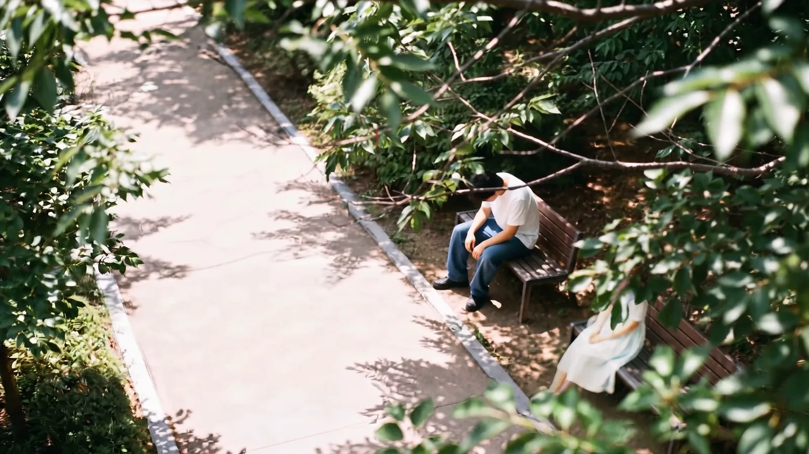
<small>Menit 0:50 di versi final. Bangku dilihat dari sudut tinggi (dibuat AI). Komposisi satu gambar ini butuh tujuh percobaan</small>

## Adegan bangku disusun dengan tiga kamera

Di storyboard, bangku adalah cut terakhir S#2 (#06) sekaligus awal pertemuan S#3. Saya yang lelah berkeliaran terduduk di bangku, dan orang yang duduk di sebelah menyodorkan botol air. Orang itu istri saya.

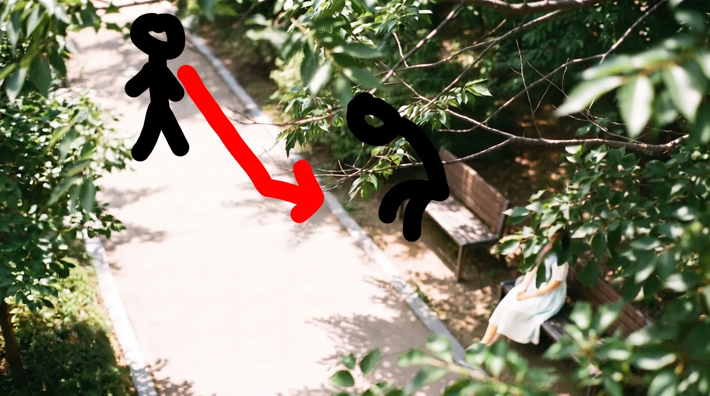
<small>Rancangan gerak adegan 3. Gerakan berjalan dari jalan setapak ke bangku saya gambar langsung di atas gambar AI</small>

Adegan ini saya bagi ke tiga kamera.

| Kamera | Posisi | Fungsi |
|---|---|---|
| A sudut tinggi | Melihat ke bawah dari atas pohon | Saya berjalan lalu duduk, dan istri saya yang wajahnya tertutup daun |
| B sudut rendah | Setinggi dudukan bangku | Tangan yang memegang botol air masuk dari luar layar ke arah saya yang duduk lelah |
| C sudut pandang | Setinggi mata saya | Saya melihat botol yang disodorkan, mendongak, dan wajah istri saya muncul (#07) |

Setelah C, nomor storyboard berlanjut. #08 wajah saya yang menoleh bengong, #09 zoom mendadak ke mata, #10 montase di dalam mata, #11 zoom keluar lagi ke wajah yang tersenyum. Montase #10 adalah foto asli kami, jadi tidak saya masukkan di sini.

Di A wajah istri saya ditutupi daun, agar wajahnya pertama kali muncul di C, tepat setelah botol.

## Tujuh percobaan untuk satu gambar sudut tinggi

Shot A saya mulai dari gambar. Urutannya: kunci gambarnya dulu, lalu buat video dengan gambar itu sebagai frame pertama. Gambarnya saya buat dengan Nano Banana Pro. Dini hari 31 Agustus saya menjalankannya sekitar tujuh kali dalam satu percakapan.

| Percobaan | Yang diubah | Hasil |
|---|---|---|
| 1 | Memasukkan hasil hari sebelumnya sebagai referensi dan meminta empat hal sekaligus: "buka jalan setapak, tutup pengantin wanita dengan daun di kanan atas, rambut hitam, gaun putih" | Hanya warna rambut yang berubah. Kalimat agar referensi dipertahankan apa adanya menekan semua instruksi lain |
| 2 | Tahap 1 metode dua tahap. Hapus orangnya, sisakan jalan setapak dan daun | Bangku dari dua jadi satu, kamera mendekat, dan daun tidak menutupi bangku. Setidaknya bangkunya harus panjang supaya ada tempat saya duduk |
| 3 | Buat baru. Tinggi 4 m, jarak 8 m, 25 derajat, 35 mm, dua bangku | Dua bangku muncul saling berhadapan depan-belakang. Kalau begitu dia tidak bisa menyodorkan botol dari samping. Yang dibutuhkan "berdampingan kiri-kanan di layar", bukan "depan-belakang" |
| 4 | Satu bangku melintang, pengantin wanita di ujung kanan layar, 3,5 m, 7 m, 27 derajat | Daunnya lagi-lagi tidak menutupi. Kata `cover` terlalu lemah |
| 5 | Posisi matahari dipindah dari belakang pengantin wanita ke belakang kamera (cahaya depan), kalimat seperti "dia kecil" dan pengandaian dihapus | Cahaya depan, bangku melintang, 27 derajat sudah benar. Tapi tiap percobaan makin dekat. Meter tidak mempan |
| 6 | Sudut dihapus, hanya tinggi dan jarak horizontal. 12 m, orang 1/8 tinggi layar, bangku 1/4 lebar layar, jalan setapak di 2/3 bawah, daun di 1/4 kanan atas, "semua di atas dadanya ada di balik daun" | Jarak, posisi, dan pohon pas sekali. Jalannya keluar miring dan terlihat janggal |
| 7 | Jalan `roughly horizontally`, paving satu motif | Bangku jadi dua lagi. Saya ubah jadi `Exactly one bench`, dan kursi kosong jadi `wide enough for another person to sit down` |

Di percobaan 4 saya mengubah kalimat daun. Alih-alih "daun menutupi wajahnya", saya tulis sebagai keadaan: `Her face is hidden behind these leaves`. Kata seperti `clearly visible` saya buang karena justru bisa memberi fokus ke bagian itu.

Posisi matahari di percobaan 5 juga penting. Awalnya matahari saya taruh di belakang istri saya. Tapi cahaya dari belakang hanya dibutuhkan di shot sudut pandang C, saat dia muncul menutupi matahari. Untuk A dan B saya ganti jadi cahaya depan dengan matahari di belakang kamera.

Inti prompt percobaan 7:

```
The camera is 3.5 metres above the ground. The horizontal distance
from the camera to the bench is 12 metres.
A paved walking path runs roughly horizontally across the frame ...
The empty path fills the lower two thirds of the frame.
Exactly one wooden park bench ... occupies about one quarter of the frame width.
... her figure occupies about one eighth of the frame height.
The left half of the bench seat is clearly empty and unoccupied,
wide enough for another person to sit down beside her.
Everything above her chest is hidden behind these leaves.
```

Tetap ada satu yang tidak berhasil sampai akhir. Daunnya tidak menutupi istri saya sepiksel pun. Setiap kali daun diam saja di pojok kanan atas layar. Modelnya sepertinya menggambar daun sebagai bagian pohon di latar, bukan latar depan. Saya juga bertanya apakah urutan pembuatan bisa diatur, tapi opsi itu tidak ada.

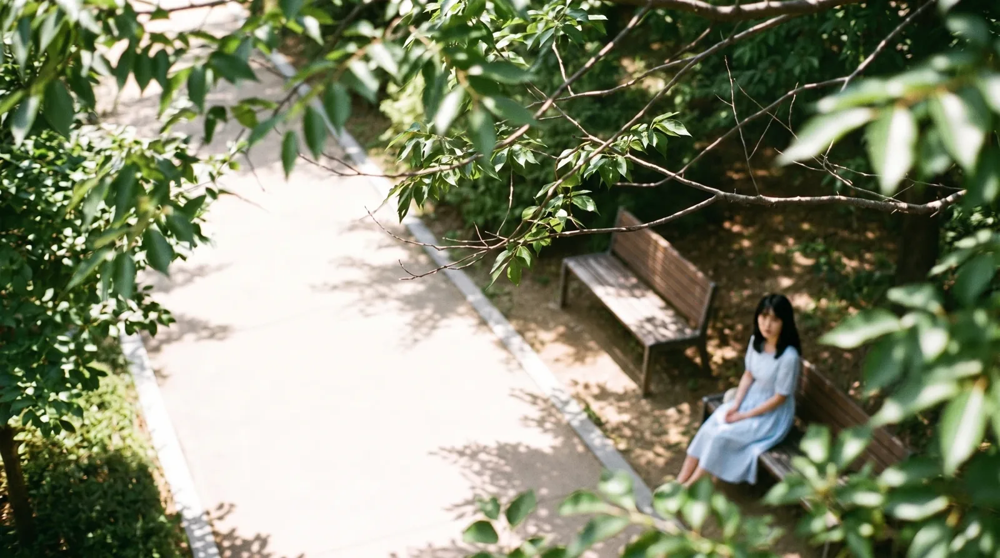
<small>Percobaan yang saya pilih sendiri dari daftar riwayat saat sudah lelah (dibuat AI). Gaunnya biru, dan daunnya tidak menutupi istri saya</small>

Akhirnya saya membuka daftar dan memilih sendiri. Gaunnya biru, tapi jarak, bangku, dan jalannya paling bagus. Daunnya saya putuskan ditangani di Premiere dengan menimpakan rekaman daun asli. Gambar yang dipilih saya rapikan dengan Gemini, saya unggah lagi ke Higgsfield, dan itu jadi frame pertama video A.

Videonya saya buat pukul 04.59 tanggal 6 September. Hanya shot ini yang memakai Seedance 2, bukan Seedance 2.5. Prompt-nya: "@강준구-cinema berjalan di jalan setapak dan terduduk di bangku, kamera diam." 1080p, dan di riwayat hanya ada satu kali ini.

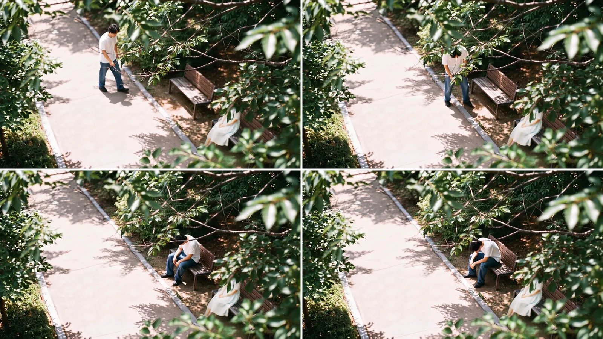
<small>Menit 0:48 sampai 0:51 di versi final (dibuat AI). Di versi final gaunnya putih dan daun di depan menutupi istri saya</small>

Di versi final shot ini sekitar 4 detik, dari 0:48 sampai 0:51. Satu gambar yang butuh tujuh percobaan menjadi 4 detik.

## Sudut rendah menyodorkan air, delapan kali pada 6 September

Shot B melihat saya dari ketinggian dudukan bangku. Sandaran bangku membentang panjang dari kanan layar, saya duduk lelah di ujungnya, dan tangan yang memegang botol air masuk dari luar kanan layar. Pemilik tangan itu istri saya, di luar layar, duduk di ujung bangku dekat kamera.

Tepat setelah A ditetapkan, masalah menyelaraskan ruang ini muncul di percakapan. Di A istri saya duduk di ujung kanan layar dan saya di kiri. Di B kamera pindah ke tempat duduk istri saya dan melihat saya sepanjang bangku. Logikanya benar, tapi penonton bisa bingung kiri-kanan.

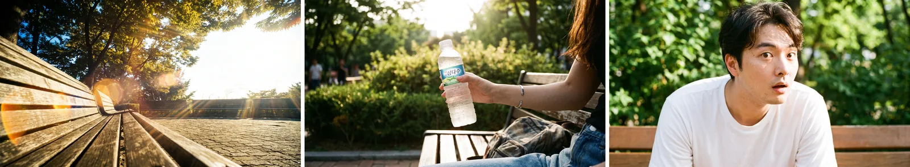
<small>Gambar adegan bangku yang lebih dulu saya buat pada 30 Agustus (dibuat AI). Bangku kosong sudut rendah, tangan dengan botol air, wajah kaget</small>

Video sudut rendah saya buat delapan kali pada 6 September, dari pukul 05.00 sampai 08.20. Semuanya Seedance 2.5.

| Waktu dibuat | Resolusi | Yang diubah |
|---|---|---|
| 05.08 | 480p | Prompt bahasa Inggris. Detik 3,8–4,5 tangan dengan botol dari kanan, detik 4,5–5,5 dia melihat botol, tidak kaget |
| 05.45 | 480p | Dibuat ulang |
| 05.53 | 1080p | Dibuat ulang |
| 06.12 | 480p | Ganti ke prompt bahasa Korea tulisan saya sendiri: "kaus putih lengan pendek, jins… mengibaskan baju seperti kepanasan… tangan menyodorkan air dari kanan layar… tidak terkejut" |
| 06.20 | 1080p | Kibasan dibuat "ringan dan pelan" |
| 07.26 | 1080p | Menambahkan "ikuti komposisi kamera gambar referensi dengan ketat" |
| 07.48 | 480p | Menambah jadwal waktu. 0–2 dtk menghela napas, 2–6 dtk mengibaskan baju, 6–8 dtk tangan dengan botol |
| 08.20 | 1080p | Final dengan jadwal waktu di atas |

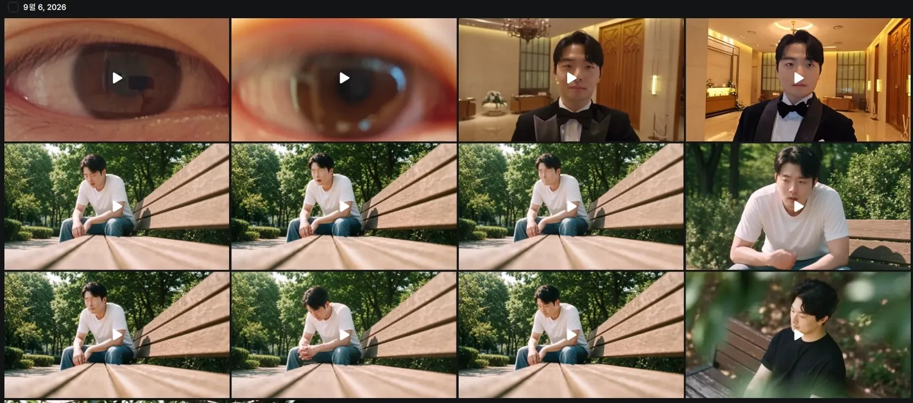
<small>Riwayat 6 September. Dua baris tengah adalah shot bangku sudut rendah. Komposisinya sama, tapi wajahnya sedikit berbeda di tiap percobaan. Klip mata dan tuksedo di baris atas adalah adegan bagian 4</small>

Ada dua alasan sampai delapan kali. Pertama, sudut rendahnya sendiri sulit dijelaskan. Kamera setinggi dudukan bangku, sandaran membentang panjang dari kanan layar, saya di ujungnya, tangan masuk dari luar layar di sisi kamera. Menguraikan ruang ini dengan kata-kata tidak mudah. Menambahkan "ikuti komposisi kamera gambar referensi dengan ketat" pada 07.26 juga upaya menyerahkan komposisi yang tidak bisa dikatakan ke gambar. Kedua, wajahnya. Selama saya membetulkan waktu masuknya tangan dan reaksi, wajahnya makin lama makin tidak mirip saya.

"Tidak kaget" ada dari percobaan pertama sampai terakhir. Di shot ini saya hanya orang lelah; reaksi menoleh kaget dipegang #08 nanti.

Setelah tiga kali dalam bahasa Inggris, saya ganti ke prompt bahasa Korea tulisan saya. Yang terakhir saya tambahkan adalah jadwal waktu. Seperti adegan berkeliaran di bagian 2, begitu saya tulis apa yang terjadi di detik berapa, waktu masuknya tangan jadi pas.

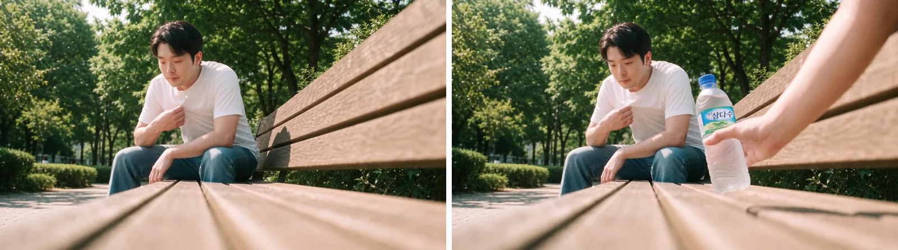
<small>Menit 0:52 dan 0:54 di versi final (dibuat AI). Tangan dengan botol air masuk di sebelah saya yang sedang mengibaskan baju</small>

## Untuk wajah, satu foto bersudut pas lebih baik dari karakter

Hal terbesar yang saya dapat dari adegan bangku adalah soal referensi wajah.

Di Higgsfield ada elemen karakter yang menggabungkan beberapa foto wajah saya. @강준구 berisi 7 foto, dan karakter Soul @강준구-cinema berisi 17 foto dengan sudut dan tempat berbeda seperti kafe, restoran, dan pemotretan pernikahan (layarnya ada di [bagian 1](/id/posts/higgsfield-wedding-film/)). Cukup panggil namanya di prompt dan wajah itu yang digambar. Video sudut tinggi memanggil @강준구-cinema, dan prompt sudut rendah 6 September juga dimulai dengan memanggil karakter, seperti "@char_jungu kaus putih lengan pendek, jins…". Praktis, tapi di adegan bangku ini tidak berjalan baik.


<small>Karakter Soul @강준구-cinema berisi 17 foto. Makin banyak foto tidak membuat wajahnya makin mirip saya</small>

Pertama, wajah yang jauh jadi masalah. Di shot seperti sudut tinggi, saat orang hanya sekitar 1/8 tinggi layar, wajahnya tidak keluar dengan baik. Di sudut rendah pun saya duduk jauh di dalam layar, jadi wajahnya tidak besar. Ditambah lagi, tiap percobaan wajahnya sedikit demi sedikit bergeser jadi bukan saya.

Jadi inilah yang saya pelajari. Daripada memanggil karakter yang mencampur banyak sudut, memasukkan satu foto wajah saya yang diambil dari sudut mirip shot yang sedang dibuat menghasilkan wajah yang jauh lebih baik. Mencampur sudut sepertinya merata-ratakan setiap sudut menjadi wajah yang bukan siapa-siapa. Prinsip "pencocokan sudut" di [bagian 1](/id/posts/higgsfield-wedding-film/) berasal dari adegan ini.

| Cara | Hasil |
|---|---|
| Elemen karakter (gabungan seperti @강준구 7 foto, @강준구-cinema 17 foto) | Mudah dipanggil. Kalau wajahnya kecil atau terus diulang, makin lama makin bukan saya |
| Satu foto wajah yang cocok dengan sudut shot | Wajah lebih bagus. Butuh usaha memilih foto yang pas untuk tiap shot |
| Wajah kecil yang jauh | Tidak keluar baik dengan cara apa pun. Shot yang perlu menampilkan wajah dibuat dekat |

## Sudut pandang saya melihat botol, dan wajah yang hanya menoleh

Shot C (#07) saya buat lebih dulu, dini hari 2 September. Empat hari lebih awal dari B.

Di percakapan saya menyebut shot ini "POV botol air", dan itu sempat meleset. Claude memahaminya sebagai sudut pandang botol dan menulis prompt seperti itu. Maksud saya adalah **pandangan saya yang melihat botol yang disodorkan**. Tangannya tangan istri saya, dan kamera yang naik dari botol ke wajahnya adalah gerakan pandangan saya yang naik. Baru setelah ini diluruskan, posisi botol dan tangannya pas.

Kata `soft veil` juga saya buang. Maksudnya cahaya yang berpendar lembut, tapi karena ini video pernikahan, ada risiko dibaca sebagai kerudung pengantin. Pendaran cahaya saya tulis sebagai `lens flare` dan `bloom`.

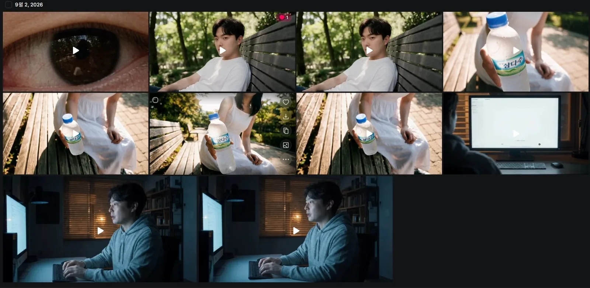
<small>Riwayat 2 September. Baris tengah dan kanan atas adalah shot sudut pandang botol, dua di tengah baris atas adalah wajah saya yang menoleh (#08)</small>

Shot sudut pandang botol saya mulai dari gambar. Istri saya menyodorkan botol, dilihat dari ketinggian mata saya. Untuk referensi wajahnya saya masukkan ketiga foto, seperti di bagian 1.

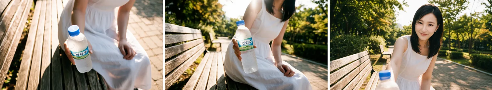
<small>Tahap gambar shot sudut pandang botol (dibuat AI). Wajahnya buatan AI</small>

Videonya saya buat empat kali.

| Waktu dibuat | Model | Resolusi | Yang diubah |
|---|---|---|---|
| 03.06 | Cinema Studio Video | 480p | Percobaan pertama |
| 03.13 | Seedance 2.5 | 480p | Pakai jadwal waktu. 0–1 dtk botol, 1–2,2 dtk tilt-up mengikuti lengan, 2,2–3,3 dtk flare matahari dari belakang, 3,3–4,2 dtk istri saya mencondongkan badan menutupi matahari, 4,2–6 dtk senyum dan dialog |
| 03.19 | Seedance 2.5 | 480p | Menambahkan "he is taller than she" |
| 03.25 | Seedance 2.5 | 1080p | Final |

Struktur yang saya tetapkan pada 1 September adalah satu shot kontinu 12 detik. Tidak dibagi dua cut: rack focus dari botol ke istri saya dalam satu shot, dan frame akhir saat flare hilang dan wajahnya tajam. Prompt Seedance yang sebenarnya diringkas jadi jadwal waktu 6 detik seperti di atas.

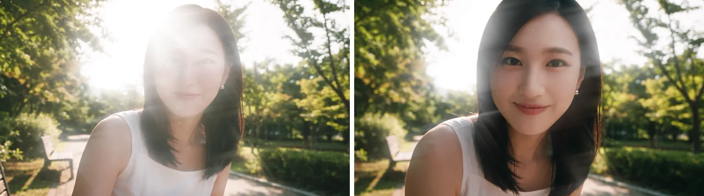
<small>Menit 0:58 dan 0:59 di versi final (dibuat AI). Wajah istri saya muncul dari dalam flare</small>

Berikutnya #08. Saya membuatnya dua kali di hari yang sama pukul 03.47 dan 03.54 dengan Seedance 2.5 1080p. Kamera perlahan mendekati wajah bengong yang hanya menoleh, lalu di detik 2–3 tersedot ke dalam mata.

Posturnya penting. Badan dan bahu tetap menghadap depan di bangku, hanya kepala yang menoleh ke kamera. Lehernya yang terpuntir harus terlihat. Kalau badan ikut berputar, dia sudah jadi orang yang sedang mengobrol. Hanya dengan kepala yang menoleh, momen baru saja menoleh kaget itu hidup. Saya tulis mulut sedikit terbuka, `not smiling`.

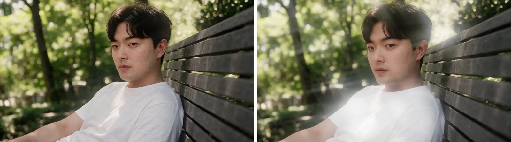
<small>Menit 1:00 dan 1:01 di versi final (dibuat AI). Badan menghadap depan bangku, hanya kepala yang menoleh</small>

#11 kebalikannya, zoom keluar dari mata. Pertama saya buat pukul 03.55 tanggal 2 September dalam 1080p, lalu saya buat ulang pada 3 September pukul 00.17 (480p), 00.28 dan 00.41 (1080p). Dialognya "Ya, boleh." Pandangannya bukan ke lensa, tapi lewat di samping lensa ke atas belakang kamera, menengadah ke istri saya yang berdiri. Ekspresinya senyum tipis.

## Prinsip prompt yang terbentuk di adegan bangku

Saat membuka chat baru pada 1 September, saya merangkum coba-coba sejauh itu sebagai prinsip dan meneruskannya. Kebanyakan berasal dari tujuh percobaan sudut tinggi. Delapan percobaan sudut rendah datang setelahnya, pada 6 September.

| Prinsip | Isi |
|---|---|
| Rasio layar, bukan meter | Ditulis 4 m, 8 m, 12 m pun, tiap percobaan makin dekat. Baru mempan saat ditulis sebagai pecahan, seperti orang 1/8 tinggi layar dan bangku 1/4 lebar layar |
| Hanya tinggi dan jarak horizontal | Kalau tinggi, sudut, dan jarak ditulis semua, mereka saling bertabrakan. Beri tinggi dan jarak horizontal, sudutnya akan mengikuti |
| Jangan menyuruh menyembunyikan | Menumpuk `not visible`, `heavily shaded`, `face is not readable` membuat seluruh orangnya lembek. Tulis keadaannya, seperti `Her face is hidden behind these leaves` |
| Latar depan dengan jarak dari lensa | Agar daun jadi latar depan, kunci jaraknya dari lensa, seperti `just 30cm from the lens, heavily blurred`. Kalau tidak, jadi pohon di latar |
| Jalan `roughly horizontally` | `diagonally` menghasilkan sudut yang nanggung |
| Tanpa pengandaian | `Two people could sit side by side` diabaikan atau digambar dua orang. `Exactly one bench`, dan kursi kosong sebagai `wide enough for another person to sit down` |
| Metode dua tahap | Dipakai saat referensi mengalahkan teks. Buat dulu hasil dengan elemen bermasalah dihapus, lalu jadikan referensi dan tambahkan hanya yang diinginkan. Kreditnya dua kali lipat, tapi lebih pasti daripada terus membetulkan |
| Gabungkan lokasi dan orang di gambar | Jangan memasukkan lokasi dan orang terpisah di tahap video. Gabungkan dalam satu gambar, lalu gerakkan |
| Wajah: satu foto bersudut pas | Satu foto wajah yang cocok dengan sudut shot lebih baik dari karakter gabungan banyak sudut. Mencampur sudut merata-ratakannya dan wajahnya runtuh |

Satu hal, tutupan daun, tidak terpecahkan dengan prinsip-prinsip ini. Cara mengunci jarak lensa hanya saya catat; kenyataannya saya menyelesaikan tahap gambar dan pindah ke cara lain.

Kalau membuat adegan yang sama lagi, saya akan melakukan ini.

| Yang dilakukan | Alasan |
|---|---|
| Wajah sejak awal pakai satu foto bersudut pas | Selama memakai elemen karakter, wajahnya makin bukan saya di tiap percobaan |
| Komposisi sejak awal pakai rasio layar | Percobaan sudut tinggi 3–5 memakai meter dan sudut, dan jaraknya tidak pernah pas |
| Satu perubahan per percobaan | Saat mengubah empat hal sekaligus di percobaan 1, hanya satu yang mempan dan saya tidak tahu sisanya tersangkut di mana |
| Tulis sudut pandang siapa di nama shot | Satu frasa "POV botol air" membuat posisi botol dan tangan meleset. Seharusnya sejak awal saya tulis "sudut pandang saya melihat botol" |
| Gerakan pakai jadwal waktu | Sudut rendah sudah enam kali dijalankan sebelum jadwal waktu ditambahkan |
| Yang tidak bisa dengan AI, cepat pindahkan ke editing | Tutupan daun baru saya serahkan ke Premiere setelah empat kali gagal berturut-turut |

Bagian 4 adalah adegan gedung pernikahan. Match cut saat keluar dari mata dan saya berdiri bertuksedo di depan gedung pernikahan, frame pertama yang saya buat 10 kali dalam 3 menit dengan GPT Image, proses menambahkan dasi kupu-kupu ke rekaman selfie asli, serta penyelesaian editing dan rekap kredit keseluruhan.
