Kamera selfie yang diperankan AI bicaranya terlalu lebay dan terlalu berbau AI sampai tidak bisa dipakai. **Jadi aktingnya saya lakukan sendiri, dan AI hanya kebagian pakaian dan lokasi.** Di adegan terakhir saya sampai lagi pada kesimpulan yang sama dengan adegan berkeliaran di bagian 2.

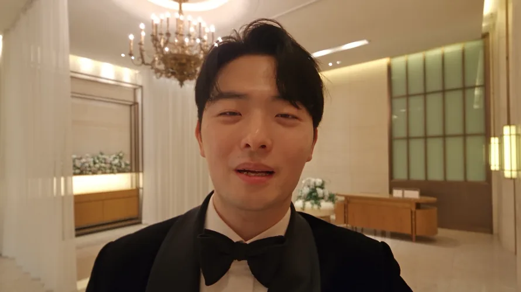
<small>Detik ke-10 shot kamera selfie final. AI memakaikan pakaian dan lokasi ke video yang benar-benar saya perankan</small>

[Bagian 1](/id/posts/higgsfield-wedding-film/) membahas pembuka dan persiapan, [bagian 2](/id/posts/higgsfield-wedding-film-2/) ruang kerja dan berkeliaran, [bagian 3](/id/posts/higgsfield-wedding-film-3/) bangku. Bagian 4 mencakup 1:48 sampai 2:15, saat gambar berakhir. Bertuksedo, saya bicara ke tamu di lobi gedung pernikahan, meletakkan kamera di lantai, dan menutup dengan "Semuanya, silakan menoleh ke belakang." Saat film berhenti, masuknya mempelai pria yang sungguhan dimulai.

Di storyboard awal, di akhir wajah tersenyum di bangku (#11), saya berencana menutup lensa dengan telapak tangan agar layar gelap lalu pindah ke gedung pernikahan. Itu saya buang. Hampir dua menit berjalan, satu trik lagi akan membuatnya bertele-tele. Saya menilai match cut langsung dari wajah tersenyum di bangku ke saya bertuksedo lebih kuat.

Gerak kamera di dalam gedung saya gambar langsung di atas foto yang saya ambil di gedung aslinya.

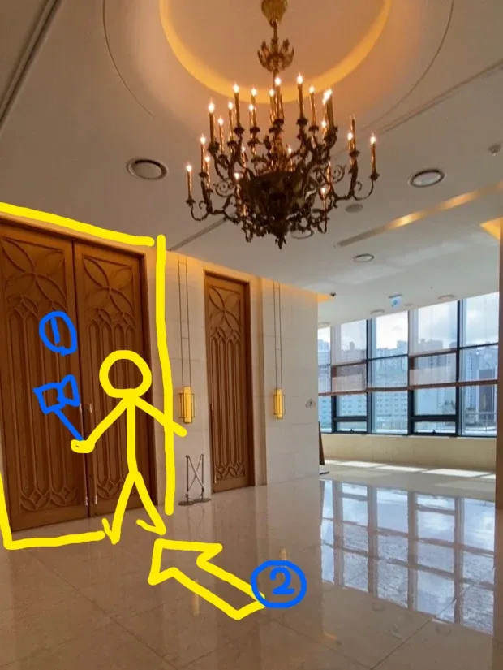
<small>Rancangan gerak adegan 4. ① kamera selfie di tangan, ② kamera yang diletakkan di lantai</small>

| Kamera | Fungsi |
|---|---|
| ① Kamera selfie | Merekam wajah saya dengan kamera sepanjang lengan sambil bicara ke tamu |
| ② Lantai | Selesai bicara, kamera diturunkan dan diletakkan di lantai. Kamera menghadap pintu gedung |

Gambar ini tidak berhenti sebagai gambar. Pada akhirnya saya masukkan apa adanya sebagai gambar referensi.

## Kenapa kamera selfie AI saya buang

Karena ini match cut, bagian depannya, wajah tersenyum di bangku, harus beres dulu. Gambar senyum ini butuh ekspresi dan wajah yang sama-sama pas, jadi saya terus membuat sambil ganti-ganti model: GPT Image 2, Nano Banana Pro, sampai Seedream 5.0 Pro. Untuk satu putaran Seedream, prompt-nya cuma "Kegendutan... kurusin dikit."

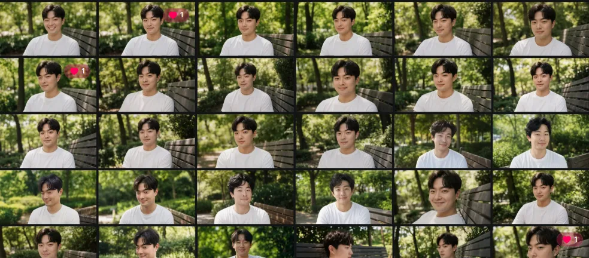
<small>Riwayat gambar malam 2 September. Komposisi hampir sama, hanya ekspresi dan wajah yang terus diganti</small>

Setelah senyumnya pas, wajah yang sama saya pindahkan ke gedung pernikahan. Saya beri Seedream 5.0 Pro dua foto saya berjas dan foto lobi gedung sebagai referensi, lalu menulis satu baris: "Ganti ke jas hitam, dan ubah latar ke tempat ini."

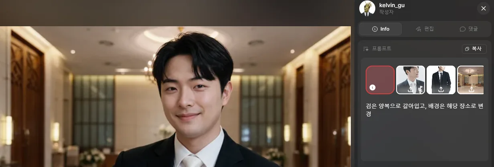
<small>Seedream 5.0 Pro. Wajah yang tersenyum di bangku langsung pindah ke lobi gedung pernikahan</small>

Ekspresi dan sudut wajah terbawa dari senyum di bangku hampir tanpa berubah. Sebegitu pasnya dua sisi match cut harus menyambung. Hanya dasinya keluar putih, jadi hasil itu saya masukkan lagi sebagai referensi dan saya koreksi: "memakai dasi kupu-kupu hitam, bukan dasi putih." Ini menjadi frame pertama kamera selfie AI.

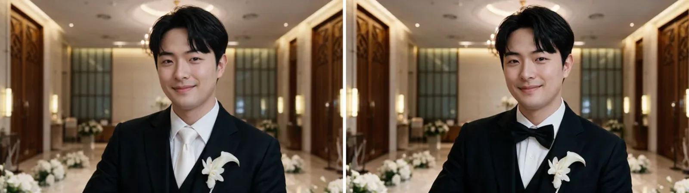
<small>Hanya dasinya yang diganti (buatan AI)</small>

Dari frame pertama itu saya membuat kamera selfie dengan Seedance 2.5. Awalnya hanya bicara ke kamera sepanjang lengan. Berikutnya, untuk menambahkan gerak dari ① ke ② di storyboard dan gambar, menurunkan kamera dan meletakkannya di lantai, saya tulis bagaimana kamera dan badan bergerak tiap saat: "satu shot tanpa putus dari satu kamera," "saat diturunkan, kamera berbalik arah," "diletakkan di lantai dengan lensa sedikit mendongak ke depan."

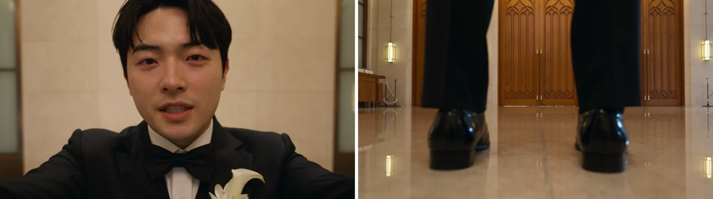
<small>Detik ke-1 dan ke-6 kamera selfie AI (buatan AI). Sepatu dan pintu berdiri di depan kamera yang diturunkan</small>

Geraknya berhasil. Masalahnya di cara bicara. **Kamera selfie buatan Seedance bicaranya terlalu lebay, dan bau AI-nya menyengat.** Diulang pun saya putuskan tidak bisa diselamatkan, lalu saya buang. AI bisa membuat wajah dan pakaian yang meyakinkan, tapi setidaknya di proyek ini, akting yang bicara ke kamera belum bisa diikuti AI. Seberapa lebay-nya, saya berencana mengunggah video gagalnya terpisah dan menempelkannya di sini.

## Akting oleh saya, pakaian dan lokasi oleh AI

Shot terakhir dimulai bukan dari orang buatan AI, tapi dari video kamera selfie yang saya perankan sendiri.

Kamera selfie-nya saya rekam di rumah dengan kamera ponsel. Kalau pakai GoPro, distorsi lebarnya ikut. Jadi saya rekam dengan ponsel, tapi beraktingnya seolah pakai GoPro. Hehe.

Bentuk mulut saat bicara, gerak kepala, sampai gerak tangan yang menurunkan kamera ke lantai, semuanya persis yang saya lakukan. AI tinggal mengganti pakaian dan lokasi. Tetap saja ada beberapa yang macet.

| Macet di mana | Alasan | Yang diubah |
|---|---|---|
| Kerahnya keluar satin mengilap | Saya sendiri menulis "tuksedo kerah satin" di prompt, jadi keluar persis begitu | "Jas hitam polos, seluruhnya wol doff, tanpa satin, tanpa kilap, tanpa kerah kontras" |
| Sambungan dari wajah tersenyum di bangku ke gedung pernikahan | Karena gelap telapak tangan dibuang, harus langsung dari mata ke gedung | Menaruh pembuka di dalam shot ini: mulai dari close-up ekstrem yang dipenuhi mata, lalu menarik keluar selama detik pertama |
| Posisi berdiri | Gambar rancangan sudah menggambar posisinya | Memberi gambar rancangan sebagai referensi dan menulis bahwa figur di dalamnya hanya penanda posisi dan tidak pernah muncul di layar |

Saya juga menulis agar wajah dan rambut mengikuti foto referensi, bukan video sumber.

Percobaan pertama adalah object swap dari Genjutsu. Lobi gedung pernikahan dan tuksedo terpasang bagus, tapi kerahnya satin.

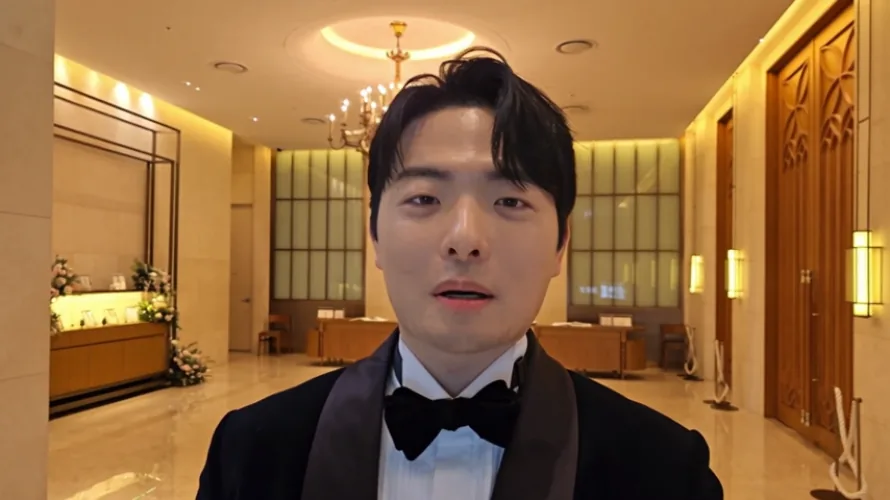
<small>Object swap Genjutsu (komposit AI). Kerahnya berkilau satin</small>

Setelah itu saya pindah ke Seedance 2.5 Edit dan memasukkan kalimat di tabel atas. Gambar rancangan saya masukkan apa adanya dengan figur kuning yang saya gambar, dan setelah saya bilang lewat kata-kata bahwa itu penanda posisi, gambarnya tidak muncul di layar; hanya posisinya yang terkunci.

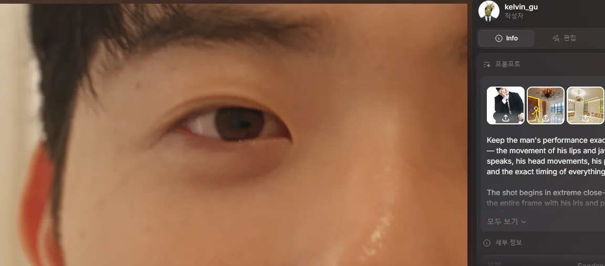
<small>Detik ke-1 versi final. Gambar rancangan dengan figur kuning masuk apa adanya sebagai referensi</small>

Dengan tarikan keluar dari mata di dalam shot ini, menaruhnya tepat setelah zoom mata dan montase asli dari bagian 3 memberi sambungan dari mata ke gedung pernikahan. Match cut-nya selesai di tahap pembuatan.

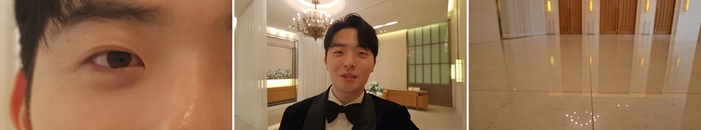
<small>0:01, 0:03, dan 0:17 versi final. Keluar dari mata, bicara, meletakkan kamera di lantai</small>

Dibandingkan versi AI saja, akhirnya juga berbeda. Di versi AI, sepatu berdiri di depan kamera di lantai. Versi final mengikuti gerak asli saya meletakkan kamera, jadi di balik lantai hanya pintu yang terlihat. Dialognya pun jadi kata-kata saya: "Kayaknya 'buka mata langsung di depan gedung pernikahan' itu pas banget buat saat ini," "Beneran, kilat, seperti cahaya," "Sekarang saya masuk," "Semuanya, silakan menoleh ke belakang."

Shot yang sudah jadi saya sambung di Premiere. Layar monitor dari bagian 2 adalah rekaman HTML yang dikomposit, dan masalah daun tidak menutupi istri saya di sudut tinggi bagian 3 diselesaikan dengan menimpakan rekaman daun asli. Saya bekerja dengan dua monitor: program monitor di layar kiri, timeline di layar kanan.

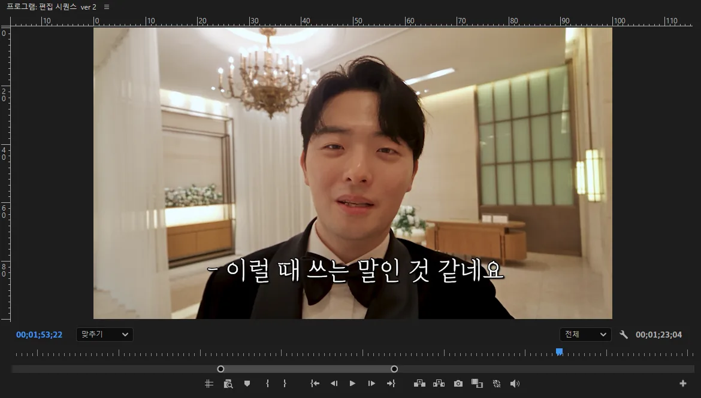
<small>Program monitor di layar kiri. Di 1:53, teks terjemahan menempel di shot kamera selfie terakhir</small>

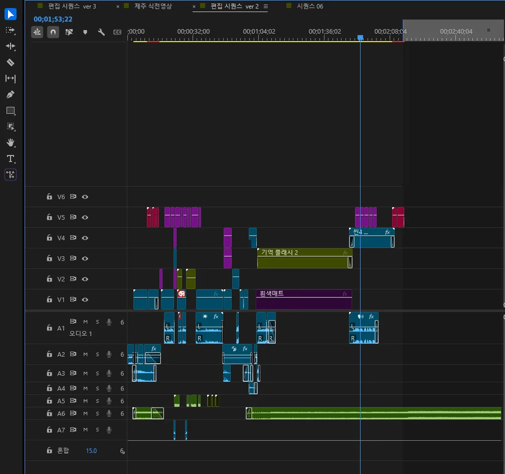
<small>Timeline final di layar kanan. Lima trek video, tujuh trek audio. Playhead ada di kamera selfie Scene 4</small>

Film ini diputar di pernikahan 19 September pukul 1 siang, tepat sebelum mempelai pria masuk; saya di layar berkata "Semuanya, silakan menoleh ke belakang," lalu masuk yang sungguhan menyusul.

[Tonton film jadinya di YouTube](https://youtu.be/J8hFwc1LpUQ)

## Dokumen serah terima yang hanya berisi kesimpulan

Selain model AI, ada satu tempat lagi saya macet: serah terima. Seperti di [bagian 1](/id/posts/higgsfield-wedding-film/), saya memulai Claude di akun istri saya lalu pindah ke akun sendiri. Percakapannya tidak ikut pindah akun, jadi saya menempel dokumen serah terima yang dirangkum chat sebelumnya ke chat baru. Melanjutkan dari dokumen itu, terlalu banyak yang hilang sampai pekerjaan tidak bisa jalan.

Penyebabnya, dokumen itu **hanya menyisakan kesimpulan dan membuang semua alasan.** Baru setelah Claude membaca ulang seluruh percakapan asli (253.348 karakter) yang tersimpan sebagai file Word di Google Drive, saya bisa melihat apa yang hilang.

| Yang ada di dokumen | Alasan yang hanya ada di percakapan asli |
|---|---|
| "Pakai 3 foto langsung sebagai referensi" | Dengan banyak foto, tiap sudut dirata-rata dan wajah rusak. Jadi foto dengan sudut dekat shot adalah yang terbaik |
| "#11 gelap telapak tangan dihapus" | Hampir dua menit berjalan, satu trik lagi akan bertele-tele. Sebagai gantinya match cut |
| #07 POV botol | Bukan dua shot tapi satu shot berkelanjutan 12 detik, dengan rack focus dari botol ke istri saya |

Claude di chat baru tidak tahu dari dokumen kenapa "dihapus," dan mengikuti "3 foto langsung" di dokumen untuk referensi wajah akan berlawanan dengan kesimpulan yang saya ingat. Kesimpulan referensi wajah bahkan tidak langsung ketemu di percakapan asli, jadi saya membetulkannya dengan memberi tahu lagi apa yang saya ingat.

Masalah menjelaskan ulang setiap ganti chat juga saya alami di pekerjaan blog. Sekarang aturan dan status saya simpan di repositori GitHub di luar chat, dan setiap chat baru membacanya dulu. Itu saya tulis di [tulisan soal membangun otak AI di GitHub](/id/posts/github-brain-for-claude/).

## Membuat dengan AI bukan jalan yang mudah

Soal filmnya sendiri saya tidak terlalu menyesal. Sudah saya kerjakan semampunya, reaksinya bagus, dan saya belajar banyak soal film. Jadi bukan "kalau mengulang," melainkan yang akan saya bawa kalau membuat sesuatu yang baru.

| Yang dibawa | Alasan |
|---|---|
| Adegan bicara dari video yang saya perankan sendiri, sejak awal | Kamera selfie AI bicaranya lebay dan bau AI, jadi saya buang |
| Tentukan bahan pakaian sejak awal | Saya menulis "tuksedo kerah satin" dan keluarlah satin |
| Pakai gambar rancangan langsung sebagai referensi | Bilang bahwa figur itu penanda posisi, maka ia tidak muncul; hanya posisinya yang terkunci |
| Shot yang bersambung di dalam satu shot | Menaruh tarikan keluar dari mata di dalam shot kamera selfie menyelesaikan match cut di tahap pembuatan |
| Serah terima berisi kesimpulan dan alasan sekaligus | Dengan dokumen tanpa alasan pekerjaan tidak jalan, dan saya harus membaca ulang 250 ribu karakter |

Kalau membuat lagi, saya ingin memakai mode Edit dengan lebih baik dan membuat karya yang jauh lebih keren dari ini.

**Membuat video dengan AI sama sekali tidak mudah.** Mungkin malah jalan yang lebih sulit daripada merekam sendiri. Dari awal saya tidak memulainya supaya gampang. Karena itu saya rasa ini tantangan yang bermakna.

Tanggal di seri ini hanya tanggal yang ada catatannya. Kenyataannya saya sudah merencanakan sedikit-sedikit setidaknya sebulan sebelumnya. Storyboard-nya saya revisi entah keberapa kali. Butuh banyak pikiran, waktu, dan usaha. Jujur, sambil jalan, kalimat "mending bayar vendor saja…" keluar dengan sendirinya.

Tapi yang saya pikirkan sambil membuatnya justru sebaliknya. Dengan AI kita bisa mencoba banyak sekali hal. Kalau komposisinya meleset, tulis ulang dalam proporsi layar; kalau wajahnya rusak, ganti referensinya dan buat lagi saat itu juga. Di lokasi syuting sungguhan, itu tidak terbayang. Bagi pembuat video, jalannya jadi lebih banyak.

Dan dasar-dasar yang saya bangun selama membuat video tentu tetap terpakai di video AI. Di film ini pun, menyusun storyboard, membagi adegan bangku ke tiga kamera, memilih match cut daripada gelap telapak tangan, dan menyambung semuanya di Premiere di akhir adalah hal yang memang biasa saya kerjakan. Yang berubah adalah batas ruangnya terlepas. Gunung salju, bulan, lobi gedung pernikahan: saya bisa menjadikannya adegan tanpa pergi ke sana. Jadi **saya kira makin kuat dasar seseorang, makin bersinar ia di video AI.**

Saya pun harus belajar lagi karena ini. Istilah shot dan tata bahasa film yang saya pelajari sambil lihat-lihat harus benar-benar saya pahami. High angle, low angle, tilt-up, rack focus, match cut, bust shot, sampai sudut dan jarak lensa: hanya dengan menyebutnya tepat di prompt saya mendekati shot yang saya mau. Satu kata "POV botol air" yang membuat posisi botol dan tangan meleset pun pada akhirnya soal istilah. Masih banyak sekali yang harus dipelajari. Ini alasan, tapi karena itu juga banyak adegan yang saya sayangkan.

Satu catatan sampingan. Saya kepikiran mengotomatiskan pekerjaan yang biasa dibayar ke vendor itu dan menjadikannya layanan. Karena hambatannya cukup tinggi. Saya sudah cukup serius memakai AI dan sudah membuat cukup banyak video, dan setelah mengerjakan ini sampai tuntas, jalannya masih terlihat panjang. Berarti banyak orang masih belum bisa melakukannya. Tercium bau uang. Hehe.

## Catatan coba-coba

Gambar senyum di bangku (2 September, 22.41 sampai 23.44): awalnya GPT Image 2 (kualitas Medium, 1344x752). Antara 22.50 dan 22.53 saja keluar 10 gambar dalam tiga menit. Lalu Nano Banana Pro dengan satu baris "senyum yang manis," dan tiga lagi dengan prompt bahasa Inggris yang sama. Mengikuti prinsip di bagian 3, prompt pertama-tama mengunci semua arah terhadap kamera, lalu dibagi ke paragraf.

| Butir | Isi prompt |
|---|---|
| Baris pertama | Semua arah relatif terhadap kamera; kiri layar adalah kiri penonton |
| Postur | Badan diputar ke kamera sampai bahu hampir menghadap lensa, punggung tegak, kedua tangan di paha |
| Tatapan | Tepat di samping lensa, sangat sedikit bergeser ke kanan layar. Menatap mata orang yang duduk di sana |
| Ekspresi | Mulut tertutup, sudut bibir jelas terangkat, kerutan di sudut mata. Wajah orang yang menemukan yang ia cari |
| Wajah | Jarak mata, kelopak, hidung, tulang pipi, rahang, philtrum, dan tebal bibir persis dari foto referensi. `Do not average these features`; jangan merampingkan wajah atau menghaluskan kulit |
| Frame | 50 mm, jarak 1,5 m, setinggi mata duduk, bust shot dipotong di tengah dada, tekstur film 35 mm |

Di bagian 3, #08 badannya tetap menghadap depan dan hanya kepala yang menoleh. #11 kebalikannya, badan ikut berputar ke kamera, karena momen kaget sudah lewat dan ia menjawab orang yang duduk di depannya.

Video #11: pada 3 September pukul 00.17 (480p), 00.28 dan 00.41 (1080p) dengan Seedance 2.5. Dari layar yang dipenuhi mata, cepat menarik keluar selama 2 detik dan berhenti di bust shot; mata yang kosong jadi fokus, senyum mengembang, dan sekitar detik 3,5 ia berkata "Ya, mau." Putaran 00.41 menambahkan "5.0–7.0 tetap tersenyum" di akhir, dalam bahasa Korea.

Konversi tuksedo: 2 September pukul 23.52, Seedream 5.0 Pro (2k) untuk konversi gedung; 23.56, dikoreksi jadi dasi kupu-kupu (1k).

Kamera selfie AI (3 September, Seedance 2.5 480p), dengan zoom-out #11 dijalankan di sela-selanya:

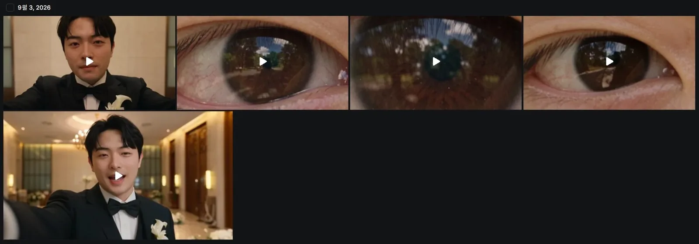
<small>Riwayat video 3 September. Kiri atas dan kiri bawah adalah kamera selfie AI; tiga lainnya zoom-out mata #11</small>

| Waktu | Durasi | Isi |
|---|---|---|
| 00.09 | 10 detik | Memegang action cam sepanjang lengan dan terus bicara. "Saya datang sejauh ini mencari kebahagiaan." "Beneran berkilat ya" (tertawa kecil) "Cara paling pasti supaya orang bahagia, sepertinya hari ini saya menemukannya." Frame terkunci sampai akhir |
| 00.43 | 8 detik | Hanya kalimat pertama yang disisakan; dari 2,6 detik kamera diturunkan. Berputar dan bergoyang seperti jatuh ke lantai, lalu diam di lantai marmer pada 4,2 detik. Dari 5 detik, pintu kayu tertutup terlihat di balik tumit dan ujung celana saya. "Di belakang kamera ada pintu kayu besar berpola lengkung Gotik, tertutup" |

Konversi video yang diperankan (6 September):

| Waktu | Model | Resolusi | Yang diubah |
|---|---|---|---|
| 13.10 | Higgsfield Genjutsu object swap | 480p | Akting, wajah, dan gerak kamera tetap; tambah dasi kupu-kupu, jas dan kemeja jadi tuksedo kerah satin, ruangan jadi lobi gedung pernikahan, pintu kayu di depan kamera yang diturunkan |
| 14.18 | Seedance 2.5 Edit | 480p | Instruksi yang sama di Seedance Edit |
| 14.43 | Seedance 2.5 Edit | 480p | Tarikan keluar dari mata, wajah dari foto referensi, jas doff, lokasi di posisi figur pada gambar rancangan |
| 15.53 | Seedance 2.5 Edit | 1080p | Final dari yang di atas. 22 detik |

Kalimat pertama prompt Genjutsu: "Pertahankan akting pria ini. Wajah dan identitas, gerak bibir dan rahang saat bicara, gerak kepala, postur, waktu setiap gerakan." Kameranya pun harus tetap, sampai goyangan saat diturunkan dan saat diam di lantai.

Kalimat pembuka putaran 14.43: mulai dari close-up ekstrem yang dipenuhi mata dan pupil, lalu menarik lurus ke belakang sepanjang sumbu lensa selama detik pertama. Cepat di awal, pelan saat tiba. Iris menjadi mata, mata menjadi wajah, dan berhenti di bust shot sumber. Sambungannya: satu take berkelanjutan tanpa cut dan tanpa dissolve, tepat satu orang.

Editing: file proyeknya `20260909_식중영상.prproj`, sequence "edit sequence ver 2." Di proyek yang sama juga terbuka ver 3, "Jeju pre-ceremony film" untuk resepsi di Jeju, dan "Sequence 06." "Memory Flash 2" dan "White Matte" di tengah timeline adalah bagian montase mata dari 1:04 sampai 1:44, dan klip "Scene 4" di V4 sesudahnya adalah kamera selfie tulisan ini. Musiknya berjalan di A6 dari awal sampai akhir. File final 4 menit 5 detik; gambar berakhir di 2:15, lalu hanya musik di atas layar hitam. Video YouTube di blog dipotong ke 2:20, menyisakan 5 detik layar hitam.

Pembuka Beat: 5 September pukul 20.06, motion transfer Higgsfield Genjutsu (720p, 12 detik), hanya mengganti wajah.

Semua yang hilang dari dokumen serah terima: percakapan asli yang pertama saya baca terpotong di sekitar 246.000 karakter; saya ambil lagi dan baca sampai habis.

| Yang hilang | Isi percakapan asli |
|---|---|
| Referensi wajah | Dokumen hanya bilang "pakai 3 foto langsung sebagai referensi." Kesimpulan bahwa banyak foto merata-rata tiap sudut dan merusak wajah, dan alasan bahwa foto dengan sudut dekat shot adalah yang terbaik, hilang |
| #07 POV botol | Bahwa ini satu shot berkelanjutan 12 detik, bukan dua, dengan rack focus dari botol ke istri saya |
| Warna gaun | Biru langit pucat yang dipilih karena putih jadi terlalu terang di cahaya musim panas dan terlalu mencolok di sudut tinggi |
| Sudut tinggi | Bahwa istri saya harus tertutup daun agar awalnya terlewat sebagai latar dan baru terlihat saat dilihat lagi |
| Postur #08 dan #11 | Hanya kepala yang menoleh; tatapan yang lewat di samping lensa ke atas belakang kamera |
| Gelap telapak tangan #11 | Hanya kesimpulan "dihapus." Alasannya, bahwa satu trik lagi di hampir dua menit akan bertele-tele, dan keputusan memakai match cut sebagai gantinya, hanya ada di aslinya |

Skala yang tercatat:

| Tahap | Catatan |
|---|---|
| Perencanaan | Sedikit-sedikit setidaknya sebulan sebelum tanggal tercatat. Revisi storyboard tak terhitung |
| Storyboard | "Kang PD pre-ceremony film final integrated storyboard sheet," terakhir disimpan 27 Agustus pukul 23.21 |
| Gambar | Puluhan per adegan |
| Video | 36 dari 30 Agustus sampai 6 September. 19 uji 480p, 16 di 1080p |
| Kredit | 563 kredit untuk 140 transaksi terakhir saja sampai 31 Agustus. 1.000 kredit baru masuk 3 September |
| Percakapan | Beberapa chat Claude, dokumen serah terima, membaca ulang 250 ribu karakter asli |
| Editing | File proyek 9 September, 5 trek video dan 7 trek audio |
| Pemutaran | 19 September pukul 1 siang, tepat sebelum mempelai pria masuk |
