Saya membuat film 2 menit yang diputar tepat sebelum mempelai pria masuk di pernikahan kami dengan Higgsfield. Hampir tidak ada yang saya rekam; sebagian besar yang tampil di layar adalah gambar dan video buatan AI.

Pernikahannya tanggal 19 September pukul 13.00. Saat film selesai, saya di layar berkata "Semuanya, silakan menoleh ke belakang," dan saat itu juga saya yang asli masuk dari pintu belakang. Pengerjaannya dari 27 Agustus, saat saya menyimpan storyboard, sampai 6 September, saat saya membuat klip terakhir. Sekitar sebelas hari.

Film jadinya ada di YouTube. Layar hitam setelah akhir film saya potong hingga tersisa 5 detik.

[Tonton film jadinya di YouTube](https://youtu.be/J8hFwc1LpUQ)

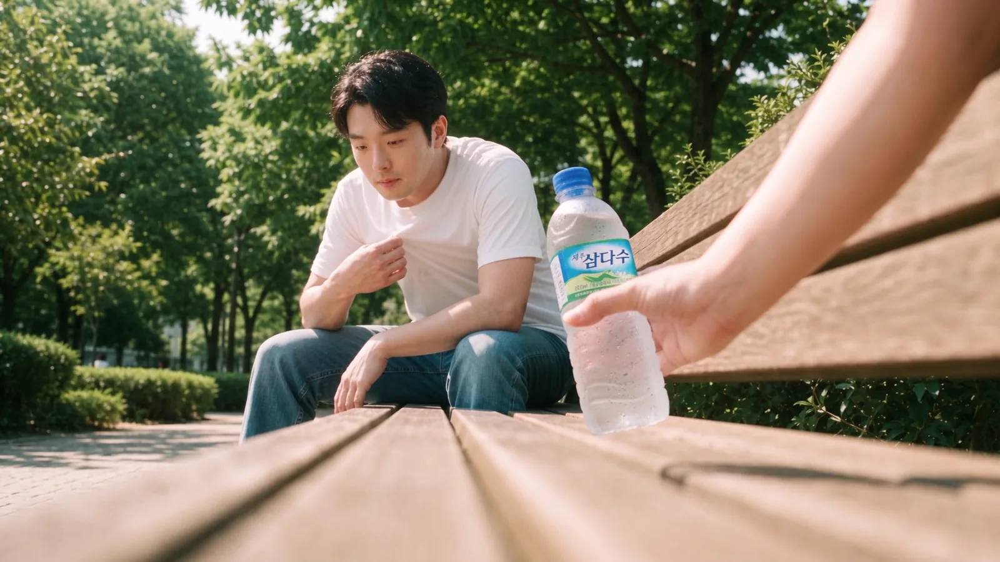
<small>Menit 0:53 di versi final. Shot bangku dari sudut rendah. Tangan yang menyodorkan air adalah tangan istri saya (dibuat AI)</small>

Proses pembuatannya panjang, jadi saya bagi menjadi empat bagian. Bagian 1 tentang alasan membuatnya, shot pembuka, dan persiapan. Bagian 2 tentang ruang kerja dan adegan berkeliaran, bagian 3 adegan bangku, bagian 4 adegan gedung pernikahan dan editing akhir. Saya mencatat sebanyak mungkin: berapa kali saya menulis ulang prompt, model apa yang saya pakai dan berapa klip, serta di mana saya tersangkut.

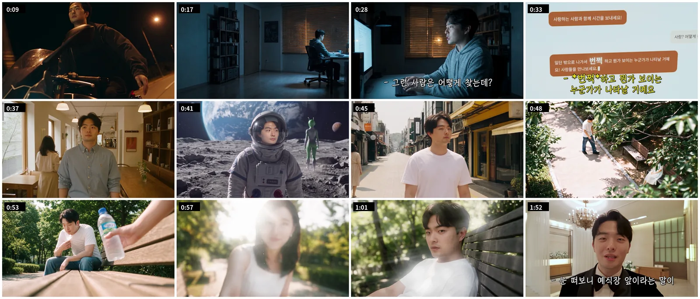
<small>Frame dari versi final secara berurutan. Foto dan video asli di montase dalam mata tidak saya masukkan</small>

## Tanpa pertunjukan, tanpa lagu, jadi saya bertaruh pada shot pertama

Alasan saya membuat film ini sederhana. Pernikahan kami tidak ada pertunjukan. Tidak ada lagu persembahan juga. Kami butuh setidaknya satu hal untuk menghibur tamu.

Film ini juga memuat momen kencan kami. Tapi kalau hanya menyambung video kencan, pasti membosankan. Tujuannya adalah menunjukkan kencan kami sekaligus membuat tamu merasa "Wah, tadi seru."

Orang sebenarnya tidak terlalu peduli video apa yang saya buat atau kencan apa yang kami jalani. Mereka melihat dulu apakah seru atau tidak. Dan menurut saya itu ditentukan di shot pertama. **Jadi keputusan terpenting di film ini adalah dengan apa membukanya.**

Setelah memilih-milih, saya memilih parodi adegan motor dari film Korea "Beat". Adegan saat dia naik motor di malam hari dan merentangkan kedua tangan. Adegan ini tidak ada di storyboard; saya menambahkannya di paling depan belakangan.

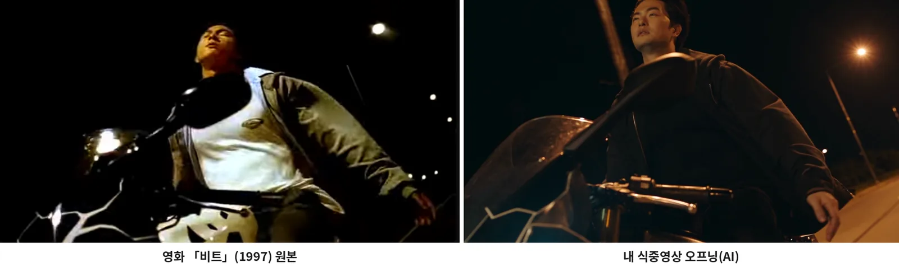
<small>Kiri adalah asli dari "Beat", kanan adalah 0:09 di versi final (dibuat AI). Sudut sama, lampu jalan sama, hanya wajahnya yang saya</small>

Shot ini saya buat pada malam 5 September dengan motion transfer Higgsfield Genjutsu. Saya memasukkan satu klip orang naik motor dan satu foto wajah saya, dan prompt-nya hanya satu baris: "Ganti wajah orang di video dengan gambar referensi." 720p, 12 detik.

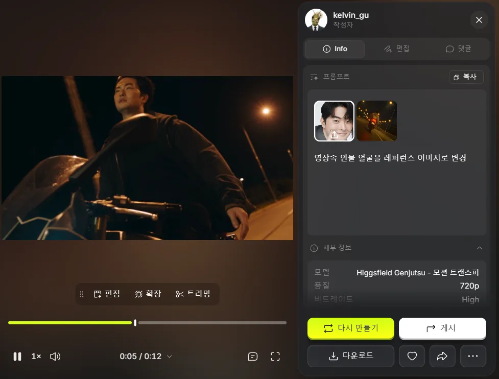
<small>Motion transfer Genjutsu. Satu foto wajah dan prompt satu baris hanya mengganti wajahnya</small>

Saya memilihnya dengan dua kriteria.

| Kriteria | Alasan |
|---|---|
| Adegan yang dikenal banyak kelompok usia | Di gedung pernikahan duduk tamu dari berbagai usia |
| Seru dan mengejutkan meski tidak tahu aslinya | Orang yang tidak tahu film aslinya pun harus langsung sadar "Ini AI ya?" |

Teks "Aku, kesepian" dan "Aku ingin bahagia" lewat di atas motor, lalu orang kesepian itu berpindah ke meja ruang kerjanya, dan cerita utama dimulai. Setelah jadi, rasanya adegan ini saja yang menggendong seluruh film. Reaksi tamu di gedung belum benar-benar terekam dengan baik. Saya sempat mencoba cross-cut dengan rekaman di gedung, tapi selain tawa pertama, reaksinya kurang tertangkap. Rekaman reaksi tamu yang diambil vendor video untuk kami belum datang, jadi begitu datang saya akan mengedit ulang reaksinya dan menaruhnya di sini.

## Ceritanya dimulai dengan bertanya pada AI soal kebahagiaan

Alurnya sengaja dibuat sederhana sejak awal. Kang PD bertanya pada AI cara menjadi bahagia, keluar rumah mengikuti sarannya, berkeliaran di tempat-tempat aneh, bertemu seseorang yang menawarkan air di bangku taman, lalu masuk ke gedung pernikahan.

| Adegan | Lokasi | Isi | Durasi di storyboard |
|---|---|---|---|
| S#1 | Ruang kerja (malam) | Dia bertanya pada AI, "Apa cara paling pasti bagi orang untuk bahagia?" Jawabannya: "Keluarlah. Saat bertemu jodoh sejati, sesuatu akan berkilat di depan matamu!" | 0:00–0:15 |
| S#2 | Kafe → taman → bulan → gunung salju → jalan musim panas | Wajah tetap di tengah layar sementara pakaian dan latar berganti-ganti. Di akhir dia terduduk lelah di bangku | 0:15–0:40 |
| S#3 | Bangku taman | Botol air masuk dari samping, dia mendongak, cahaya latar memudar dan dia melihat istri saya. Zoom cepat ke dalam matanya, tempat montase foto dan video asli berputar | 0:40–2:00 |
| S#4 | Ruang tunggu gedung pernikahan | Dari ekspresi itu langsung berpindah ke dirinya bertuksedo, berbicara ke tamu lewat kamera selfie, lalu di depan pintu: "Silakan lihat ke belakang" | 2:00–2:20 |

Storyboard-nya memuat kamera, arahan, dan suara untuk setiap cut dalam satu lembar. Saya menyusun S#1 sampai S#4 secara vertikal dalam satu PDF berjudul "Lembar storyboard terpadu final film pra-acara Kang PD". Saat bekerja saya menyebutnya film pra-acara, tapi kenyataannya diputar di tengah acara, tepat sebelum mempelai pria masuk.

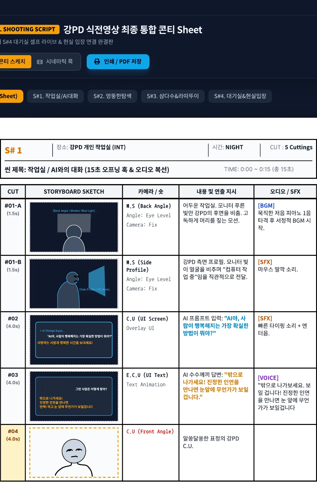
<small>S#1 ruang kerja. Saya bahkan menulis kalimat untuk layar chat AI dan efek suaranya</small>

S#3 adalah klimaksnya. Tilt-up dari botol air ke wajah istri saya, lens flare dari cahaya latar, zoom ke dalam mata ala Ratatouille, dan montase di dalamnya memakan ruang terbanyak di storyboard. Adegan ini juga paling banyak menghabiskan kredit dan waktu.

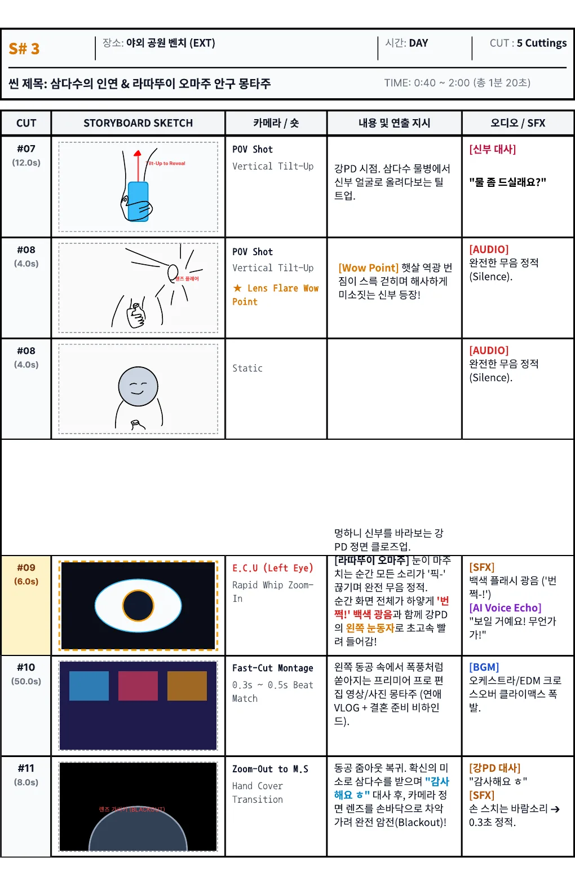
<small>S#3 bangku. Kalimat pengantin wanita "Mau minum?", #09 zoom ke mata, #10 montase</small>

S#4 adalah bagian yang menyambung ke lokasi nyata. Saya di layar berbicara ke kamera selfie di ruang tunggu, menurunkan kamera, dan saat film berakhir musik masuk yang asli dimulai.

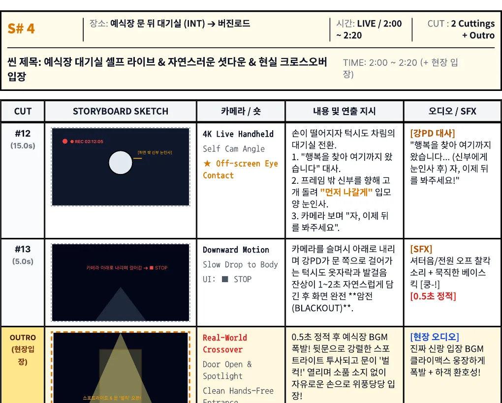
<small>S#4. Adegan terakhir yang menyambungkan film dengan masuknya mempelai yang sebenarnya</small>

Durasi storyboard 2 menit 20 detik, dan gambar di versi final berakhir di 2:15. Montase saya rencanakan 50 detik tapi jadi jauh lebih pendek, dan dialognya juga berubah. Perubahannya saya tulis di bagian 3 dan 4.

## Dua akun Claude dan Higgsfield

Saya memakai dua alat AI bersamaan. Higgsfield untuk membuat gambar dan video, Claude untuk merancang prompt dan meninjau hasil. Di Higgsfield saya memakai akun saya sendiri sejak awal.

Claude awalnya saya pakai di akun istri saya. Claude memahami deskripsi adegan saya dengan sangat baik, sampai akhirnya saya membuat akun sendiri dan menaikkan paket ke Max. Perpindahan akun ini belakangan menjadi lubang besar. Percakapan di akun istri tidak ikut pindah ke akun saya, jadi saya membuat dokumen serah terima dan menempelkannya, tapi dokumen itu hanya menyisakan kesimpulan dan membuang semua alasannya. Soal ini saya tulis terpisah di bagian 4.

Higgsfield saya hubungkan ke Claude sebagai konektor. Claude langsung membuat gambar, menampilkan daftar hasil, serta mengecek saldo dan riwayat transaksi. Praktis, tapi harganya mahal.

| Yang terjadi | Penyebab | Yang saya ubah |
|---|---|---|
| Satu percakapan memakan 4% kuota Max, dan beberapa pesan lagi membuatnya 7% | Konektor Higgsfield punya sekitar 80 alat, jadi deskripsinya ikut terbawa setiap giliran meski tidak dipakai. Hasil seperti 100 transaksi juga terus menumpuk | Konektor hanya dinyalakan saat membuat gambar/video, dan obrolan perencanaan serta naskah dilakukan di chat baru dengan konektor mati |
| Claude bisa menampilkan daftar hasil tapi tidak bisa melihat gambarnya | Daftar hanya berisi ID dan alamat; Claude tidak bisa membuka gambarnya | Saya yang menunjuk gambar mana yang dipilih berdasarkan urutan di layar |

Di Higgsfield saya membuat proyek "film pernikahan" dan mulai mengunggah bahan pada 29 Agustus. Hari itu saya mulai dari ruang kerja S#1.

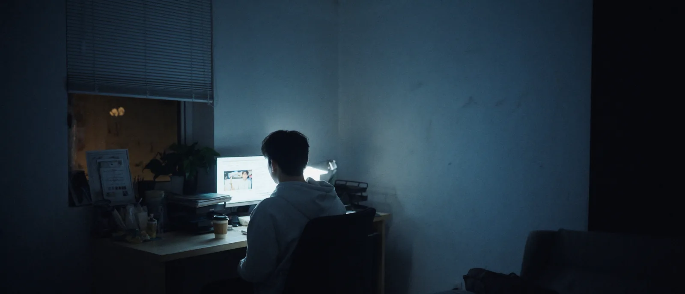
<small>Gambar ruang kerja yang saya buat pukul 17.00 tanggal 29 Agustus (dibuat AI). Versi final memakai komposisi lain</small>

## Lokasi sebagai elemen, wajah berdasarkan sudut

Higgsfield memungkinkan menyimpan lokasi dan karakter sebagai elemen lalu memanggilnya di prompt dengan tanda @. Saya membuat elemen lokasi untuk gedung pernikahan, gunung salju, bulan, ruang kerja, jalan musim panas, taman, dan kafe. Gunung salju dan bulan punya beberapa versi, sampai @bg-snow-5 dan @bg-moon-4.

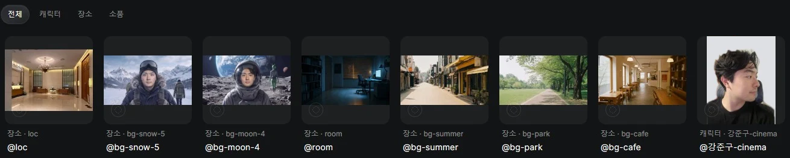
<small>Tujuh elemen lokasi dan satu elemen karakter yang saya simpan di Higgsfield. Latar rumah di foto karakter saya ganti dengan warna polos</small>

Urutan kerja saya pertahankan sampai akhir. **Buat gambar lokasi dulu, lalu gambar dengan orang di lokasi itu, baru gerakkan gambar itu menjadi video.** Kalau lokasi dan orang dimasukkan terpisah di tahap video, keduanya tidak cocok, sedangkan gambar yang dimasukkan sebagai frame pertama langsung masuk ke video apa adanya.

Wajah butuh coba-coba lebih panjang. Elemen karakter pertama saya (@char_jungu, @char_sumin) berbasis satu foto, jadi wajahnya keluar lemah. Jadi saya menambah foto ke elemen dan juga memasukkan foto langsung sebagai referensi per cut. Kali ini saya kira makin banyak foto makin baik. Ternyata kebalikannya.

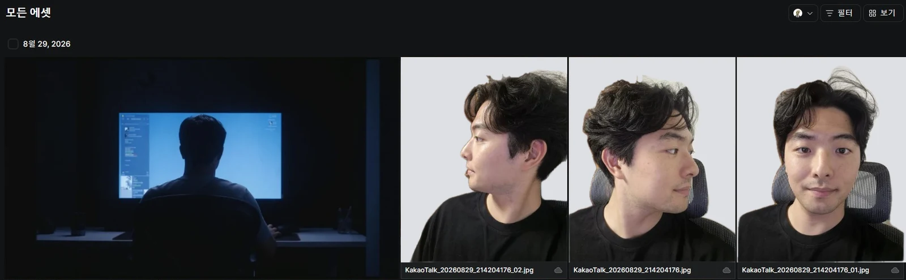
<small>Foto wajah saya yang diunggah ke proyek pada 29 Agustus. Samping, 45 derajat, dan depan difoto terpisah. Isi rumah terlihat, jadi hanya latarnya saya ganti warna polos</small>

Saat foto depan, samping, dan menunduk dimasukkan bersamaan, setiap sudut dirata-rata dan wajahnya jadi lembek. Jadi saya ubah aturannya.

| Prioritas | Foto yang dipakai sebagai referensi |
|---|---|
| 1 | Tepat satu foto yang diambil dari sudut mirip dengan shot yang dibuat |
| 2 | Kalau tidak ada, satu foto depan yang bagus dan satu foto samping yang bagus |
| Jangan | Foto depan, samping, dan menunduk sekaligus. Ketiga arah dirata-rata bersamaan |

Aturan ini sempat goyah saat memasukkan wajah istri saya. Fotonya ada tiga: depan, menoleh 45 derajat dengan mata ke depan, dan 45 derajat dengan mata menunduk. Saya butuh wajahnya yang terlihat dari bawah dari sudut pandang saya di bangku, jadi Claude menyarankan hanya memakai foto ketiga yang sudutnya paling dekat. Saya menilai di foto itu matanya menunduk sehingga matanya tidak akan keluar dengan baik, dan memasukkan ketiganya. Aturan tetap aturan, tapi ekspresi di setiap foto juga harus dipertimbangkan.

Saya juga mengunci fitur wajah dengan teks. Jarak mata, bentuk kelopak, lebar batang hidung, tinggi tulang pipi, sudut rahang, panjang filtrum, dan ketebalan bibir saya tuliskan, lalu diakhiri dengan `Do not average these features`. Kalimat itu untuk mencegah perataan yang muncul saat mencampur sudut.

Kalau saya buka elemen karakter yang masih ada, @강준구 berisi 7 foto. Campuran foto jas dari pemotretan pernikahan dan foto sehari-hari.

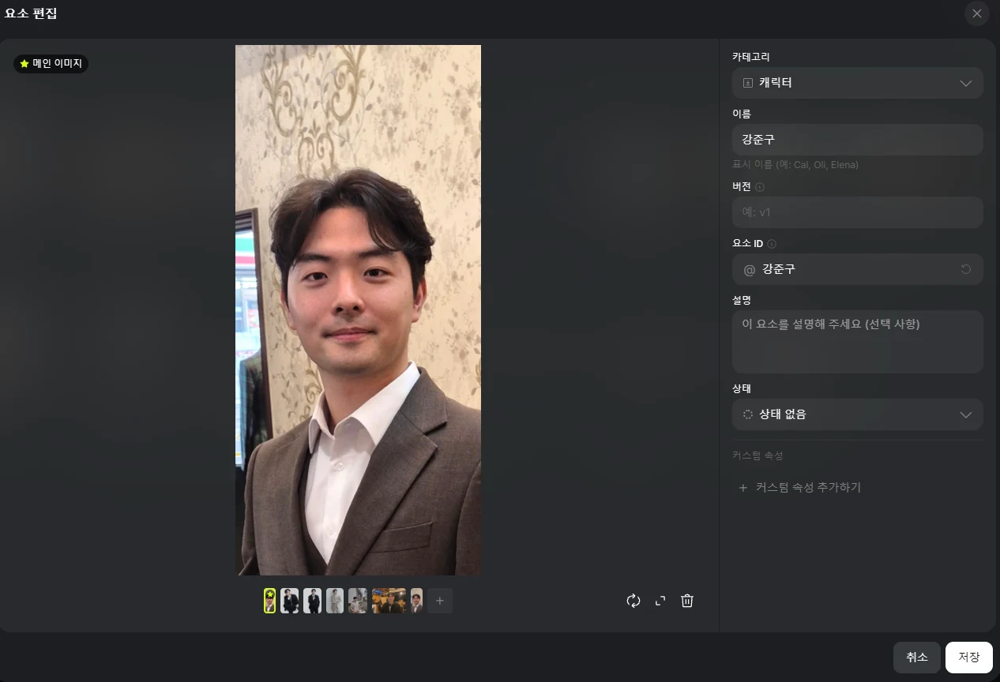
<small>Elemen @강준구. Satu gambar utama dan enam foto tambahan</small>

Saya juga membuat karakter Soul Higgsfield (@강준구-cinema). Saya memasukkan 17 foto diri saya dari berbagai tempat, dan 25 kredit keluar sebagai baris Soul ID di riwayat transaksi. Tapi karakter ini hanya bisa dipanggil di Soul Cinema, tidak di Nano Banana Pro atau Cinema Studio, jadi tidak saya pakai di kebanyakan shot. Pada 6 September saya memanggilnya untuk satu shot dengan Seedance 2, berjalan ke bangku lalu duduk.

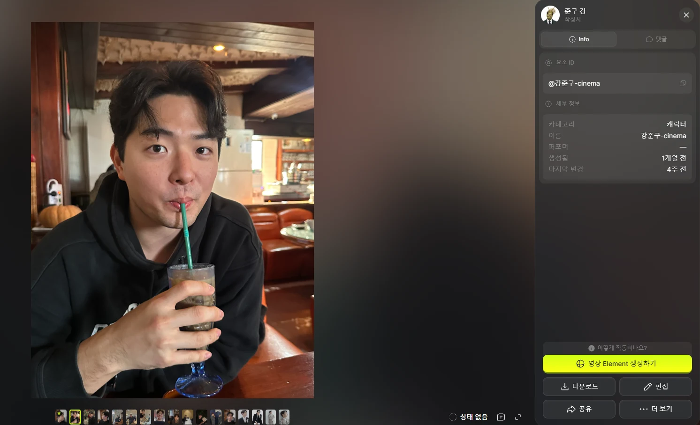
<small>@강준구-cinema. 17 foto dengan sudut dan tempat berbeda: kafe, restoran, pemotretan pernikahan</small>

## Kredit tidak terbawa ke bulan berikutnya

Akun Higgsfield saya memakai paket Plus. Setiap tanggal 3 pukul 11.00 waktu Korea, masuk 1.000 kredit. Saya menyuruh Claude membuka riwayat transaksi sampai paling akhir untuk memastikan, dan di catatan 3 Agustus ada baris penarikan 843 kredit sisa yang bersebelahan dengan baris pemberian 1.000 kredit baru. **Kredit sisa tidak terbawa ke bulan berikutnya, melainkan hilang.**

Jadi menjelang reset tidak ada alasan untuk berhemat, dan setelah reset saya ragu bahkan untuk satu video. Biaya per sekali jalan per model, dari riwayat transaksi:

| Model | Jenis | Biaya per sekali (kredit) |
|---|---|---|
| Nano Banana Pro | Gambar | 2 |
| GPT Image 2.0 | Gambar | 0,5–8,5 (beda 17 kali tergantung pengaturan) |
| Cinema Studio 4.0 | Video | 20–72 |
| Seedance 2.5 | Video | 19,26–132,73 |

Pada 31 Agustus saya mengelompokkan 140 transaksi terakhir per model: dari total 563 kredit, 8 video memakan 356 (63%). Nano Banana Pro membuat 38 gambar hanya dengan 76 kredit. 132,73 kredit yang hilang sekaligus, menurut waktunya, adalah versi final Seedance 2.5 Edit 1080p yang saya jalankan pukul 22.41 tanggal 30 Agustus (waktu Korea). Menurut riwayat transaksi, hari itu saja saya menghabiskan hampir 300 kredit.

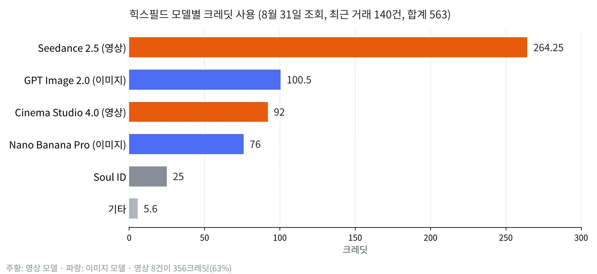
<small>140 transaksi yang saya ambil pada 31 Agustus, dijumlahkan per model (saya gambar sendiri dari riwayat transaksi)</small>

Dari 30 Agustus sampai 6 September saya membuat 36 video di akun saya. Per model:

| Model | Jumlah | Adegan utama |
|---|---|---|
| Seedance 2.5 | 20 | Tilt-up sudut pandang di bangku, zoom masuk dan keluar mata, kamera selfie di gedung pernikahan |
| Seedance 2.5 Edit | 9 | Adegan berkeliaran (mengganti latar dan pakaian di rekaman asli), menambah dasi kupu-kupu di kamera selfie gedung, shot keluar dari mata |
| Cinema Studio | 4 | Tiga shot berbicara di ruang kerja, satu tilt-up sudut pandang di bangku |
| Higgsfield Genjutsu | 2 | Ganti wajah (motion transfer), menambah dasi kupu-kupu (object swap) |
| Seedance 2 | 1 | Berjalan ke bangku lalu duduk |

Dari 36 video, 19 adalah uji coba 480p dan 16 adalah 1080p. Komposisi dan gerakan saya cek di 480p, lalu hanya yang bagus saya jalankan ulang di 1080p dengan prompt yang sama. Kredit sangat bergantung pada resolusi, jadi urutan ini terbentuk dengan sendirinya.

Hal yang terlewat saat persiapan membuat saya menghabiskan banyak kredit dan waktu belakangan. Kalau mengerjakan hal yang sama lagi, saya akan memakai urutan ini.

| Yang dilakukan | Alasan |
|---|---|
| Tulis "sudut pandang siapa, melihat apa" untuk setiap cut di storyboard | Saya hanya menulis "POV botol air", dan Claude membacanya sebagai sudut pandang botol. Padahal itu sudut pandang saya yang melihat botol |
| Simpan keputusan beserta alasannya di satu file | Saat pindah akun saya hanya menyerahkan ringkasan, dan semua alasannya hilang |
| Jadikan uji 480p → 1080p aturan sejak awal | Satu kali jalan 132 kredit setara enam kali uji coba |
| Nyalakan konektor hanya saat membuat | Deskripsi alatnya saja sudah memakan banyak kuota Claude setiap giliran |

Bagian 2 membahas ruang kerja S#1 dan adegan berkeliaran S#2. Bagaimana saya menulis ulang prompt sambil menjalankan ulang klip selfie GoPro 15 detik lewat Seedance 2.5 Edit enam kali, dan mengapa saya menyerah membuat layar monitor dengan AI.
