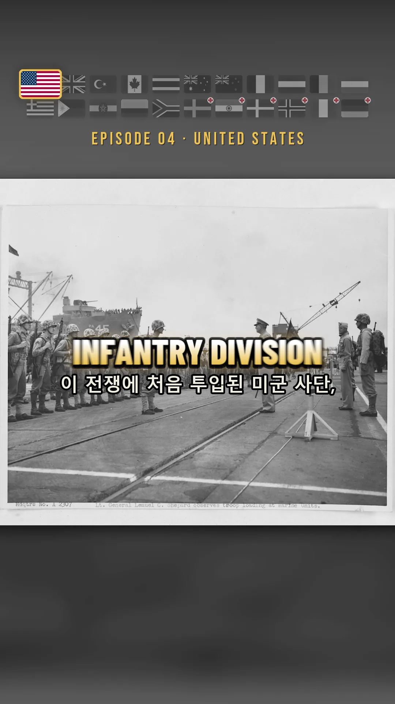
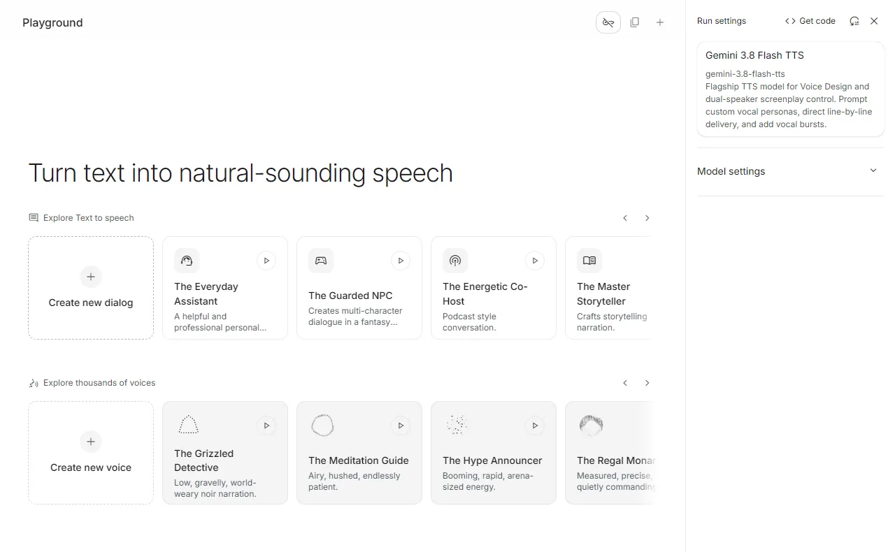
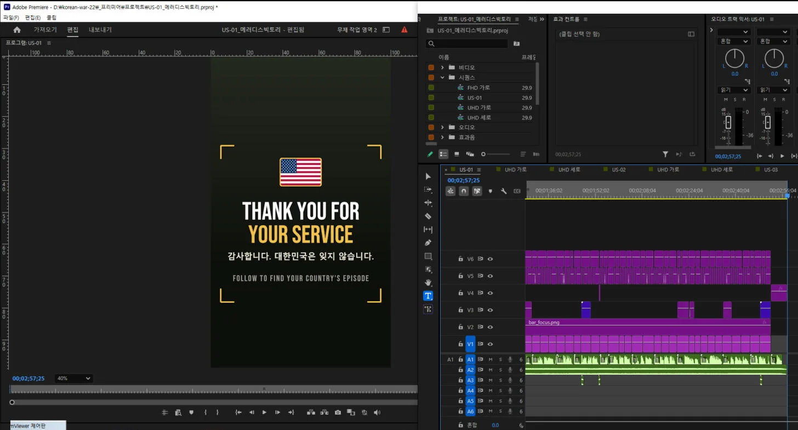
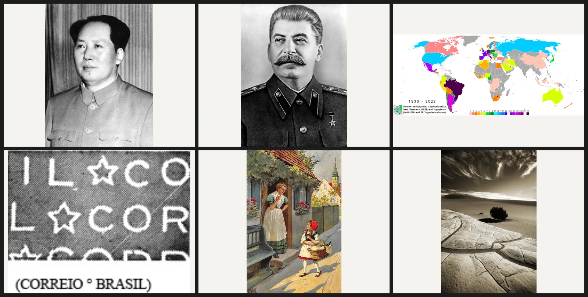
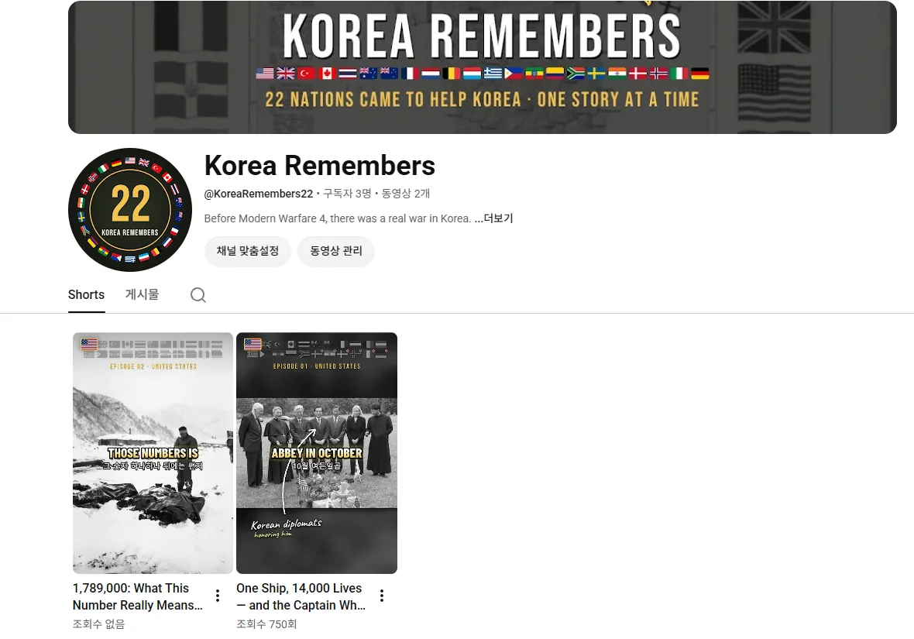

Masukkan satu naskah dan satu folder foto, dan Claude menyusun sendiri timeline Premiere. Selama tiga hari saya membangun jalur itu dan menghasilkan empat shorts berdurasi sekitar dua menit lima puluh detik.

<small>Satu bingkai jadi. Deretan bendera, teks besar, teks pendamping, dan penempatan foto semuanya diletakkan oleh kode</small>

## Mengapa 22 negara

Dua puluh dua negara mengirim pasukan atau tenaga medis ke Perang Korea: 16 negara tempur dan 6 negara dukungan medis. Saya memilihnya sebagai bahan kanal karena tiga alasan.

| Alasan | Isi |
|---|---|
| Waktu | Modern Warfare 4 rilis pada 23 Oktober 2026. Kampanyenya adalah perang di Semenanjung Korea yang dibuka dengan invasi penuh Korea Utara, dan tokoh utamanya seorang prajurit Korea Selatan. Gamer sedunia sedang mencari Korea |
| Jumlah bahan | Setiap negara punya satuan, pertempuran, dan tokoh untuk diceritakan. Dua puluh dua negara bisa sampai ratusan episode. Naskah saja sudah 145 yang saya tulis |
| Pasar | Di antara negara peserta, Amerika Serikat, Inggris, Kanada, Australia, Selandia Baru, Belanda, Skandinavia, dan Jerman punya tarif iklan tinggi |

Alasan ketiga sebenarnya yang terbesar. Kalau hanya memakai bahasa Korea, pasarnya lima puluh juta orang dan masih terbagi lagi di dalamnya. Maka saya memilih **bahasa Inggris sebagai dasar, dan hanya pada episode negara itu dipasang takarir bahasa negara tersebut beserta benderanya sebagai perlakuan khusus**. Taktiknya: orang yang melihat negaranya disorot akan menelusuri profil sambil bertanya "apakah negara saya juga ada?". Sisa bahasa saya serahkan pada sulih suara otomatis YouTube. Nama kanalnya Korea Remembers, satu akun, satu episode sehari.

Emosinya rasa terima kasih, bukan amarah. Kenyataan bahwa yang membuatnya orang Korea langsung menjadi ketulusannya sendiri.

## Saya membedah referensi untuk menetapkan desain

Saya tidak membuatnya dengan perasaan. Saya mengunduh video kanal yang saya tuju lalu membongkarnya. Hystoria dari Indonesia (142 ribu pelanggan) untuk strukturnya, dan untuk tata bahasa visualnya saya mengunduh tiga shorts Silent Souls Stories (175 ribu pelanggan) dengan yt-dlp lalu membedahnya bingkai demi bingkai.

| Yang saya temukan di referensi | Yang saya terapkan di video saya |
|---|---|
| Nyaris tanpa efek transisi. Hanya potongan, ditambah tarikan kecil yang menetap tepat setelah potongan | Tiap potongan ditarik dari 104% ke 100,5%, lalu didorong pelan sampai 106% |
| Rata-rata adegan 2 detik | Potongan rata-rata sekitar 3 detik, pembuka 1,3 sampai 1,7 detik |
| Kilatan putih 0,6 detik hanya pada transisi besar | Hanya satu dua kali, di tempat cerita berbelok |
| Takarir 1 sampai 3 kata huruf besar di tengah layar | Gradasi jatuh dari putih ke kuning, di tengah layar |

<small>Peta tidak diambil dari mana-mana, melainkan digambar oleh kode. Hanya data garis pantai yang memakai sumber terbuka, sisanya gambar sendiri</small>

Saya menambahkan dua hal milik saya. Deretan 22 bendera berada di bagian atas layar sepanjang video, dan begitu narasi berkata "hari ini, Amerika Serikat", bendera itu saja membesar 1,45 kali dengan bingkai emas sementara sisanya jatuh ke hitam putih. Lalu peta tidak saya pinjam, saya gambar: tekstur kertas, garis pantai bertinta, garis ombak di tepi pantai, paralel 38, kotak judul bernomor, panah pergerakan merah. Tiap adegan punya peta berbeda.

## Suara dibuat dalam satu blok, pewaktuan diurus oleh transkripsi

Awalnya saya memasang suara panduan bawaan Windows. Penilaiannya satu kata. Sampah.

Sekarang saya membuatnya di web Gemini AI Studio. Yang penting adalah **memasukkan seluruh naskah ke dalam satu speech block dengan baris kosong antaradegan, lalu menjalankannya sekali jalan**. Kalau dibuat per adegan, suaranya berubah tipis-tipis. Suara yang dipakai hanya satu, Riko. Narasi dua menit lima puluh detik keluar sebagai satu berkas.

<small>Layar tempat narasi dibuat. "Create new dialog" harus ditekan dulu agar kolom teks muncul</small>

Lalu inti perkaranya. Berkas wav narasi saya transkripsikan ulang dengan faster-whisper untuk **mengambil detik kemunculan tiap kata.** Dengan begitu takarir tidak perlu dicocokkan dengan tangan. Jika daftar potongan menulis "foto ini mulai pada kata 'Hungnam'", kode mencari waktu asli kata itu dan menaruh potongannya. Ketepatan penjajarannya 95 sampai 98 persen per episode.

Takarirnya dua baris. Baris besar 1 sampai 3 kata dalam bahasa negara itu, baris kecil di bawahnya bahasa Inggris. Untuk negara berbahasa Inggris, baris bawahnya bahasa Korea. Bahasa Korea terpecah terlalu kecil, jadi saya kelompokkan ulang menurut makna. Potongan di bawah sembilan huruf, atau yang maknanya belum selesai, digabung dengan berikutnya, dan satu baris boleh sampai delapan belas huruf. Dalam satu episode, 139 potongan turun menjadi 66.

## Claude menyusun Premiere secara langsung

Di sinilah MCP dipakai. Yang saya pakai ada dua.

| MCP | Tugasnya |
|---|---|
| Premiere Pro MCP | Membuka dan menyimpan proyek dengan nama lain, menyusun timeline lewat `execute_extendscript`, mengekspor |
| Playwright (Whale, porta debug 9222) | Membuat dan mengunduh suara di AI Studio, mengumpulkan bahan dari Arsip Nasional AS dan DigitaltMuseum, menjadwalkan unggahan ke YouTube dan Instagram |

Urutannya begini. Sisi Python (`premiere_prep.py`) menyusun foto lebih dulu pada 1080×1920, menggambar takarir, papan nama, huruf kuas, dan peta sebagai rangkaian PNG, lalu menghasilkan satu `plan.json`. Kemudian satu baris ExtendScript dikirim lewat Premiere MCP. Skrip itu membaca plan dan mengisi delapan trek.

<small>Timeline yang sudah tersusun. Tidak ada orang yang menyeret klip ini satu per satu</small>

V1 foto dan peta, V2 deretan bendera, V3 papan nama, panah, dan huruf kuas Korea, V4 kartu teks, penutup, dan kilatan putih, V5 takarir besar, V6 takarir pendamping, A1 narasi, A2 musik. Satu episode memuat lebih dari 250 klip dan tidak ada manusia yang meletakkannya.

Yang saya pelajari saat mengotomatiskan adalah bahwa penilaian pun bisa dimasukkan ke dalam kode. Tiap adegan diberi skor kepentingan dari narasinya. Kata kunci seperti Medal of Honor, first, captured, killed bernilai 3, angka besar 3, ucapan terima kasih 3, dan kata kunci yang baru pertama muncul di episode itu bernilai 2. Hanya adegan di atas 6 poin yang boleh memakai huruf kuas kuning, dan di bawah itu kode membuangnya otomatis. Efek suaranya pun saya sintesis sendiri dengan Python agar tidak tersangkut lisensi: dentuman logo, desau kilatan, ketikan kartu, debam, dan sapuan kuas, lima buah.

## Ketika kode tidak bisa memercayai yang dikumpulkan kode

Bahannya juga dikumpulkan oleh kode. Ia menyisir Wikimedia Commons per negara dan memilah lisensi ke dalam tiga tingkat: bebas (domain publik, CC0), atribusi (CC BY), dan berbagi serupa (CC BY-SA). Nonkomersial dan tanpa turunan tidak diambil.

Tetapi begitu kumpulan pertama saya buka, 114 foto Filipina seluruhnya dari rentang 1992 sampai 2016. Acara politik Filipina dan kunjungan Paus. Penyebabnya, satu-satunya subkategori `Philippines in the Korean War` adalah tokoh yang dulu veteran perang lalu menjadi presiden, dan menurun dua tingkat dari sana ikut menyeret video APEC. Saya menutup penurunan ke kategori berbentuk nama orang, menambahkan saringan tahun 1949–1956, dan memecah putusannya jadi tiga: ambil, periksa, buang.

Fitur pencarian kata yang saya tambahkan setelahnya justru lubang yang lebih besar. Saya menjalankan Jerman sebagai kata kunci dan menerima 110 berkas: lomba foto Angkatan Darat AS tahun 2007, prangko Brasil, peta keikutsertaan Piala Dunia, dan animasi Soviet.

<small>Yang kembali dari pencarian "Jerman". Seluruh 110 berkas seperti ini</small>

Uji keterkaitannya ternyata ikut memakai jalur kategori tempat berkas itu terseret, dan hasil pencarian menuliskan kata kuncinya persis di jalur tersebut, sehingga apa pun lolos. Pencarian saya matikan secara bawaan, dan 704 berkas yang tersaring, 5,2GB, sekarang ditaruh di folder karantina alih-alih dihapus. Jumlah foto saya turunkan dari 1.658 menjadi 1.040. Menyusun rencana di atas angka yang digelembungkan hanya akan menjadi lubang di kemudian hari.

## Keadaan sekarang

<small>Kanalnya baru saja dibuka. Baris pertama keterangannya berbunyi "Before Modern Warfare 4, there was a real war in Korea."</small>

Versi utuh sudah ada dari US-01, kapal SS Meredith Victory di Hungnam, sampai US-04, Task Force Smith, dan tayang ke YouTube serta Instagram satu per hari. Episode 1 ada di [One Ship, 14,000 Lives — and the Captain Who Gave Up Everything](https://youtube.com/shorts/D4IVNaqsKUQ). Berikutnya kisah Hudner dan Brown.

Pekerjaan yang tersisa menumpuk di sisi manusia. Lima negara dengan foto kurang dari sepuluh lembar belum bisa dijadikan video. Untuk Jerman dan Italia, foto masa itu hanya ada sebagai arsip nonelektronik di Arsip Nasional Korea, sehingga permohonan salinan yang menuntut verifikasi identitas harus diajukan. Episode negara non-Inggris memerlukan narasi bahasanya sendiri dan pemeriksaan penutur asli.
