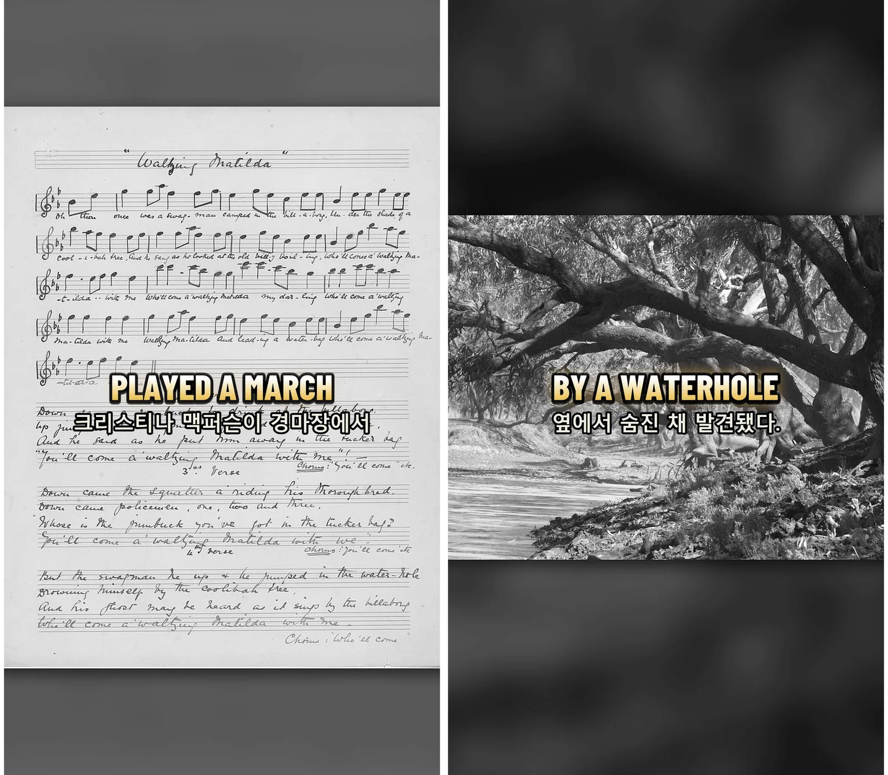
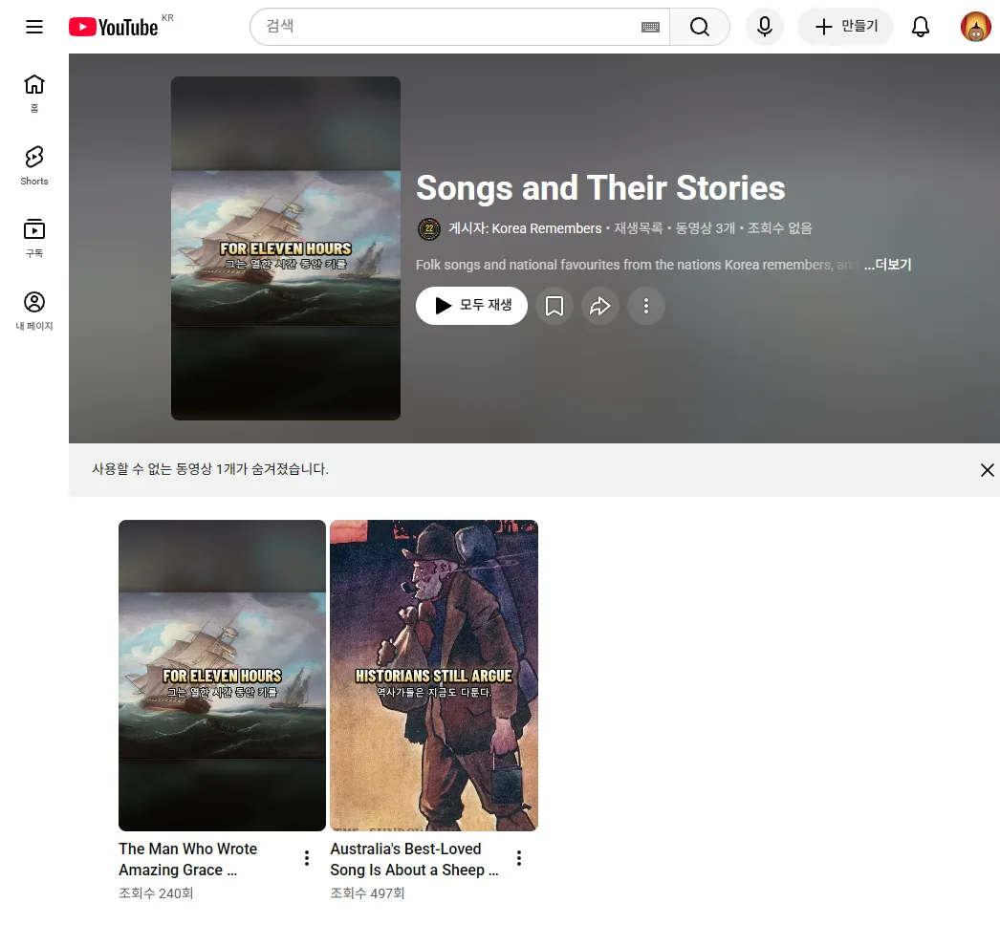

Saya membuat shorts 60 detik tentang satu lagu yang dikenal di setiap negara beserta kisah di baliknya. Saya hanya memakai lagu yang hak ciptanya sudah habis, dan bunyinya tidak dibuat AI, hanya rekaman pertunjukan asli. Dalam dua hari saya membuat tiga episode.

<small>Bingkai pertama tiga episode: Waltzing Matilda (Australia), Amazing Grace (dibuat sebagai episode AS), Auld Lang Syne (Skotlandia)</small>

## Mengapa memasukkan lagu ke kanal perang

Saya mengelola Korea Remembers, kanal yang membahas 22 negara peserta Perang Korea satu per satu. Gagasan menambahkan lagu tiap negara muncul lebih dulu, tetapi mengaitkannya dengan perang terasa dipaksakan. Jadi kanalnya sama, daftar putarnya dipisah, dan aturannya dibedakan.

| Hal | Episode perang | Episode lagu |
|---|---|---|
| Cerita | Pasukan, pertempuran, tokoh negara itu | Hanya lagu dan cerita negara itu. Perang Korea tidak disinggung |
| Pembuka / penutup | Deretan 22 bendera, ucapan terima kasih | Tidak ada keduanya. Mulai dengan satu penggal lagu, berakhir dengan lagu |
| Durasi | 3 menit, 60 detik | Kurang dari 60 detik |
| Visual | Foto masa itu, peta gambar tangan | Foto lama, lukisan, partitur |

Bahannya lagu rakyat atau lagu kesayangan bangsa yang hak ciptanya sudah habis. Urutan negara mengikuti penonton kanal: AS 11,4%, Filipina 6,8%, India 2,5%, Kanada 2,1%, Australia 1,6%.

## Satu nada saja berbeda, jadi terasa palsu

Awalnya saya sempat berpikir memakai lagu tiruan buatan AI. Saya batalkan. Orang Korea marah melihat Arirang diaransemen aneh, dan orang negara lain pun sama. Saya memutuskan tidak mengubah melodi, irama, maupun alat musik sedikit pun, sehingga harus memakai rekaman yang dimainkan orang sungguhan.

Masalahnya, hak cipta lagu dan hak cipta rekamannya terpisah. Saat menelusuri lagu pertama, Waltzing Matilda, saya menemukan ini.

| Rekaman | Kendalanya |
|---|---|
| Rekaman pertama 1926–27 (tenor John Collinson) | Melodinya berbeda dari yang dikenal sekarang. Catatannya menyebut baris ke-2 dan ke-4 diubah |
| Versi Peter Dawson 1938 | Versi yang membuat lagu ini populer. Perlindungan rekaman sudah habis di Australia dan Inggris, tetapi di AS berlaku sampai akhir 2038 |
| Band Divisi Marinir 1 AS (2021) | Diunggah sebagai "PUBLIC DOMAIN" di DVIDS, situs media publik militer AS. Permainan tiup tanpa lirik |

Versi Dawson paling "asli", tetapi 11% penonton ada di AS. Saya memilih versi band. Liriknya hanya muncul sebagai teks di layar.

<small>Halaman tempat saya mengambil audio episode 1. PUBLIC DOMAIN tertulis di bagian bawah kotak info. Divisi Marinir 1 bertugas di Australia pada Perang Dunia II dan menjadikan lagu ini lagu divisi</small>

Ketiga episode memakai jalur ini.

| Eps. | Lagu | Rekaman yang dipakai | Durasi |
|---|---|---|---|
| 1 | Waltzing Matilda | Band Divisi Marinir 1 AS (DVIDS) | 43,2 dtk |
| 2 | Amazing Grace | Versi vokal Southern Aire, band Cadangan Angkatan Udara AS (Wikimedia Commons) | 39,3 dtk |
| 3 | Auld Lang Syne | Band Angkatan Darat AS, permainan tiup (Wikimedia Commons) | 58,9 dtk |

Pertunjukan tidak pernah dipotong atau disambung. Kalau durasinya 43 detik, videonya 43 detik. Hanya Amazing Grace, yang rekaman penuhnya 130 detik, dipotong di akhir bait pertama.

## Kalau memilih dengan telinga, itu bukan otomatisasi

Jika ada beberapa kandidat rekaman, seseorang harus mendengarkan semuanya dan memutuskan "ya, ini lagunya." Kalau itu saya, bukan otomatisasi. Jadi saya mengambil melodi dari versi paling banyak ditonton sebagai acuan dan meminta kode membandingkan kandidat yang boleh dipakai. Caranya mengekstrak tinggi nada dan menyelaraskannya meski tempo berbeda.

<small>Makin rendah berarti melodi sama, tetapi lagu yang berbeda mendapat nilai lebih rendah daripada kandidat sebenarnya</small>

Hasilnya gagal. Lagu yang sama sekali berbeda bernilai 0,52 dan tampak lebih "sama" daripada kandidat asli. Memperpanjang menjadi potongan 40 detik tidak mengubah apa pun. Hanya menghabiskan token. Cara ini saya hentikan, dan sekarang saya hanya mendengarkan 30 detik pertama kandidat peringkat satu.

## Urutan membuat satu episode

Setelah dua episode, alurnya mantap. Saya memakai ulang alat perakitan yang dibuat untuk episode perang.

| Langkah | Yang dikerjakan |
|---|---|
| 1 | Cari audio dulu: Wikimedia Commons, lalu DVIDS. Ukur durasinya |
| 2 | Baca artikel Wikipedia sekali, buat tabel pemeriksaan fakta, tulis naskah. Jumlah kata = (durasi lagu − 3 dtk intro lagu saja − 5 dtk penutup lagu saja) × 2,3 |
| 3 | Unduh foto lama, lukisan, dan partitur dari sumber publik |
| 4 | Buat narasi dan ambil waktu tiap kata lewat transkripsi |
| 5 | Tulis daftar potongan dan rakit timeline dengan MCP Premiere. Pasang musik lalu ekspor |
| 6 | Periksa durasi, bingkai hitam, dan suara kiri/kanan dengan angka, lalu lihat satu lembar ringkasan |

Bedanya dengan episode perang: panjang naskah dihitung mundur dari panjang lagu. Lagu tidak bisa dipotong, jadi kata-katalah yang harus menyesuaikan lagu.

<small>Episode 1. Partitur tulisan tangan tahun 1895 dan lukisan kolam air. Cerita "yang diwariskan turun-temurun" dan fakta yang terkonfirmasi dipisah dalam naskah</small>

## Tiga detik pertama dikunci dengan angka besar

Saat mengunggah episode 2 saya sadar pembukanya lemah. Dalam 3 detik pertama harus ada rasa "pernah dengar lagu ini?" Orang ingin menjadi bagian dari angka besar. Sebanyak itu yang tahu? Saya juga tahu lagu ini? Mereka berhenti.

Angka tidak saya karang. Saya cari dasarnya dengan satu-dua pencarian lalu tulis ulang sebagai perkiraan.

| Lagu | Angka besar di layar | Dasar |
|---|---|---|
| Waltzing Matilda | Sekitar 1 dari 4 orang Australia memilihnya sebagai lagu kebangsaan | 28% dalam pemungutan suara nasional 1977 |
| Amazing Grace | Lagu yang dinyanyikan sekitar tiap 3 detik | Perkiraan penulis biografi sekitar 10 juta kali setahun ÷ 31,5 juta detik setahun |
| Auld Lang Syne | Lagu yang didengar sekitar 1 juta orang saat tengah malam | Perkiraan kerumunan hitung mundur tahun baru Times Square |

Survei tingkat pengenalan seperti "sekian % tahu lagu ini" tidak saya temukan untuk kedua lagu. Jika tidak ada, saya ganti dengan angka besar lain seperti persentase suara atau jumlah pertunjukan. Pembuka ini mulai dipakai di episode 3.

<small>Episode 3. Pembuka angka besar ada di kiri. Di kanan, kalimat bahwa Korea menyanyikan lagu kebangsaannya dengan melodi ini dari 1945 sampai 1948</small>

## Keadaan sekarang

<small>Daftar putar Songs and Their Stories. Hari ini episode 1 ditonton 497 kali, episode 2 sebanyak 240 kali</small>

Saya mengunggah tiga, tetapi hari ini daftar putar hanya menampilkan dua. Episode 3 berubah menjadi tidak dapat diputar, dan saya sedang memeriksa sebabnya.

Ada juga satu kesalahan. Episode 1–3 memuat baris bahasa Korea di bagian bawah. Video untuk penonton dunia tidak membutuhkannya. Mulai episode 4 baris bawah diganti bahasa Indonesia.

Episode 1 dimulai dari fakta bahwa lagu paling dicintai orang Australia sebenarnya tentang pencuri domba.

{{shorts: UJUn_dsgcus}}
