ซีรีส์ tvN เรื่อง 100 Days of Lies จะสมเหตุสมผลก็ต่อเมื่ออีกาคยอง (คิมยูจอง) ตายในตอนที่ 2 ฉันจึงเลิกดูหลังจบตอนที่ 2

เรื่องนี้เป็นโปรเจกต์พิเศษครบรอบ 20 ปีของ tvN นำแสดงโดยคิมยูจอง พัคจินยอง คิมฮยอนจู อีมูแซง และจินซอนกยู
กำกับโดยยูอินชิกจาก 'Extraordinary Attorney Woo' และเขียนบทโดยรยูโบรีจาก 'Do You Like Brahms?'
ทีมระดับนี้ ฉันอดคาดหวังไม่ได้

ขอบอกไว้ก่อน
ถ้าฉันพูดแรงขนาดนี้ แล้วมีคนถามว่า "แล้ววิดีโอของคุณเองดีแค่ไหน?" ฉันก็ไม่มีอะไรจะตอบ
ช่วงเวลาออกอากาศคงถูกกำหนดก่อน และมีแรงกดดันให้เติมรายละเอียดระหว่างถ่ายทำ
ฉากที่นักเขียนอยากตัดอาจถูกสั่งให้คงไว้จากข้างบน ผู้กำกับและนักแสดงก็คงรู้สึกขัดเขินระหว่างถ่าย
ฉันรู้ด้วยว่าคนทำคงรู้สึกถึงข้อบกพร่องมากกว่าใคร
ถึงอย่างนั้น ในฐานะผู้ชมและคนที่ทำงานแบบเดียวกัน ฉันอยากบันทึกสิ่งที่รู้สึกไว้ อย่างระมัดระวังแต่ตรงไปตรงมา

ภาพประกอบฉากในโพสต์นี้คือภาพหน้าจอจริงที่วาดใหม่เป็นสไตล์ภาพหมึกเกาหลีด้วย Gemini

## ปูมหลังที่ประกาศด้วยบทพูดแทนการแสดงให้เห็น

ตอนที่ 1 ราวนาทีที่ 18:28 อดีตของกาคยองถูกเล่าผ่านบทพูดติดต่อกัน

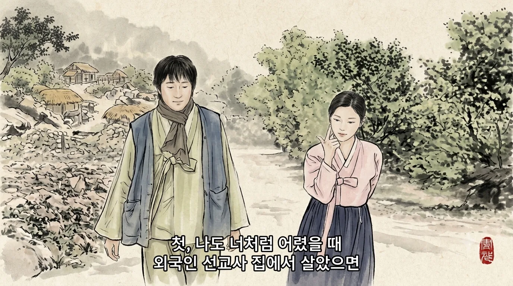

"ถ้าตอนเด็กฉันได้อยู่บ้านมิชชันนารีต่างชาติแบบเธอบ้าง…", "โดนใส่ร้ายว่าขโมยของกินแล้วโดนตี…" และ "ตอนนั้นฉันขโมยขนมปังจริง ๆ"

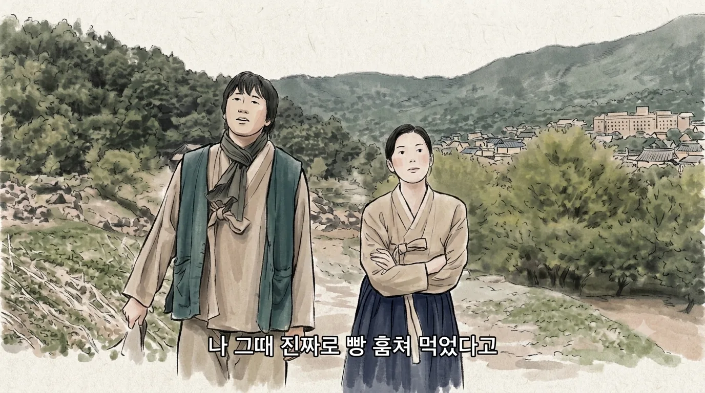

ฉันเข้าใจว่าเขาอยากให้เธอเป็นเด็กหัวไวที่เอาตัวรอดด้วยการโกหกและการแสดง
ปัญหาคือเลือกวิธีที่แบนที่สุด นั่นคือบทพูด
ถ้าให้เห็นกาคยองตอนเด็กขโมยขนมปังจริง ๆ แล้วร้องไห้หลอกผู้ใหญ่สักแค่ 30 วินาที ตัวละครนี้จะลึกขึ้นอีกมาก

นาทีที่ 22:52 มีบทพูดว่า "สามปีก่อนเธอขโมยเงินฉันไปเพื่อแอบลงเรือหนีไป…"

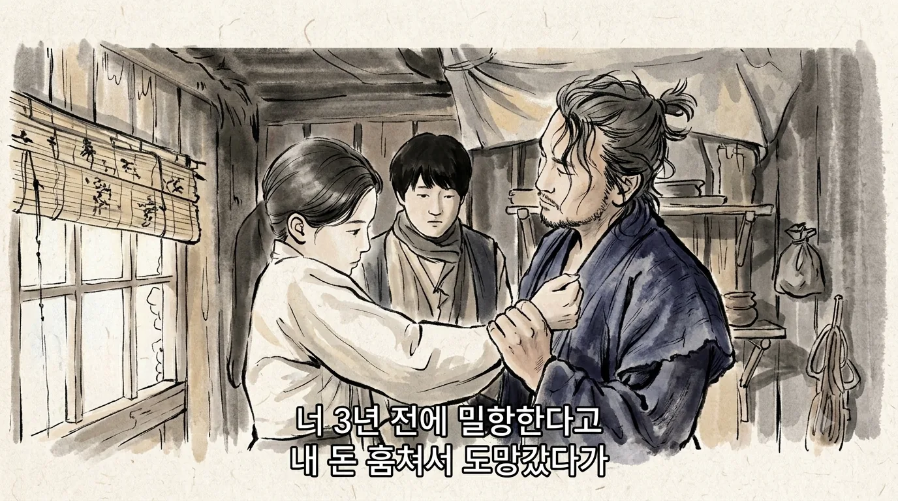

จะทำให้คนดูเชื่อว่าเธอมีความฝันอยากจากไป ต้องแสดงอะไรสักอย่าง จะเป็นภาพย้อนอดีตหรือการกระทำก็ได้
ตะโกนว่า "เศรษฐกิจจงฟื้น!" เศรษฐกิจก็ไม่ฟื้น บทพูดบรรทัดเดียวก็สร้างตัวละครไม่ได้

อีกฝั่งหนึ่งคือ The Outlaws
มาซอกโด (มาดงซอก) ปรากฏตัวครั้งแรกกลางถนนที่มีชาวจีนเชื้อสายเกาหลีอาศัยอยู่มาก ตรงที่ผู้ชายกำลังถือมีดทำครัวเผชิญหน้ากัน
มาซอกโดคุยโทรศัพท์เรื่องงานอยู่ เดินไปยืนตรงหน้า แล้วบอกคนในสายว่า "เด็ก ๆ ตีกันน่ะ"

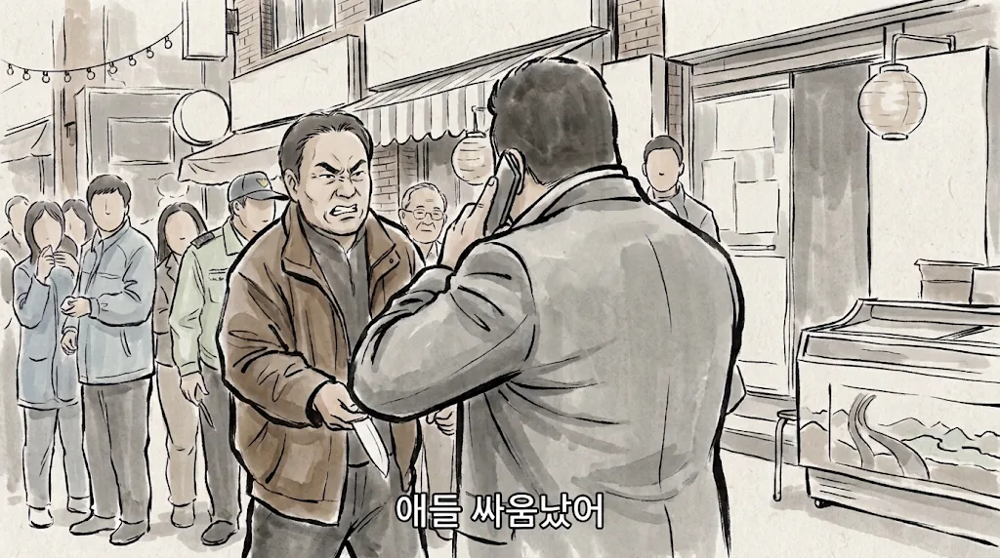

การเผชิญหน้าด้วยมีดทำครัวสำหรับเขาเป็นแค่เด็กตีกัน
พูดออกมาอย่างไม่ใส่ใจ แต่แรงมาก
แล้วเขาก็จัดการทุกอย่างโดยไม่วางสายด้วยซ้ำ

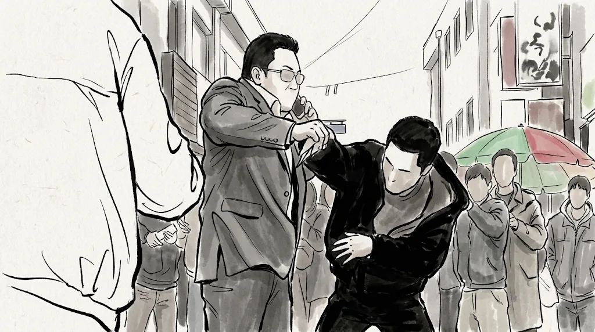

เขาไม่ได้ทุบตีใคร และไม่มีใครบอกเราว่าเขาแกร่ง
แต่คนดูเชื่อทันที

ถ้าทีมเขียนบทของซีรีส์นี้เขียน The Outlaws อาจออกมาแบบนี้

> นักสืบรุ่นน้อง: โอ้โห พี่! ได้ยินว่าเดือนนี้เดือนเดียวพี่จับโจรเข้าคุกไปสิบคนแล้ว! ปีนี้พี่ต้องได้ถ้วยรางวัลนักสืบคดีอาชญากรรมยอดเยี่ยมอีกแน่ ๆ เหมือนปีที่แล้ว!
> (มาดงซอกยิ้มกริ่ม จบฉาก)

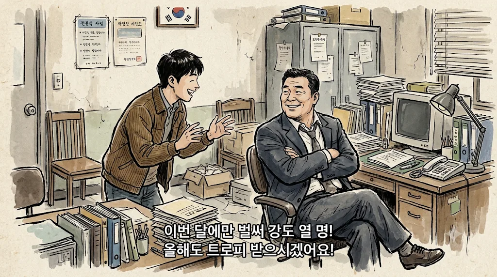

แล้วฉากรับถ้วยรางวัลก็ไม่เคยมา
รู้สึกเหมือนการอธิบายสถานการณ์และการสร้างตัวละครถูกทำแบบการบ้าน ติ๊กว่า "ส่งปูมหลังแล้ว" แล้วผ่านไป นี่คือเหตุผลที่ฉันไม่ชอบการกำกับแบบนี้
อาจเก็บเรื่องแอบลงเรือไว้เล่าให้ดีทีหลังก็ได้ แต่ไม่รู้ทำไมรู้สึกว่ามันจบแค่บรรทัดนั้น

ผ้ารัดท้องในนาทีที่ 28:31 ของตอนที่ 1 ก็เหมือนกัน
นักสู้เพื่อเอกราชยูโซรัน (คิมฮยอนจู) บอกเองเลยว่าในท้องไม่ใช่ลูกแต่เป็นผ้ารัดท้อง "ฉันจะใส่ผ้ารัดท้องนี้ต่อไป"

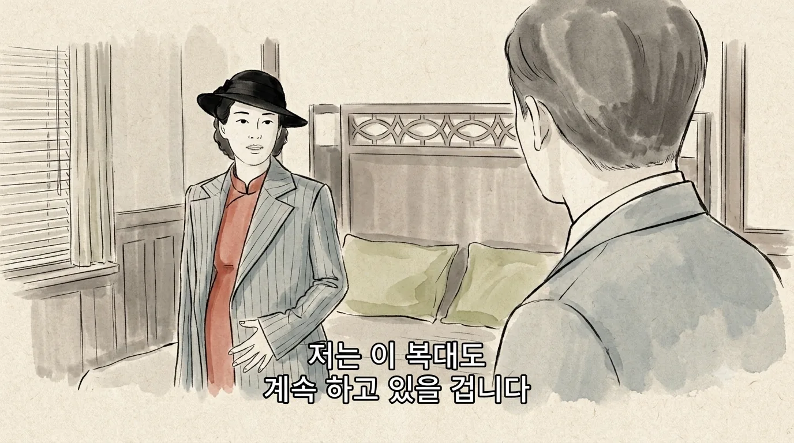

แค่ให้เห็นเธอสูบบุหรี่หรือยกแก้วเหล้า คนดูก็จะสังเกตเองว่า "เอ๊ะ ในท้องไม่มีอะไรเหรอ?"
พอชี้ให้เห็นขนาดนั้น ฉันนึกว่าเธอซ่อนอาวุธหรือเอกสารไว้ข้างใน
แต่มันก็แค่ผ้ารัดท้อง และผ้ารัดท้องก็แทบไม่ได้โผล่บนจอด้วย
จะบอกว่าเป็นการระลึกถึงลูกที่เสียไปก็ได้ แต่สุดท้ายดูเหมือนประหยัดค่าแต่งหน้าคนท้องด้วยบทพูดบรรทัดเดียว

## การอารักขาของญี่ปุ่นที่หายไปเฉย ๆ

ตอนที่ 1 ราวนาทีที่ 52:32 ผู้ตรวจการฝ่ายการเมืองซาโตะ ชินอิจิ (จินซอนกยู) มาถึงพร้อมขบวนรถหลายคัน

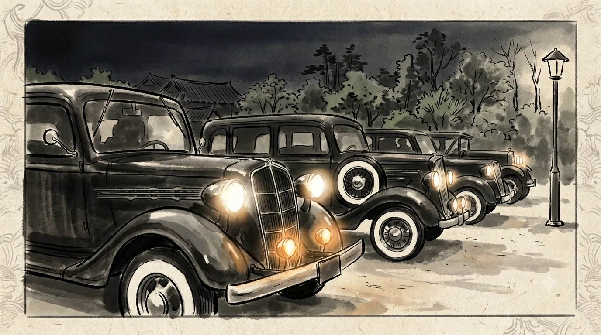

แต่หลังการยิงกันในบ้าน นาทีที่ 14:30 ของตอนที่ 2 เขากลับถูกส่งกลับคนเดียวด้วยรถคันเดียวเพราะกำลังโกรธ

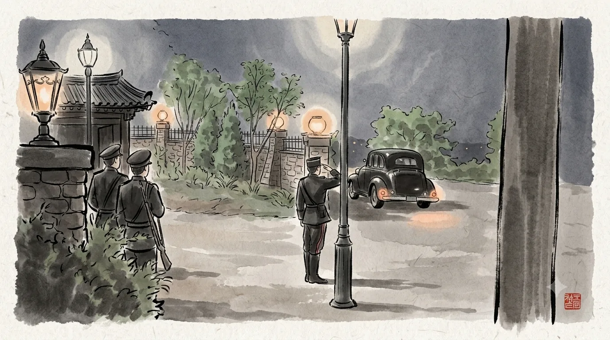

ไม่มีใครรู้ว่าข้างนอกมีพรรคพวกอยู่กี่คน หรือมีระเบิดหรือเปล่า
การที่หน่วยที่คุ้มกันคนอันดับสองของรัฐบาลทั่วไปไม่รู้สึกว่าแปลก นั่นแหละที่แปลกที่สุด

การยิงกันเองก็เช่นกัน
เสียงปืนนัดแรกดังที่นาทีที่ 2:02 ของตอนที่ 2 และองครักษ์ทุบหน้าต่างเข้ามาที่ 6:54
ในราวห้านาทีนั้นมีกระสุนถูกยิงออกไป 22 นัด

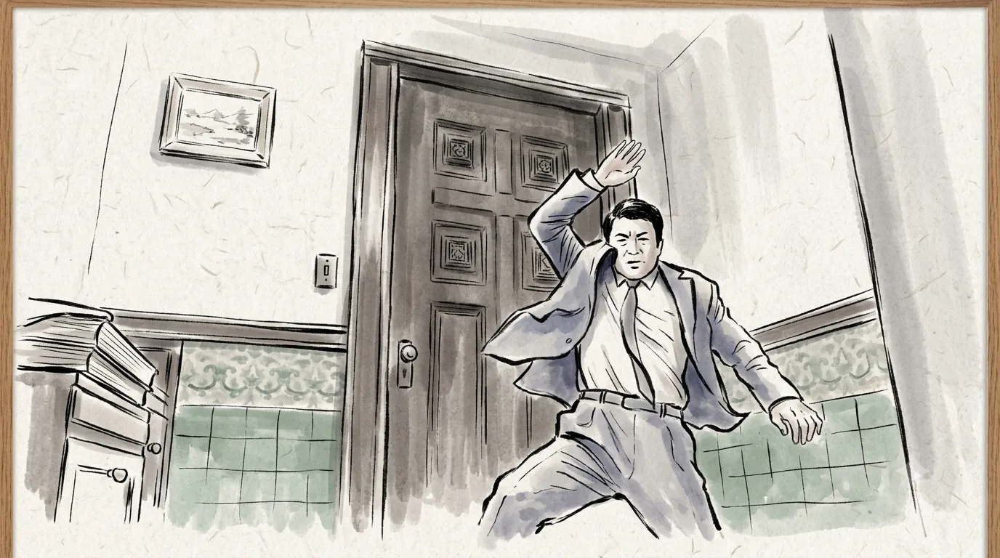

คนที่อยู่ข้างในคือผู้บังคับบัญชาสูงสุดของพวกเขา
แต่องครักษ์กลับแค่ทุบประตูอยู่ข้างนอก
องครักษ์ที่เคาะประตูอย่างสุภาพไม่ว่าเจ้านายจะตายหรือไม่ ตลอดห้านาทีฉันคิดอยู่อย่างเดียวว่า "ป่านนี้ไม่ควรพังประตูเข้าไปแล้วเหรอ?"

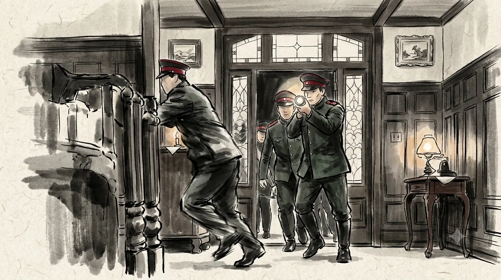

## นักสู้เพื่อเอกราชที่ถูกขโมยตัวเล็ก ๆ จูงจมูก

องค์กรที่ฆ่าคนเพื่อเอกราชของชาติ กลับปล่อยอีกาคยอง คนนอกที่รู้ตัวตนพวกเขา ให้มีชีวิตอยู่
ทั้งที่เธอพูดออกมาตรง ๆ ว่า "ก็ไม่ได้มีใครจ่ายเงินให้ฉันนี่"

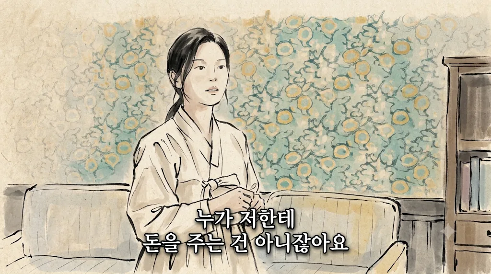

ในสถานการณ์ที่ความลับคือทุกอย่าง และผลของปฏิบัติการทั้งหมดเป็นเดิมพัน เรื่องนี้ไม่สมเหตุสมผล
นี่คือเหตุผลที่ฉันบอกว่าเรื่องนี้จะสมเหตุสมผลก็ต่อเมื่อกาคยองตายในตอนที่ 2

กาคยองขโมยกระสุนของนักสู้เพื่อเอกราช แล้วไปที่ฐานลับของพวกเขาเพื่อขายคืน
พร้อมบอกตรง ๆ ว่าตัวเองเป็นคนขโมย
ราวนาทีที่ 59:17 ของตอนที่ 1 เธอถึงขั้นยั่วยูโซรันว่า "ฉันจะตะโกนแล้วก่อเรื่องให้วุ่น"

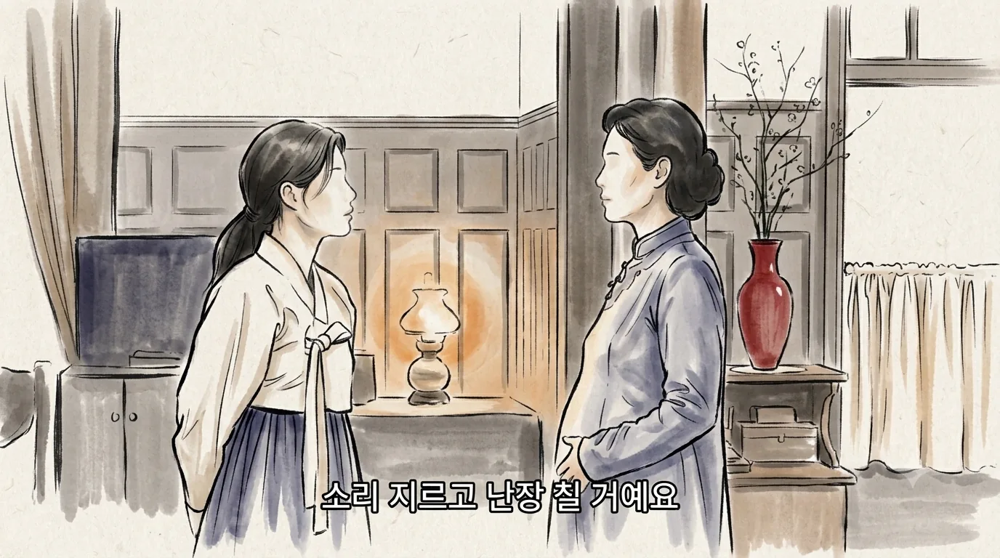

มีวิธีจัดการเธอได้อีกมากโดยไม่ต้องใช้ปืน
และจริง ๆ หลังจากนั้นพอนักสู้เพื่อเอกราชเอาปืนจ่อจากข้างหลัง เธอถึงเพิ่งกลัว
ขโมยตัวเล็ก ๆ ที่กุมสถานการณ์ต่อหน้าคนที่ยอมสละชีวิตเพื่อชาติ ทำให้รู้สึกว่าเรื่องนี้มองนักสู้เพื่อเอกราชเบาเกินไป และฉันไม่สบายใจ

การยิงกันก่อนหน้านั้นก็เหมือนกัน
คนที่ยิงปืนและก่อความวุ่นวายในบ้านหลังนั้นคืออดีตสามีของยูโซรัน
เขาก็เป็นนักสู้เพื่อเอกราช แต่ดูเหมือนจะอยู่อีกองค์กรหนึ่ง ไม่ใช่องค์กรของยูโซรัน
ฉันเข้าใจการตั้งเรื่องว่ามีหลายกลุ่มที่ต่างคนต่างเคลื่อนไหวและสื่อสารกันไม่ได้ แต่วิธีที่นำเสนอทำให้นักสู้เพื่อเอกราชดูโง่เกินไป

## มาตรฐานของฉันสูงเพราะ Mr. Sunshine

ฉันคิดว่าที่ฉันพูดแรงขนาดนี้ก็เพราะ Mr. Sunshine
ซีรีส์เรื่องนั้นไม่มีตัวละครแบน ๆ สักตัว และไม่ขาดอะไรเลยทั้งความถูกต้องทางประวัติศาสตร์ การถ่ายทอดจิตใจ การกำกับ และเนื้อเรื่อง

ยิ่งไปกว่านั้น 100 Days of Lies ดูเหมือนอยากเล่าเรื่องที่คล้ายกัน
ยูจีน ชเว (อีบยองฮอน) ไม่เคยคิดเรื่องเอกราชเลย แต่ค่อย ๆ ซึมซับจากคนที่ยอมทิ้งชีวิตเพียงเพราะเกิดบนแผ่นดินโชซอน จนสุดท้ายก็ก้าวเดินบนเส้นทางนั้นเอง
อีกาคยอง นักล้วงกระเป๋าที่ฝันจะเก็บเงินไปอเมริกา ก็คงเดินบนเส้นทางเดียวกัน
ยุคเดียวกัน หัวข้อเดียวกัน เส้นทางตัวละครคล้ายกัน ฉันจึงอดใช้มาตรฐานที่เข้มกว่าไม่ได้

ทั้งปูมหลังที่ใช้บทพูดแทนฉาก และฉากที่ไม่สมเหตุสมผล ฉันทนไม่ไหวแล้ว
ฉันจึงปิดไปที่ตอนที่ 2
