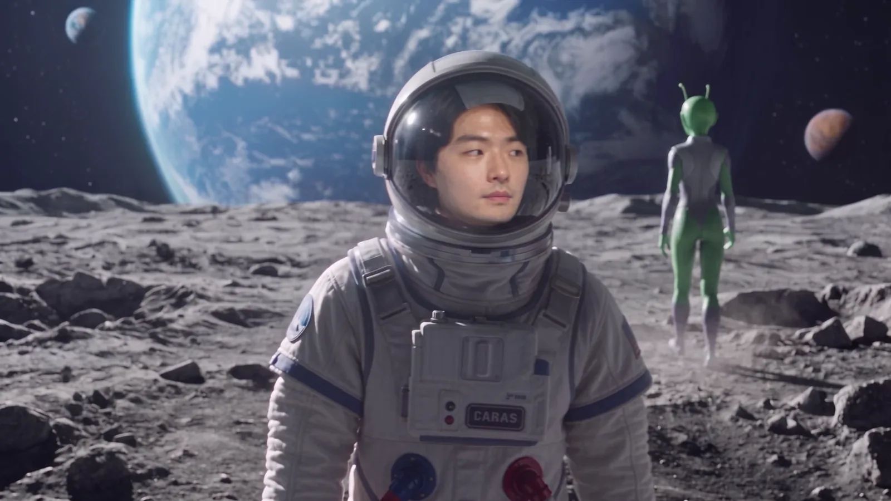
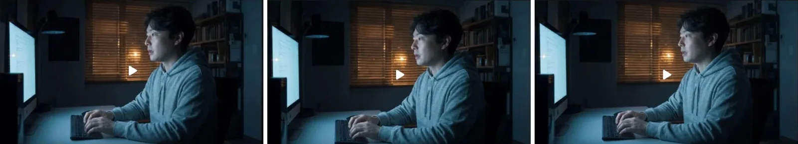
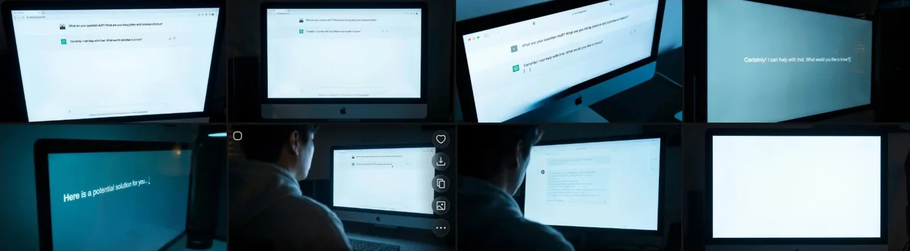
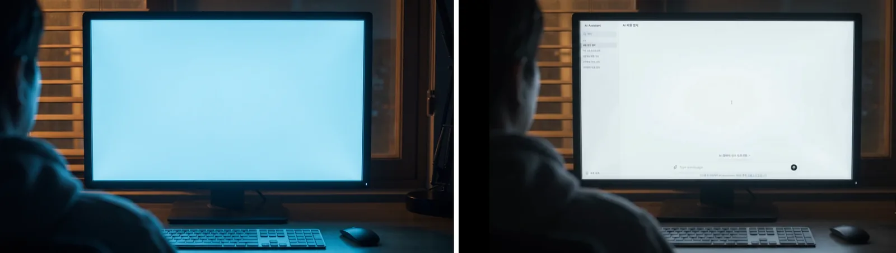
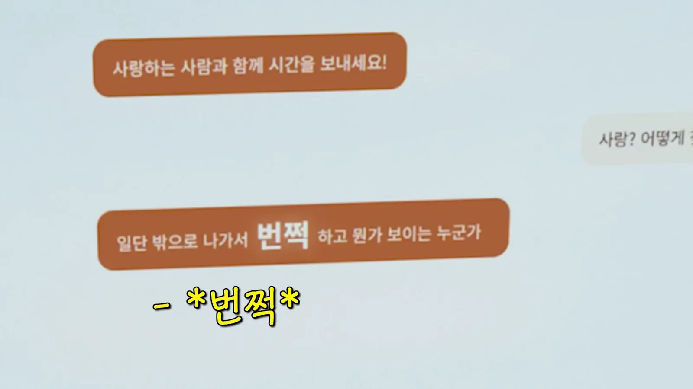
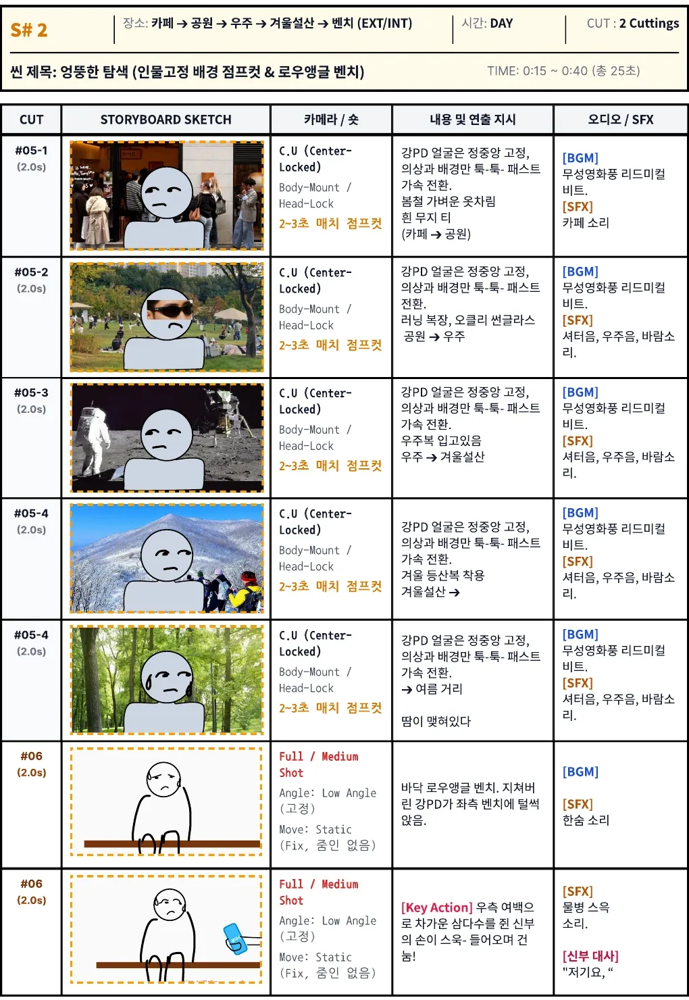
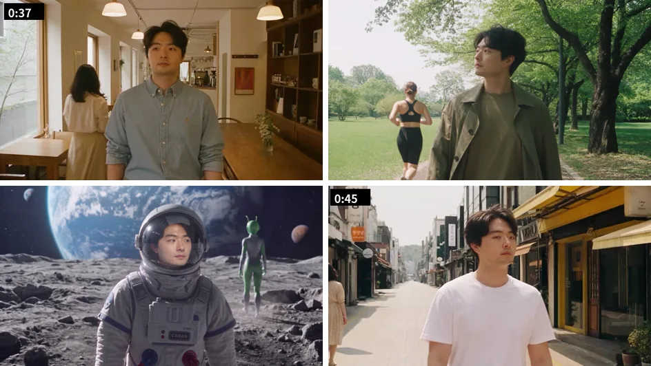
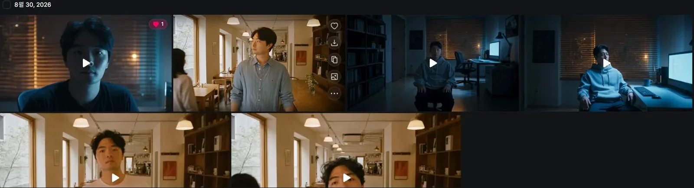
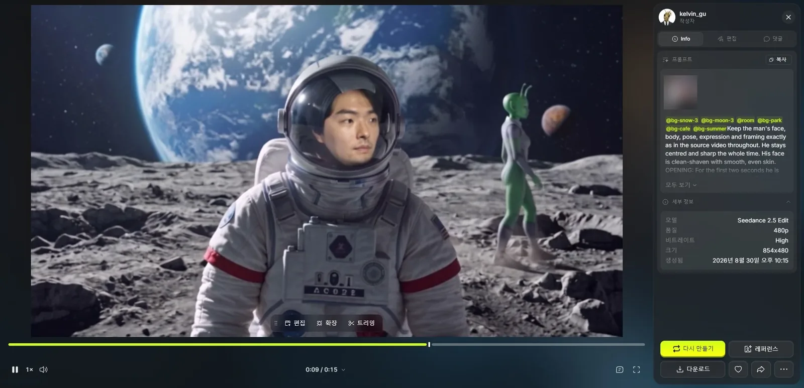

สิ่งที่ AI ทำไม่ได้ ผมไม่ฝืนให้มันทำ **จอมอนิเตอร์ที่ตัวหนังสือต้องเป๊ะผมซ้อนภาพเอา ส่วนฉากที่หน้าต้องอยู่กับที่ผมถ่ายเอง** งานของ AI มีแค่ใส่เสื้อผ้ากับฉากหลังทับลงไป

[ตอนที่ 1](/th/posts/higgsfield-wedding-film/) ว่าด้วยฉากเปิดกับการเตรียม ตอนที่ 2 ตั้งแต่หลังฉากเปิดถึงราววินาทีที่ 47 คือห้องทำงานที่ผมถาม AI เรื่องความสุข กับฉากที่ผมเดินหลงหา "แสงวาบ"


<small>นาที 0:41 ในฉบับเต็ม ดวงจันทร์จากฉากเดินหลง (AI สร้าง) ท่าเดินกับสีหน้ามาจากฟุตเทจที่ผมถ่ายด้วย GoPro ตรงๆ</small>

## AI เขียนบนจอไม่ได้

ฉากห้องทำงานผมทำด้วย Cinema Studio ของ Higgsfield เป็นโมเดลวิดีโอที่เลือกกล้อง เลนส์ รูรับแสง และแนวหนัง แล้วถ่ายออกมาเหมือนหนัง ช็อตหนึ่งผมพิมพ์จากด้านข้างแล้วถามว่า "AI วิธีที่ชัวร์ที่สุดที่คนจะมีความสุขคืออะไร" อีกช็อตถามกลับว่า "ความรักเหรอ แล้วจะหาคนแบบนั้นได้ยังไง"


<small>ช็อตห้องทำงานที่ทำด้วย Cinema Studio</small>

แต่ตัวเอกจริงๆ ของฉากนี้คือจอมอนิเตอร์ จอที่ AI ตอบวิธีมีความสุขต้องอ่านออก เรื่องถึงจะเดินได้ ตอนแรกผมก็จะให้ AI ทำจอนี้ด้วย ทั้งวิดีโอทั้งภาพ เปลี่ยนโมเดลไปเรื่อยๆ สั่งว่า "ซูมใกล้ส่วนที่มีคำตอบของ AI บนจอนี้"


<small>ความพยายามโคลสอัปจอ ตัวหนังสือออกมาเป็นภาษาอังกฤษหรือเละ ภาพสุดท้ายจอว่างเลย</small>

เปลี่ยนโมเดลแล้วก็ยังติดที่เดิม ตัวหนังสือบนจอเป็นภาษาอังกฤษ ไม่ใช่เกาหลี แถมยังเป็นประโยคมั่วๆ อย่าง "What are your question stuff?" ยิ่งใกล้ยิ่งเละ ทุกบรรทัดต้องตรงกับซับ ตัวหนังสือที่แค่คล้ายๆ เลยใช้ไม่ได้

ผมเลยเปลี่ยนวิธี **ทำจอเป็นจอว่าง แล้วทำหน้าจอแชตแยกด้วย HTML อัดไว้ แล้วไปซ้อนในตำแหน่งจอใน Premiere**


<small>ซ้ายคือจอว่างที่ทำไว้ซ้อน (AI สร้าง) ขวาคือผลหลังแปะหน้าจอแชต HTML</small>

เปลี่ยนมาซ้อนภาพแล้วได้ของแถม บทในสตอรีบอร์ดคือ "ออกไปข้างนอกครับ พอเจอเนื้อคู่ตัวจริง จะมีอะไรวาบ! ขึ้นตรงหน้า" แต่ในฉบับเต็มกลายเป็นภาษาแชต "ออกไปข้างนอกก่อน เดี๋ยวจะมีใครสักคนที่มีอะไรวาบขึ้นมา! ลองไปเจอผู้คนดูนะ" HTML คือพิมพ์ตัวหนังสือเอง แก้แบบนี้เลยไม่เสียเครดิต


<small>นาที 0:31 ในฉบับเต็ม "วาบ" กลับมาอีกในฉากม้านั่งกับหอจัดงานแต่ง</small>

## ฉากที่บอกว่า "นี่คือ AI"

ต่อไปคือ S#2 ฉากที่ในสตอรีบอร์ดตั้งชื่อว่า "การค้นหาแปลกๆ" Kang PD ออกไปข้างนอกตามที่ AI บอก แล้วเดินหลงไปคาเฟ่ สวน ดวงจันทร์ ภูเขาหิมะ และถนนหน้าร้อน เพื่อหาแสงวาบ


<small>สตอรีบอร์ด S#2 หน้าล็อกอยู่กลางจอ เสื้อผ้ากับฉากหลังเปลี่ยนทุก 2–3 วินาที</small>

ใส่ฉากนี้ด้วยเหตุผลสองข้อ

| เหตุผล | หน้าที่ |
|---|---|
| ความรู้สึกตามหาแสงวาบ | ให้ความรู้สึกว่ากำลังเดินไปทั่วเพื่อหา "แสงวาบ" ที่ AI พูดถึง |
| ย้ำว่านี่คือวิดีโอ AI | ปีนภูเขาหิมะ ชุดอวกาศบนดวงจันทร์ มนุษย์ต่างดาวเดินผ่าน ใครเห็นก็รู้ว่าถ่ายจริงไม่ได้ ช่วงนี้บอกผ่านจอว่า "นี่ AI นะครับ อย่าเข้าใจผิด" |

เหตุผลข้อสองสำคัญกว่าที่คิด หนังจบแล้วมีแขกผู้ใหญ่หลายคนถามว่าไปถ่ายทั้งหมดนี่ตอนไหน หลายคนคิดว่าเราไปถ่ายจริง แสดงว่าทุกวันนี้แยกวิดีโอ AI กับของจริงยากขนาดนั้น **หนังที่ทำด้วย AI ต้องมีช่วงที่รู้ได้ชัดว่าเป็น AI** ฉากนี้รับหน้าที่นั้น

## หน้าผมถ่ายเอง ให้ AI ทำแค่เสื้อผ้ากับฉากหลัง

กล้องของฉากนี้ในสตอรีบอร์ดเขียนว่า "C.U (Center-Locked), Body-Mount / Head-Lock" หน้าปักอยู่กลางจอเหมือนกล้องผูกติดตัว มีแค่โลกที่เปลี่ยน

ถ้าให้ AI ทำจากศูนย์ ตำแหน่งกับขนาดหน้าจะเปลี่ยนทุกสถานที่ ผมเลยไม่ส่งส่วนนี้ให้ AI **ผมถ่ายเซลฟีเอง 15 วินาที ถือ GoPro เดินไป** แล้วใส่คลิปนั้นเข้า Seedance 2.5 Edit Edit คงการเคลื่อนไหวของวิดีโอต้นฉบับไว้ แล้ววาดใหม่แค่ส่วนที่พรอมต์ระบุ ท่าเดิน สีหน้า และการสั่นของกล้องเลยเหมือนตอนถ่าย ส่วนฉากหลังกับเสื้อผ้าถูกเปลี่ยน คลิปต้นฉบับเห็นในบ้าน เลยไม่ได้ใส่ไว้ที่นี่

พรอมต์แรกเป็นแค่ลิสต์ช็อต วินาทีไหนอยู่ที่ไหนใส่ชุดอะไร ดูผลเทสไปแล้วเติมประโยคทีละประโยค เหตุผลเป็นแบบนี้

| ประโยคที่เติม | เหตุผล |
|---|---|
| "กล้องถือมือและเดินไปด้วยกัน ฉากหลังกับคนใช้การเคลื่อนกล้องเดียวกัน" | กล้องเซลฟีสั่นทุกก้าว ฉากหลังต้องสั่นแบบเดียวกันถึงจะดูเป็นภาพเดียว |
| 2 วินาทีแรกนั่งในห้องทำงาน (@room) แล้วลุกขึ้น | สะพานจาก S#1 ในห้องทำงานไป S#2 |
| "ภาพอ้างอิงใช้สำหรับสภาพแวดล้อม แสง และเสื้อผ้าเท่านั้น ห้ามลอกคน" | จำกัดสิ่งที่เอามาจากภาพสถานที่ให้เหลือสภาพแวดล้อม แสง และเสื้อผ้า |
| ทั้ง 15 วินาทีเป็นตารางเวลา | ลิสต์ช็อตไม่ได้บอกว่าแต่ละวินาทีเกิดอะไร กล้องขยับยังไง |

ส่วนที่สนุกที่สุดในผลลัพธ์คือคนเดินผ่าน ทุกสถานที่ผมเขียนในพรอมต์แค่ว่า "ผู้หญิงเดินผ่าน เห็นจากด้านหลัง" ในคาเฟ่มีผู้หญิงเดินผ่าน ในสวนมีผู้หญิงชุดวิ่งวิ่งผ่าน แต่บนดวงจันทร์มีมนุษย์ต่างดาวสีเขียวเดินผ่าน อย่างที่บอกไป มนุษย์ต่างดาวคือตัวที่ทำให้ชัดว่านี่คือ AI เลยเก็บไว้


<small>จากซ้ายบน: คาเฟ่ สวน ดวงจันทร์ ถนนหน้าร้อน (AI สร้าง) ตำแหน่งหน้ามาจากคลิปเซลฟีต้นฉบับ</small>

ในฉบับเต็ม ฉากเดินหลงเริ่มที่คาเฟ่ตอน 0:36 และจบราว 0:47 จาก 25 วินาทีในสตอรีบอร์ดเหลือราว 10 วินาทีกว่าๆ ช็อตสุดท้ายที่ทรุดนั่งบนม้านั่งส่งต่อไปฉากม้านั่งที่ทำแยกในตอนที่ 3

ถ้าทำฉากเดิมอีก จะทำแบบนี้

| สิ่งที่ทำ | เหตุผล |
|---|---|
| จอที่มีตัวหนังสือ ซ้อนภาพตั้งแต่แรก | จอที่ทุกบรรทัดต้องตรงกับซับ โมเดลไหนก็สร้างให้ถูกไม่ได้ |
| สิ่งที่ต้องนิ่งให้ถ่ายเอง แล้วใช้ Edit | ท่าเดิน สีหน้า ตำแหน่งหน้ามาจากต้นฉบับ AI วาดแค่เสื้อผ้ากับฉากหลัง |
| ตารางเวลาตั้งแต่แรก | ลิสต์ช็อตอย่างเดียวปล่อยจังหวะกับการเคลื่อนกล้องว่างไว้ |
| เขียนบทบาทของภาพอ้างอิงในพรอมต์ | ควรเขียนตั้งแต่แรกว่าจะเอาอะไรจากภาพสถานที่ |

ตอนที่ 3 คือฉากม้านั่ง: ทำไมหน้าผมยิ่งห่างจากตัวผมทุกรอบที่ทำใหม่ และทำไมรูปเดียวที่มุมตรงกันถึงดีกว่าตัวละครที่รวมรูปหลายรูป

## บันทึกลองผิดลองถูก

Cinema Studio ห้องทำงาน: ทุกช็อต 8 วินาที กล้อง Modern เลนส์ Halation Vintage รูรับแสง f/1.4 แนว Drama 2020s ทำ 1080p ตรงๆ ไม่มีเทส 480p ที่ 8 วินาที 720p ใช้ 20 เครดิต 1080p ใช้ 45–72

| เวลา | ความละเอียด | เนื้อหา |
|---|---|---|
| 31 ส.ค. 01:03 | 1080p | พิมพ์จากด้านข้างพร้อมพูดว่า "AI วิธีที่ชัวร์ที่สุดที่คนจะมีความสุขคืออะไร" |
| 2 ก.ย. 01:27 | 1080p | ทำใหม่ด้วยบทเดิม |
| 2 ก.ย. 01:29 | 1080p | "ความรักเหรอ แล้วจะหาคนแบบนั้นได้ยังไง" |

S#1 ในสตอรีบอร์ดยาว 15 วินาที 0:00 ถึง 0:15 แต่มีฉากเปิดมอเตอร์ไซค์ Beat ต่อหน้า และบทสนทนายาวขึ้น ในฉบับเต็มเลยยาวถึง 0:35

ความพยายามทำจอ: 2 กันยายน 01:37 ทำคลิป 480p หนึ่งคลิปด้วย Seedance 2.5 ขอ "บทสนทนากับ AI บนจอเหมือนรูปตัวอย่าง" "เป็นโหมดสว่าง" วันที่ 6 กันยายนลองใหม่ด้วยภาพ ตอน 13:31 และระหว่าง 16:17 ถึง 16:26 ทำโคลสอัปหลายภาพด้วย Nano Banana Pro กับ Seedream 5.0 Pro และตอน 16:28 ลอง Angles ที่เปลี่ยนมุมมองด้วย

ช็อตในสตอรีบอร์ด S#2:

| ช็อต | สถานที่ | ชุด | เสียง |
|---|---|---|---|
| #05-1 | คาเฟ่ → สวน | ชุดหน้าใบไม้ผลิบางๆ เสื้อยืดขาวเรียบ | บีตจังหวะแบบหนังเงียบ เสียงคาเฟ่ |
| #05-2 | สวน → อวกาศ | ชุดวิ่ง แว่น Oakley | เสียงชัตเตอร์ เสียงอวกาศ ลม |
| #05-3 | อวกาศ → ภูเขาหน้าหนาว | ชุดอวกาศ | เหมือนเดิม |
| #05-4 | ภูเขาหน้าหนาว → ถนนหน้าร้อน | ชุดเดินเขาหน้าหนาว | เหมือนเดิม |
| #05-4 | ถนนหน้าร้อน | เหงื่อผุด | เหมือนเดิม |
| #06 | ม้านั่งมุมต่ำจากพื้น | ทรุดนั่งบนม้านั่งซ้ายอย่างเหนื่อย | เสียงถอนหายใจ |

รอบของ Seedance 2.5 Edit (30 สิงหาคม): สถานที่เรียกเอลิเมนต์จากตอนที่ 1 (@bg-cafe, @bg-park, @bg-moon, @bg-snow, @bg-summer)


<small>ประวัติ Seedance 2.5 Edit วันที่ 30 สิงหาคม ภาพย่อคือเฟรมแรก ช่วงแรกเลยเริ่มในคาเฟ่ ส่วนช่วงหลังที่เติมสะพานห้องทำงานแล้วเริ่มในห้องทำงาน</small>

| เวอร์ชัน | เวลา | ความละเอียด | สิ่งที่เปลี่ยน |
|---|---|---|---|
| v1 | 18:10 | 480p | เรียกเอลิเมนต์สถานที่ห้าอัน แล้วเขียนแค่ลิสต์ช็อตตามเวลา เช่น "0.0 วิ คาเฟ่ เสื้อยืดขาว → 1.6 วิ สวน ชุดวิ่ง → 3.2 วิ ดวงจันทร์ ชุดอวกาศ…" |
| v2 | 19:30 | 480p | ประโยคใช้การเคลื่อนกล้องร่วมกัน |
| v3 | 21:17 | 480p | 2 วินาทีในห้องทำงาน "ห้ามลอกคน" |
| v3 อีกรอบ | 21:22 | 480p | ทำใหม่ด้วยพรอมต์เดิม |
| v4 | 22:15 | 480p | เขียนทั้ง 15 วินาทีใหม่เป็นตารางเวลา |
| v4 สุดท้าย | 22:41 | 1080p | เปลี่ยนเอลิเมนต์หิมะกับดวงจันทร์เป็น @bg-snow-5 และ @bg-moon-4 แล้วทำฉบับสุดท้าย |

ต้นพรอมต์ v4:

```
@bg-snow-3 @bg-moon-3 @room @bg-park @bg-cafe @bg-summer
Keep the man's face, body, pose, expression and framing exactly
as in the source video throughout. He stays centred and sharp
the whole time. His face is clean-shaven with smooth, even skin.
OPENING: For the first two seconds he is ...
```


<small>หน้ารายละเอียด v4 480p โมเดล ความละเอียด ขนาด และเวลาอยู่ด้านขวา ภาพย่อวิดีโอต้นฉบับในแผงผมเบลอไว้</small>

| หัวข้อ | คำสั่ง |
|---|---|
| หน้า | หน้า ตัว ท่าทาง สีหน้า และเฟรมตามต้นฉบับเป๊ะ อยู่กลางจอและคมจนจบ โกนหนวดเกลี้ยง ผิวเรียบ |
| ฉากเปิด | นั่งอาบแสงจอ ลุกขึ้นที่วินาทีที่ 2 กล้องระดับสายตา ห้ามมุมต่ำ |
| เปลี่ยนสถานที่ | หลังวินาทีที่ 4 ห้าสถานที่ตัดชนกัน แต่ละที่กำหนดเวลา |
| เสื้อผ้ากับแสง | เขียนเสื้อผ้ากับแสงแยกแต่ละสถานที่ |
| สายตา | "กำลังหาแสงวาบ" มองซ้ายไปขวาแค่สองครั้ง |
| คนเดินผ่าน | ทุกที่มีผู้หญิงเดินผ่านเห็นจากด้านหลัง คนละคนทุกครั้ง ไม่มีผู้ชาย |
| ท่าเดิน | ยิ่งเปลี่ยนที่ยิ่งเดินเหนื่อยขึ้น |

เครดิต: รอบสุดท้าย 1080p รอบเดียว 132.73 เครดิต เทส 480p เริ่มที่ 19.26 รอบนี้รอบเดียวเลยกินไปเกือบหมด ตามประวัติธุรกรรม วันที่ 30 สิงหาคมเครดิตออกไปเกือบ 300
