ตอนใส่หน้าผมเข้าวิดีโอ AI **รูปอ้างอิงรูปเดียวที่มุมตรงกับช็อต ออกมาเหมือนผมกว่าตัวละครที่ยัดรูปหน้าตรง ด้านข้าง มุมบน มุมล่างไว้เต็มไปหมดมาก** ส่วนหน้าที่อยู่ไกลและเล็ก ทำแบบไหนก็ออกมาไม่ดี

ผมรู้เรื่องนี้จากฉากม้านั่งในหนังงานแต่งของเรา รันภาพมุมสูงภาพเดียวไปเจ็ดรอบ และสร้างช็อตมุมต่ำตอนถูกยื่นน้ำให้แปดรอบในวันที่ 6 กันยายนวันเดียว ที่ต้องพยายามขนาดนี้เพราะองค์ประกอบมุมต่ำอธิบายเป็นคำยาก และยิ่งรันใหม่ หน้าก็ยิ่งไม่เหมือนผม หลักการเขียนพรอมต์อย่างการใช้สัดส่วนจอแทนเมตรก็ตกผลึกในฉากนี้

[ตอนที่ 1](/th/posts/higgsfield-wedding-film/) คือสตอรีบอร์ดกับการเตรียมตัว [ตอนที่ 2](/th/posts/higgsfield-wedding-film-2/) คือห้องทำงานกับฉากเดินหลง ตอนที่ 3 คือช่วงประมาณ 0:47 ถึง 1:04 ในฉบับเต็ม ตอนที่ผมเดินหลงจนเหนื่อยแล้วนั่งลงบนม้านั่ง และภรรยายื่นน้ำให้ วิดีโอผมเช็กจากหน้ารายละเอียดในบัญชี Higgsfield ส่วนภาพเจ็ดรอบเช็กจากบันทึกแชตกับ Claude วันที่ 31 สิงหาคม

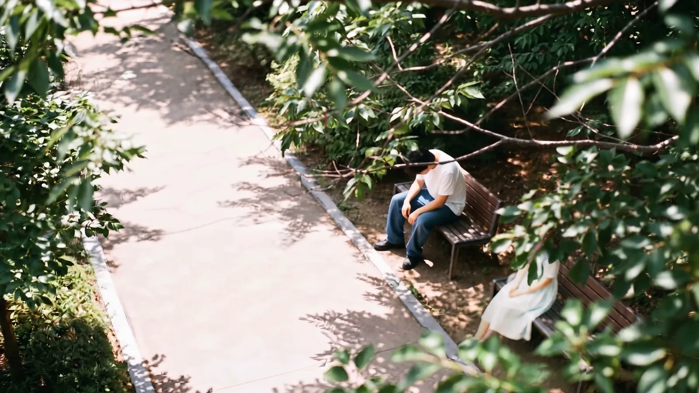
<small>นาทีที่ 0:50 ในฉบับเต็ม ม้านั่งมุมสูง (สร้างด้วย AI) องค์ประกอบภาพเดียวนี้ใช้ไปเจ็ดรอบ</small>

## ฉากม้านั่งวางกล้องไว้สามตัว

ในสตอรีบอร์ด ม้านั่งคือคัตสุดท้ายของ S#2 (#06) และเป็นจุดเริ่มการพบกันใน S#3 ผมเดินหลงจนเหนื่อยแล้วทิ้งตัวลงบนม้านั่ง คนที่นั่งข้าง ๆ ยื่นขวดน้ำให้ คนนั้นคือภรรยาผม

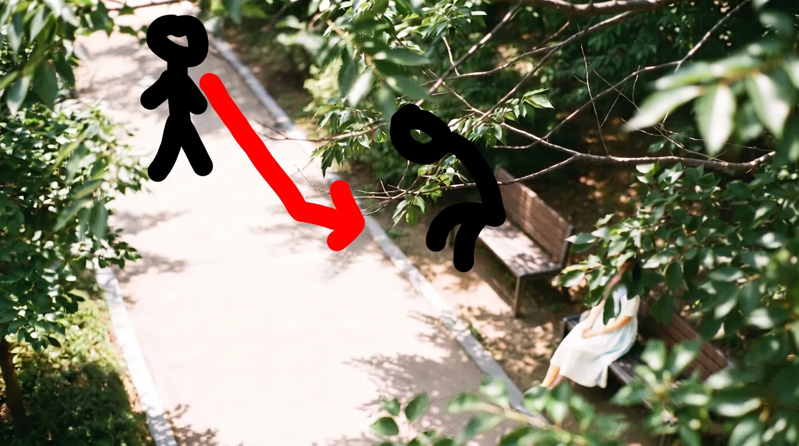
<small>การออกแบบการเคลื่อนไหวฉาก 3 วาดการเดินจากทางเดินไปม้านั่งลงบนภาพ AI เอง</small>

ผมแบ่งฉากนี้เป็นกล้องสามตัว

| กล้อง | ตำแหน่ง | หน้าที่ |
|---|---|---|
| A มุมสูง | มองลงมาจากบนต้นไม้ | ผมเดินมานั่ง กับภรรยาที่หน้าถูกใบไม้บัง |
| B มุมต่ำ | ระดับเบาะม้านั่ง | มือถือขวดน้ำยื่นเข้ามาจากนอกจอหาผมที่นั่งเหนื่อย |
| C มุมมองของผม | ระดับสายตาผม | มองขวดน้ำที่ยื่นมา เงยหน้าขึ้น แล้วหน้าภรรยาก็ปรากฏ (#07) |

หลัง C เลขสตอรีบอร์ดต่อไปเรื่อย ๆ #08 หน้าผมหันมางง ๆ #09 ซูมเข้าดวงตากะทันหัน #10 มอนทาจในดวงตา #11 ซูมออกกลับมาเป็นหน้าที่ยิ้ม มอนทาจ #10 เป็นรูปจริงของเรา เลยไม่ได้ใส่ไว้ตรงนี้

ใน A ผมให้ใบไม้บังหน้าภรรยา เพื่อให้หน้าเธอปรากฏครั้งแรกใน C หลังขวดน้ำพอดี

## ภาพมุมสูงภาพเดียว เจ็ดรอบ

ช็อต A เริ่มจากภาพ ลำดับคือล็อกภาพให้ได้ก่อน แล้วค่อยทำวิดีโอโดยใช้ภาพนั้นเป็นเฟรมแรก ภาพสร้างด้วย Nano Banana Pro ตีสี่ตีห้าวันที่ 31 สิงหาคม ผมรันไปประมาณเจ็ดรอบในแชตเดียว

| รอบ | สิ่งที่เปลี่ยน | ผล |
|---|---|---|
| 1 | ใส่ผลของเมื่อวานเป็นภาพอ้างอิง แล้วขอสี่อย่างพร้อมกัน "เปิดทางเดิน ใช้ใบไม้มุมขวาบนบังเจ้าสาว ผมดำ ชุดเดรสขาว" | เปลี่ยนแค่สีผม ประโยคที่ให้คงภาพอ้างอิงไว้ทับคำสั่งอื่นหมด |
| 2 | ขั้นที่ 1 ของวิธีสองขั้น ลบคนออก เหลือแค่ทางเดินกับใบไม้ | ม้านั่งจากสองตัวเหลือตัวเดียว กล้องเข้าใกล้ขึ้น และใบไม้ไม่บังม้านั่ง อย่างน้อยม้านั่งต้องยาวพอให้มีที่ให้ผมนั่ง |
| 3 | สร้างใหม่ สูง 4 ม. ห่าง 8 ม. 25 องศา 35 มม. ม้านั่งสองตัว | ม้านั่งสองตัวหันหน้าเข้าหากันแบบหน้าหลัง แบบนั้นเธอยื่นขวดจากด้านข้างไม่ได้ ที่ต้องการคือ "เรียงข้างกันซ้ายขวาในจอ" ไม่ใช่ "หน้าหลัง" |
| 4 | ม้านั่งตัวเดียววางขวาง เจ้าสาวอยู่ขอบขวาสุดของจอ 3.5 ม. 7 ม. 27 องศา | ใบไม้ไม่บังอีก คำว่า `cover` อ่อนไป |
| 5 | ย้ายดวงอาทิตย์จากหลังเจ้าสาวไปหลังกล้อง (แสงตามหน้า) ลบประโยคอย่าง "เธอตัวเล็ก" และประโยคสมมุติ | แสงตามหน้า ม้านั่งขวาง 27 องศาถูกหมด แต่ยิ่งรันยิ่งเข้าใกล้ เมตรใช้ไม่ได้ผล |
| 6 | ตัดมุมออก เหลือแค่ความสูงกับระยะแนวนอน 12 ม. คนสูง 1/8 ของจอ ม้านั่งกว้าง 1/4 ของจอ ทางเดินอยู่ 2/3 ล่าง ใบไม้อยู่ 1/4 ขวาบน "ทุกอย่างเหนืออกอยู่หลังใบไม้" | ระยะ ตำแหน่ง ต้นไม้พอดีเป๊ะ ทางเดินออกมาเฉียงดูแปลก |
| 7 | ทางเดิน `roughly horizontally` ทางเท้าลายเดียว | ม้านั่งกลายเป็นสองตัวอีก เลยแก้เป็น `Exactly one bench` และที่ว่างเป็น `wide enough for another person to sit down` |

รอบที่ 4 ผมเปลี่ยนประโยคใบไม้ จาก "ใบไม้บังหน้าเธอ" เป็นเขียนเป็นสภาพ `Her face is hidden behind these leaves` คำอย่าง `clearly visible` ตัดออก เพราะอาจกลับไปดึงโฟกัสไปที่ตรงนั้น

ตำแหน่งดวงอาทิตย์ในรอบที่ 5 ก็มีความหมาย แรก ๆ ผมวางดวงอาทิตย์ไว้หลังภรรยา แต่แสงย้อนจำเป็นแค่ในช็อตมุมมอง C ตอนที่เธอปรากฏตัวบังดวงอาทิตย์ A กับ B เลยเปลี่ยนเป็นแสงตามหน้า ให้ดวงอาทิตย์อยู่หลังกล้อง

แก่นของพรอมต์รอบที่ 7 เป็นแบบนี้

```
The camera is 3.5 metres above the ground. The horizontal distance
from the camera to the bench is 12 metres.
A paved walking path runs roughly horizontally across the frame ...
The empty path fills the lower two thirds of the frame.
Exactly one wooden park bench ... occupies about one quarter of the frame width.
... her figure occupies about one eighth of the frame height.
The left half of the bench seat is clearly empty and unoccupied,
wide enough for another person to sit down beside her.
Everything above her chest is hidden behind these leaves.
```

ถึงอย่างนั้นก็มีอย่างหนึ่งที่ไม่สำเร็จจนจบ ใบไม้ไม่บังภรรยาแม้แต่พิกเซลเดียว ทุกรอบใบไม้อยู่นิ่ง ๆ ที่มุมขวาบนของจอ โมเดลดูเหมือนวาดใบไม้เป็นส่วนหนึ่งของต้นไม้ฉากหลัง ไม่ใช่ฉากหน้า ผมถามด้วยว่ากำหนดลำดับการสร้างได้ไหม แต่ไม่มีตัวเลือกแบบนั้น

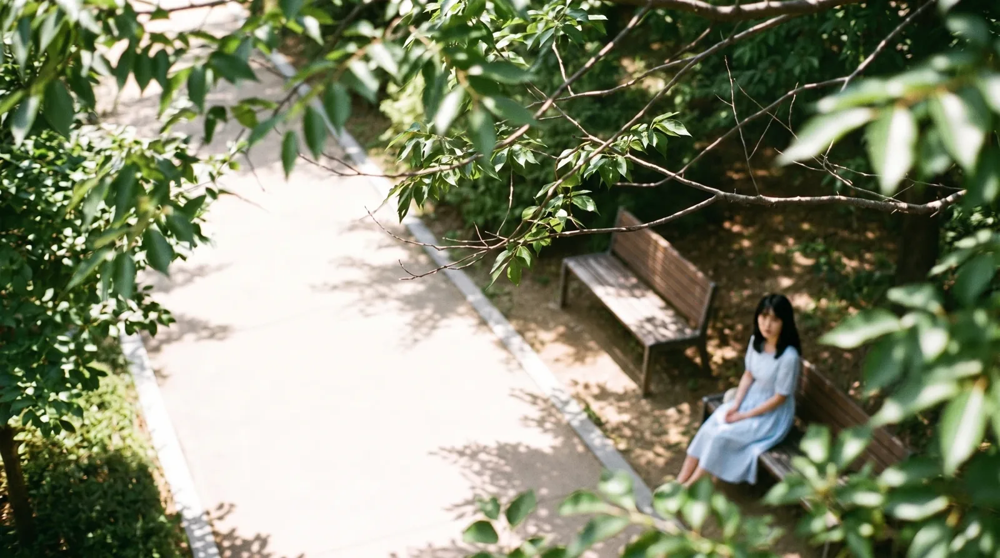
<small>รอบที่ผมเลือกเองจากรายการประวัติตอนเหนื่อยแล้ว (สร้างด้วย AI) ชุดเดรสสีน้ำเงิน และใบไม้ไม่บังภรรยา</small>

สุดท้ายผมเปิดรายการแล้วเลือกเอง ชุดเป็นสีน้ำเงินก็จริง แต่ระยะ ม้านั่ง และทางเดินดีที่สุด ส่วนใบไม้ตัดสินใจไปแก้ใน Premiere โดยเอาฟุตเทจใบไม้จริงมาทับ ภาพที่เลือกเก็บงานด้วย Gemini แล้วอัปกลับเข้า Higgsfield กลายเป็นเฟรมแรกของวิดีโอ A

วิดีโอทำตอนตีสี่ห้าสิบเก้าวันที่ 6 กันยายน ช็อตนี้ช็อตเดียวที่ใช้ Seedance 2 ไม่ใช่ Seedance 2.5 พรอมต์คือ "@강준구-cinema เดินมาตามทางแล้วทิ้งตัวลงบนม้านั่ง กล้องนิ่ง" 1080p ในประวัติมีแค่รอบนี้รอบเดียว

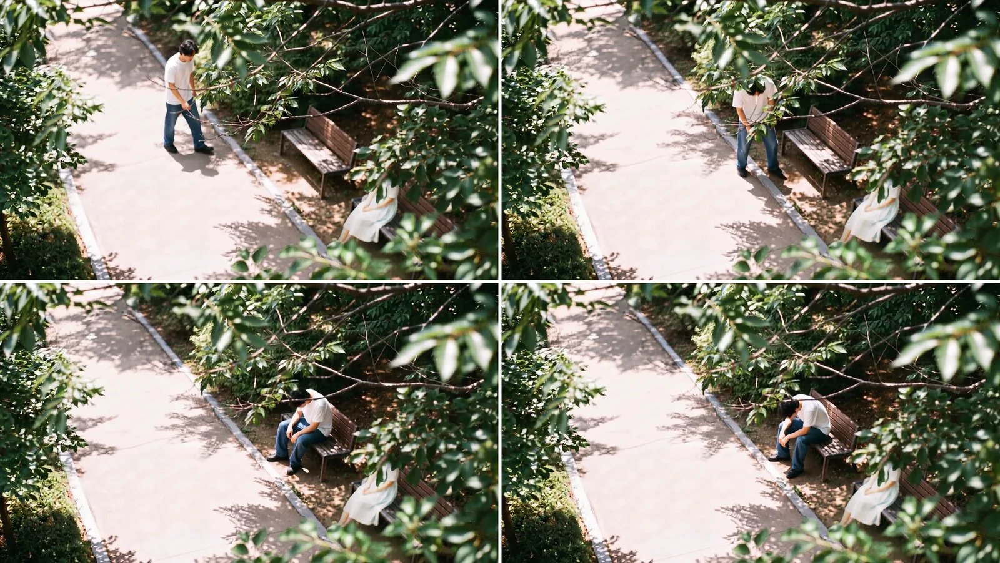
<small>นาทีที่ 0:48 ถึง 0:51 ในฉบับเต็ม (สร้างด้วย AI) ในฉบับเต็มชุดเดรสเป็นสีขาว และใบไม้ด้านหน้าบังภรรยาไว้</small>

ในฉบับเต็ม ช็อตนี้ยาวราว 4 วินาที ตั้งแต่ 0:48 ถึง 0:51 ภาพเดียวที่รันเจ็ดรอบกลายเป็น 4 วินาที

## มุมต่ำตอนยื่นน้ำ วันที่ 6 กันยายน แปดรอบ

ช็อต B มองผมจากระดับเบาะม้านั่ง พนักพิงยื่นยาวจากขวาของจอ ผมนั่งเหนื่อยอยู่ปลายสุด และมือถือขวดน้ำยื่นเข้ามาจากนอกจอด้านขวา เจ้าของมือคือภรรยาที่อยู่นอกจอ นั่งที่ปลายม้านั่งฝั่งกล้อง

พอตัดสินใจ A ได้ ในแชตก็มีเรื่องจัดพื้นที่นี้ให้ตรงกัน ใน A ภรรยานั่งขอบขวาสุดของจอ ผมนั่งทางซ้าย ใน B กล้องไปอยู่ที่ที่นั่งของภรรยาแล้วมองผมตามแนวยาวของม้านั่ง ตรรกะถูก แต่คนดูอาจสับสนซ้ายขวา

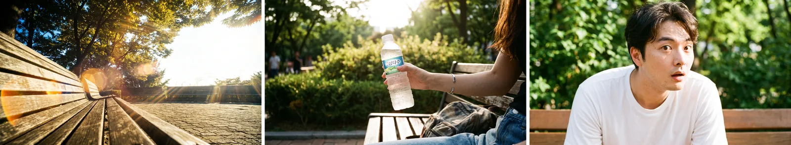
<small>ภาพฉากม้านั่งที่ทำไว้ก่อนวันที่ 30 สิงหาคม (สร้างด้วย AI) ม้านั่งว่างมุมต่ำ มือถือขวดน้ำ สีหน้าตกใจ</small>

วิดีโอมุมต่ำสร้างแปดรอบในวันที่ 6 กันยายน ตั้งแต่ตีห้าถึงแปดโมงยี่สิบ ใช้ Seedance 2.5 ทั้งหมด

| เวลาที่สร้าง | ความละเอียด | สิ่งที่เปลี่ยน |
|---|---|---|
| 05:08 | 480p | พรอมต์ภาษาอังกฤษ วินาที 3.8–4.5 มือถือขวดจากขวา วินาที 4.5–5.5 มองขวด ไม่ตกใจ |
| 05:45 | 480p | สร้างใหม่ |
| 05:53 | 1080p | สร้างใหม่ |
| 06:12 | 480p | เปลี่ยนเป็นพรอมต์ภาษาเกาหลีที่ผมเขียนเอง "เสื้อยืดขาวแขนสั้น ยีนส์… กระพือเสื้อเหมือนร้อน… มือยื่นน้ำจากขวาของจอ… ไม่ตกใจ" |
| 06:20 | 1080p | การกระพือเป็น "เบา ๆ ช้า ๆ" |
| 07:26 | 1080p | เพิ่ม "ทำตามองค์ประกอบกล้องในภาพอ้างอิงอย่างเคร่งครัด" |
| 07:48 | 480p | เพิ่มตารางเวลา 0–2 วิ ถอนหายใจ 2–6 วิ กระพือเสื้อ 6–8 วิ มือถือขวด |
| 08:20 | 1080p | ฉบับสุดท้ายตามตารางเวลาข้างบน |

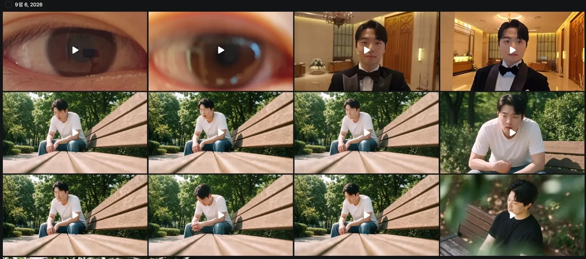
<small>ประวัติวันที่ 6 กันยายน สองแถวกลางคือช็อตม้านั่งมุมต่ำ องค์ประกอบเหมือนกัน แต่หน้าต่างกันนิดหน่อยทุกรอบ คลิปดวงตากับทักซิโด้แถวบนเป็นฉากของตอนที่ 4</small>

ที่รันถึงแปดรอบมีเหตุผลสองข้อ ข้อแรก มุมต่ำเองอธิบายยาก กล้องอยู่ระดับเบาะม้านั่ง พนักพิงยื่นยาวจากขวาของจอ ผมนั่งปลายสุด มือยื่นเข้ามาจากนอกจอฝั่งกล้อง อธิบายพื้นที่นี้เป็นคำไม่ง่ายเลย การเพิ่ม "ทำตามองค์ประกอบกล้องในภาพอ้างอิงอย่างเคร่งครัด" ตอน 07:26 ก็เพื่อโยนองค์ประกอบที่เขียนไม่ได้ไปให้ภาพจัดการ ข้อสองคือหน้า ระหว่างแก้จังหวะมือเข้ากับปฏิกิริยา ยิ่งรันหน้าก็ยิ่งไม่ใช่ผม

"ไม่ตกใจ" อยู่ในพรอมต์ตั้งแต่รอบแรกถึงรอบสุดท้าย ในช็อตนี้ผมเป็นแค่คนเหนื่อย ปฏิกิริยาหันมามองด้วยความตกใจเป็นหน้าที่ของ #08 ข้างหลัง

รันภาษาอังกฤษสามรอบแล้วเปลี่ยนเป็นพรอมต์ภาษาเกาหลีที่ผมเขียนเอง สิ่งสุดท้ายที่ใส่คือตารางเวลา เหมือนฉากเดินหลงในตอนที่ 2 พอเขียนว่าวินาทีไหนทำอะไร จังหวะมือเข้าก็ลงตัว

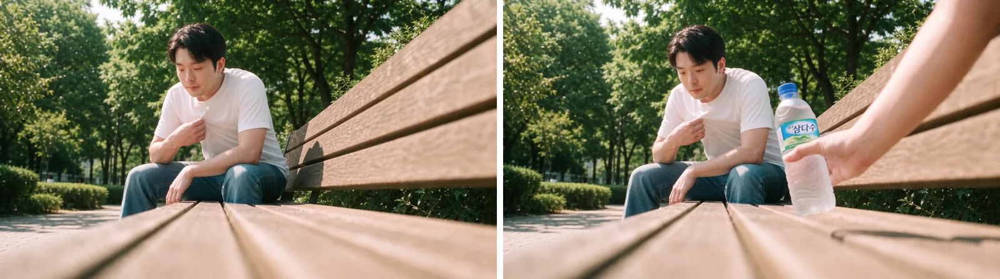
<small>นาทีที่ 0:52 กับ 0:54 ในฉบับเต็ม (สร้างด้วย AI) มือถือขวดน้ำยื่นเข้ามาข้างผมที่กำลังกระพือเสื้อ</small>

## ใบหน้า รูปเดียวที่มุมตรงกันดีกว่าตัวละคร

สิ่งที่ได้มากที่สุดจากฉากม้านั่งคือเรื่องรูปอ้างอิงใบหน้า

ใน Higgsfield มีเอลิเมนต์ตัวละครที่รวมรูปหน้าผมไว้หลายรูป @강준구 มี 7 รูป ตัวละคร Soul @강준구-cinema มี 17 รูปต่างมุมต่างที่ ทั้งคาเฟ่ ร้านอาหาร และถ่ายพรีเวดดิง (ใส่หน้าจอไว้ใน[ตอนที่ 1](/th/posts/higgsfield-wedding-film/)) แค่เรียกชื่อในพรอมต์ก็วาดหน้านั้นให้ วิดีโอมุมสูงเรียก @강준구-cinema พรอมต์มุมต่ำวันที่ 6 กันยายนก็เริ่มด้วยการเรียกตัวละคร อย่าง "@char_jungu เสื้อยืดขาวแขนสั้น ยีนส์…" สะดวกก็จริง แต่ในฉากม้านั่งไม่ค่อยได้ผล


<small>ตัวละคร Soul @강준구-cinema ที่ใส่รูป 17 รูป ใส่เยอะไม่ได้ทำให้หน้าเหมือนผมขึ้น</small>

ปัญหาแรกคือหน้าที่อยู่ไกล ในช็อตอย่างมุมสูงที่คนสูงแค่ประมาณ 1/8 ของจอ หน้าออกมาไม่ดี มุมต่ำก็เหมือนกัน ผมนั่งอยู่ลึกเข้าไปในจอ หน้าเลยไม่ใหญ่ แถมยิ่งรัน หน้าก็ค่อย ๆ ไหลไปทางที่ไม่ใช่ผม

สิ่งที่ได้รู้คือแบบนี้ แทนที่จะเรียกตัวละครที่ผสมหลายมุม ใส่รูปหน้าผมรูปเดียวที่ถ่ายมุมใกล้กับช็อตที่กำลังทำเป็นภาพอ้างอิง หน้าออกมาดีกว่ามาก ผสมหลายมุมแล้วดูเหมือนแต่ละมุมถูกเฉลี่ยจนเป็นหน้าที่ไม่ใช่ใคร หลัก "จับคู่มุม" ที่เขียนไว้ใน[ตอนที่ 1](/th/posts/higgsfield-wedding-film/) มาจากฉากนี้

| วิธี | ผล |
|---|---|
| เอลิเมนต์ตัวละคร (รวมหลายรูปอย่าง @강준구 7 รูป @강준구-cinema 17 รูป) | เรียกใช้ง่าย ถ้าหน้าเล็กหรือรันซ้ำ ๆ จะค่อย ๆ ไม่ใช่ผม |
| รูปหน้ารูปเดียวที่ตรงกับมุมของช็อต | หน้าออกมาดีกว่า ต้องเหนื่อยเลือกรูปให้ตรงทุกช็อต |
| หน้าเล็กที่อยู่ไกล | ทำแบบไหนก็ออกมาไม่ดี ช็อตที่ต้องโชว์หน้าให้ถ่ายใกล้ |

## มุมมองผมที่มองขวดน้ำ กับหน้าที่หันแค่หัว

ช็อต C (#07) ทำก่อน ตอนตีสามวันที่ 2 กันยายน เร็วกว่า B สี่วัน

ในแชตผมเรียกช็อตนี้ว่า "POV ขวดน้ำ" แล้วมันก็คลาดกันครั้งหนึ่ง Claude เข้าใจว่าเป็นมุมมองของขวดแล้วเขียนพรอมต์แบบนั้น ที่ผมหมายถึงคือ **สายตาผมที่มองขวดน้ำที่ยื่นมา** มือคือมือภรรยา กล้องที่ไล่ขึ้นจากขวดไปหน้าภรรยาคือสายตาผมที่เงยขึ้น พอแก้ตรงนี้ได้ ตำแหน่งขวดกับมือถึงเข้าที่

คำว่า `soft veil` ก็ตัดออก ตั้งใจหมายถึงแสงฟุ้งนุ่ม ๆ แต่เป็นวิดีโองานแต่ง เลยเสี่ยงถูกอ่านเป็นผ้าคลุมหน้าเจ้าสาว แสงฟุ้งผมเขียนเป็น `lens flare` กับ `bloom`

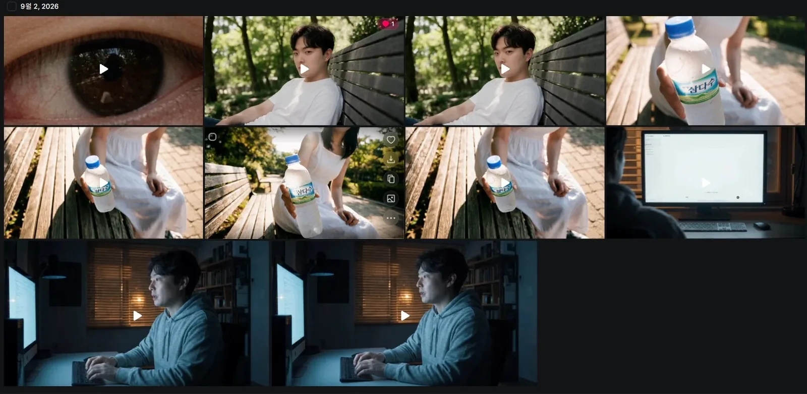
<small>ประวัติวันที่ 2 กันยายน แถวกลางกับขวาบนคือช็อตมุมมองขวดน้ำ สองอันตรงกลางแถวบนคือหน้าผมที่หันมา (#08)</small>

ช็อตมุมมองขวดน้ำเริ่มจากภาพ ภรรยายื่นขวดน้ำ มองจากระดับสายตาผม รูปอ้างอิงหน้าภรรยาใส่ทั้งสามรูปตามที่เขียนในตอนที่ 1

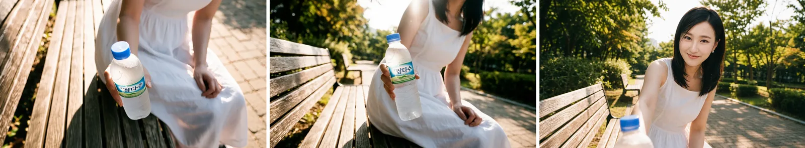
<small>ขั้นภาพของช็อตมุมมองขวดน้ำ (สร้างด้วย AI) หน้าเป็นหน้าที่ AI สร้าง</small>

วิดีโอทำสี่รอบ

| เวลาที่สร้าง | โมเดล | ความละเอียด | สิ่งที่เปลี่ยน |
|---|---|---|---|
| 03:06 | Cinema Studio Video | 480p | ลองครั้งแรก |
| 03:13 | Seedance 2.5 | 480p | เปลี่ยนเป็นตารางเวลา 0–1 วิ ขวดน้ำ 1–2.2 วิ แพนขึ้นตามแขน 2.2–3.3 วิ แฟลร์แสงย้อน 3.3–4.2 วิ ภรรยาโน้มตัวบังดวงอาทิตย์ 4.2–6 วิ ยิ้มและพูด |
| 03:19 | Seedance 2.5 | 480p | เพิ่ม "he is taller than she" |
| 03:25 | Seedance 2.5 | 1080p | ฉบับสุดท้าย |

โครงสร้างที่ตั้งไว้วันที่ 1 กันยายนคือช็อตต่อเนื่องเดียวยาว 12 วินาที ไม่แบ่งเป็นสองคัต ใส่แร็กโฟกัสจากขวดไปภรรยาไว้ในช็อตเดียว และเฟรมสุดท้ายให้แฟลร์หายไปจนหน้าชัด พรอมต์ Seedance จริงย่อเหลือตารางเวลา 6 วินาทีอย่างข้างบน

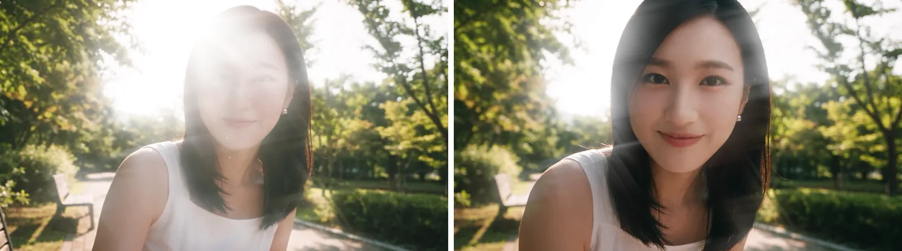
<small>นาทีที่ 0:58 กับ 0:59 ในฉบับเต็ม (สร้างด้วย AI) หน้าภรรยาปรากฏออกมาจากแฟลร์</small>

ต่อไปคือ #08 ทำวันเดียวกันสองรอบ ตอน 03:47 กับ 03:54 ด้วย Seedance 2.5 1080p เป็นช็อตที่ค่อย ๆ เข้าใกล้หน้างง ๆ ที่หันแค่หัว แล้ววินาทีที่ 2–3 ก็ดูดเข้าดวงตาวูบ

ท่าทางสำคัญ ลำตัวกับไหล่หันตรงไปตามม้านั่ง หันแค่หัวมาทางกล้อง ต้องเห็นคอที่บิด ถ้าหันทั้งตัวจะกลายเป็นคนที่คุยกันอยู่แล้ว ต้องหันแค่หัว ถึงจะได้จังหวะที่เพิ่งหันมามองด้วยความตกใจ ผมเขียนว่าปากเผยอนิดหน่อย `not smiling`

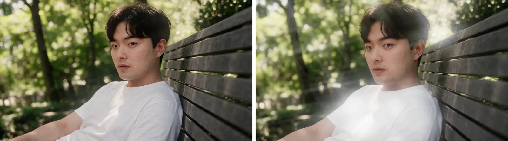
<small>นาทีที่ 1:00 กับ 1:01 ในฉบับเต็ม (สร้างด้วย AI) ตัวหันตรงไปตามม้านั่ง หันแค่หัว</small>

#11 กลับกัน คือช็อตซูมออกจากดวงตา ทำครั้งแรกตอน 03:55 วันที่ 2 กันยายน 1080p แล้วทำใหม่วันที่ 3 กันยายนตอน 00:17 (480p) 00:28 กับ 00:41 (1080p) บทพูดคือ "ครับ ได้เลย" สายตาไม่ได้มองเลนส์ แต่ผ่านข้างเลนส์ไปด้านบนหลังกล้อง เงยมองภรรยาที่ยืนอยู่ สีหน้ายิ้มบาง ๆ

## หลักการพรอมต์ที่ตกผลึกจากฉากม้านั่ง

วันที่ 1 กันยายนตอนเปิดแชตใหม่ ผมสรุปการลองผิดลองถูกจนถึงตอนนั้นเป็นหลักการแล้วส่งต่อ ส่วนใหญ่มาจากมุมสูงเจ็ดรอบ ส่วนมุมต่ำแปดรอบเกิดทีหลังในวันที่ 6 กันยายน

| หลักการ | รายละเอียด |
|---|---|
| สัดส่วนจอแทนเมตร | เขียน 4 ม. 8 ม. 12 ม. ก็ยังเข้าใกล้ขึ้นทุกรอบ ต้องเขียนเป็นเศษส่วน อย่างคนสูง 1/8 ของจอ ม้านั่งกว้าง 1/4 ของจอ ถึงได้ผล |
| ใช้แค่ความสูงกับระยะแนวนอน | เขียนความสูง มุม และระยะครบจะชนกันเอง ให้ความสูงกับระยะแนวนอน มุมจะตามมาเอง |
| อย่าสั่งให้ซ่อน | กองคำ `not visible`, `heavily shaded`, `face is not readable` ทำให้คนทั้งตัวเละ เขียนเป็นสภาพ อย่าง `Her face is hidden behind these leaves` |
| ฉากหน้าใช้ระยะจากเลนส์ | จะให้ใบไม้เป็นฉากหน้า ต้องตอกระยะจากเลนส์ อย่าง `just 30cm from the lens, heavily blurred` ไม่งั้นจะกลายเป็นต้นไม้ฉากหลัง |
| ทางเดิน `roughly horizontally` | ถ้าเขียน `diagonally` จะได้มุมครึ่ง ๆ กลาง ๆ |
| ห้ามประโยคสมมุติ | `Two people could sit side by side` จะถูกเมินหรือวาดคนสองคน ใช้ `Exactly one bench` และที่ว่างเป็น `wide enough for another person to sit down` |
| วิธีสองขั้น | ใช้ตอนภาพอ้างอิงชนะตัวหนังสือ ทำผลที่ลบองค์ประกอบปัญหาออกก่อน แล้วใช้ผลนั้นเป็นภาพอ้างอิงเติมเฉพาะที่ต้องการ เครดิตสองเท่า แต่ชัวร์กว่าแก้วนไปเรื่อย ๆ |
| รวมสถานที่กับคนในภาพ | อย่าโยนสถานที่กับคนแยกกันตอนทำวิดีโอ รวมเป็นภาพเดียวก่อนแล้วค่อยทำให้ขยับ |
| ใบหน้า รูปเดียวมุมตรงกัน | รูปหน้ารูปเดียวที่ตรงกับมุมช็อตดีกว่าตัวละครที่รวมหลายมุม ผสมมุมแล้วถูกเฉลี่ยจนหน้าพัง |

ใบไม้บังหน้าเป็นเรื่องเดียวที่หลักการพวกนี้แก้ไม่ได้ วิธีตอกระยะจากเลนส์แค่จดไว้ ที่ทำจริงคือจบขั้นภาพแล้วไปใช้วิธีอื่น

ถ้าทำฉากเดิมใหม่ ผมจะทำแบบนี้

| สิ่งที่ทำ | เหตุผล |
|---|---|
| ใบหน้าใช้รูปเดียวมุมตรงกันตั้งแต่แรก | รันด้วยเอลิเมนต์ตัวละครแล้วหน้าค่อย ๆ ไม่ใช่ผมทุกรอบ |
| องค์ประกอบใช้สัดส่วนจอตั้งแต่แรก | มุมสูงรอบ 3–5 เขียนเมตรกับมุม ระยะไม่เคยตรง |
| แก้แค่อย่างเดียวต่อรอบ | รอบ 1 เปลี่ยนสี่อย่างพร้อมกัน ได้ผลอย่างเดียว ที่เหลือไม่รู้ด้วยซ้ำว่าติดตรงไหน |
| ใส่ในชื่อช็อตว่ามุมมองของใคร | คำเดียว "POV ขวดน้ำ" ทำให้ตำแหน่งขวดกับมือคลาด ควรเขียน "มุมมองผมที่มองขวดน้ำ" ตั้งแต่แรก |
| การเคลื่อนไหวใช้ตารางเวลา | มุมต่ำรันไปหกรอบแล้วกว่าจะใส่ตารางเวลา |
| อะไรที่ AI ทำไม่ได้ ย้ายไปตัดต่อเร็ว ๆ | ใบไม้บังหน้าเพิ่งยกให้ Premiere หลังพลาดติดกันสี่รอบ |

ตอนที่ 4 คือฉากหอจัดงานแต่ง แมตช์คัตที่ออกจากดวงตาแล้วเป็นผมใส่ทักซิโด้ยืนหน้าหอจัดงาน เฟรมแรกที่สร้างด้วย GPT Image 10 ภาพในสามนาที ขั้นตอนใส่โบว์ไทให้ฟุตเทจเซลฟีจริง และการเก็บงานตัดต่อพร้อมสรุปเครดิตทั้งหมด
