ฉากเซลฟีสุดท้ายในหอจัดงานแต่งของหนังงานแต่งเรา **หลังทำเวอร์ชัน AI ล้วนไปสองรอบ สุดท้ายผมเอาคลิปที่ผมแสดงเองใส่เข้า Seedance 2.5 Edit แล้วเปลี่ยนแค่ชุดกับสถานที่** ช่วงเปิดที่ถอยออกจากดวงตาก็ใส่ไว้ในช็อตเดียวกันนั้น

[ตอนที่ 1](/th/posts/higgsfield-wedding-film/) คือสตอรีบอร์ดกับการเตรียมตัว [ตอนที่ 2](/th/posts/higgsfield-wedding-film-2/) คือห้องทำงานกับฉากเดินหลง [ตอนที่ 3](/th/posts/higgsfield-wedding-film-3/) คือฉากม้านั่ง ตอนที่ 4 คือช่วง 1:48 จนภาพจบที่ 2:15 ผมใส่ทักซิโด้พูดกับแขกในล็อบบี้หอจัดงาน แล้ววางกล้องลงพื้น บันทึกการสร้าง ผมไล่เปิดหน้ารายละเอียดภาพและวิดีโอในบัญชี Higgsfield ทีละอัน เช็กโมเดล ความละเอียด เวลา และพรอมต์ ท้ายสุดเขียนสิ่งที่คิดหลังจบทั้งสี่ตอน

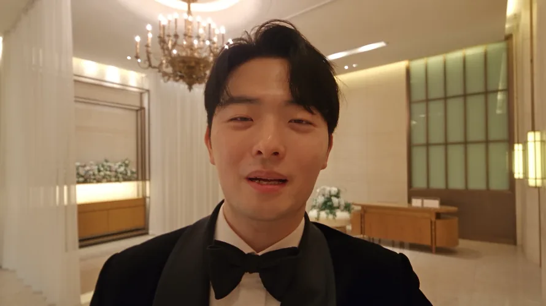
<small>วินาทีที่ 10 ของช็อตเซลฟีฉบับสุดท้าย ใส่ชุดกับสถานที่ด้วย AI ลงบนคลิปที่ผมแสดงจริง</small>

## จากดวงตาตรงเข้าหอจัดงาน

S#4 คือฉากที่เชื่อมหนังกับความจริง ผมในจอคุยกับแขกผ่านกล้องเซลฟีในหอจัดงาน ลดกล้องลง แล้วจบด้วย "ทุกคนช่วยหันไปข้างหลังหน่อยครับ" พอหนังดับ เจ้าบ่าวตัวจริงก็เริ่มเดินเข้า

สตอรีบอร์ดแรก ตอนท้าย #11 ผมตั้งใจเอาฝ่ามือปิดเลนส์ให้จอมืด แล้วค่อยข้ามไปหอจัดงาน อันนี้ตัดทิ้ง มาถึงเกือบนาทีที่สองแล้ว ใส่ลูกเล่นอีกอันจะยืด ผมตัดสินว่าแมตช์คัตจากหน้ายิ้มของ #11 บนม้านั่งไปเป็นชุดทักซิโด้ทันทีจะแรงกว่า

เอกสารส่งต่องานที่ทำตอนย้ายแชต Claude มีแค่ข้อสรุป "ตัดฉากฝ่ามือปิดจอ" ไม่มีเหตุผลนี้ เรื่องนี้เขียนแยกไว้ข้างล่าง

กล้องจะเคลื่อนยังไงในหอจัดงาน ผมวาดลงบนรูปที่ถ่ายจากหอจัดงานจริงเอง

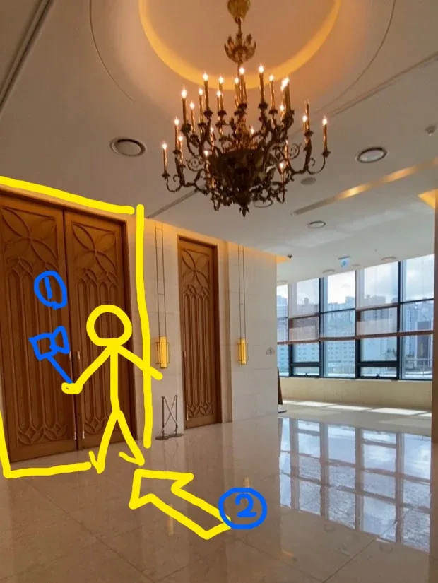
<small>การออกแบบการเคลื่อนไหวฉาก 4 ① คือกล้องเซลฟีในมือ ② คือกล้องที่วางลงพื้น</small>

| กล้อง | หน้าที่ |
|---|---|
| ① เซลฟี | ยื่นแขนถือกล้องถ่ายหน้าตัวเองพร้อมพูดกับแขก |
| ② พื้น | พูดจบแล้วลดกล้องวางบนพื้น กล้องมองไปทางประตูหอจัดงาน |

ภาพวาดนี้ไม่ได้จบแค่เป็นภาพวาด ในเวอร์ชันสุดท้ายผมใส่มันเป็นภาพอ้างอิงตามนั้นเลย

## จากรอยยิ้มบนม้านั่งถึงเซลฟี AI วันที่ 2–3 กันยายน

ฉากหอจัดงานเริ่มที่ม้านั่ง ต้องทำส่วนหน้าของแมตช์คัตก่อน คือหน้ายิ้มของ #11

ตั้งแต่สี่ทุ่มสี่สิบเอ็ดถึงห้าทุ่มสี่สิบสี่คืนวันที่ 2 กันยายน ผมสร้างภาพของช็อตนี้ช็อตเดียวไม่หยุด แรก ๆ ใช้ GPT Image 2 (คุณภาพ Medium, 1344x752) แค่สามนาทีช่วงสี่ทุ่มห้าสิบถึงห้าสิบสามก็ออกมา 10 ภาพ ต่อด้วย Nano Banana Pro ใส่บรรทัดเดียว "รอยยิ้มน่ารัก" แล้วสร้างอีกสามภาพด้วยพรอมต์ภาษาอังกฤษเดิม ระหว่างนั้นยังมีรอบ Seedream 5.0 Pro ที่ผมเขียนแค่ "อ้วน... ลดน้ำหนักหน่อย"

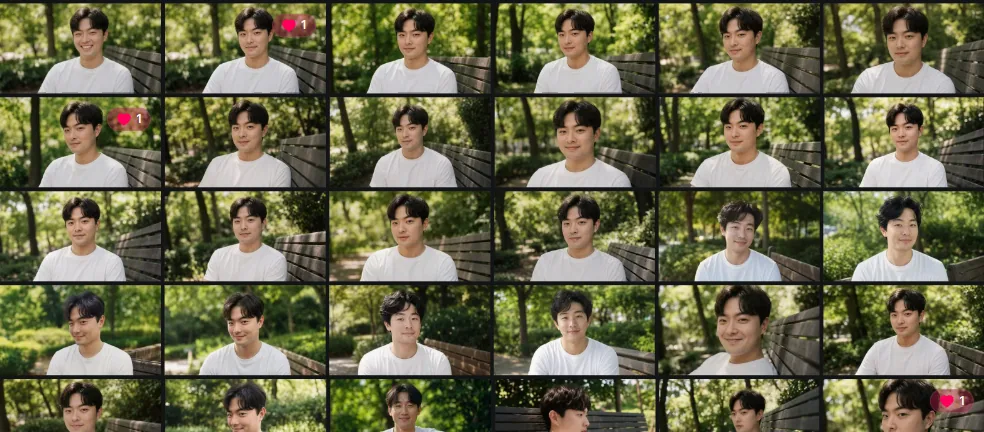
<small>ประวัติภาพคืนวันที่ 2 กันยายน หน้ายิ้มองค์ประกอบแทบเหมือนกันเกินยี่สิบภาพ</small>

พรอมต์เขียนตามหลักที่ตั้งไว้ในตอนที่ 3 ตอกก่อนว่าทุกทิศอิงกล้อง แล้วแบ่งท่าทาง สายตา สีหน้า ใบหน้า ฉากหลัง แสง และเลนส์เป็นย่อหน้า

| หัวข้อ | เนื้อหาพรอมต์ |
|---|---|
| บรรทัดแรก | ทุกทิศอิงกล้อง ซ้ายของจอคือซ้ายของคนดู |
| ท่าทาง | หมุนลำตัวมาทางกล้องจนไหล่เกือบตรงกับเลนส์ หลังตรง มือสองข้างวางบนต้นขา |
| สายตา | ข้างเลนส์พอดี เยื้องไปทางขวาของจอนิดเดียว สบตากับคนที่นั่งตรงนั้น |
| สีหน้า | ปิดปาก มุมปากยกชัด หางตาย่น หน้าของคนที่เจอสิ่งที่ตามหาแล้ว |
| ใบหน้า | ระยะห่างตา เปลือกตา จมูก โหนกแก้ม กราม ร่องเหนือริมฝีปาก ความหนาริมฝีปาก เหมือนรูปอ้างอิง `Do not average these features` ห้ามทำหน้าเรียวหรือผิวเนียน |
| เฟรม | 50 มม. ระยะ 1.5 ม. ระดับสายตาตอนนั่ง บัสต์ช็อตตัดกลางอก เนื้อฟิล์ม 35 มม. |

ในตอนที่ 3 หน้าที่หันมาของ #08 ตัวหันตรงไปข้างหน้า หันแค่หัว #11 กลับกัน หมุนตัวมาทางกล้องด้วย เพราะช่วงตกใจผ่านไปแล้ว เป็นฉากตอบคนที่นั่งตรงข้าม

วิดีโอ #11 จากภาพนี้ รันด้วย Seedance 2.5 วันที่ 3 กันยายนตอน 00:17 (480p) 00:28 กับ 00:41 (1080p) จากจอที่เต็มไปด้วยดวงตา ถอยออกเร็ว ๆ สองวินาทีแล้วหยุดที่บัสต์ช็อต ตาที่เหม่อเริ่มชัด รอยยิ้มแผ่ แล้วราววินาทีที่ 3.5 พูดว่า "ครับ ได้เลย" เวอร์ชัน 00:41 เติมท้ายเป็นภาษาเกาหลีว่า "ยิ้มค้างไว้ 5.0–7.0"

พอรอยยิ้มลงตัว ผมย้ายหน้าเดิมไปหอจัดงาน ห้าทุ่มห้าสิบสองคืนวันที่ 2 กันยายน ใส่ภาพหลายภาพเป็นภาพอ้างอิงใน Seedream 5.0 Pro (2k) แล้วเขียนบรรทัดเดียว "เปลี่ยนเป็นสูทสีดำ แล้วเปลี่ยนฉากหลังเป็นสถานที่นี้" ภาพอ้างอิงคือรูปผมใส่สูทสองรูปกับรูปล็อบบี้หอจัดงาน

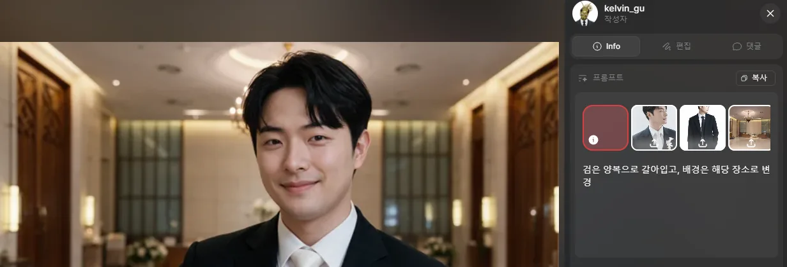
<small>Seedream 5.0 Pro หน้าที่ยิ้มบนม้านั่งย้ายมาล็อบบี้หอจัดงานตามนั้นเลย</small>

สีหน้ากับมุมหน้าตามมาจากรอยยิ้มบนม้านั่งแทบเป๊ะ หน้าหลังของแมตช์คัตต้องตรงกันแบบนี้ แต่เนกไทออกมาสีขาว ห้าทุ่มห้าสิบหก ผมใส่ผลนี้กลับเป็นภาพอ้างอิงแล้วแก้ว่า "ผูกโบว์ไทสีดำแทนเนกไทขาว" (1k) อันนี้กลายเป็นเฟรมแรกของเซลฟี AI

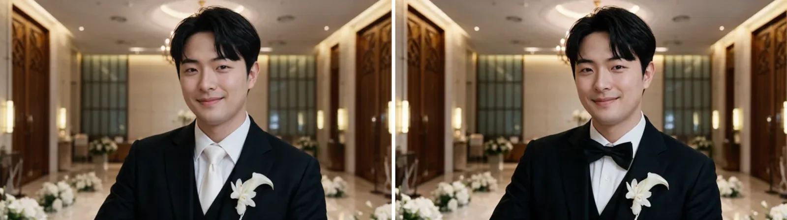
<small>2 กันยายน 23:52 กับ 23:56 (สร้างด้วย AI) เปลี่ยนแค่เนกไท</small>

ได้เฟรมแรกแล้วก็ไปวิดีโอทันที วันที่ 3 กันยายนตอน 00:09 กับ 00:43 ทำเซลฟีสองรอบด้วย Seedance 2.5 480p ระหว่างนั้นวันเดียวกันก็รันซูมออก #11 ไปด้วย

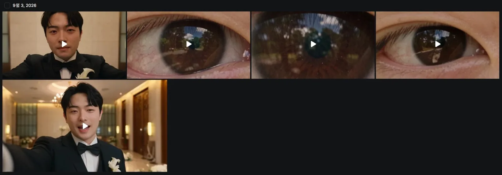
<small>ประวัติวิดีโอวันที่ 3 กันยายน ซ้ายบนกับซ้ายล่างคือเซลฟี AI อีกสามอันคือซูมออกจากดวงตา #11</small>

สองเวอร์ชันบทพูดและความยาวต่างกัน

| เวลาที่สร้าง | ความยาว | เนื้อหา |
|---|---|---|
| 00:09 | 10 วิ | ยื่นแขนถือแอ็กชันแคมพูดไปเรื่อย ๆ "ผมมาไกลถึงนี่เพื่อตามหาความสุข" "วาบจริง ๆ ด้วย" (หัวเราะเบา ๆ) "วิธีที่แน่นอนที่สุดที่คนเราจะมีความสุข ผมว่าผมเจอแล้ววันนี้" เฟรมนิ่งจนจบ |
| 00:43 | 8 วิ | บทเหลือแค่บรรทัดแรก ลดกล้องตั้งแต่วินาที 2.6 กล้องหมุนสั่นเหมือนร่วงลงพื้น วินาที 4.2 วางบนพื้นหินอ่อน ตั้งแต่วินาทีที่ 5 เห็นประตูไม้ที่ปิดอยู่เลยส้นรองเท้ากับปลายขากางเกงผมไป |

เวอร์ชัน 00:43 เป็นเวอร์ชันแรกที่ใส่การเคลื่อนจาก ① ไป ② ในสตอรีบอร์ดและภาพวาดลงในวิดีโอ พรอมต์ก็ยาวขึ้น เขียนว่ากล้องกับตัวเคลื่อนยังไงทุกช่วงเวลา เช่น "ช็อตเดียวไม่ตัด ถ่ายจากกล้องตัวเดียว" "หลังกล้องมีประตูไม้บานใหญ่ลายโค้งโกธิกปิดอยู่" "ตอนลดกล้อง ทิศจะหมุนกลับด้าน" "วางบนพื้นให้เลนส์มองไปข้างหน้าเงยขึ้นนิดหน่อย"

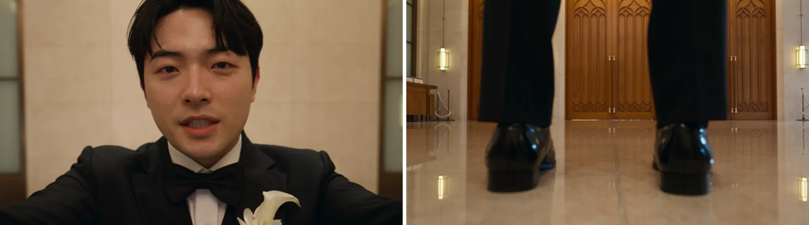
<small>วินาทีที่ 1 กับ 6 ของเวอร์ชันวันที่ 3 กันยายน 00:43 (สร้างด้วย AI) รองเท้ากับประตูตั้งอยู่หน้ากล้องที่วางพื้น</small>

ทั้งสองเวอร์ชันไม่ได้เข้าฉบับเต็ม บทในฉบับเต็มคือ "ลืมตามาก็อยู่หน้าหอจัดงาน คงหมายถึงแบบนี้แหละครับ" "วาบเหมือนแสงจริง ๆ" "ผมจะเข้าไปแล้วนะครับ" และ "ทุกคนช่วยหันไปข้างหลังหน่อยครับ" ไม่ตรงกับบทในเวอร์ชันวันที่ 3 กันยายน

ที่ทิ้งเพราะน้ำเสียง เซลฟีที่ Seedance ทำ พูดเลี่ยนเกินไป กลิ่น AI แรงมาก รันใหม่กี่รอบก็คิดว่ากู้ไม่ได้แน่ ๆ เลยทิ้ง น้ำเสียงเลี่ยนขนาดไหน เดี๋ยวจะอัปคลิปที่พลาดแยกไว้แล้วเอามาแปะตรงนี้

## ใส่ทักซิโด้ให้คลิปที่ผมแสดงเอง วันที่ 6 กันยายน สี่รอบ

ช็อตสุดท้ายไม่ได้เริ่มจากคนที่ AI สร้าง แต่เริ่มจากคลิปเซลฟีที่ผมแสดงเอง

เซลฟีถ่ายที่บ้านด้วยกล้องมือถือ ถ้าถ่ายด้วย GoPro จะติดภาพบิดของเลนส์มุมกว้าง เลยถ่ายด้วยมือถือ แต่แสดงเหมือนกำลังถ่ายด้วย GoPro ฮ่า ๆ

รูปปากตอนพูด การขยับหัว จนถึงมือที่ลดกล้องลงวางบนพื้น เป็นสิ่งที่ผมทำจริงทั้งหมด ในพรอมต์เขียนให้เปลี่ยนห้องในคลิปต้นฉบับเป็นล็อบบี้หอจัดงาน งานตรงนี้คือเปลี่ยนแค่ชุดกับสถานที่

วันที่ 6 กันยายน รันสี่รอบตั้งแต่บ่ายโมงสิบถึงบ่ายสามห้าสิบสาม

| เวลาที่สร้าง | โมเดล | ความละเอียด | สิ่งที่เปลี่ยน |
|---|---|---|---|
| 13:10 | Higgsfield Genjutsu object swap | 480p | การแสดง หน้า และการเคลื่อนกล้องคงเดิม เพิ่มโบว์ไท แจ็กเก็ตกับเสื้อเชิ้ตเป็นทักซิโด้ปกซาติน ห้องเป็นล็อบบี้หอจัดงาน ประตูไม้หน้ากล้องที่วางลง |
| 14:18 | Seedance 2.5 Edit | 480p | คำสั่งเดิมย้ายไป Seedance Edit |
| 14:43 | Seedance 2.5 Edit | 480p | ต่อช่วงเปิดที่ถอยออกจากภาพซูมดวงตาสุดขีดไว้ข้างหน้า หน้าตามรูปอ้างอิง ไม่ตามต้นฉบับ ชุดเป็นสูทด้านไม่มีซาติน สถานที่คือตำแหน่งรูปคนในภาพวาด |
| 15:53 | Seedance 2.5 Edit | 1080p | ฉบับสุดท้ายของข้างบน 22 วินาที |

รอบแรกเป็น object swap ของ Genjutsu ประโยคแรกของพรอมต์คือ "คงการแสดงของผู้ชายคนนี้ไว้ตามเดิม หน้าและตัวตน การขยับปากกับกรามตอนพูด การขยับหัว ท่าทาง และจังหวะของทุกการเคลื่อนไหว" กล้องก็ให้คงเดิม รวมถึงการสั่นตอนลดลงและตอนวางลงพื้น

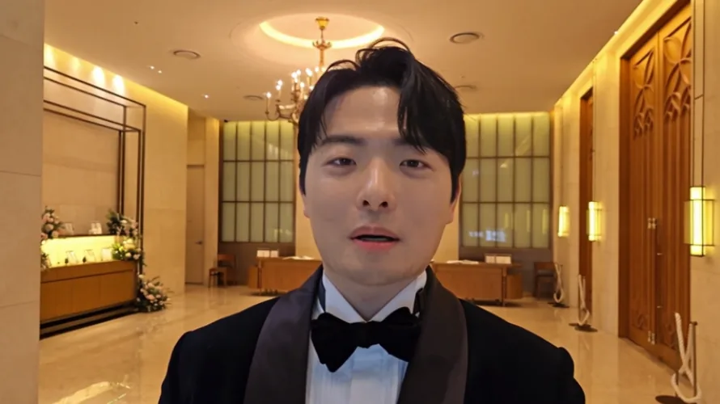
<small>Genjutsu object swap วันที่ 6 กันยายน 13:10 (ซ้อนภาพด้วย AI) ปกเสื้อมีเงาซาติน</small>

ล็อบบี้หอจัดงานกับทักซิโด้ใส่ออกมาดี แต่ปกเป็นซาตินวาว ๆ ผมเขียนในพรอมต์เองว่า "ทักซิโด้ปกซาติน" ก็เลยออกมาตามนั้น 14:18 ย้ายคำสั่งเดิมไป Seedance 2.5 Edit แล้ว 14:43 เปลี่ยนประโยคชุดใหม่หมด "สูทสีดำธรรมดา ผ้าวูลด้านทั้งตัว ไม่มีซาติน ไม่มีเงา ไม่มีขอบปกตัดสี"

ที่เปลี่ยนตอน 14:43 ไม่ได้มีแค่ชุด

| ประโยค | สิ่งที่เปลี่ยน |
|---|---|
| เปิด | เริ่มจากภาพซูมสุดขีดที่ดวงตากับรูม่านตาเต็มจอ แล้ววินาทีแรกถอยออกตรง ๆ ตามแกนเลนส์ ตอนแรกเร็ว ตอนถึงช้า ม่านตากลายเป็นตา ตากลายเป็นหน้า แล้วหยุดที่บัสต์ช็อตของต้นฉบับ |
| ใบหน้า | หน้ากับทรงผมตามรูปอ้างอิง ไม่ตามวิดีโอต้นฉบับ |
| สถานที่ | ล็อบบี้หอจัดงานในภาพอ้างอิง รูปคนที่วาดในภาพนั้นเป็นแค่เครื่องหมายตำแหน่งยืน และห้ามโผล่บนจอเด็ดขาด |
| ความต่อเนื่อง | เทกต่อเนื่องเดียว ไม่มีคัตหรือดิสโซลฟ์ มีคนเดียวเท่านั้น |

ภาพหอจัดงานที่ใส่เป็นภาพอ้างอิงก็คือภาพวาดการออกแบบข้างบนนั่นเอง ใส่ไปทั้งที่ยังมีรูปคนสีเหลืองวาดอยู่ แล้วบอกเป็นตัวหนังสือว่ามันคือเครื่องหมายตำแหน่ง ภาพวาดไม่ได้โผล่ขึ้นจอ

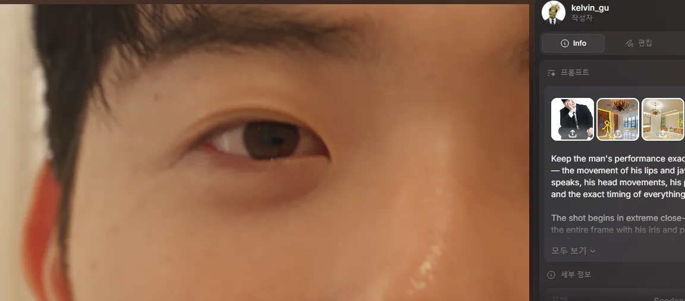
<small>วินาทีที่ 1 ของฉบับสุดท้าย ภาพวาดการออกแบบที่มีรูปคนสีเหลืองเข้าไปในภาพอ้างอิงตามนั้น</small>

พอใส่ช่วงเปิดที่ถอยออกจากดวงตาไว้ในช็อตนี้ แค่วางต่อหลังซูมเข้าดวงตากับมอนทาจจริงในตอนที่ 3 ก็กลายเป็นการเชื่อมจากดวงตาไปหอจัดงาน 15:53 รันพรอมต์เดิมที่ 1080p อันนี้เข้าฉบับเต็มตั้งแต่ 1:48

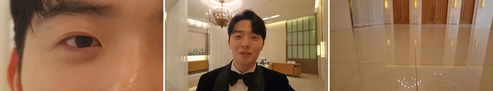
<small>0:01 0:03 และ 0:17 ของฉบับสุดท้าย ออกจากดวงตา พูด แล้ววางกล้องลงพื้น</small>

เทียบกับเวอร์ชัน AI ล้วนวันที่ 3 กันยายน ฉากจบต่างกัน เวอร์ชันวันที่ 3 กันยายนมีรองเท้ายืนหน้ากล้องบนพื้น ฉบับสุดท้ายตามการวางกล้องจริงของผม เลยพื้นไปเห็นแค่ประตู

## เก็บงานตัดต่อ กับรูรั่วการส่งต่องาน

ช็อตที่สร้างเสร็จเอามาต่อใน Premiere ไฟล์โปรเจกต์ชื่อ `20260909_식중영상.prproj` หน้าจอมอนิเตอร์ในตอนที่ 2 ซ้อนจากคลิปอัด HTML ส่วนปัญหามุมสูงในตอนที่ 3 ที่ใบไม้ไม่บังภรรยา แก้ด้วยการเอาฟุตเทจใบไม้จริงทับ

ตอนทำงานใช้จอสองจอ จอซ้ายเปิดโปรแกรมมอนิเตอร์ จอขวาเปิดไทม์ไลน์

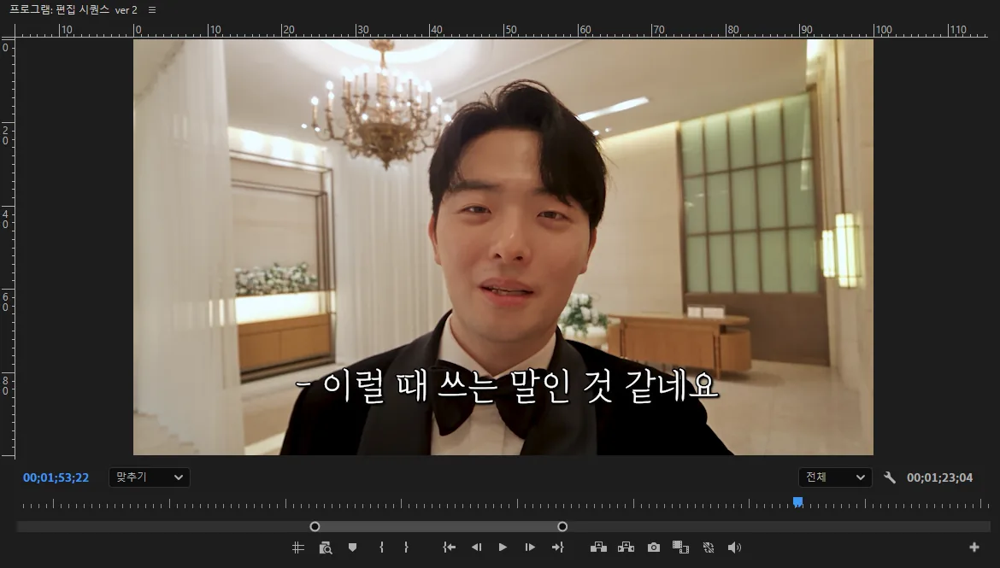
<small>โปรแกรมมอนิเตอร์บนจอซ้าย 1:53 มีซับอยู่บนช็อตเซลฟีสุดท้าย</small>

ชื่อซีเควนซ์คือ "ซีเควนซ์ตัดต่อ ver 2" ในโปรเจกต์เดียวกันยังเปิด ver 3 "หนังก่อนพิธีเชจู" สำหรับงานเลี้ยงที่เชจู และ "ซีเควนซ์ 06" ไว้ด้วย ภาพสุดท้ายคือช็อตเซลฟีที่หยุดไว้ที่ 1:53

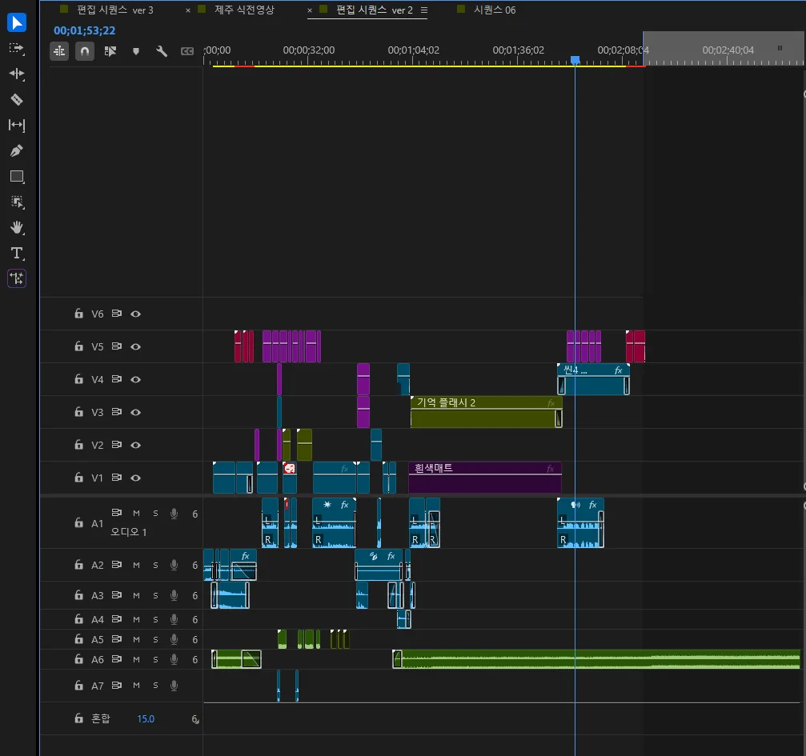
<small>ไทม์ไลน์บนจอขวา วิดีโอ 5 แทร็ก เสียง 7 แทร็ก หัวเล่นอยู่บนเซลฟีฉาก 4</small>

ไทม์ไลน์ใช้วิดีโอห้าแทร็ก เสียงเจ็ดแทร็ก "แฟลชความทรงจำ 2" กับ "แมตขาว" ที่ยาวอยู่ตรงกลาง ตามตำแหน่งคือ 1:04 ถึง 1:44 ช่วงมอนทาจในดวงตา ถัดมาคลิป "ฉาก 4" บน V4 คือเซลฟีที่ทำในโพสต์นี้ เพลงบน A6 ยาวตั้งแต่ต้นจนจบ จอนี้คือไทม์ไลน์สุดท้าย

รอบนี้ระหว่างไล่ดูบันทึกใหม่ ผมก็เช็กด้วยว่าฉากเปิดล้อเลียน Beat ข้างหน้าสุดทำยังไง สองทุ่มหกนาทีวันที่ 5 กันยายน ใช้ motion transfer ของ Higgsfield Genjutsu (720p, 12 วินาที) เปลี่ยนแค่หน้า รูปเทียบกับต้นฉบับอยู่ใน[ตอนที่ 1](/th/posts/higgsfield-wedding-film/)

ไฟล์สุดท้ายยาว 4 นาที 5 วินาที ภาพจบที่ 2:15 หลังจากนั้นเป็นเพลงบนจอดำ ฉายก่อนเจ้าบ่าวเดินเข้าในพิธีบ่ายโมงวันที่ 19 กันยายน หลังผมในจอพูดว่า "ทุกคนช่วยหันไปข้างหลังหน่อยครับ" การเดินเข้าจริงก็ตามมา วิดีโอ YouTube ในบล็อกคือไฟล์นี้ที่ตัดเหลือ 2:20 เหลือจอดำไว้แค่ 5 วินาที

[ดูหนังฉบับเต็มบน YouTube](https://youtu.be/J8hFwc1LpUQ)

ที่เหลือคือเรื่องส่งต่องาน อย่างที่เขียนใน[ตอนที่ 1](/th/posts/higgsfield-wedding-film/) Claude เริ่มที่บัญชีภรรยาแล้วย้ายมาบัญชีผม บทสนทนาไม่ข้ามบัญชีมา ผมเลยเอาเอกสารส่งต่องานที่แชตก่อนสรุปไว้มาแปะในแชตใหม่ พอลองทำต่อจากเอกสารนั้น ตกหล่นเยอะเกินจนงานไม่เดิน

วันที่ 31 สิงหาคมในแชตใหม่ ผมเจอสาเหตุ เอกสารส่งต่องานไม่ใช่บทสนทนาทั้งหมด แต่เป็นสรุปที่คัดแค่ข้อสรุปกับหลักการ ผมเลยให้ Claude อ่านบทสนทนาต้นฉบับทั้งหมดที่เก็บเป็นไฟล์ Word ใน Google Drive ยาว 253,348 ตัวอักษร ที่อ่านครั้งแรกเป็นฉบับที่ถูกตัดราว 246,000 ตัวอักษร เลยเอามาใหม่แล้วอ่านจนจบ

เทียบดูแล้ว สิ่งที่หายไปจากเอกสารเป็นแบบนี้

| ที่หายไป | ที่มีในบทสนทนาต้นฉบับ |
|---|---|
| รูปอ้างอิงใบหน้า | เอกสารมีแค่ "ใช้รูป 3 รูปเป็นภาพอ้างอิงตรง ๆ" หายไปทั้งข้อสรุปว่ารูปเยอะจะถูกเฉลี่ยทุกมุมจนหน้าพัง และเหตุผลว่ารูปมุมใกล้ช็อตดีที่สุด |
| #07 มุมมองขวดน้ำ | ว่าเป็นช็อตต่อเนื่องเดียว 12 วินาที ไม่ใช่สองคัต และใช้แร็กโฟกัสส่งโฟกัสจากขวดไปภรรยา |
| สีชุดเดรส | ฟ้าอ่อน เลือกเพราะสีขาวโดนแดดหน้าร้อนแล้วสว่างจ้า เด่นเกินในมุมสูง |
| มุมสูง | ว่าภรรยาต้องถูกใบไม้บัง ให้ตอนแรกมองผ่านเป็นฉากหลัง ดูอีกทีถึงเห็น |
| ท่าทาง #08 กับ #11 | หันแค่หัว และสายตาที่ผ่านข้างเลนส์ไปมองด้านบนหลังกล้อง |
| #11 ฝ่ามือปิดจอ | มีแค่ข้อสรุป "ตัด" เหตุผลที่ว่าใส่ลูกเล่นอีกอันตอนเกือบนาทีที่สองจะยืด กับการตัดสินใจไปแมตช์คัตแทน มีแค่ในต้นฉบับ |

ข้อสรุปเรื่องรูปอ้างอิงใบหน้า แม้แต่ในต้นฉบับก็หาไม่เจอทันที ผมแก้โดยพูดสิ่งที่จำได้ซ้ำอีกรอบ รูปที่ถ่ายมุมใกล้ช็อตดีที่สุด ถ้าไม่มี ให้ใส่หน้าตรงที่ดีหนึ่งรูปกับด้านข้างที่ดีหนึ่งรูป

Claude ในแชตใหม่ดูแค่เอกสารเลยไม่รู้ว่า "ตัด" เพราะอะไร และถ้าทำตาม "3 รูปตรง ๆ" ในเอกสารเรื่องรูปอ้างอิงใบหน้า จะสวนทางกับข้อสรุปที่ผมจำได้ ปัญหาต้องอธิบายใหม่ทุกครั้งที่เปลี่ยนแชต ผมก็เจอเหมือนกันในงานบล็อก ตอนนี้ผมเก็บกฎกับสถานะไว้ใน GitHub repository นอกแชต แล้วให้แชตใหม่อ่านก่อนเริ่ม เขียนไว้ในโพสต์[สร้างสมองให้ AI บน GitHub](/th/posts/github-brain-for-claude/)

ตัวหนังเองไม่ค่อยเสียดายอะไร ทำเต็มที่แล้ว ฟีดแบ็กก็ดี ได้เรียนรู้เรื่องวิดีโอเยอะ เลยไม่เขียนว่า "ถ้าทำใหม่" แต่จดสิ่งที่จะเอาไปด้วยถ้าทำอะไรใหม่

| สิ่งที่เอาไปด้วย | เหตุผล |
|---|---|
| ฉากพูดใช้คลิปที่แสดงเองตั้งแต่แรก | เซลฟี AI วันที่ 3 กันยายนทิ้งเพราะพูดเลี่ยนและกลิ่น AI แรง ฉบับสุดท้ายคือคลิปแสดงจริงที่ใส่ชุดกับสถานที่ |
| ระบุเนื้อผ้าชุดตั้งแต่แรก | เขียน "ทักซิโด้ปกซาติน" ก็ได้ซาตินตามนั้น แก้เป็นด้านต้องเสียอีกรอบ |
| ใช้ภาพวาดการออกแบบเป็นภาพอ้างอิงตรง ๆ | บอกว่ารูปคนเป็นเครื่องหมายตำแหน่ง มันก็ไม่โผล่บนจอ ได้แค่ตำแหน่ง |
| ช็อตที่ต่อกันทำในช็อตเดียว | ใส่ช่วงถอยออกจากดวงตาไว้ในช็อตเซลฟี แมตช์คัตก็จบตั้งแต่ขั้นสร้าง |
| ส่งต่องานพร้อมข้อสรุปและเหตุผล | เอกสารที่ไม่มีเหตุผลทำให้งานไม่เดินเลย ต้องกลับไปอ่านต้นฉบับ 250,000 ตัวอักษรใหม่ |

ถ้าทำอีก อยากใช้โหมด Edit ให้เก่งขึ้น แล้วทำงานที่เจ๋งกว่าครั้งนี้มาก ๆ

## ทำด้วย AI ไม่ใช่ทางลัด

**ทำวิดีโอด้วย AI ไม่ง่ายเลยสักนิด** อาจเป็นทางที่ยากกว่าถ่ายเองด้วยซ้ำ ตั้งแต่แรกก็ไม่ได้เริ่มเพื่อหาทางง่าย ผมเลยคิดว่ามันเป็นความท้าทายที่มีความหมาย

วันที่ในซีรีส์นี้เป็นแค่วันที่มีบันทึกเหลืออยู่ ความจริงผมค่อย ๆ วางแผนมาก่อนหน้านั้นอย่างน้อยหนึ่งเดือน สตอรีบอร์ดแก้จนไม่รู้ว่ารอบที่เท่าไร แค่ที่มีบันทึกก็มากขนาดนี้

| ขั้นตอน | บันทึก |
|---|---|
| วางแผน | ค่อย ๆ ทำมาก่อนวันที่บันทึกอย่างน้อยหนึ่งเดือน แก้สตอรีบอร์ดนับไม่ถ้วน |
| สตอรีบอร์ด | "แผ่นสตอรีบอร์ดรวมฉบับสุดท้าย หนังก่อนพิธี Kang PD" บันทึกครั้งสุดท้าย 27 สิงหาคม ห้าทุ่มยี่สิบเอ็ด |
| ภาพ | ฉากละหลายสิบภาพ ภาพมุมสูงภาพเดียวในตอนที่ 3 เจ็ดรอบ ช็อตยิ้มบนม้านั่งช็อตเดียวในโพสต์นี้เกินยี่สิบภาพ |
| วิดีโอ | 36 คลิปตั้งแต่ 30 สิงหาคมถึง 6 กันยายน ตัวทดลอง 480p 19 คลิป 1080p 16 คลิป |
| เครดิต | แค่ธุรกรรมล่าสุด 140 รายการถึงวันที่ 31 สิงหาคมก็ 563 เครดิต วันที่ 3 กันยายนเครดิตใหม่เข้ามา 1,000 |
| บทสนทนา | แชต Claude หลายหน้าต่าง เอกสารส่งต่องาน อ่านต้นฉบับ 250,000 ตัวอักษรใหม่ |
| ตัดต่อ | ไฟล์โปรเจกต์วันที่ 9 กันยายน วิดีโอ 5 แทร็ก เสียง 7 แทร็ก |
| ฉาย | 19 กันยายน บ่ายโมง ก่อนเจ้าบ่าวเดินเข้า |

ใช้ความคิด เวลา และแรงไปเยอะมาก พูดตรง ๆ ทำ ๆ ไปก็หลุดปากเองว่าจ้างบริษัททำดีที่สุด…

แต่สิ่งที่คิดระหว่างทำกลับไปอีกทาง ทำวิดีโอด้วย AI ลองได้เยอะจริง ๆ รันภาพมุมสูงเจ็ดรอบ สร้างมุมต่ำเดิมแปดรอบในวันเดียว ถ้าเป็นกองถ่ายจริงไม่กล้าแม้แต่จะคิด สำหรับคนทำวิดีโอ ทางเปิดกว้างขึ้นเยอะ

และพื้นฐานที่ทำวิดีโอมาตลอดก็ใช้ได้ในวิดีโอ AI อยู่แล้ว ในหนังเรื่องนี้ก็เหมือนกัน วางสตอรีบอร์ด แบ่งฉากม้านั่งเป็นกล้องสามตัว เลือกแมตช์คัตแทนฝ่ามือปิดจอ แล้วไปต่อใน Premiere ตอนท้าย ทั้งหมดเป็นงานที่ทำอยู่แล้ว ที่เปลี่ยนคือข้อจำกัดเรื่องสถานที่หายไป ภูเขาหิมะ ดวงจันทร์ ล็อบบี้หอจัดงาน ทำเป็นฉากได้โดยไม่ต้องไป เพราะฉะนั้น **ผมว่ายิ่งพื้นฐานแน่น ยิ่งเปล่งประกายในวิดีโอ AI ได้มาก**

ผมเองก็ต้องกลับไปเรียนใหม่ตอนทำเรื่องนี้ ศัพท์ช็อตกับไวยากรณ์ภาพยนตร์ที่ครูพักลักจำมา ต้องรู้ให้ถูกจริง ๆ ไฮแองเกิล โลว์แองเกิล ทิลต์อัป แร็กโฟกัส แมตช์คัต บัสต์ช็อต มุมรับภาพเลนส์กับระยะ ต้องเขียนชื่อให้ถูกในพรอมต์ถึงจะเข้าใกล้ช็อตที่อยากได้ ตำแหน่งขวดกับมือเพี้ยนเพราะคำเดียว "POV ขวดน้ำ" สุดท้ายก็เป็นปัญหาศัพท์ มีอะไรให้เรียนเยอะมาก ๆ เป็นข้ออ้างก็จริง แต่เพราะงี้เลยมีหลายฉากที่ยังไม่พอใจ

เรื่องนอกเรื่องอีกเรื่อง ผมคิดว่างานที่คนจ่ายเงินจ้างบริษัททำ ถ้าผมลองทำเป็นระบบอัตโนมัติแล้วเปิดเป็นบริการก็น่าสนุก เพราะกำแพงค่อนข้างสูง ผมใช้ AI ขยันพอตัว ทำวิดีโอมาก็เยอะ แต่พอทำเรื่องนี้จนจบ ทางยังดูอีกยาว แปลว่าหลายคนน่าจะยังทำไม่ได้ ได้กลิ่นเงิน ฮ่า ๆ
