ผมใช้ Higgsfield ทำหนังยาว 2 นาทีที่ฉายก่อนเจ้าบ่าวเดินเข้างานแต่งของเรา แทบไม่ได้ถ่ายอะไรเลย สิ่งที่อยู่บนจอส่วนใหญ่เป็นภาพและวิดีโอที่ AI สร้าง

งานแต่งวันที่ 19 กันยายน บ่ายโมง พอหนังจบ ผมในจอจะพูดว่า "ทุกคนช่วยหันไปข้างหลังหน่อยครับ" และในวินาทีนั้นผมตัวจริงก็เดินเข้ามาจากประตูด้านหลัง ช่วงทำงานคือตั้งแต่ 27 สิงหาคมที่บันทึกสตอรีบอร์ด จนถึง 6 กันยายนที่สร้างคลิปสุดท้าย ประมาณสิบเอ็ดวัน

หนังฉบับเต็มอยู่บน YouTube จอดำหลังตอนจบผมตัดเหลือไว้แค่ 5 วินาที

[ดูหนังฉบับเต็มบน YouTube](https://youtu.be/J8hFwc1LpUQ)

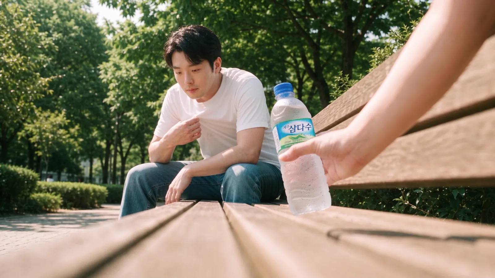
<small>นาทีที่ 0:53 ในฉบับเต็ม ช็อตม้านั่งมุมต่ำ มือที่ยื่นน้ำมาคือมือภรรยาผม (สร้างด้วย AI)</small>

ขั้นตอนการสร้างยาว ผมเลยแบ่งเป็นสี่ตอน ตอนที่ 1 คือเหตุผลที่ทำ ช็อตแรก และการเตรียมตัว ตอนที่ 2 คือห้องทำงานกับฉากเดินหลง ตอนที่ 3 คือฉากม้านั่ง ตอนที่ 4 คือฉากหอจัดงานแต่งและการตัดต่อขั้นสุดท้าย ผมจดไว้ให้มากที่สุด ทั้งแก้พรอมต์ไปกี่รอบ ใช้โมเดลไหนสร้างไปกี่คลิป และติดตรงไหน

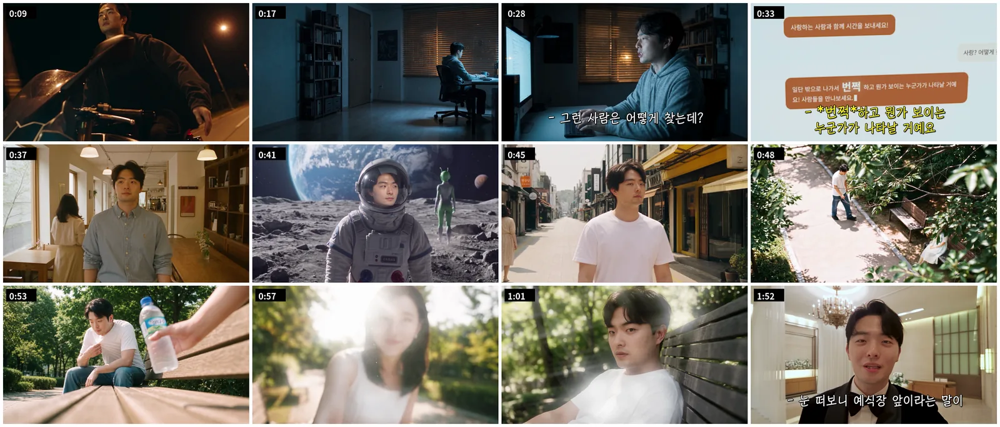
<small>เฟรมจากฉบับเต็มเรียงตามเวลา ไม่ได้ใส่รูปและวิดีโอจริงจากมอนทาจในดวงตา</small>

## ไม่มีโชว์ ไม่มีเพลง เลยเดิมพันกับช็อตแรก

เหตุผลที่ทำหนังเรื่องนี้ง่าย ๆ งานแต่งของเราไม่มีโชว์ ไม่มีเพลงร้องให้บ่าวสาวด้วย อย่างน้อยต้องมีสักอย่างที่ทำให้แขกสนุก

ในหนังมีฉากเดตของเราด้วย แต่ถ้าเอาวิดีโอเดตมาต่อกันอย่างเดียวยังไงก็น่าเบื่อ เป้าหมายคือโชว์เดตของเราไปพร้อมกับทำให้แขกรู้สึกว่า "โห ดูอะไรสนุก ๆ มา"

คนเราไม่ค่อยสนหรอกว่าผมทำวิดีโออะไร หรือเราไปเดตแบบไหน เขาดูก่อนว่าสนุกหรือไม่สนุก และผมคิดว่ามันตัดสินกันที่ช็อตแรก **เพราะฉะนั้นการตัดสินใจที่สำคัญที่สุดของหนังเรื่องนี้คือจะเปิดด้วยอะไร**

เลือกไปเลือกมา ได้การล้อเลียนฉากมอเตอร์ไซค์จากหนังเกาหลีเรื่อง "Beat" ฉากที่เขาขี่มอเตอร์ไซค์ตอนกลางคืนแล้วกางแขนสองข้าง ฉากนี้ไม่มีในสตอรีบอร์ด ผมเอามาแปะไว้หน้าสุดทีหลัง

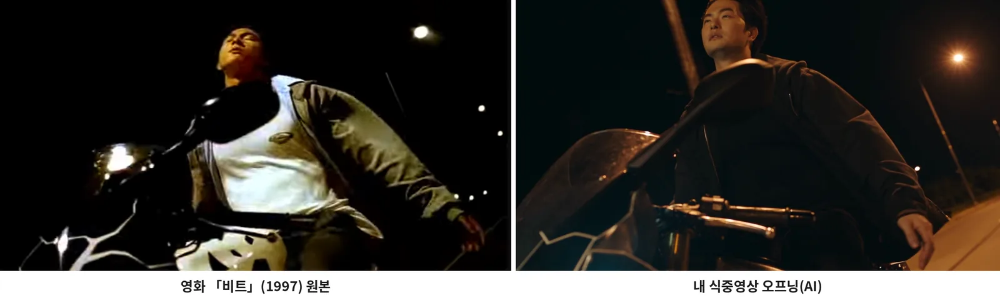
<small>ซ้ายคือต้นฉบับจาก "Beat" ขวาคือ 0:09 ในฉบับเต็ม (สร้างด้วย AI) มุมเดียวกัน ไฟถนนเดียวกัน ต่างแค่หน้าเป็นผม</small>

ช็อตนี้ผมทำคืนวันที่ 5 กันยายนด้วย motion transfer ของ Higgsfield Genjutsu ใส่คลิปขี่มอเตอร์ไซค์หนึ่งคลิปกับรูปหน้าผมหนึ่งรูป พรอมต์มีบรรทัดเดียว: "เปลี่ยนหน้าคนในวิดีโอเป็นภาพอ้างอิง" 720p ยาว 12 วินาที

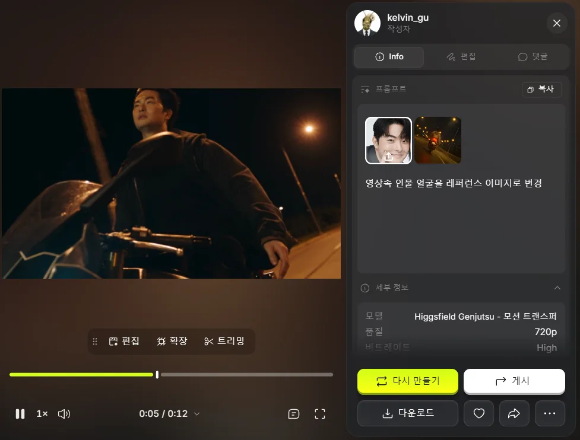
<small>motion transfer ของ Genjutsu รูปหน้ารูปเดียวกับพรอมต์บรรทัดเดียวเปลี่ยนแค่หน้า</small>

เกณฑ์ที่ใช้เลือกมีสองข้อ

| เกณฑ์ | เหตุผล |
|---|---|
| ฉากที่คนหลายช่วงวัยรู้จัก | ในหอจัดงานมีแขกทุกช่วงวัยนั่งอยู่ |
| ไม่รู้จักก็ยังสนุกและน่าทึ่ง | คนที่ไม่รู้จักต้นฉบับก็ต้องสังเกตได้ทันทีว่า "นี่ AI เหรอ" |

ข้อความ "ฉัน เหงา" กับ "อยากมีความสุข" ลอยผ่านบนมอเตอร์ไซค์ แล้วคนเหงาคนนั้นก็ข้ามไปที่โต๊ะในห้องทำงาน เรื่องหลักเริ่มตรงนั้น ทำเสร็จแล้วรู้สึกว่าฉากนี้ฉากเดียวแบกทั้งเรื่องไว้ ปฏิกิริยาของแขกในงานผมยังเก็บไว้ได้ไม่ดีนัก เคยลองตัดสลับกับฟุตเทจในงานดูครั้งหนึ่ง แต่นอกจากเสียงหัวเราะช่วงแรกแล้ว ปฏิกิริยาจับได้ไม่ค่อยชัด ฟุตเทจปฏิกิริยาแขกที่บริษัทวิดีโอถ่ายให้ยังไม่มาถึง พอมาแล้วจะตัดปฏิกิริยาใหม่แล้วเอามาลงตรงนี้

## เรื่องเริ่มจากการถาม AI เรื่องความสุข

พล็อตวางไว้เรียบง่ายตั้งแต่แรก Kang PD ถาม AI ว่าจะมีความสุขได้ยังไง ทำตามที่บอกแล้วออกไปข้างนอก หลงไปในที่แปลก ๆ เจอคนยื่นน้ำให้ที่ม้านั่งในสวน แล้วเดินเข้าหอจัดงานแต่ง

| ฉาก | สถานที่ | เนื้อหา | ความยาวในสตอรีบอร์ด |
|---|---|---|---|
| S#1 | ห้องทำงาน (กลางคืน) | ถาม AI ว่า "วิธีที่แน่นอนที่สุดที่คนเราจะมีความสุขคืออะไร" คำตอบคือ "ออกไปข้างนอกสิ พอเจอคู่แท้ จะมีอะไรวาบขึ้นตรงหน้า!" | 0:00–0:15 |
| S#2 | คาเฟ่ → สวน → ดวงจันทร์ → ภูเขาหิมะ → ถนนหน้าร้อน | หน้าอยู่กลางจอเหมือนเดิม แต่ชุดกับฉากหลังเปลี่ยนไปเรื่อย ๆ สุดท้ายเหนื่อยจนทิ้งตัวลงบนม้านั่ง | 0:15–0:40 |
| S#3 | ม้านั่งในสวน | ขวดน้ำยื่นเข้ามาจากด้านข้าง เงยหน้าขึ้น แสงย้อนจางลงแล้วเห็นภรรยาผม ซูมเข้าดวงตาอย่างรวดเร็ว ข้างในมีมอนทาจรูปและวิดีโอจริง | 0:40–2:00 |
| S#4 | ห้องรอในหอจัดงาน | จากสีหน้านั้นตัดไปเป็นชุดทักซิโด้ทันที คุยกับแขกผ่านกล้องเซลฟี แล้วที่หน้าประตู: "ช่วยมองไปข้างหลังหน่อยครับ" | 2:00–2:20 |

สตอรีบอร์ดรวมกล้อง การกำกับ และเสียงของทุกคัตไว้ในแผ่นเดียว ผมต่อ S#1 ถึง S#4 เรียงลงมาเป็น PDF ไฟล์เดียวชื่อ "แผ่นสตอรีบอร์ดรวมฉบับสุดท้าย หนังก่อนพิธี Kang PD" ตอนทำงานผมเรียกว่าหนังก่อนพิธี แต่จริง ๆ ฉายกลางพิธี ก่อนเจ้าบ่าวเดินเข้าพอดี

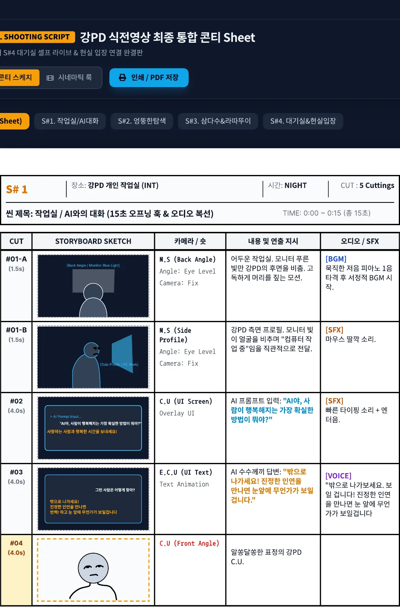
<small>S#1 ห้องทำงาน เขียนไว้ถึงข้อความบนหน้าจอแชต AI และเสียงประกอบ</small>

S#3 คือไคลแมกซ์ แพนกล้องขึ้นจากขวดน้ำไปหน้าภรรยาผม แสงแฟลร์จากแสงย้อน ซูมเข้าดวงตาแบบหนัง Ratatouille และมอนทาจข้างใน กินพื้นที่ในสตอรีบอร์ดมากที่สุด ฉากนี้ก็ใช้เครดิตและเวลามากที่สุดด้วย

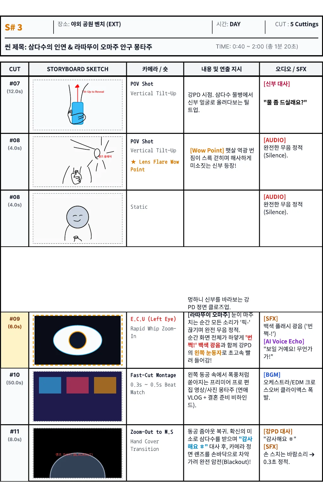
<small>S#3 ม้านั่ง บทเจ้าสาว "ดื่มน้ำหน่อยไหมคะ" #09 ซูมเข้าดวงตา #10 มอนทาจ</small>

S#4 คือส่วนที่เชื่อมกับสถานที่จริง ผมในจอคุยกับกล้องเซลฟีในห้องรอ ลดกล้องลง และพอหนังจบ เพลงเดินเข้างานจริงก็เริ่ม

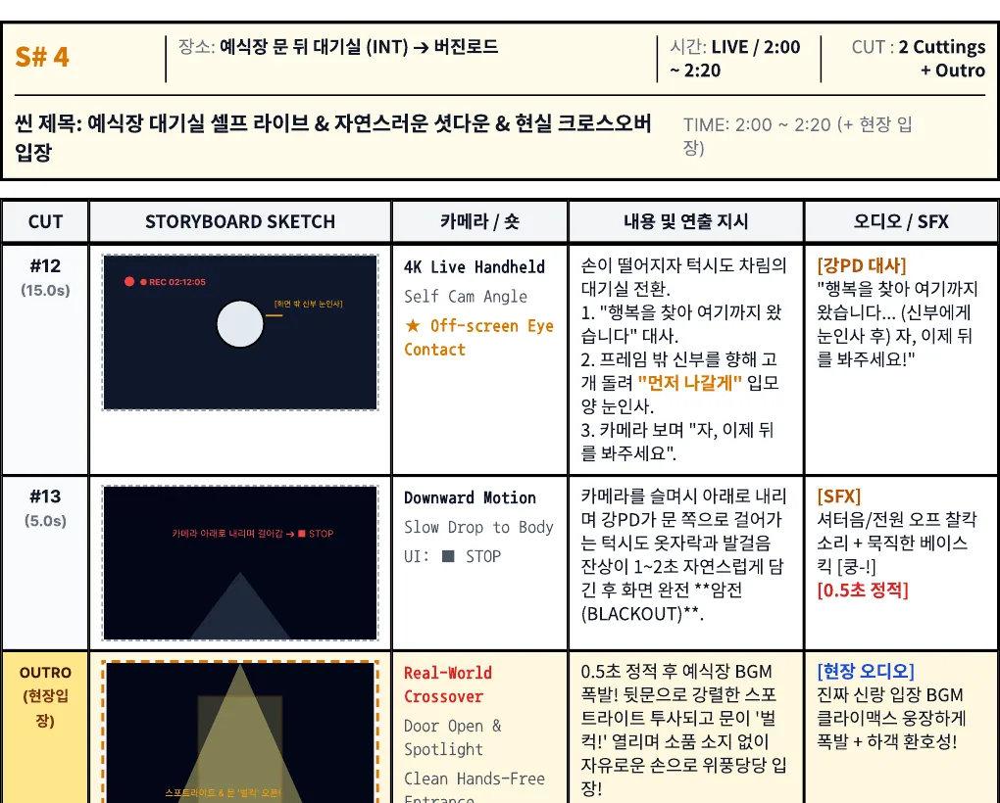
<small>S#4 ฉากสุดท้ายที่เชื่อมหนังกับการเดินเข้างานจริง</small>

สตอรีบอร์ดยาวรวม 2 นาที 20 วินาที ส่วนภาพในฉบับเต็มจบที่ 2:15 มอนทาจตั้งไว้ 50 วินาทีแต่จริง ๆ สั้นลงมาก บทพูดก็เปลี่ยน เปลี่ยนยังไงเขียนไว้ในตอนที่ 3 และ 4

## บัญชี Claude สองบัญชีกับ Higgsfield

ผมใช้เครื่องมือ AI สองตัวคู่กัน Higgsfield สำหรับสร้างภาพและวิดีโอ Claude สำหรับออกแบบพรอมต์และตรวจผลลัพธ์ Higgsfield ใช้บัญชีของผมเองตั้งแต่แรก

Claude เริ่มจากบัญชีของภรรยา มันเข้าใจคำบรรยายฉากของผมดีมาก จนสุดท้ายผมสมัครบัญชีของตัวเองแล้วอัปแพ็กเกจเป็น Max การย้ายบัญชีนี้กลายเป็นรูรั่วใหญ่ทีหลัง บทสนทนาในบัญชีภรรยาไม่ตามมาในบัญชีผม ผมเลยทำเอกสารส่งต่องานไปแปะ แต่เอกสารนั้นเหลือแค่ข้อสรุป เหตุผลหายหมด เรื่องนี้เขียนแยกไว้ในตอนที่ 4

ผมต่อ Higgsfield เข้ากับ Claude เป็นคอนเนกเตอร์ Claude สร้างภาพเอง เปิดรายการที่สร้าง และเช็กยอดคงเหลือกับประวัติธุรกรรมได้ สะดวกก็จริง แต่แลกมาแพง

| สิ่งที่เจอ | สาเหตุ | สิ่งที่เปลี่ยน |
|---|---|---|
| คุยรอบเดียวใช้โควตา Max ไป 4% พิมพ์อีกไม่กี่ข้อความขึ้นเป็น 7% | คอนเนกเตอร์ Higgsfield มีเครื่องมือประมาณ 80 ตัว คำอธิบายเลยติดไปทุกรอบแม้ไม่ได้ใช้ ผลลัพธ์อย่างธุรกรรม 100 รายการก็สะสมไปเรื่อย ๆ | เปิดคอนเนกเตอร์เฉพาะตอนสร้าง ส่วนบทสนทนาวางแผนกับบทพูดย้ายไปแชตใหม่ที่ปิดคอนเนกเตอร์ |
| Claude เปิดรายการที่สร้างได้แต่มองไม่เห็นภาพ | รายการส่งมาแค่ ID กับที่อยู่ Claude เปิดภาพเองไม่ได้ | ผมบอกเองว่าภาพที่จะเลือกอยู่ช่องที่เท่าไรบนจอ |

ใน Higgsfield ผมสร้างโปรเจกต์ "หนังงานแต่ง" แล้วเริ่มอัปโหลดวัตถุดิบตั้งแต่ 29 สิงหาคม วันนั้นเริ่มจากห้องทำงาน S#1

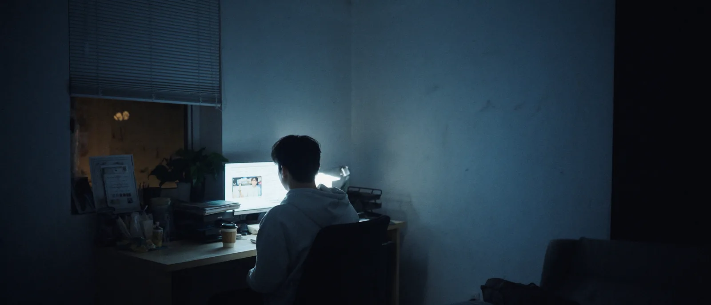
<small>ภาพห้องทำงานที่ทำตอนห้าโมงเย็นวันที่ 29 สิงหาคม (สร้างด้วย AI) ฉบับเต็มใช้องค์ประกอบอื่น</small>

## สถานที่ใช้เอลิเมนต์ ใบหน้าใช้มุม

Higgsfield เก็บสถานที่และตัวละครเป็นเอลิเมนต์ไว้แล้วเรียกในพรอมต์ด้วยเครื่องหมาย @ ได้ ผมทำเอลิเมนต์สถานที่ไว้สำหรับหอจัดงาน ภูเขาหิมะ ดวงจันทร์ ห้องทำงาน ถนนหน้าร้อน สวน และคาเฟ่ ภูเขาหิมะกับดวงจันทร์มีหลายเวอร์ชัน ไปถึง @bg-snow-5 กับ @bg-moon-4

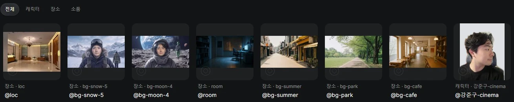
<small>เอลิเมนต์สถานที่เจ็ดตัวกับเอลิเมนต์ตัวละครหนึ่งตัวที่เก็บไว้ใน Higgsfield ฉากหลังบ้านในรูปตัวละครเปลี่ยนเป็นสีพื้น</small>

ลำดับงานผมยึดไว้แบบเดียวจนจบ **ทำภาพสถานที่ก่อน แล้วทำภาพที่ใส่คนลงในสถานที่นั้น แล้วค่อยทำภาพนั้นให้ขยับเป็นวิดีโอ** ถ้าโยนสถานที่กับคนแยกกันตอนทำวิดีโอ สองอย่างจะไม่เข้ากัน ส่วนภาพที่ใส่เป็นเฟรมแรกจะเข้าไปในวิดีโอตามนั้นเลย

ใบหน้าลองผิดลองถูกนานกว่า เอลิเมนต์ตัวละครแรก (@char_jungu, @char_sumin) ทำจากรูปเดียว หน้าเลยออกมาไม่ชัด ผมเลยเพิ่มรูปในเอลิเมนต์ และใส่รูปเป็นภาพอ้างอิงตรง ๆ ทีละคัตด้วย คราวนี้คิดว่ารูปยิ่งเยอะยิ่งดี กลับกลายเป็นตรงข้าม

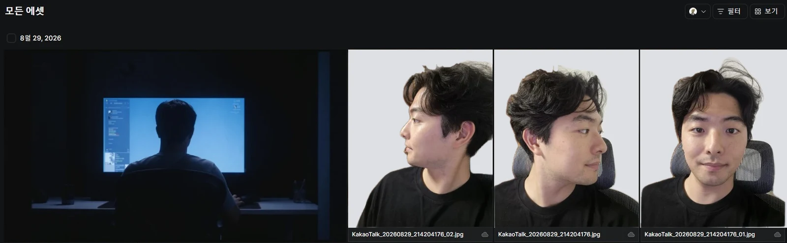
<small>รูปหน้าผมที่อัปโหลดเข้าโปรเจกต์วันที่ 29 สิงหาคม ถ่ายด้านข้าง 45 องศา และหน้าตรงแยกกัน เห็นในบ้าน เลยเปลี่ยนแค่ฉากหลังเป็นสีพื้น</small>

พอใส่รูปหน้าตรง ด้านข้าง และก้มหน้าพร้อมกัน แต่ละมุมจะถูกเฉลี่ย หน้าเลยเละ ผมจึงเปลี่ยนหลัก

| ลำดับ | รูปที่ใช้เป็นภาพอ้างอิง |
|---|---|
| 1 | รูปเดียวเท่านั้นที่ถ่ายมุมใกล้กับช็อตที่จะทำ |
| 2 | ถ้าไม่มี ใช้หน้าตรงที่ดีหนึ่งรูปกับด้านข้างที่ดีหนึ่งรูป |
| ห้าม | รูปหน้าตรง ด้านข้าง และมองลงพร้อมกัน สามทิศถูกเฉลี่ยพร้อมกัน |

ตอนใส่หน้าภรรยา หลักนี้สั่นคลอนอยู่ครั้งหนึ่ง รูปของเธอมีสามรูป หน้าตรง หัน 45 องศาตามองตรง และ 45 องศาตามองต่ำ ผมต้องการหน้าเธอที่มองลงมาจากมุมของผมที่นั่งบนม้านั่ง Claude เลยเสนอให้ใช้แค่รูปที่สามที่มุมใกล้สุด ผมมองว่ารูปนั้นตามองต่ำ ตาคงออกมาไม่ดี เลยใส่ทั้งสามรูป หลักก็คือหลัก แต่ต้องดูสีหน้าแต่ละรูปด้วย

ผมใช้วิธีตอกตำแหน่งบนใบหน้าด้วยข้อความด้วย เขียนระยะห่างระหว่างตา รูปเปลือกตา ความกว้างสันจมูก ความสูงโหนกแก้ม มุมกราม ความยาวร่องเหนือริมฝีปาก และความหนาริมฝีปาก แล้วปิดท้ายด้วย `Do not average these features` ประโยคนี้มีไว้กันการเฉลี่ยที่เกิดตอนผสมมุม

ถ้าเปิดเอลิเมนต์ตัวละครที่ยังเหลืออยู่ตอนนี้ @강준구 มีรูป 7 รูป ผสมรูปใส่สูทตอนถ่ายพรีเวดดิงกับรูปปกติ

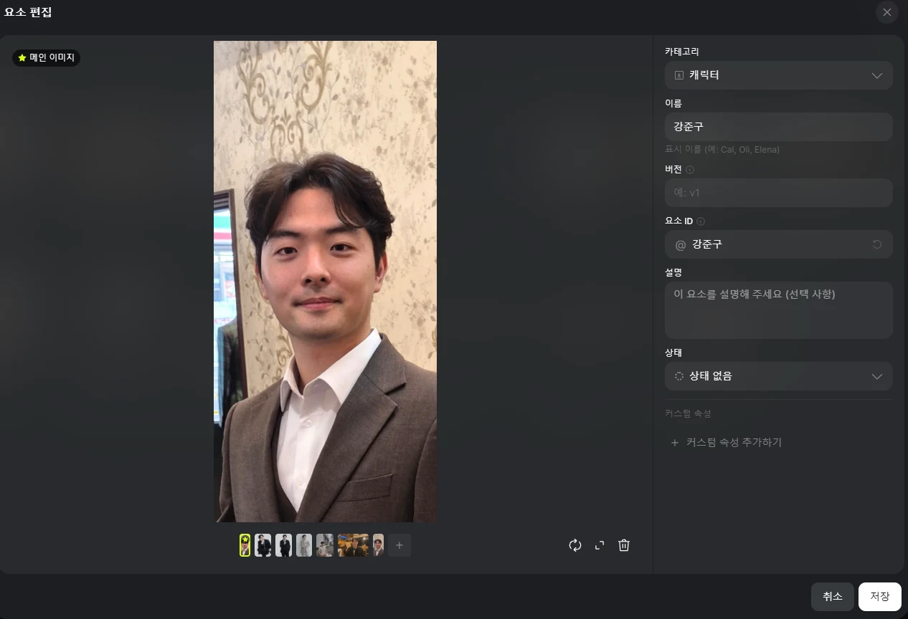
<small>เอลิเมนต์ @강준구 ภาพหลักหนึ่งรูปกับรูปเพิ่มหกรูป</small>

ผมทำตัวละคร Soul ของ Higgsfield (@강준구-cinema) ด้วย ใส่รูปตัวเองจากหลายที่ 17 รูป ในประวัติธุรกรรมมีรายการ Soul ID ตัดไป 25 เครดิต แต่มันเรียกใช้ได้แค่ใน Soul Cinema ไม่ได้ใน Nano Banana Pro หรือ Cinema Studio เลยไม่ได้ใช้ในช็อตส่วนใหญ่ วันที่ 6 กันยายนเรียกใช้ในช็อตเดียวกับ Seedance 2 ฉากเดินมาที่ม้านั่งแล้วนั่ง

<small>@강준구-cinema รูป 17 รูปต่างมุมต่างที่ ทั้งคาเฟ่ ร้านอาหาร และถ่ายพรีเวดดิง</small>

## เครดิตไม่ทบไปเดือนหน้า

บัญชี Higgsfield ของผมเป็นแพ็กเกจ Plus เครดิต 1,000 เข้าทุกวันที่ 3 ของเดือน สิบเอ็ดโมงเช้าเวลาเกาหลี ผมให้ Claude ไล่ดูประวัติธุรกรรมจนสุดเพื่อเช็ก ในบันทึกวันที่ 3 สิงหาคมมีบรรทัดเรียกคืนเครดิตที่เหลือ 843 อยู่ข้างบรรทัดให้เครดิตใหม่ 1,000 **เครดิตที่เหลือไม่ทบไปเดือนหน้า แต่หายไปเลย**

ช่วงก่อนรีเซ็ตเลยไม่มีเหตุผลต้องประหยัด ส่วนหลังรีเซ็ตจะลังเลแม้แต่วิดีโอเดียว ค่าใช้จ่ายต่อครั้งแยกตามโมเดลจากประวัติธุรกรรม:

| โมเดล | ประเภท | ค่าใช้จ่ายต่อครั้ง (เครดิต) |
|---|---|---|
| Nano Banana Pro | ภาพ | 2 |
| GPT Image 2.0 | ภาพ | 0.5–8.5 (ต่างกัน 17 เท่าตามการตั้งค่า) |
| Cinema Studio 4.0 | วิดีโอ | 20–72 |
| Seedance 2.5 | วิดีโอ | 19.26–132.73 |

วันที่ 31 สิงหาคม ผมจัดกลุ่มธุรกรรมล่าสุด 140 รายการตามโมเดล จากรวม 563 เครดิต วิดีโอ 8 ชิ้นกินไป 356 (63%) Nano Banana Pro ทำภาพ 38 ภาพใช้แค่ 76 เครดิต ส่วน 132.73 เครดิตที่หายไปทีเดียว ดูจากเวลาแล้วคือ Seedance 2.5 Edit 1080p ฉบับสุดท้ายที่รันตอนสี่ทุ่มสี่สิบเอ็ดวันที่ 30 สิงหาคม (เวลาเกาหลี) ตามประวัติธุรกรรม วันนั้นวันเดียวใช้ไปเกือบ 300 เครดิต

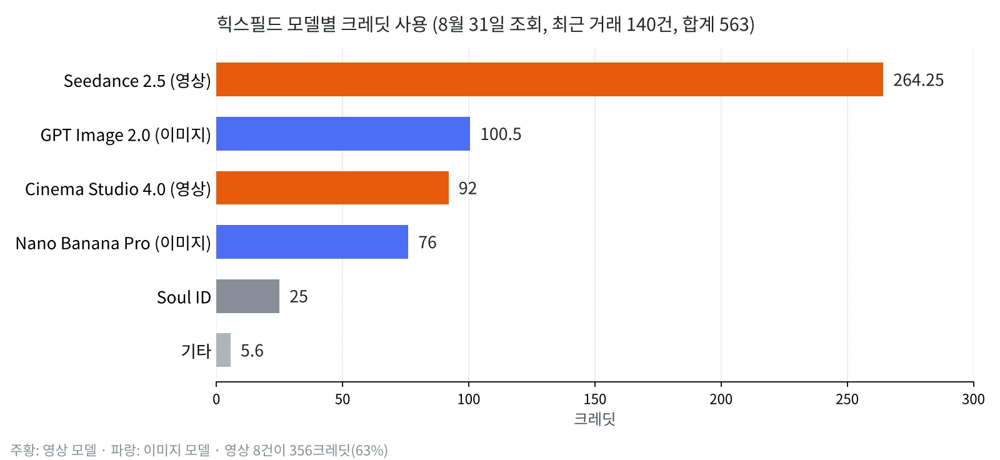
<small>ธุรกรรม 140 รายการที่ดึงมาวันที่ 31 สิงหาคม รวมตามโมเดล (วาดเองจากประวัติธุรกรรม)</small>

ตั้งแต่ 30 สิงหาคมถึง 6 กันยายน ผมสร้างวิดีโอในบัญชีไป 36 ชิ้น แยกตามโมเดล:

| โมเดล | จำนวน | ฉากหลักที่ใช้ |
|---|---|---|
| Seedance 2.5 | 20 | แพนขึ้นมุมมองม้านั่ง ซูมเข้าออกดวงตา กล้องเซลฟีในหอจัดงาน |
| Seedance 2.5 Edit | 9 | ฉากเดินหลง (เปลี่ยนฉากหลังและชุดในฟุตเทจจริง) เพิ่มโบว์ไทในกล้องเซลฟีหอจัดงาน ช็อตออกจากดวงตา |
| Cinema Studio | 4 | ช็อตพูดในห้องทำงานสามช็อต แพนขึ้นมุมมองม้านั่งหนึ่งช็อต |
| Higgsfield Genjutsu | 2 | เปลี่ยนหน้า (motion transfer) เพิ่มโบว์ไท (object swap) |
| Seedance 2 | 1 | เดินมาที่ม้านั่งแล้วนั่ง |

จาก 36 ชิ้น 19 ชิ้นเป็นตัวทดลอง 480p ส่วน 1080p มี 16 ชิ้น เช็กองค์ประกอบกับการเคลื่อนไหวที่ 480p ก่อน แล้วค่อยรันใหม่เฉพาะที่ดีเป็น 1080p ด้วยพรอมต์เดิม เครดิตต่างกันมากตามความละเอียด ลำดับนี้เลยลงตัวไปเอง

สิ่งที่พลาดไปตอนเตรียมทำให้ต้องเสียเครดิตและเวลาเยอะทีหลัง ถ้าทำแบบนี้อีก ผมจะทำตามลำดับนี้

| สิ่งที่ทำ | เหตุผล |
|---|---|
| เขียนในสตอรีบอร์ดทุกคัตว่า "มุมมองของใคร มองอะไร" | ผมเขียนแค่ "POV ขวดน้ำ" Claude เลยอ่านว่าเป็นมุมมองของขวด ที่จริงคือมุมมองของผมที่มองขวด |
| เก็บการตัดสินใจพร้อมเหตุผลไว้ในไฟล์เดียว | ตอนย้ายบัญชีส่งต่อแค่สรุป เหตุผลหายหมด |
| ตั้งเป็นกฎตั้งแต่แรกว่าวิดีโอทดลอง 480p → 1080p | รันครั้งเดียว 132 เครดิตเท่ากับทดลองหกครั้ง |
| เปิดคอนเนกเตอร์เฉพาะตอนสร้าง | แค่คำอธิบายเครื่องมือก็กินโควตา Claude ไปมากทุกรอบ |

ตอนที่ 2 ว่าด้วยห้องทำงาน S#1 และฉากเดินหลง S#2 ผมแก้พรอมต์ยังไงระหว่างรันคลิปเซลฟี GoPro ยาว 15 วินาทีผ่าน Seedance 2.5 Edit ซ้ำหกรอบ และทำไมถึงเลิกสร้างหน้าจอมอนิเตอร์ด้วย AI
