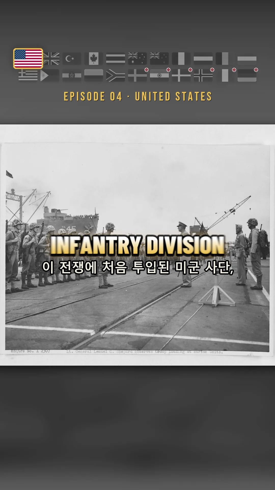
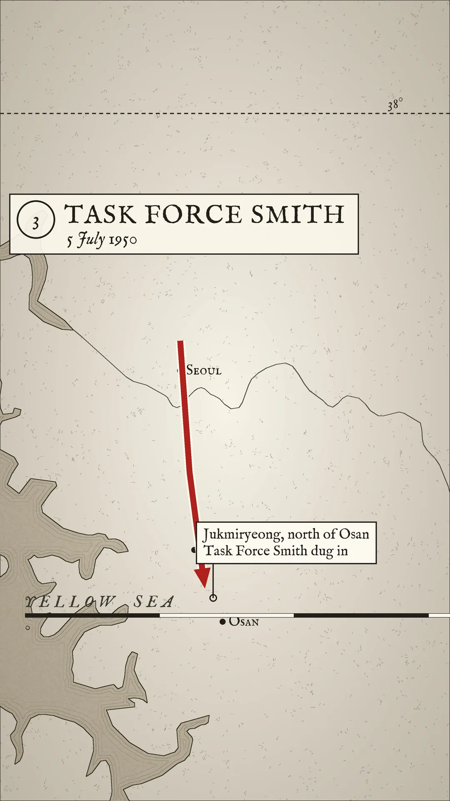
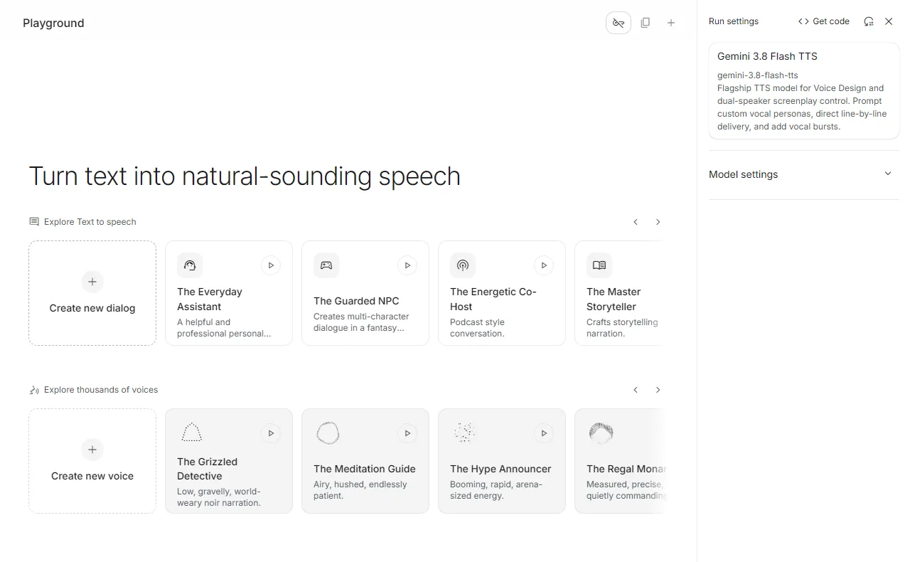
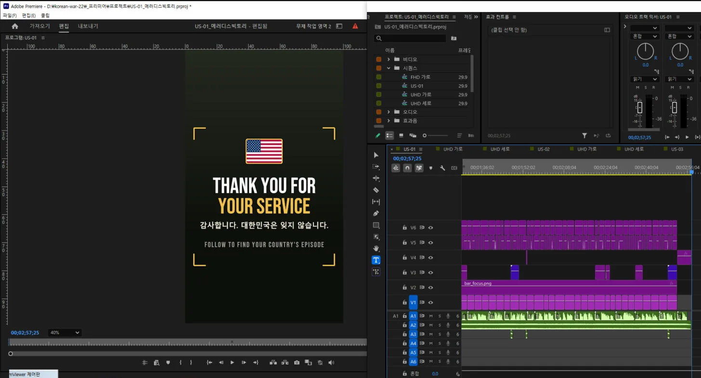
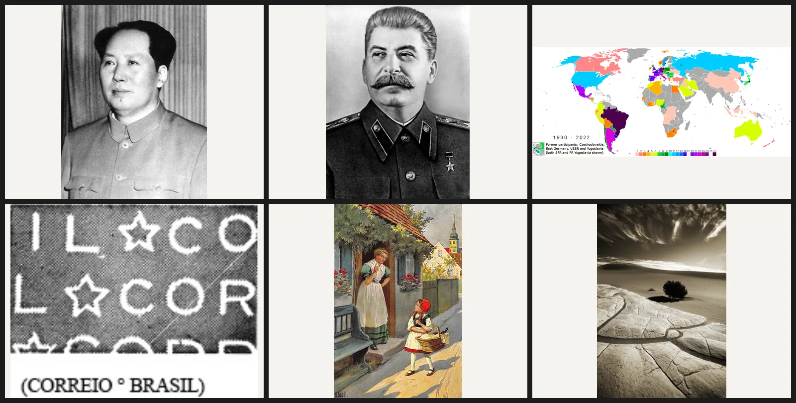
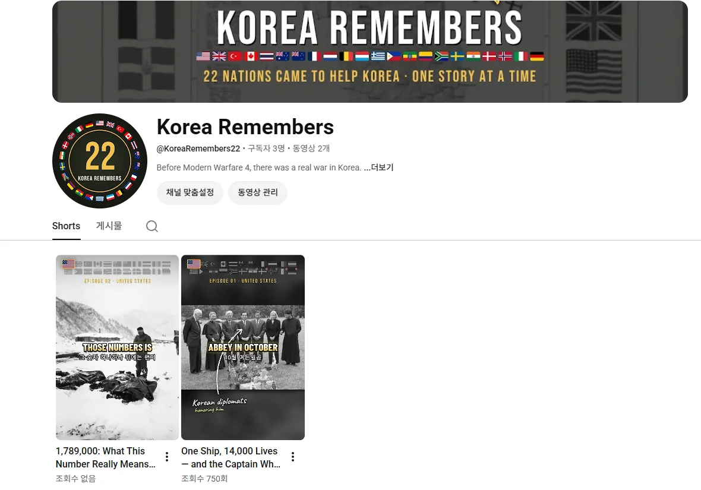

ใส่บทหนึ่งชุดกับโฟลเดอร์ภาพเข้าไป แล้ว Claude ก็ประกอบไทม์ไลน์ใน Premiere ให้เอง ผมใช้เวลาสามวันสร้างเส้นทางนี้ขึ้นมา แล้วผลิตคลิปสั้นความยาวราวสองนาทีห้าสิบวินาทีได้สี่ตอน

<small>เฟรมที่เสร็จแล้ว แถบธง คำบรรยายตัวใหญ่ คำบรรยายรอง และตำแหน่งภาพ ล้วนถูกวางโดยโค้ด</small>

## ทำไมต้อง 22 ชาติ

มียี่สิบสองประเทศที่ส่งกำลังพลหรือบุคลากรทางการแพทย์มาในสงครามเกาหลี เป็นชาติรบ 16 และชาติสนับสนุนทางการแพทย์ 6 ผมเลือกเรื่องนี้มาทำช่องด้วยเหตุผลสามข้อ

| เหตุผล | รายละเอียด |
|---|---|
| จังหวะเวลา | Modern Warfare 4 ออกวันที่ 23 ตุลาคม 2026 แคมเปญของเกมคือสงครามบนคาบสมุทรเกาหลีที่เปิดฉากด้วยการบุกเต็มรูปแบบของเกาหลีเหนือ ตัวเอกเป็นพลทหารเกาหลีใต้ ตอนนี้เกมเมอร์ทั่วโลกกำลังค้นหาเกาหลี |
| ปริมาณวัตถุดิบ | ทุกชาติมีหน่วย มีการรบ และมีผู้คนให้เล่า ยี่สิบสองชาติยืดไปได้เป็นร้อยตอน ตอนนี้ผมเขียนบทไว้แล้ว 145 ตอน |
| ตลาด | ในบรรดาชาติที่ร่วมรบ สหรัฐฯ อังกฤษ แคนาดา ออสเตรเลีย นิวซีแลนด์ เนเธอร์แลนด์ กลุ่มนอร์ดิก และเยอรมนี ล้วนมีค่าโฆษณาสูง |

ข้อสามนี่แหละใหญ่ที่สุดจริง ๆ ถ้าทำเป็นภาษาเกาหลีอย่างเดียว ตลาดมีห้าสิบล้านคน แล้วยังถูกแบ่งย่อยอีก ผมจึงเลือก **ใช้ภาษาอังกฤษเป็นพื้น แล้วใส่คำบรรยายภาษาของชาตินั้นกับธงเป็นการปฏิบัติพิเศษเฉพาะตอนของชาตินั้น** หมากคือทำให้คนที่เห็นประเทศตัวเองถูกเน้นขึ้นมา ไล่ดูโปรไฟล์แล้วถามว่า "ประเทศฉันมีด้วยไหม" ส่วนภาษาที่เหลือปล่อยให้ระบบพากย์อัตโนมัติของยูทูบจัดการ ช่องชื่อ Korea Remembers ใช้บัญชีเดียว ลงวันละตอน

อารมณ์ของช่องคือความขอบคุณ ไม่ใช่ความโกรธ ข้อเท็จจริงที่ว่าคนเกาหลีเป็นคนทำ กลายเป็นความจริงใจในตัวมันเอง

## ผมแกะช่องอ้างอิงเพื่อกำหนดดีไซน์

ผมไม่ได้ทำตามความรู้สึก ผมโหลดคลิปของช่องที่อยากไปให้ถึงมาแกะดู ดูโครงสร้างจากช่อง Hystoria ของอินโดนีเซีย (ผู้ติดตาม 1.42 แสน) ส่วนไวยากรณ์ภาพนั้น ผมโหลดคลิปสั้นสามตัวของ Silent Souls Stories (ผู้ติดตาม 1.75 แสน) ด้วย yt-dlp แล้วไล่ดูทีละเฟรม

| สิ่งที่พบในช่องอ้างอิง | สิ่งที่ผมนำมาใช้ |
|---|---|
| แทบไม่มีเอฟเฟกต์เปลี่ยนภาพ มีแค่การตัด กับการดึงภาพเล็กน้อยที่นิ่งลงทันทีหลังตัด | แต่ละคัตดึงจาก 104% ลงมา 100.5% แล้วค่อย ๆ ดันไปถึง 106% |
| ฉากหนึ่งเฉลี่ย 2 วินาที | คัตเฉลี่ยราว 3 วินาที ส่วนช่วงเปิด 1.3 ถึง 1.7 วินาที |
| แสงวาบสีขาว 0.6 วินาทีเฉพาะตอนเปลี่ยนช่วงใหญ่ | ใช้แค่หนึ่งถึงสองครั้ง ตรงที่เรื่องหักมุม |
| คำบรรยาย 1 ถึง 3 คำ ตัวพิมพ์ใหญ่ กลางจอ | ไล่สีจากขาวลงเหลือง วางกลางจอ |

<small>แผนที่ไม่ได้หยิบมาใช้ แต่ให้โค้ดวาด มีเพียงข้อมูลเส้นชายฝั่งที่มาจากแหล่งเปิด ที่เหลือวาดทั้งหมด</small>

ผมเติมของตัวเองเข้าไปสองอย่าง แถบธง 22 ชาติลอยอยู่ด้านบนจอตลอดทั้งคลิป และวินาทีที่เสียงบรรยายพูดว่า "วันนี้คือสหรัฐอเมริกา" ธงนั้นธงเดียวจะขยาย 1.45 เท่าพร้อมขอบสีทอง ส่วนที่เหลือกลายเป็นขาวดำ อีกอย่างคือแผนที่ ผมไม่ได้ยืมมา แต่วาดเอง ทั้งพื้นผิวกระดาษ เส้นชายฝั่งลายหมึก เส้นคลื่นริมฝั่ง เส้นขนานที่ 38 กล่องหัวเรื่องที่มีเลขกำกับ และลูกศรบอกการเคลื่อนที่สีแดง ทุกฉากได้แผนที่คนละใบ

## เสียงทำทีเดียวเป็นบล็อกเดียว จังหวะให้การถอดเสียงจัดการ

ตอนแรกผมวางเสียงไกด์ด้วยเสียงที่ติดมากับวินโดวส์ คำตัดสินมีคำเดียว ขยะ

ตอนนี้ผมทำที่เว็บ Gemini AI Studio จุดสำคัญคือ **ใส่บททั้งหมดลงในบล็อกเสียงเดียว เว้นบรรทัดว่างระหว่างฉาก แล้วสั่งรันรวดเดียว** ถ้าทำทีละฉาก เสียงจะเพี้ยนไปทีละนิด เสียงใช้ตัวเดียวคือ Riko เสียงบรรยายยาวสองนาทีห้าสิบวินาทีออกมาเป็นไฟล์เดียว

<small>หน้าจอที่ใช้สร้างเสียงบรรยาย ต้องกด "Create new dialog" ก่อน ช่องใส่ข้อความถึงจะโผล่</small>

จากนั้นคือหัวใจ ผมเอาไฟล์เสียงบรรยายไปถอดเสียงซ้ำด้วย faster-whisper **เพื่อดึงออกมาว่าคำแต่ละคำอยู่ที่วินาทีไหน** แบบนี้ก็ไม่ต้องไล่จับคำบรรยายด้วยมือ ถ้าในรายการคัตเขียนว่า "ภาพนี้เริ่มที่คำว่า Hungnam" โค้ดจะหาเวลาจริงของคำนั้นแล้ววางคัตให้ ความแม่นของการจับคู่อยู่ที่ 95 ถึง 98 เปอร์เซ็นต์ต่อตอน

คำบรรยายมีสองบรรทัด บรรทัดใหญ่เป็นภาษาของชาตินั้น 1 ถึง 3 คำ บรรทัดเล็กข้างล่างเป็นภาษาอังกฤษ ส่วนตอนของชาติที่ใช้ภาษาอังกฤษ บรรทัดล่างจะเป็นภาษาเกาหลี ภาษาเกาหลีถูกหั่นเป็นชิ้นเล็กเกินไป ผมจึงจัดกลุ่มใหม่ตามความหมาย ชิ้นที่สั้นกว่าเก้าตัวอักษร หรือชิ้นที่ความหมายยังไม่จบ จะถูกรวมกับชิ้นถัดไป และหนึ่งบรรทัดยาวได้ถึงสิบแปดตัวอักษร ตอนหนึ่งลดจาก 139 ชิ้นเหลือ 66 ชิ้น

## Claude ประกอบ Premiere ให้โดยตรง

ตรงนี้แหละที่ใช้ MCP ผมใช้อยู่สองตัว

| MCP | หน้าที่ |
|---|---|
| Premiere Pro MCP | เปิดโปรเจกต์และบันทึกเป็นชื่อใหม่ ประกอบไทม์ไลน์ผ่าน `execute_extendscript` และส่งออกไฟล์ |
| Playwright (เบราว์เซอร์ Whale พอร์ตดีบัก 9222) | สร้างและดาวน์โหลดเสียงใน AI Studio เก็บวัตถุดิบจากหอจดหมายเหตุแห่งชาติสหรัฐฯ และ DigitaltMuseum ตั้งเวลาอัปโหลดขึ้นยูทูบกับอินสตาแกรม |

ลำดับเป็นแบบนี้ ฝั่งไพทอน (`premiere_prep.py`) จะประกอบภาพล่วงหน้าที่ขนาด 1080×1920 วาดคำบรรยาย ป้ายชื่อ ตัวอักษรพู่กัน และแผนที่ออกมาเป็นชุดไฟล์ PNG แล้วสร้าง `plan.json` ขึ้นมาหนึ่งไฟล์ จากนั้นจึงยิง ExtendScript หนึ่งบรรทัดผ่าน MCP ของ Premiere สคริปต์นั้นจะอ่าน plan แล้วเติมแทร็กแปดแทร็กให้เต็ม

<small>ไทม์ไลน์ที่ประกอบเสร็จแล้ว ไม่มีใครลากคลิปพวกนี้เข้าไปทีละตัว</small>

V1 ภาพกับแผนที่ V2 แถบธง V3 ป้ายชื่อ ลูกศร และตัวอักษรพู่กันเกาหลี V4 การ์ดข้อความ ฉากจบ และแสงวาบขาว V5 คำบรรยายตัวใหญ่ V6 คำบรรยายรอง A1 เสียงบรรยาย A2 ดนตรี หนึ่งตอนมีคลิปเกิน 250 ชิ้น และไม่มีมนุษย์คนไหนวางมัน

สิ่งที่ได้เรียนรู้ระหว่างทำระบบอัตโนมัติคือ แม้แต่การตัดสินใจก็ใส่ลงไปในโค้ดได้ ทุกฉากจะได้คะแนนความสำคัญจากเสียงบรรยายของมัน คำสำคัญอย่าง Medal of Honor, first, captured, killed ได้ 3 คะแนน ตัวเลขใหญ่ได้ 3 คำขอบคุณได้ 3 และคำสำคัญที่โผล่เป็นครั้งแรกในตอนนั้นได้ 2 เฉพาะฉากที่เกิน 6 คะแนนเท่านั้นที่ใช้ตัวอักษรพู่กันสีเหลืองได้ ถ้าไม่ถึง โค้ดจะตัดออกให้เอง เอฟเฟกต์เสียงผมก็สังเคราะห์เองด้วยไพทอนเพื่อไม่ให้ติดลิขสิทธิ์ ทั้งเสียงกระแทกตอนขึ้นโลโก้ เสียงลมตอนแสงวาบ เสียงพิมพ์ของการ์ด เสียงทุ้มหนัก และเสียงพู่กัน รวมห้าเสียง

## เมื่อโค้ดเชื่อสิ่งที่โค้ดเก็บมาไม่ได้

วัตถุดิบก็เก็บด้วยโค้ดเหมือนกัน มันไล่กวาด Wikimedia Commons เป็นรายประเทศ แล้วแยกสัญญาอนุญาตเป็นสามระดับ คือเสรี (สาธารณสมบัติ, CC0) ระบุที่มา (CC BY) และเผยแพร่แบบเดียวกัน (CC BY-SA) ส่วนแบบห้ามใช้เชิงพาณิชย์และห้ามดัดแปลงนั้นไม่รับ

แต่พอเปิดชุดที่เก็บมารอบแรกดู ภาพฟิลิปปินส์ทั้ง 114 ใบเป็นภาพช่วงปี 1992 ถึง 2016 ทั้งหมด เป็นงานการเมืองฟิลิปปินส์กับการเยือนของพระสันตะปาปา สาเหตุคือหมวดย่อยเพียงหมวดเดียวของ `Philippines in the Korean War` เป็นบุคคลที่เคยเป็นทหารผ่านศึกแล้วได้เป็นประธานาธิบดี และการไล่ลงไปอีกสองชั้นจากตรงนั้นก็ลากวิดีโอเอเปคตามมาด้วย ผมจึงห้ามไม่ให้ไล่ลงไปในหมวดที่มีรูปแบบเป็นชื่อคน ใส่ตัวกรองปี 1949–1956 และแยกคำตัดสินเป็นสามทาง คือรับ ตรวจซ้ำ และทิ้ง

ฟังก์ชัน "ค้นด้วยคำ" ที่เติมเข้าไปหลังจากนั้นกลับเป็นรูรั่วที่ใหญ่กว่า ผมลองใช้คำว่าเยอรมนีค้นดู ได้ไฟล์กลับมา 110 ไฟล์ เป็นการประกวดภาพถ่ายของกองทัพสหรัฐฯ ปี 2007 แสตมป์บราซิล แผนที่การเข้าร่วมฟุตบอลโลก และการ์ตูนโซเวียต

<small>ของที่ได้กลับมาจากการค้นคำว่า "เยอรมนี" ทั้ง 110 ไฟล์เป็นแบบนี้</small>

การตรวจว่าเกี่ยวกับเกาหลีหรือไม่นั้นดันใช้เส้นทางหมวดหมู่ที่ไฟล์ถูกลากมาเป็นหลักฐานด้วย และผลการค้นจะมีคำค้นเขียนอยู่ในเส้นทางนั้นตรง ๆ อะไรก็เลยผ่านหมด ผมปิดการค้นเป็นค่าตั้งต้น และไฟล์ที่คัดออก 704 ไฟล์ ขนาด 5.2GB ตอนนี้เก็บไว้ในโฟลเดอร์กักกันแทนที่จะลบ ผมแก้ตัวเลขจำนวนภาพจาก 1,658 ลงมาเป็น 1,040 ถ้าวางแผนบนตัวเลขที่พองไว้ ตัวเลขนั้นจะกลายเป็นรูโหว่ในภายหลัง

## ตอนนี้ถึงไหนแล้ว

<small>ช่องเพิ่งเปิด บรรทัดแรกของคำแนะนำช่องเขียนว่า "Before Modern Warfare 4, there was a real war in Korea."</small>

ตัวเต็มทำเสร็จแล้วตั้งแต่ US-01 เรื่องเรือ SS Meredith Victory ที่ฮึงนัม ไปจนถึง US-04 หน่วยเฉพาะกิจสมิธ และกำลังทยอยขึ้นยูทูบกับอินสตาแกรมวันละตอน ตอนที่ 1 อยู่ที่นี่ [One Ship, 14,000 Lives — and the Captain Who Gave Up Everything](https://youtube.com/shorts/D4IVNaqsKUQ) ตอนต่อไปเป็นเรื่องของฮัดเนอร์กับบราวน์

งานที่เหลือกองอยู่ฝั่งที่ต้องใช้คน ห้าประเทศที่มีภาพไม่ถึงสิบใบยังทำวิดีโอไม่ได้ ภาพยุคนั้นของเยอรมนีกับอิตาลีมีอยู่ในหอจดหมายเหตุแห่งชาติเกาหลีในรูปเอกสารที่ไม่ใช่ดิจิทัลเท่านั้น จึงต้องยื่นคำขอสำเนาที่ต้องยืนยันตัวตน ส่วนตอนของชาติที่ไม่ได้ใช้ภาษาอังกฤษก็ต้องมีเสียงบรรยายภาษานั้นและการตรวจทานโดยเจ้าของภาษาต่างหาก
