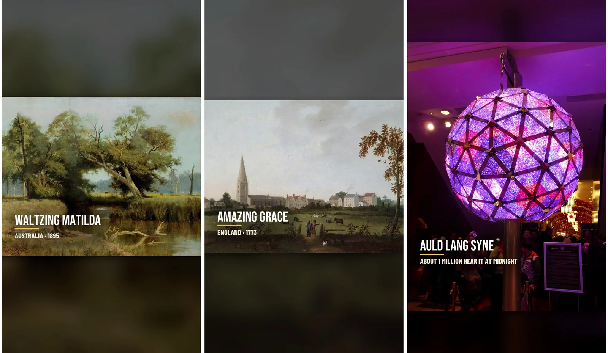

ผมกำลังทำชอร์ตความยาว 60 วินาทีเกี่ยวกับเพลงหนึ่งเพลงที่คนในแต่ละประเทศรู้จัก พร้อมเรื่องราวเบื้องหลังเพลงนั้น ผมใช้เฉพาะเพลงที่หมดลิขสิทธิ์แล้ว และเสียงไม่ได้สร้างจาก AI ใช้เฉพาะการแสดงที่บันทึกไว้จริง ในสองวันทำไปสามตอน

<small>เฟรมแรกของสามตอน: Waltzing Matilda (ออสเตรเลีย), Amazing Grace (ทำเป็นตอนของสหรัฐฯ), Auld Lang Syne (สกอตแลนด์)</small>

## ทำไมถึงเอาเพลงมาใส่ในช่องสงคราม

ผมทำช่อง Korea Remembers ที่เล่าถึง 22 ประเทศที่เข้าร่วมสงครามเกาหลีทีละประเทศ ไอเดียใส่เพลงของแต่ละประเทศเกิดขึ้นก่อน แต่พอจะโยงกับสงครามกลับรู้สึกฝืน ผมจึงใช้ช่องเดิม แยกเพลย์ลิสต์ และแยกกฎออกจากกัน

| หัวข้อ | ตอนสงคราม | ตอนเพลง |
|---|---|---|
| เรื่องราว | หน่วย การรบ และบุคคลของประเทศนั้น | เฉพาะเพลงกับเรื่องของประเทศนั้น ไม่พูดถึงสงครามเกาหลี |
| เปิด / ปิด | แถบธง 22 ประเทศ คำขอบคุณ | ไม่มีทั้งสองอย่าง เริ่มด้วยท่อนหนึ่งของเพลงและจบด้วยเพลง |
| ความยาว | 3 นาที, 60 วินาที | ไม่เกิน 60 วินาที |
| ภาพ | ภาพถ่ายสมัยนั้น แผนที่ที่วาดเอง | ภาพถ่ายเก่า ภาพวาด โน้ตเพลง |

วัตถุดิบคือเพลงพื้นบ้านหรือเพลงยอดนิยมของชาติที่หมดลิขสิทธิ์แล้ว ลำดับประเทศเป็นไปตามผู้ชมของช่อง: สหรัฐฯ 11.4% ฟิลิปปินส์ 6.8% อินเดีย 2.5% แคนาดา 2.1% ออสเตรเลีย 1.6%

## เสียงผิดไปโน้ตเดียวก็กลายเป็นของปลอม

แรก ๆ ผมคิดจะใช้เพลงเลียนแบบที่ AI สร้าง แต่เลิกความคิดนั้น คนเกาหลีเห็นอารีรังถูกเรียบเรียงแปลก ๆ แล้วโกรธ คนชาติอื่นก็รู้สึกเหมือนกัน ผมตัดสินใจไม่เปลี่ยนทำนอง จังหวะ หรือเครื่องดนตรีแม้แต่นิดเดียว ซึ่งหมายถึงต้องใช้การบันทึกเสียงที่คนจริง ๆ เล่น

ปัญหาคือลิขสิทธิ์ของเพลงกับลิขสิทธิ์ของการบันทึกแยกจากกัน ตอนค้นเพลงแรก Waltzing Matilda ผมพบดังนี้

| การบันทึก | ข้อติดขัด |
|---|---|
| บันทึกครั้งแรก 1926–27 (เทเนอร์ จอห์น คอลลินสัน) | ทำนองต่างจากที่คนรู้จักทุกวันนี้ คำอธิบายระบุว่าแก้บรรทัดที่ 2 และ 4 |
| ฉบับปีเตอร์ ดอว์สัน 1938 | ฉบับที่ทำให้เพลงนี้ฮิต ความคุ้มครองการบันทึกในออสเตรเลียและอังกฤษหมดแล้ว แต่ในสหรัฐฯ ยังอยู่ถึงสิ้นปี 2038 |
| วงดุริยางค์ทหารนาวิกโยธินที่ 1 ของสหรัฐฯ (2021) | ลงไว้เป็น "PUBLIC DOMAIN" ที่ DVIDS เว็บสื่อสาธารณะของกองทัพสหรัฐฯ เป็นการเล่นเครื่องเป่าไม่มีเนื้อร้อง |

ฉบับดอว์สัน "ของจริง" ที่สุด แต่ผู้ชม 11% อยู่ในสหรัฐฯ ผมจึงเลือกฉบับวงดุริยางค์ เนื้อร้องปรากฏเป็นข้อความบนจอเท่านั้น

<small>หน้าที่ผมได้เสียงของตอน 1 มา มีคำว่า PUBLIC DOMAIN อยู่ล่างสุดของกล่องข้อมูล กองนาวิกโยธินที่ 1 ประจำอยู่ในออสเตรเลียช่วงสงครามโลกครั้งที่สองและรับเพลงนี้เป็นเพลงประจำกอง</small>

ทั้งสามตอนได้เสียงมาทางนี้

| ตอน | เพลง | การบันทึกที่ใช้ | ความยาว |
|---|---|---|---|
| 1 | Waltzing Matilda | วงดุริยางค์นาวิกโยธินที่ 1 สหรัฐฯ (DVIDS) | 43.2 วิ |
| 2 | Amazing Grace | ฉบับขับร้องของวง Southern Aire กองหนุนกองทัพอากาศสหรัฐฯ (วิกิมีเดียคอมมอนส์) | 39.3 วิ |
| 3 | Auld Lang Syne | วงดุริยางค์กองทัพบกสหรัฐฯ เล่นเครื่องเป่า (วิกิมีเดียคอมมอนส์) | 58.9 วิ |

ผมไม่ตัดหรือต่อการแสดง ถ้ายาว 43 วินาที วิดีโอก็ยาว 43 วินาที มีเพียง Amazing Grace ที่ตัวเต็มยาว 130 วินาทีเท่านั้นที่ตัดตอนจบท่อนที่ 1

## ถ้าเลือกด้วยหู ก็ไม่ใช่ระบบอัตโนมัติ

ถ้ามีไฟล์เสียงให้เลือกหลายอัน ต้องมีใครสักคนฟังทั้งหมดแล้วตัดสินว่า "ใช่ นี่คือเพลงนั้น" ถ้าผมเป็นคนทำเอง ก็ไม่ใช่อัตโนมัติ ผมจึงดึงทำนองจากฉบับที่มีคนดูมากที่สุดมาเป็นเกณฑ์ แล้วให้โค้ดเปรียบเทียบตัวเลือกที่ใช้ได้ โดยดึงระดับเสียงแล้วจับคู่ให้แม้จังหวะต่างกัน

<small>ยิ่งต่ำยิ่งเป็นทำนองเดียวกัน แต่เพลงอื่นกลับได้คะแนนต่ำกว่าตัวเลือกจริง</small>

ผลคือล้มเหลว เพลงที่ต่างกันโดยสิ้นเชิงได้ 0.52 ดู "เหมือน" มากกว่าตัวเลือกจริง ขยายเป็นช่วง 40 วินาทีก็ไม่ต่างกัน เปลืองโทเค็นอย่างเดียว ผมหยุดวิธีนี้ ตอนนี้ฟังเองแค่ 30 วินาทีของตัวเลือกอันดับหนึ่ง

## ลำดับการทำหนึ่งตอน

หลังทำสองตอน ลำดับก็เข้าที่ ผมใช้เครื่องมือประกอบที่สร้างไว้สำหรับตอนสงครามต่อ

| ขั้น | งาน |
|---|---|
| 1 | หาเสียงก่อน: วิกิมีเดียคอมมอนส์ แล้วค่อย DVIDS วัดความยาว |
| 2 | อ่านวิกิพีเดียหนึ่งรอบ ทำตารางตรวจข้อเท็จจริง แล้วเขียนบท จำนวนคำ = (ความยาวเพลง − 3 วินาทีแรกที่มีแต่เพลง − 5 วินาทีท้าย) × 2.3 |
| 3 | โหลดภาพถ่ายเก่า ภาพวาด โน้ตเพลงจากแหล่งสาธารณะ |
| 4 | สร้างเสียงบรรยายและจับเวลาของแต่ละคำด้วยการถอดเสียง |
| 5 | เขียนรายการคัตและประกอบไทม์ไลน์ด้วย Premiere MCP ใส่เพลงแล้วส่งออก |
| 6 | ตรวจความยาว เฟรมดำ และเสียงซ้าย/ขวาเป็นตัวเลข แล้วดูสรุปหนึ่งแผ่น |

ต่างจากตอนสงครามตรงที่ความยาวบทคำนวณย้อนจากความยาวเพลง เพลงตัดไม่ได้ คำพูดจึงต้องปรับตามเพลง

<small>ตอน 1 โน้ตที่จดด้วยมือเมื่อปี 1895 กับภาพวาดแอ่งน้ำ ในบทแยก "เรื่องเล่าที่สืบต่อกันมา" ออกจากข้อเท็จจริงที่ยืนยันแล้ว</small>

## เปิด 3 วินาทีแรกด้วยตัวเลขใหญ่

ระหว่างอัปโหลดตอน 2 ผมรู้ว่าช่วงเปิดอ่อน 3 วินาทีแรกต้องมีความรู้สึกว่า "เคยได้ยินเพลงนี้ไหม" คนอยากเป็นส่วนหนึ่งของตัวเลขใหญ่ มีคนรู้จักมากขนาดนั้นเลยหรือ ฉันเองก็รู้จักเพลงนี้ใช่ไหม แล้วพวกเขาก็หยุดดู

ผมไม่แต่งตัวเลข หาที่มาด้วยการค้นหนึ่งสองครั้งแล้วเขียนเป็นค่าโดยประมาณ

| เพลง | ตัวเลขใหญ่บนจอ | ที่มา |
|---|---|---|
| Waltzing Matilda | ชาวออสเตรเลียราว 1 ใน 4 เลือกเป็นเพลงชาติ | 28% ในการลงประชามติระดับชาติปี 1977 |
| Amazing Grace | เพลงที่ถูกร้องราวทุก 3 วินาที | ประมาณการของผู้เขียนชีวประวัติราว 10 ล้านครั้งต่อปี ÷ 31.5 ล้านวินาทีต่อปี |
| Auld Lang Syne | เพลงที่ราว 1 ล้านคนได้ยินตอนเที่ยงคืน | ประมาณการจำนวนคนในการนับถอยหลังปีใหม่ที่ไทม์สแควร์ |

ผมหาผลสำรวจการรู้จักแบบ "กี่เปอร์เซ็นต์รู้จักเพลงนี้" ของทั้งสองเพลงไม่พบ ถ้าไม่มีก็ใช้ตัวเลขใหญ่อย่างอื่นแทน เช่น สัดส่วนการลงคะแนนหรือจำนวนครั้งที่ถูกร้อง ช่วงเปิดแบบนี้เริ่มใช้ตั้งแต่ตอน 3

<small>ตอน 3 ช่วงเปิดด้วยตัวเลขใหญ่อยู่ทางซ้าย ทางขวาคือประโยคที่บอกว่าเกาหลีร้องเพลงชาติด้วยทำนองนี้ตั้งแต่ปี 1945 ถึง 1948</small>

## ตอนนี้

<small>เพลย์ลิสต์ Songs and Their Stories วันนี้ตอน 1 มี 497 ครั้ง ตอน 2 มี 240 ครั้ง</small>

อัปไปสามตอน แต่วันนี้เพลย์ลิสต์แสดงแค่สองตอน ตอน 3 กลายเป็นดูไม่ได้ และผมกำลังตรวจสอบสาเหตุ

มีความผิดพลาดอย่างหนึ่งด้วย ตอน 1–3 มีบรรทัดภาษาเกาหลีอยู่ด้านล่าง วิดีโอสำหรับผู้ชมทั่วโลกไม่จำเป็นต้องมีบรรทัดเกาหลี ตั้งแต่ตอน 4 บรรทัดล่างจะเปลี่ยนเป็นภาษาอินโดนีเซีย

ตอน 1 เริ่มจากข้อเท็จจริงที่ว่าเพลงที่ชาวออสเตรเลียรักที่สุดนั้นแท้จริงแล้วเป็นเรื่องของขโมยแกะ

{{shorts: UJUn_dsgcus}}
