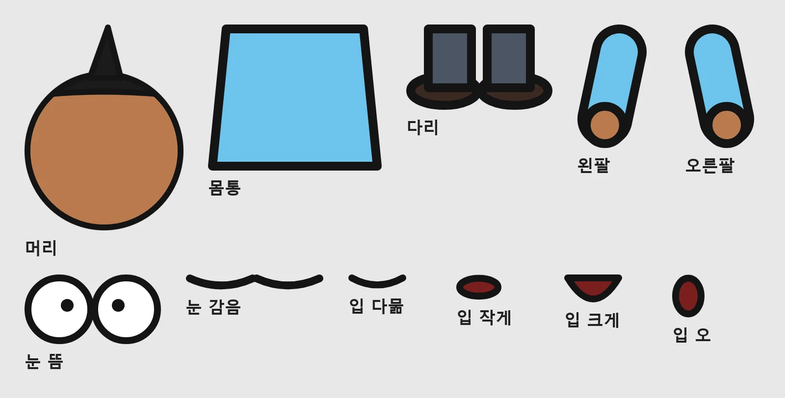
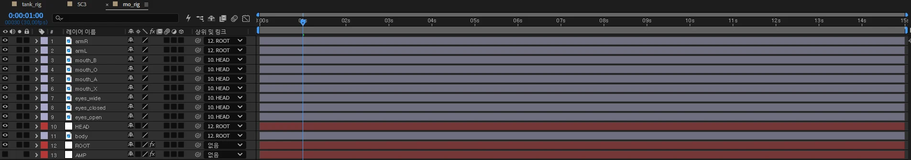

ผมวาดแอนิเมชันไม่เป็น แต่ก็เปิดช่องช็อตส์แอนิเมชันนิทานร่วมกับ AI ได้ ชื่อ Tiny Tale Troupe ตัวละครประจำห้าตัวเล่นนิทานพื้นบ้านเรื่องใหม่ทุกตอน ตัวละครวาดด้วยโค้ด การเคลื่อนไหวมาจากริกกิ้ง After Effects และฉากหลังทำด้วย Gemini

<small>ฉากหนึ่งจากตอนที่ 1 «ขวานทอง» ฉากหลังโดย Gemini ตัวละครวาดด้วยโค้ดและขยับใน After Effects</small>

ตอนที่ 1 อยู่ที่นี่: [Tiny Tale Troupe ตอนที่ 1](https://youtube.com/shorts/Rechu83_CdA)

## นักแสดงห้าคน เรื่องใหม่ทุกครั้ง

รูปแบบนี้ผมยืมมาจาก South Park นักแสดงชุดเดิมแค่เปลี่ยนบทและชุดเพื่อเล่นนิทานเรื่องใหม่ และประโยคแรกกับประโยคสุดท้ายจะถามว่า «ถ้าเป็นคุณล่ะ?» ไม่ต้องออกแบบตัวละครใหม่ และคนดูก็ผูกพันกับพวกเขา

<small>ตัวเอกห้าตัว จากซ้าย: โม, บาบา, นานา, คิกิ, แทงก์</small>

| ตัวละคร | รูปลักษณ์ | เป็นใครสำหรับคนดู |
|---|---|---|
| โม | ชายผอมวัย 20 ผมแหลม สีฟ้า | «ตัวเรา» คนธรรมดา: ใจดีแต่ไม่อยากเสียเปรียบ และหวั่นไหวกับสิ่งยั่วยุ |
| บาบา | ชายอ้วนวัย 40 หัวล้านมีหนวด สีม่วง | ตัวที่ดูไปด่าไป ตัวร้าย ราชา คนรวย |
| นานา | คุณยายหลังค่อมวัย 70 ถือไม้เท้า สีเขียว | ผู้ตั้งบททดสอบ ผู้รู้ แม่มด |
| คิกิ | เด็กหญิง 10 ขวบ ผมแกละสองข้าง สีเหลือง | ใช้ไหวพริบเล่นงานบาบาให้คนดูสะใจ |
| แทงก์ | หญิงร่างสูงวัย 30 ผมแดงสั้น สีแดง | พลังและกฎ เป็นกำแพง หรือพันธมิตรที่คาดไม่ถึง |

ผมตั้งใจให้เชื้อชาติ อายุ และรูปร่างต่างกันทั้งหมด เพราะช่องนี้ทำให้คนดูทั่วโลก

## ภาพ AI ได้คนใหม่ทุกครั้ง

ตอนแรกผมอยากให้ AI สร้างตัวละครด้วย บน Higgsfield ผมใช้ Nano Banana Pro สร้างภาพบาบาสามภาพ โดยเปลี่ยนแค่ระดับความเรียบง่าย

<small>ภาพบาบาสามภาพจากคำอธิบายเดียวกัน เปลี่ยนแค่ความเรียบง่าย (สร้างด้วย AI)</small>

ไม่มีภาพไหนแย่ ปัญหาคือ **สามภาพนั้นเป็นคนสามคน** ใส่คำอธิบายเดิมแล้วสร้างใหม่ก็ได้ตัวละครอื่น ใช้ไม่ได้กับช่องที่ต้องมีนักแสดงคนเดิมทุกตอน ผมเขียน «mitten hands» หมายถึงมือไม่มีนิ้ว มันเลยใส่ถุงมือสีส้มให้จริง ๆ ตลกดี

ทั้งสามภาพยังซับซ้อนเกินจะขยับด้วย ต้องเรียบระดับ South Park: ตัวเป็นก้อนเดียว ตาขาวโต ปากเป็นเส้นเดียว แยกกันด้วยผม หมวก และสีเท่านั้น ผมเลยวาด SVG ด้วย Python เองแทนเครื่องมือวาดภาพ ไม่เสียเครดิต ได้ตัวละครเดิมทุกครั้ง และเปลี่ยนสีหน้าหรือหมวกได้เหมือนอะไหล่

## ต้องตัดเป็นชิ้นถึงจะขยับได้

การทดสอบแรกแค่ทำให้ภาพทั้งภาพเด้งไปมา ดูเหมือนตัวสั่นผิดธรรมชาติ ผมศึกษาการริกแอนิเมชันแบบคัตเอาต์ใหม่และแยกตัวละครแต่ละตัวเป็นชิ้น

<small>ตัวละครหนึ่งตัวแยกเป็นขา ลำตัว หัว แขน ตา และปาก</small>

ทุกชิ้นอยู่ตำแหน่งเดิมบนผืนผ้าใบเดียวกัน แค่วางซ้อนก็กลับเป็นภาพเดิม แขนหมุนที่ไหล่ หัวหมุนที่คอ ปากมีสี่แบบ: ปิด เปิดเล็กน้อย อ้ากว้าง และกลม

<small>เวลาหันตัวจะสลับทั้งภาพ ด้านหลังไม่มีตาและปาก</small>

พอแยกชิ้นก็เกิดรอยต่อ ยกแขนแล้วไหล่แยก เอียงหัวแล้วคอลอย ผมทำปลายข้อต่อให้กลมเพื่อให้ซ้อนกัน แล้วรวมแขนและหัวทุกอันที่หมุนสุดไว้ในแผ่นเดียวเพื่อตรวจช่องโหว่

<small>แผ่นตรวจที่หมุนแขนและหัวสุด เพื่อดูว่ารอยต่อไม่แยก</small>

## ทำไมย้ายมา After Effects

ตอนแรกผมเรนเดอร์การเคลื่อนไหวด้วยโค้ดแล้วประกอบใน Premiere แต่กลายเป็นว่าการแสดงของตัวละครสำคัญกว่าเสียง ตัวละครดูมีชีวิตเมื่อปากตรงกับคำ มือยื่นออกตอนคำที่เน้น และส่ายหัวตอนพูดว่า «ไม่» การใส่คีย์เฟรมแบบนี้ใน Premiere ทีละฉากหมายถึงการเรียก AI หลายสิบครั้งต่อฉาก

ใน After Effects พอสร้างริกครั้งเดียว expression ก็จัดการที่เหลือ ตอนนี้ผมแค่ใส่เสียงบทพูดกับข้อความ แล้วสิ่งนี้ก็เกิดขึ้น:

| ส่วน | สิ่งที่เกิดเอง |
|---|---|
| ปาก | เลือกปากหนึ่งในสี่แบบตามตัวสะกดของแต่ละคำ และเปลี่ยนก่อนเสียงหนึ่งจังหวะ |
| ตา | กะพริบก่อนพูด หลังพูดจบ และราวทุก 3 วินาทีระหว่างฟัง |
| หัวและตัว | ตอน no หรือ not ส่ายหัวและเอนไปข้างหลัง ตอนเครื่องหมายคำถามเอียงหัว |
| แขน | ตอนคำอย่าง this, mine, you ชี้ไปทางอีกฝ่าย ตอนเครื่องหมายอัศเจรีย์ยกแขนสูง |

<small>ริกในไทม์ไลน์ After Effects เลเยอร์แขน ปาก ตา และหัวผูกกับ HEAD และ ROOT</small>

<small>บทพูดหนึ่งบรรทัดตัดเป็นเจ็ดจังหวะ ตาปิดเปิด ปากเปลี่ยน และแขนยื่นออกตอนคำชี้</small>

สิ่งที่ผมกำหนดในแต่ละตอนมีแค่บรรทัดเดียวต่อฉาก: ใครพูดบทไหน การเคลื่อนไหวตัดเป็น 15 ครั้งต่อวินาที ตั้งใจให้ขยับกระตุกนิด ๆ เข้ากับลายเส้นนี้ After Effects เชื่อมกับ Claude ผ่าน MCP ซึ่งรันสคริปต์และประกอบฉาก

## ฉากหลังยกให้ Gemini

ฉากหลังไม่มีคน AI จึงทำได้ดี ผมอธิบายฉากให้ Gemini แล้วในแชตเดียวกันสั่งว่า «คงการจัดวางไว้ แค่ทำลายเส้นให้เรียบง่าย» เป็นสองขั้น สระน้ำของตอนที่ 1 ออกมาพอดีตั้งแต่ครั้งแรก

มีพลาดเหมือนกัน «เรียบง่าย 10 สี» ทำให้จืด ส่วน «ของเยอะ ดูมีชีวิต» ทำให้เหมือนภาพถ่าย ตอนนี้ผมอัปโหลดภาพสวนที่ดีหนึ่งภาพแล้วเขียนว่า «ลายเส้นเหมือนภาพที่แนบมาทุกประการ» แล้วบอกแค่สถานที่กับของห้าหกอย่าง ขอให้ 40% ด้านล่างเป็นพื้นว่าง เพราะเป็นที่ยืนของตัวละคร ส่วนเครื่องหมายดาวของ Gemini มุมขวาล่างลบด้วย Python

## ตอนนี้สี่ตอนแล้ว

<small>ช่อง Tiny Tale Troupe</small>

ผมอัปโหลดไปสี่ตอน: ขวานทอง คนเป่าปี่ มุจินะ และถุงนิทาน ไม่ได้วาดด้วยมือสักภาพ แต่ได้แอนิเมชันที่ตัวละครพูดและทำท่าทาง ผมเคยสงสัยว่าแบบนี้ทำด้วย AI ได้หรือ และมันทำได้จริง แต่โครงสร้างที่ทำให้ใช้ตัวละครเดิมได้เรื่อย ๆ สำคัญกว่า AI ที่สร้างภาพ
